# 经纬10月线下课线索获客笔记整理

线索获客：用短视频把陌生人变成成交线索（3 天线下课）· 逐字稿整理版

*经纬主讲，3 天线下大课，面向中小老板与创始人。全程围绕一条主线展开：圈客 → 锁客 → 来客 → 成客 → 生客，最后落到团队的招募、培养与激励。案例大量取自律师、心理咨询、教育规划、家装、餐饮、实体门店等行业的真实账号与成交数据。*

*全文按真实讲次分 14 节，按主题归类而非按时间流水；口语赘词、现场事务（点名、走动、招生）与 ASR 识别错误已清理，讲述者的原话、案例、数字口径与报价尽量保留。*

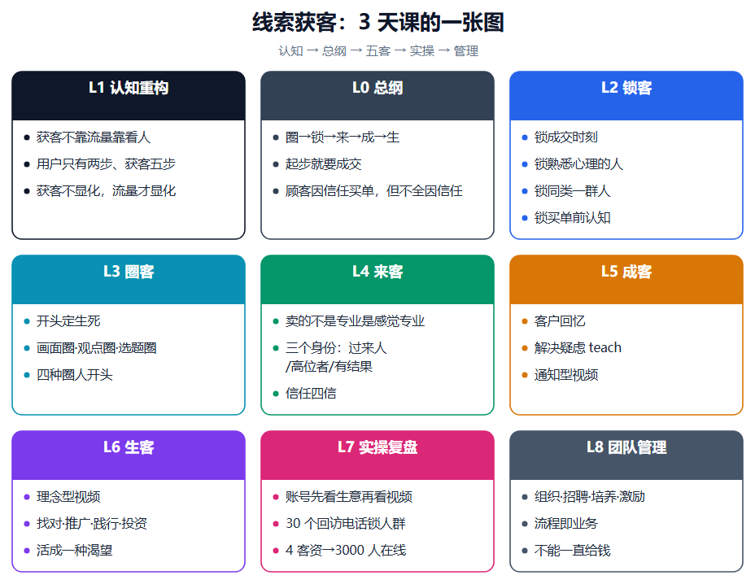

# 整理说明

***素材范围****：经纬《线索获客》3 天线下课，14 段录音转写（编号 002–015），原稿约 37\.2 万字。第 1 天 5 段、第 2 天 5 段、第 3 天 4 段。*

\>

***覆盖缺口****：文件编号从 002 起，缺 001（开课前签到与场地规则部分未单独成稿）；每天的课后答疑、饭桌交流、课间零散对话未纳入；第 3 天下午末尾的结课致谢已压成一句。除此之外三天课程主体完整，未做任何虚构补写。*

\>

***整理动作****：删去催场、点名、"坐前面"、设备调试、招生报价、合影换座、吃饭住宿等现场事务；统一五个环节名为****圈客 / 锁客 / 来客 / 成客 / 生客****（ASR 曾把"生客"大量写成"深刻 / 深客 / 宣客"，把"成客"写成"乘客"）；讲师统一为****经纬****；案例学员统一为****杨璇****；还原被写成数字的数量级词（"几1000"→几千）；序数词改中文（"第 1 个"→"第一个"），数据保留阿拉伯数字。*

\>

***压缩比与取舍****：原稿 37\.2 万字 → 成品约 32\.5 万字，压缩比约 0\.87（未含本导航层）。语言精简主要来自口语赘词、重复强调与现场杂音；案例、故事、报价、阈值、原话一律保留。个别整段听不清处整条不写，未引入存疑标记。*

# 讲师署名核定表

|**ASR 写法**|**核定**|**依据**|
|---|---|---|
|金纬 / 经纬|经纬|全文 59 处作"经纬"，学员原话"我来经纬了""我关注经纬大概一年"|
|杨轩 / 杨旋 / 杨璇|杨璇|第 1 天晚上现场实操的案例账号主人|
|线索深刻 / 深客 / 宣客|生客|第 5 个环节，与"圈客 / 锁客 / 来客 / 成客"并列|
|乘客|成客|第 4 个环节，对应"成交视频 \+ 通知视频"|
|老杨|老杨（经纬合伙人）|第 2 天晚上与经纬共同主讲案例复盘|

# 知识地图（分层映射到各节）

|**层**|**主题**|**对应分节**|
|---|---|---|
|L1　认知重构|获客不靠流量靠"看人"；用户只有两步、获客只有五步|一|
|L0　总纲|主导消费旅程：圈客 → 来客 → 成客 → 生客，起步就要成交|二|
|L2　锁客|四把锁：成交时刻、熟悉的人、同类一群人、买单前认知|三、四|
|L3　圈客|开头定生死；画面圈、观点圈、选题圈|六、七|
|L4　来客|顾客买的是"感觉专业"；三个身份；信任视频四信|八、九|
|L5　成客|客户回忆、解决疑虑、通知视频三种成交素材|十一|
|L6　生客|理念型视频；找对、推广、践行、投资理念四步|十二|
|L7　实操与复盘|账号现场诊断、美业 IP 全流程复盘|五、十|
|L8　团队管理|组织、招聘、培养、激励|十三、十四|

# 分节导读

|**分节**|**一句话导读**|
|---|---|
|一　圈客开篇|用"纽约房产经纪"和"有流量没转化"两个极端案例拆掉流量神话，把获客从"看播放量"扭到"看人"，给出钓鱼五步对应五个客。|
|二　主导消费旅程|把五步走一遍：起步就是成交；圈客让看的人对、来客给非选你不可的理由、成客解决信任、生客活成渴望，最后用大芳全案串起来。|
|三　锁客（上）|四把锁的第一把：锁"必定下单的成交时刻"——顾客在两三年需求期里，哪个时点才真的愿意掏钱。|
|四　锁客（下）|你能成交的人非常有限；不要教顾客打拳、不要在视频里追求价值感；用唐玉琴律师的选题错配讲清"能力上错了货架"。|
|五　账号分析与实操|现场拆家装、长笛、律师三类账号，再用杨璇从"办什么案拍什么案"到单月 5000 条客资，演示锁人群、锁阶段、一条视频的动线。|
|六　圈客（上）|锁客是策略，圈客才是把人真圈进来；两条煲仔饭视频一个 0 客资一个 8 个客资，讲透"开头定生死"，给出四种圈人开头。|
|七　圈客（下）|画面圈、观点圈、选题圈：客户觉得美才叫美；短视频不是讲答案的地方；万物皆可作选题包人群。|
|八　来客（上）|"更专业、更靠谱"打动不了人；顾客只有 30 分、你正好 31 分；讲透专业是私人感受，以及三个身份（过来人、高位者、有结果）。|
|九　来客（下）|信任视频的四信结构：信专业、信实力、信持续、信人品——四封一起写，不是选一封。|
|十　案例复盘|老杨拆一个美业 IP：从 4 个客资 0 变现做到 3000 人在线，讲两个坑（只讲专业、抄对标）、30 个回访电话锁人群、15–20 天决策周期。|
|十一　成客|把关注你几个月的老粉推完最后一脚：客户评价其实是"客户回忆"、解决疑虑、通知型视频三种成交素材，以及为什么禁用 AI 写稿。|
|十二　生客|四客做完已是千万级营收；理念型视频靠"信念"而非"正确"，按找对、推广、践行、投资理念四步落地。|
|十三　管理（上）|为什么编导会写文案却不获客；管理先解决组织、招聘、培养、激励四件事；用流程把新人练成操盘手。|
|十四　管理（下）|招人实操：四类简历、四十分钟面试、软素质大于硬技能、高底薪买可迁移能力、三道淘汰，收在"不能一直给钱"。|

# 术语表

*课程黑话与专有名词速查，按出现顺序排，表尾是出处。*

|**术语**|**解释**|**出处**|
|---|---|---|
|圈客|用短视频让本来就会买的人看到，看人别看播放量。|一|
|锁客|策划锁定必定下单的成交客群，决定视频做给谁看。|二|
|来客|在视频里下钩子传购买理由，让客户主动发私信。|二|
|成客|铺完成交铺垫，让用户刷完账号越刷越信、直接买单。|二|
|生客|建立巨大渴望、活成用户想要的人，让客源生生不息。|二|
|客资|客户主动加微的线索，多不等于精准更不等于成交。|一|
|客资厌恶症|客资暴涨后接不住、反而嫌烦怕乱，营收不增反降。|一|
|幸存者偏差|只看见极少数做出爆款的人，就以为那套方法可复制。|一|
|成交时刻|客户被上一方案逼到绝境、开始认你产品价值的阶段。|三|
|消费旅程|顾客先知、信任、对比、首单、复购的完整决策路径。|二|
|价值感|视频里自证专业、证明自己是好人|四|
|买单前认知|客户掏钱之前正遭遇的那个问题|四|
|动线|先锁谁、再说什么、最后给什么理由|五|
|流量地牢|只盯播放量，圈来的人却成交不了|六|
|开头圈|开头三五秒让人不划走的那句话|六|
|痛苦表达法|靠唤醒用户痛点来圈人的过时表达|六|
|画面圈|用出镜形象和场景筛出目标客群|七|
|观点圈|挑一个刚好匹配客群认知的观点|七|
|选题圈|用客户买单前关心的话题圈住人|七|
|万物选题包人群|走到哪拍到哪，任何话题都能圈人|七|
|感觉专业|顾客靠刻板印象判断你专业，非真实水平|八|
|刻板印象|凭长相、头衔等直接下的模糊判断|八|
|转介绍顾客|已从朋友处知道你身份与成果的客户|八|
|三个身份|过来人、高位者、有结果三种身份|八|
|四信|让顾客信专业、实力、持续、人品|九|
|IP|被当成目标的名声，本质仍是获客|九|
|客户回忆|让客户复述自己为何选你、如何说服自己买单|十一|
|成交型视频|给观望老粉一把对比的尺子，推他交钱|十一|
|解决疑虑（teach）|逐条打穿顾客疑虑，并给出判断标准|十一|
|通知型视频|15秒讲清你卖什么、多少钱、怎么找你|十一|
|理念|你一贯相信什么，是解决问题方向的浓缩|十二|
|理念型视频|讲我为什么做这件事，给方向不给方法|十二|
|信徒|认同你方向、不跳价不砍价的客户|十二|
|知行合一|几十年按同一理念做事，攒下用户心智|十二|
|复利|同一理念坚持越久，心智资产越累积|十二|
|代练式直播|带观众跟着做动作，把看客变成参与者|十|
|强参与感|观众亲自参与并看到自己的变化才停留|十|
|操盘手|懂短视频懂营销、能对业绩结果负责的业务精兵|十三|
|营销基因|把创意变成变现的能力，只懂创意的人缺这一层|十三|
|选题闸|选题要过人群策略、观点溯源、项目经理三道评审|十三|
|内训流程|新人连看三天课程录像，先把语言体系统一|十三|
|软素质|营销思维、用户思维、自信等无教材可教的能力|十四|
|硬技能|采访、选题、拍摄等有教材、可后期培养的技能|十四|
|可迁移能力|到你这里能直接调用、撑住你业务的那部分能力|十四|
|三道淘汰|笔试、选题创作、项目价值三个节点依次筛人|十四|
|小白兔员工|不犯错不闹事、态度好但创造不了业绩的人|十四|

# 易错对照卡

*讲师点出的错误做法与正确替代，按出现顺序排。*

|**❌ 错误做法**|**✅ 正确做法**|**出处**|
|---|---|---|
|只盯播放量做爆款|先锁正价品买单人群，让每条视频出现在本来就会买的人面前|一|
|客资越多越好全员接流|宁可一天30个精准客资，也别300个泛客资，先筛人群再加微|一|
|没结果就归因流量小|逐条判断看视频的人是不是买单人群，把归因落到人身上|一|
|天天研究平台规则|只研究两步：视频出现在他面前，让他愿意点开账号发私信|一|
|把有需求的人当客群|锁愿意克服线上麻烦、默认方案已失效的那批人|二|
|只讲专业、案例、年限|在视频里给一个非选你不可的理由，明确回答为什么是你|二|
|只管进线让销售去洗|在视频里把疑虑逐条打消，让用户刷完账号就愿意直接买单|二|
|做工具号只讲干货答案|讲渴望和结果画面，让账号活成用户想成为的那个人|二|
|按职业资产找客户|按特定阶段的需求集合锁人，如刚被上一方案放弃的人|三|
|讲正确但不合阶段的道理|只讲他这个阶段最想听的话题，如为什么借高利贷也要赌|三|
|按自己办的案子拍视频|只拍客户买单前正遭遇的问题，交付细节留到上门后。|四|
|视频里大讲专业细节|开头只给方向判断，别讲条款、动作等买单后才懂的细节。|四|
|把老顾客好评当素材|先判断内容落在买单前还是买单后，买单后的不发。|四|
|开头用同行黑话锁人|换成该阶段客户听得懂的话，如“职务侵占关7天怎么办”。|五|
|整条照抄对标爆款|只借“他为什么能”，用销售录音里的洞察重写选题。|五|
|先投流、搭团队、做矩阵|先做一个号跑出能转化的内容，再谈放大。|五|
|拿“我亲自交付”当卖点|拍锦旗、感谢信、23\.6%入职率，证明团队筛选严格。|五|
|开头先泛再慢慢筛人|第一句就报人群、地域、阶段，让不对的人立刻划走。|六|
|开头先戳客户痛点|改聊共同感兴趣的话题、人物、观点，让人愿意留下。|六|
|只追播放量和点赞数|用“看的人对不对、付不付得起这个价”判断视频好坏。|六|
|写逐字稿抠字眼|只写开头加两三个观点的框架，剩下现场自由发挥|七|
|用自己的审美判断画面|换成目标客户视角，看客户是否觉得你像同类人|七|
|照搬同行爆款视频|按自己客群买单前的问题重做选题，只借形式|七|
|讲第一步第二步的操作流程|只讲买单前客户关心的问题，操作细节留到成交后|七|
|开口就讲最正确的答案|在认同的观点里挑第三到第五个，匹配客群认知|七|
|强调自己更专业更靠谱|放大客户脑中的刻板印象，让他感觉你专业|八|
|把交付流程当卖点宣传|用身份、画面、结果传递感觉，不解释流程|八|
|只讲专业干货圈人|谈衣食住行吃喝玩乐，用生活话题圈同一批人|八|
|到处找差异化卖点|定一个点，条条视频从不同维度持续加分|九|
|前端就讲核心技术|前端只讲买单前的处境，技术留到付费后交付|十|
|问IP客户是谁|打30个客户回访电话，用原话找共性|十|
|抄对标的爆款选题|先测自己能赢的点，再定选题和内容形式|十|
|报价被拒就降价|先铺案例、见证、赚钱、身份四类视频再报价|十|
|小流量就做99引流品|小赛道直接成交高客单，不做低价承接|十|
|采访客户夸课程好|问来之前遇到什么问题、为何偏偏选你|十一|
|选口齿伶俐形象好的客户|选买单前画像最典型、最有代表性的人|十一|
|让客户回去考虑考虑|直接给出判断标准和全部信息，让他当场决定|十一|
|只讲指标和调理干货|先讲你为什么做这件事，给方向立信念|十二|
|理念写成帮你解决问题|把“好”定义到可感知、可验证的具体标准|十二|
|每条视频各讲各的都对|所有选题围绕同一理念持续加分|十二|
|招只会写文案的编导|按营销策略、观点、文案三要素招，前两项自己培养|十三|
|全公司只设一道选题会|拆成人群策略、观点溯源、项目经理三道评审再上会|十三|
|把流程做成动作铺排|让流程承载业务判断，做完流程就等于做完项目|十三|
|招行业编导照搬经验|只招靠洞察用户需求拿结果的人，经验不匹配直接不招|十三|
|边做交付边等有空招人|提前抽身持续面试，把招聘当布局动作不当救火|十四|
|凭经验判断别人选题|先要人群策略：打谁、为什么打、风险与优势，再谈选题|十四|
|说招一个能变现的编导|先写清四层能力模型，按画像招不按个人偏好招|十四|
|只靠不断加钱做激励|即时奖金管行为、增长分润管长期，考核只管下限|十四|

# 关键数字速查表

|**数字**|**含义**|**出处**|
|---|---|---|
|12 万粉破亿|账号 12 万粉丝时年营收破亿|一\-5|
|230 万粉一条百赞|刘润抖音 230 万粉，单条约一百来个赞|一\-2|
|3 天涨粉 1000 万|某博主 3 天涨粉 1000 万，现场几乎没人认识他|一\-6|
|5000 万播放全北京|猪脚饭爆款 5000 万播放，观众全在北京|一\-6|
|200 粉变现 1000 万|游乐场设计师李工，200 多粉变现超 1000 万，客单 50–100 万|一\-6|
|一小时 15000|心理咨询师咨询费 1\.5 万/小时，来的多是大学生|一\-6|
|8 亿 / 6 亿 / 4\.5 亿|抖音日活 8 亿、视频号 6 亿、小红书 4\.5 亿|一\-8|
|10 万客单 vs 300 元|大芳客单价 10 万，医生开的膏药 300 元|二\-6|
|199 升 10 万|199 元面诊作入口，主单 10 万|二\-6|
|200 万 → 800 万|大芳营收，客单价与转化率各翻一倍|二\-6|
|半年 100 万|周洋帆半年花 100 万找"我的主题是什么"|三\-1|
|最少变现 10 万|只要说清人群、找到买单人群，账号最少变现 10 万|三\-1|
|2\.4 万粉 1 单|拳击教练 2\.4 万粉丝，只有 1 人找他买单|四\-2|
|一单 7 万 / 15 万|律师单案报价与成交，视频没人点赞但成交额高|四\-7|
|5000 条客资|杨璇单月 5000 条客资|五\-7|
|600 万月营收|杨璇 10–12 万粉时单月营收约 600 万|五\-7|
|会见加阅卷 1 万|杨璇团队首次收费 1 万（市面 3000、800、5000）|五\-8|
|4 客资 → 3000 人|美业 IP 合作三个月，从 4 个客资 0 变现到 3000 人在线|十\-3|
|30 个回访电话|用 30 个回访电话锁定三类目标人群|十\-3|
|15–20 天|客户不会在 15 到 20 天内快速决策，别指望立刻成交|十\-6|
|四封信|信任视频四信：专业、实力、持续、人品|九\-1 至 九\-4|
|1000 万营收|圈客、来客、成客、生客四块做完，已是千万级营收|十二\-1|
|20 万 vs 10 万|优秀运营赚 20 万、普通运营赚 10 万，损失远不止 10 万|十三\-8|
|26–31 岁|短视频岗招聘的年龄要求|十四\-4|
|三道淘汰|新人筛选与培养的三道淘汰机制|十四\-6|

# 一、第1天上午（上）｜圈客开篇：先换一个「看人」的视角

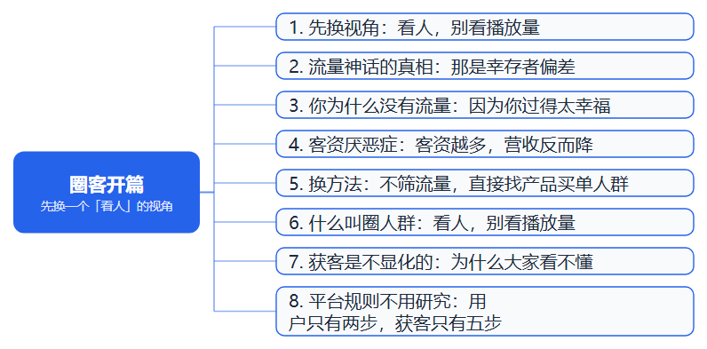

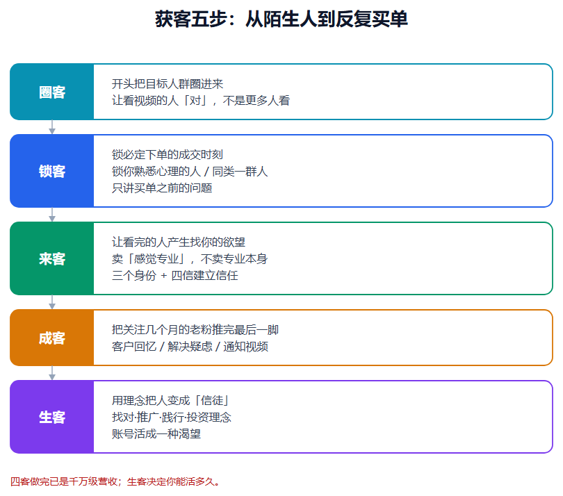

## 1\. 先换视角：看人，别看播放量

这三天叫线索获客。什么是圈客营销？开始之前，先讲两段真实的经历——我们接下来讲的每一段经历，都是真实的。

这两个人不是特例，是样本。一个在美国纽约，一个在东北沈阳；一个是房产经纪人，一个是刑事律师；一个没流量，一个有流量。把他们的经历摊开看，你会在里面看到自己。

### 1\. 纽约的房产经纪人：拍了整整一年，获客是零

他在美国纽约做房地产经纪人，在皇后区，几乎每一个地铁站、公交站的门口都能看到他的广告：要卖房可以委托他，电话多少多少。他自己认为，在当地房地产圈，最起码是个非常知名的中介、经纪人。人长得很漂亮，形象好，专业能力也不错，而且有钱——他是高干，请得起豪华的团队。

准备做线上，他就在纽约当地找了团队，也找了代运营，拍摄、剪辑全包。拍了整整一年，将近 250 到 300 条视频，一年的获客量是零。

这件事非常匪夷所思。他长得好看，当地有知名度，专业能力也不错，为什么线上获客是零？他自己也解释不了，来的时候说了一句话：我似乎没有能力做出大流量来。

他做了一年，平均播放量大概在 500 到 1500 之间。他发现比他弱的人流量比他大，没他好看的人流量也比他大，而他用的团队非常豪华。于是他得出一个结论：我没有能力。为什么没有能力？不知道。

### 2\. 沈阳的刑事律师杨欢：一万人在线，一个多月没开张

杨欢在东北沈阳做刑事律师。律师本身就是非常小众的赛道，尤其是刑事律师——如果你是律师圈的，你起码一定知道他，因为他流量很大，高峰期直播间可以做到 1 万人在线。

1 万人在线是什么概念？在律师赛道，直播间 1 万人在线，相当于直播的时候有 50 万人在看。全中国有刑事案件的人，也就那么几十万，撑死上百万，30 万已经是非常非常夸张的数字。他的视频几百赞、几千赞，4000 赞、5000 赞也非常常见。

当时我的编导很好奇，问了他一个问题。

**问**：杨律师你做得很好，我有时候还会看你的视频，怎么跑到我们这儿来了？

**答**：这很好吗？我已经一个多月没有开张了。

**问**：怎么会呢？我们看你视频流量很大，直播间虽然没巅峰期那么好，可还有 500 人在线。

**答**：是啊。我原来 1 万人在线的时候，下播还有十来个人给我发私信；自从掉到几百人在线之后，私信就很少很少了，有时候一个都没有。

几百人在线，没有私信；几百个点赞，没有转化。他跟纽约那位正好是两个极端：一个是完全没有流量，一个是流量很大、完全没有转化。他自己还补了一句：就算做出了流量，我好像也没有办法变现。

### 3\. 这两种经历，几乎每个人都占一个

把这两个人的经历放在一起看，代表性非常强。在场的绝大多数人，你不是另一个版本的纽约经纪人，就是另一个版本的杨欢，一定在这两个地方待过。

第一种叫流量失明症。百分之八十、九十的人都经历过这个阶段，尤其是做线上的第一年，或者还没开始做线上——你一定经历过这种痛苦：对流量有非常非常强烈的渴望。

为什么渴望？因为所有人都在跟你说要做流量。打开视频号，打开抖音，打开小红书，每个人都在教你。

一个人说：我的新号，第一条视频就拿到 18 万点赞。意思是，他有一套方法，能让你也做出 18 万点赞。

另一个人说：我的第一条视频就有一百多万播放。意思是，只要有方法，第一条视频就能让一百多万人知道你。

第三个人说：搞流量，大道至简，有特别特别简单的方法。

第四个人说：爆款短视频都是有结构和规律的。

所有人都在传递同一个信息：你不会做爆款，他会；你不会做爆款不是你不行，是你没方法，而他有方法。你做爆款是在拼概率，他有模板。就这么回事。

为什么每个人都对流量有那么强的渴望？因为只要你打开短视频，所有人都在教你怎么做流量，都在给你强化一个认知：你做不出来，是因为方法不对。

### 4\. 两种病：一个盯着流量，一个盯着客资

这一路走下来，人基本会得两种病。两种病摊开看是这样：

|**症状**|**典型表现**|**嘴上说的话**|**真实原因**|
|---|---|---|---|
|流量失明症|只盯播放量，越做越焦虑|我缺一套爆款方法|人生底色普通，硬拼流量|
|客资厌恶症|客资暴涨，成交反降|流量太泛、客户不精准|一开始就没找到买单人群|

一种是流量失明症：眼睛里只有播放量，看不到播放量背后是谁。绝大多数人卡在这里，做了一年、两年，播放量上不去，就认定自己缺一套方法。

另一种叫客资厌恶症：好不容易做出客资了，一天几百个加微，反而开始烦、开始怕，最后营收不增反降。

这两种病看着相反，其实是一件事：都没有在看人。一个没看人，所以做不出精准流量；一个没看人，所以接不住精准客资。

📌 一句话总结：先判断自己缺的是流量还是精准人群，两种病都源于没在看人。

## 🟥2\. 流量神话的真相：那是幸存者偏差

### 1\. 刘润 230 万粉，一条视频一百来个赞

有没有这样的方法？你们认为这个世界上有没有做出爆款的方法？新号第一条视频就做出百万播放量的方法？到底有没有？先别急着回答，看一个人。

还有刘润，在场的人应该都知道，知名的商业博主。今天他的抖音号大概 230 万粉丝，视频号也有一百多万。这样一个人，你说他会不会做流量？不会做流量，他不可能有几百万粉丝。

可是你去打开他的账号：一个 230 万粉的账号，现在发一条视频，点赞数是多少？一百左右。评论多少？5 个到 15 个，最多十来个。就这么多点赞，就这么多评论，而且是在他已经有 200 万粉丝的前提下。

这就出现一个矛盾：是前面那些流量导师说得对，还是刘润的现状是真相？是流量导师在骗你，还是刘润没学那些流量导师的方法？还是说，一个 230 万粉的人，他不会做流量？

这个世界看起来很奇怪：一方面有人跟你说有方法可以做出爆款，另一方面大 V 的流量在枯竭。哪个是真相？我认为两部分都是真相。

那些导师肯定也没有说谎，流量的事实也是真的，大 V 掉量也是真的，所有人都在掉量，这都是真相。真正的症结在这儿：那些方法有没有？完全有。但如果一个方法百分之九十九的人做不到，如果连刘润这样的大 V、所有知名博主都学不会、做不到，那这种偶然发作的方法，怎么能算好方法？

连大 V 都学不会，你能学得会吗？

### 2\. 需要大流量的方法，都是让你参与一场几乎必输的赌博

**⚠️ 尤其是在今天，一切让你必须靠大流量去获客的方法，都是让你参与一场几乎必输的赌博。因为你做不出来，那就是在赌。**

我今天有一个方法，这个方法在我身上应验了，可这个方法本身的成功概率非常非常低。我就赌在场 100 个人，100 个人当中有 1 个人能学得会、能用得上，然后我说这是好方法——这不就是幸存者偏差吗？

所以有一小部分人今天能在市场上拿到巨大流量：新号第一条视频就能起号，能做出百万爆款。为什么？真是因为他有方法？我们去看那些低概率的事情，低概率里面到底传递了什么。

### 3\. 最近一年能拿到大流量的，只有四种人

今天你想在三个平台——视频号、小红书、抖音——拿到相对比较大的流量，基本上你要符合四个条件中的任何一个。

第一个，负债。左边上面这个人叫唐健，在青岛，有 2 家餐饮大店，每家店 1000 多平，在当地你可以理解成是个富翁。因为疫情破产了，亏损 4000 万，一夜之间头发全白，然后带着自己的老母亲重新创业。他本身是餐饮人，他讲自己破产的经历、破产的感受、破产的心态，引起了非常多实体人、尤其是餐饮人的共鸣——疫情那几年的难，所有实体人都能理解。于是他拿到了最大的流量。

他为什么能火？因为他负债。而且不是负债几十万——你说你也负债，你负债多少？36900。开物料还刷了花呗，还有 5000 块没还。没有人能理解，好吗？没有人愿意追随。

我们为什么愿意追随一个负债的人？因为你负债千万，仍然积极面对人生。我从来没听说过"你的花呗还有 5000 块没还，然后你积极面对人生，哇我好羡慕你，我要追随你"。没听说过。要负债，千万起。

第二个，你要么取得很大的成就，像张雪骑车一样，拿到世界第一。你想给人带来能量、带来指引，可以，你得有那种级别的成就。

我经常刷视频，看到有些人的头衔写得非常有意思：荣获广东省佛山市 35 岁优秀青年奖；浙江省绍兴市羽翼协会副会长；什么协会的会长、副会长；什么奖杯。没有人知道，好吗？最近打网球，我又看到很多人的头衔：曾荣获广东省佛山市 ATP 小赛冠军。什么叫 ATP 小赛？没有人知道。我只知道澳网，我只知道美网，我不知道你那些东西。

第三个，你像董太太一样。董太太各位都知道，离婚，带 3 个娃，3 个娃都读国际学校，一个女性，离完婚之后带娃，给娃提供很好的教育、很好的财富支持，自己还得漂亮、还得瘦、还得美、还得创业成功，还能讲旅行创业。

你说"我也离婚了"——一个很普通的事，对不对？你最起码得有 3 个娃，3 个娃上国际学校，自己还得好看。

第四个，你造船，你像路飞一样。你想装逼可以，你自己造一条船。

四种条件摊开看：

|**条件**|**具体样子**|**观众为什么看**|
|---|---|---|
|负债|唐健：亏 4000 万，一夜白头|惨到极致仍翻盘，值得追随|
|成就|世界第一；野鸡协会头衔不算|强到极致，给能量给指引|
|身份反差|董太太：离婚带 3 娃读国际学校|心疼加羡慕，女性共鸣|
|极致装逼|像路飞一样自己造船|挑战不可能，看个稀奇|

最起码在最近一年，你想获得大流量，无一例外就是在这四个里面选一个。你总得有点不一样，总得有点让别人觉得很羡慕的事，或者让别人觉得很心疼的事。

所以，我为什么要看你？你说你负债 5000 块，你刚刚离婚，我为什么要看你？我没有理由看你。你要么装逼到极致，挑战不可能，我愿意看；你要么苦到极致，决定翻盘，我愿意看。这就是那个幸存者，这就是那个偶然发生的事情。

📌 一句话总结：爆款方法成功率极低，靠大流量获客等于参与一场几乎必输的赌博。

## 3\. 你为什么没有流量：因为你过得太幸福

### 1\. 我实名反对"讲故事、搞情绪"

今天你到网上去看，几乎所有流量大 V 都会跟你讲：这条视频为什么能火？因为它讲故事。那条视频为什么能火？因为它有情绪。

那我问你：你有多少故事？你有多少情绪？你每天都有情绪吗？你有那么多故事可以讲吗？没有。

普通人，普普通通的人生，哪来那么多故事？我们为什么要拍视频？难道一定要拍视频哭吗？一定要这样做吗？

好，就算你这样做了，365 天，就算你不做矩阵，你做 365 条视频，你能哭多少回？你能感动多少回？你有多少个故事可以讲？你讲 350 个，离婚离 365 次？没有那么多东西可以讲。

我们就是这么过来的：奖项普通，活动普通，经历普通，能力普通，成就普通。

### 2\. 有流量的人，无一例外是绝境重生

这句话，是我自己做线上大概 2 年左右的时候才明白的。

以前有些同学、有些朋友、有些客户跟我讲，他希望做很大流量。我都会跟他讲：你做不出很大流量，其实是一种很幸福的事情。

为什么？你去看所有有流量的人，无一例外，要么惨到极致，要么强到极致，都是绝境重生。否则没有观众愿意看他。

### 3\. 一份"普通人生"的清单

我说你为什么没有流量？因为你过得太幸福了，你过得太坦顺了。

小学没有被霸凌过。初中正常考上了一个高中。高中的时候学习压力也没那么大，你的父母也很爱你。你的父母也没有在你上学的时候离婚、出轨等等这一切。

毕业之后，大学女友——你也没有谈上一个非常有钱的女朋友或者男朋友，大学的时候也就只是经历了一次普通的分手而已。

毕业之后正常找工作，找了工作之后，老板正常给你发工资，发完工资你正常吃饭。你毕业之后遇到最大的磨难，就是毕业之后多长了几斤肉而已。

你也没有经历过什么失业、破产，顶多有那么两三个月失业找不到工作，那两三个月你也在家里睡觉，或者出去玩。

人生太顺了，没有那些故事可以讲。

### 4\. 想要故事，就得"重来一次人生"

你要想抢到流量，可以，重新回到娘胎里面来，重来一次人生。重来一遍什么样的人生呢？

3 岁的时候发现自己不是亲生的，但父母仍然很爱你。7、8 岁的时候，有一位亲人走了，所以你 7、8 岁就开始独立。

独立之后，小学的时候被霸凌，初中的时候被侵犯——同性侵犯，或者是异性侵犯。

然后你咬牙上了高中，高中之后高考，高考之后发现你的分数被别人冒名顶替，你上了一个自己不该上的学校。在那个你不该上的学校里，你奋发读书，好好学习，然后找到了一份很好的工作。

你以为人生走上了很好的、光明的未来，结果工作半年之后，公司倒闭了，原因是老板贪污，连带着你自己也有了一些很黑色的人生经历。

这个时候你的人生遇到了一个很好的伴侣，这个伴侣陪你度过了艰难的人生。又过了半年，伴侣突然有一天告诉你，他发现自己并不爱你，他爱另外一个人。

如果是这样的人生，你有大量的故事可以讲。

### 5\. "我为什么没有流量"这个问题，我没法回答

我在线下课，很多同学会来找我问问题，但唯独有一个问题我没有办法回答：经纬，你帮我看一下，我为什么没有流量？

你让我怎么回答？我说是因为你表现力不好，你相不相信？就算你表现力好，你也没有。

有人说是因为你的文案不好，你相不相信？就你那种选题、那种主题，就算文案好，也没有流量。

有人说是因为场景不好，你相不相信？就算你去故宫拍、去长城拍、去白宫门口拍，也没有。

因为你的经历本来就很普通，你的主题本来就很普通。我们的人生底色就很普通，成就很普通，为什么你会有流量呢？凭什么有？为什么几百万、几千万人愿意看你？你说不出来这个原因的。

这不是技术的事情。这是你过去的人生经历给你塑造的底色，塑造了今天的你。你有就是有，你没有就是没有。没有就是没有。

### 6\. 拼流量体质、拼转化基因，都没有意义

所以，最适合普通人的短视频打法，一定不是拼谁有流量体质，一定不是拼谁有强转化基因，这没有意义。

今天现场有一个人，清华毕业，事业有成，曾经拿到过雷军的融资。他做出过流量，值得学吗？值得学吗？

今天现场还有一个人，有 5 个娃，5 个娃都上国际学校，每个娃成绩都很好，他做家庭教育。你问他：怎么有那么多流量？他告诉你：做流量一定要真心，一定要真诚，讲自己的故事就可以了。那是他的故事有流量，不代表你的故事有流量。值得学吗？不值得。

今天互联网上有非常多的人，本身就有流量体质，他的方法一定不适合你。我如果是马斯克的儿子，我做流量的方法你能学吗？你怎么学？你问我怎么做流量，我说很简单，我说我爸就好了。我说我爸有流量，你说你爸没流量。就是这样。

第二个，强转化基因。有些人做出很大的流量，是因为他有非常强的转化能力、非常强的销转能力，他有电销团队，有私域团队。你有吗？没有。

对他们而言，流量慢一点无所谓，他可以销转，可以收单，可以转化，可以扣单，可以一对一地扣。你能做到吗？你做不到。

如果你今天没有很好的流量体质，你的团队也没有很强的销转基因，我们就不应该走那种大流量的方法。

📌 一句话总结：普通人生底色撑不起大流量，别再归因于表现力、文案、场景。

## 4\. 客资厌恶症：客资越多，营收反而降

### 1\. 一天 300 个加微，客户把全家带来接流

我们当年有一个客户，做"少女腹"的。解释一下什么叫少女腹：其实是减肥的一种，就是产后康复，产康。女性生完孩子之后，肚子撑开了，肚子不好看。他做的事情，就是让你的肚子变成少女的肚子——有马甲线，比较紧致，肚脐也是竖着的。

当时我们合作，效果还不错：一天加微可以加 300 个，一个月加微可以加 11000 个。团队非常兴奋。那天在群里说：视频号这边增加了六百多个关注，客户加了 130 个，加上抖音的客资，我们一天终于达到 300 客资了。

团队很兴奋，认为拿到这么多客资，业务一定起飞。

客户也很开心。客户在镇江，本来是他一个人来杭州跟我们合作，后来因为客资非常多，为了承接这些客资，他干了一件事：把全家都带来了。孩子没人带，干脆也来；儿子、保姆、老公、表妹、老公的妹妹，全带来了。为什么？因为要接流，一天 300 个。

**⚠️ 结果是什么？全员接流之后，精准客户服务不周，新流量成交不掉，当月的营收不增反降。**

什么意思？如果我一天有 30 个客资，我可以跟每个人深度聊天，谁有需求、谁没需求，我都知道。如果我一天有 300 个，聊不过来，谁真的有需求、谁没需求，我不知道。

这个客户说一声"你好"，他也许是一个很好的客户，但是我不知道；那个客户说了很多问题，也许他并不是一个好客户，但是我跟他聊了很久。

所以，当客资不精准的时候，也是一件很痛苦的事情。

### 2\. 深圳房产知识付费：200 人在线比 1000 人在线更赚钱

这个人是我们之前的学员，在深圳做房地产知识付费，卖房子的课程和服务，那一年大概能做 1\.5 个亿。

他自己讲：纯房产知识付费，卖课卖得最好、引流引得最好的，是 150 到 300 人的场。这个时候评论区极其和谐，流量极其精准，也控得住场。但每次出去踩盘，或者讲解全国楼市有什么大政策的时候，直播间上 1000 人了，就会进来很多泛粉，精准粉的问题抓不住，整个直播间就很泛，甚至会影响后面几天的直播。

问他：200 在线和 1000 在线，实际收入差多少？他说：200 到 300 人在线一场，能引到的精准客户，是 1000 多人在线那种大场的 10 倍——大场一场只有十几个、二十个。流量差了 5 倍，但是转化差了 10 倍；再算到后端的变现，差 100 万级别。

他都认为流量越大、客资越多越好，可是结果呢？

他直播间 200 人在线的时候，营收非常高。等直播间到 1000 人在线，1000 人在线的营收还没有 200 人在线高。后端转化的压力、沟通的压力、销转的压力，带来上百万的损失。

你说他没有客资吗？有客资。你说他客资没有变多吗？变多了。那为什么没有办法带来更高的营收？因为带来了更多转化的压力。

很多人很羡慕别人有客资，可是如果客资不对呢？如果客资是不精准的呢？两场直播的账摊开算：

|**维度**|**200–300 人在线**|**1000 人在线**|
|---|---|---|
|流量规模|小|大 5 倍|
|单场引流|稳定、可控|十几个到二十个|
|转化效率|高|差 10 倍|
|评论区氛围|和谐，控得住场|泛粉涌入，抓不住|
|后端结果|营收高|损失上百万|

### 3\. 一家公司真正的利润，一定来自正价品

一家公司真正的利润，一定来源于正价品。如果你的客资不对，你只能是服务瘫痪——所有人都在沟通，问要不要买几个引流品。引流品有什么用？没有人买你的正价品，成交一个正价比什么都困难。

这样你会有营收吗？也许你的客资很多，但是不会有营收。

有非常多的顾客找我们之前，说自己有很多客资。我问他：那营收有多少？

有很多人找你咨询，不代表很多人愿意为你付费；有很多人买你的引流品，不代表别人愿意买你的正价品。

### 4\. 两种病，其实是同一个病根

现场一定也有人有类似的经历。

第一种，像画饼一样：你做不出流量，你认为是方法论的问题，其实是心的问题。

第二种，就是你做出了客资，你也很痛苦，你认为是线上流量不精准——有没有可能，是你一开始就没有找到精准人群？

我们这个课叫线索获客，本质上不是教你怎么样做流量。我们讲的是：你怎么样去找到对你而言有商业价值的流量，怎么样做出愿意为你付费的商业价值的流量。

📌 一句话总结：客资不精准会拖垮服务与成交，营收反而下降，精准比数量重要。

## 5\. 换方法：不筛流量，直接找产品买单人群

### 1\. 漏斗有两个前提，你一个都不占

你可以脑袋里面想象一个漏斗。都知道漏斗，漏斗为什么有用？有两个前提。

第一个前提，漏斗的开口得足够大，否则漏斗就失效了。

第二个前提，它能一直往下漏、一直筛。也就是说，它需要有强转化。

这两个条件不存在了，漏斗本身也不存在。别人的漏斗口子这么大，你的漏斗口子这么小；别人的豆子一直筛，一直筛，能筛出成交来；你的豆子呢？到第二环，没有人成交，全没了。

### 2\. 反向做：让视频出现在本来就会买的人面前

我们为什么换一个方法，叫反向前端去找产品买单人群？

就是我不做流量。我有一个产品，我的产品是不是有买单人群？我为什么不用短视频去找买单人群？

说实话，这个世界上总有一批人，他是一定需要我们的产品的，刷到我的产品就走不动道。那我就让我的短视频出现在这类群体面前，是不是就 OK 了？

我不需要做曝光，我不需要做影响力，我只需要让我的产品出现在对的人面前，而且是让我的正价品出现在对的人面前。所以这个方法叫"找产品买单人群"。

### 3\. 我自己的后台：1878、833、1570、14000、12000、1 万

我自己的数据也没有很好。你去看我的后台，我的后台也就 1878、833、1570、14000、12000、1 万，也就这么多，而且是在我已经有账号粉丝的前提下，这也不是零粉。

所以如果你抛掉我的老粉，其实我也没有多少播放量。

如果我换一个表达方式给客户去表达：我今天不是有 4000 多个播放量，我是有 4000 多个我的产品买单的精准人群在看。你是不是觉得含义完全不一样？

你问：那请问你播放量多少？4800。好像不大。换一个表达：请问你现在视频怎么样？我说我每条视频有 4800 个精准的产品买单人群在看。含义一样吗？完全不一样。

所以我的播放量也就这么多。可是就这么点播放量，3000 播放量，我们也能一年过千万。

我们线下课到现在为止是 44 期，2023 年上半年，4、5 月份就开始了，每个月更新 30 条视频，我们就放着不动。

如果你是互联网上了解人比较多的人，2023 年那会儿，我的竞争对手今天最起码有 50% 在卖 AI 课，因为他们短视频课卖不动了；然后有 10% 在卖社群，因为他们没有办法交付。

就这样，我熬死了 90% 的人，我熬死全是流量比我大的。

说一个秘密。我们看到很多人做流量很厉害，其实我一直以来都不是一个很会做流量的人。我对外一直都说我完全不会做流量，你问我怎么做出百万爆款，我不会。

今年一整年，从年初到现在为止，我没有见到我的账号里面有一条视频超过 30 万播放量，一个都没有。你说我会不会做流量？其实我也不会做流量。

之前有一个人说：经纬，你做流量很厉害。我说：哇，太羞耻了。

给大家说一个秘密，这是我的账号，账户显示 32\.6 万，看起来好像很厉害。抖音平台有两个 APP，一个叫抖音，一个叫今日头条，它们是同一个母公司，字节跳动。所以有一个功能，叫今日头条、西瓜视频和懂车帝同步粉丝量。

也就是说，如果我有一个抖音账号，还有一个西瓜视频或者今日头条的账号，我在今日头条上面有粉丝，可以把两个粉丝合并。这对账号没有任何影响，它只是穿了一个马甲而已，只是为了好看。我把它脱了，给你看我裸奔的样子——就这么多。

时至今日，我也只有 13 万粉丝而已。这不是一个大 V 该有的粉丝量。这是一个普通人做了整整 3 年半，做了 1000 多条视频，吭哧吭哧，每一条视频涨几十个粉，一点一点涨，涨到 13 万粉丝，也就仅此而已。

可是到今天，我们不用做流量也做到了。2 个月前，我们的营收已经破亿，是在 12 万粉丝的时候破的。

这不是卖货的毛利，利润率还是比卖货要高一点。

你知道 2023 年那会儿基本上没有人议论我，也就今年稍微莫名其妙地，有些人议论我了。

### 4\. 两种时代，两种方法

我们的方法不是让你做流量，我们的方法就是让你每一条视频都去找产品买单人群。我们的方法不让你去做漏斗去筛，因为你筛不了，你没有那个能力去筛。我们的方法就是让你去找精准人群。

所以我认为这个世界上其实有两种方法。

第一种方法在流量获客时代：叫你既要有大流量，也要有很强的转化，你才能做出一定的结果。

你们头脑里面现在对于短视频所有的认知，几乎都跟这个词相关。你们认为做好短视频一定要有很大的流量，一定要有很强的转化，播放量一定得高。因为之前所有人都在跟你强调这一件事。

可是我想告诉各位：不可能。不是很难，是不可能。这个东西是你过去的经历给你的，给了你人生的底色。你有就是有，你没有就是没有。你如果人生经历很普通，天王老子来，你也不可能成为大 V。

两种方法摆在一起：

|**维度**|**流量获客时代**|**圈人群获客**|
|---|---|---|
|前提|大流量加强转化|找到产品买单人群|
|核心动作|做曝光、做爆款、筛漏斗|让对的人刷到正价品|
|依赖什么|流量体质、销转团队|产品与人群的匹配|
|普通人能不能做到|做不到|每条视频都能做|
|没结果怎么归因|流量太小|看的人对不对|

📌 一句话总结：不做漏斗筛流量，让正价品直接出现在本来就会买的人面前。

## 6\. 什么叫圈人群：看人，别看播放量

### 1\. 一句话：看人，别看播放量

换一个方法，我们不要去筛，我们直接去圈客，直接用视频去找我们的产品买单人群，用短视频去圈最终产品要成交的人。这就是真正适合普通人的获客方法。

用短视频去圈人群，圈什么人群？圈你的买单人群。不需要依赖你的人生，不需要依赖你的人生素材，不需要依赖你很强的表达能力，不需要依赖这些东西。

什么是圈人群？一句话：看人，别看播放量。

也就是说，把我们的注意力、把我们的目光，全部放到人身上。去看人是否精准，看人是不是我们要的，而不是去看播放量。

只有当你圈对了人群，你才能被精准用户看到。

### 2\. 3 天涨粉 1000 万，你也没刷到

这个人在 2 个月之前，3 天涨粉 1000 万。你们认识他吗？只有一个人认识，大多数人不知道。

大多数人都不知道他，可是他已经很火了。3 天涨粉 1000 万是什么概念？相当于在这 3 天里，全中国有 1 亿人刷到他了。你没刷到，因为你不在他的曝光面前。

今天视频号每天有 6\.5 亿的日活，抖音每天有 8 亿的日活，小红书也有 4 到 5 亿的日活。我们就拿 8 亿来说，8 亿的日活——我问你：就算你做出了一个百万爆款，你要的人真的刷到你了吗？

所以网上有一种说法，我觉得很奇妙：我先做出爆款，让别人认识我，然后我再去转化，是不是就可以了？

听起来很合理，对不对？换个方法给你举例子，你就明白了。

### 3\. 猪脚饭的 5000 万播放，全是北京人

如果你现在是广东卖猪脚饭的，做出了一条爆款，多少播放量？5000 万播放量。5000 万人，全部是北京人。然后你说你下一条开始做转化，你能转化掉吗？

转化不了。

每天 8 亿的日活，你说你做出了一个爆款，然后去转化，你怎么知道你那个爆款爆的是在对的人面前？你也没有办法知道你的曝光在对着谁。

我们一直盯着播放量，最大概率的结果是什么？你认为你的流量做出来了，但是不变现，因为它根本就没有曝光在对的人面前。这个很常见。

### 4\. 心理咨询师：一小时 15000，来了一堆大学生

有一个顾客做心理咨询。他跟我说：我问到的所有人都告诉我怎么去做流量，但是我明显感觉到，做流量已经不再是真正能解决问题的一种方式了。

比如我原来一个视频做到 10 万观看，也许我能获客几十个；现在可能一个都没有。很多时候数据做得很好，但是就是没有任何结果。这种感觉是很痛苦的，因为你在行业里已经做到一百多万播放了。

为什么？我可以给你解释。

你知道这个人他的咨询费多少钱一个小时吗？15000。心理咨询费一小时 15000。这个价格不正常。

一小时 15000 的咨询费，多少人负担得起？心理咨询基本上是 10 次、20 次、30 次起做的。

他的顾客是谁？范冰冰和李晨分手的时候，范冰冰找他做心理咨询。

可他吸引了很多二十多岁大学生的流量。大学生怎么可能付得起 15000 找他做心理咨询？没有意义。

### 5\. 游乐场设计师李工：200 多个粉，变现 1000 万

这个人叫水上乐园设计师李工。一个游乐场设计师，专门设计游乐场，做水上乐园的主题，干游乐场改造。

我问大家一件事：今天全中国有多少个游乐场老板？往多了说，不超过 3000 个。

所以你知道吗？他这辈子粉丝量都不可能超过 3000。因为你不是游乐场老板，你为什么要关注他？没有理由关注他。

那我问你：他的播放量该做多少才合理？他说：我做出百万播放量，有没有可能？没可能。

全中国有 3000 个游乐场老板，此时此刻，今天上午十点钟左右，打开视频号或者打开抖音的游乐场老板有多少个？1000 个。这 1000 个游乐场老板里，正好最近有给自己的游乐场做升级改造的，有多少个？

所以你的播放量就应该只有几百。

我自己来说，我的粉丝只有两百多个，但是我已经变现超过 1000 万了。因为我们这个行业客单价特别高，单件基本上 50 万到 100 万。现在五百多粉。

两百多粉，一千多万的营收。

如果在你看来，这个叫什么？这个叫还在起号期，账号标签还没有打中。标签还没打中的时候，人家收入 1000 万，你说是为什么？

那 200 个人是人。换个表达方式：我的账号已经有两百多个游乐场老板关注了，这条视频有两百多个游乐场老板在关注。我该不该变现？我该不该成交其中一到两个、两到三个？应该呀。

注意力变了，你知道吗？你不要说"我的播放量只有三百"，你说"我已经有 300 个人在看了"。事实没变，你的理解完全不一样。三个账号放在一起看：

|**账号**|**粉丝**|**播放/点赞**|**客单价**|**结果**|
|---|---|---|---|---|
|纽约房产经纪|当地知名|500–1500 播放|房产佣金|一年零成交|
|心理咨询师|行业头部|10 万–百万播放|15000/小时|只有大学生流量|
|游乐场设计师李工|200 多粉|几百播放|50 万–100 万|变现 1000 万|

### 6\. 播放量对应成交额，这才叫合理

我们要圈人群。当你盯着人群看、盯着人看，再低的播放量，也会有对应规模的变现。这是一个很重要的逻辑。

当你盯着人群看：我这条视频 500 播放量，换言之，我给 500 个精准用户看到了，那我是不是该转化这 500 个人？

我这条视频做出了 3000 播放量，换言之，我是不是给 3000 个精准用户看到了？我该不该赚这 3000 个精准用户的钱？

讲得更极端一点：如果你这条视频 200 播放量，你应该干嘛？你应该赚这 200 个人的钱。200 个人过来难不难？难道 200 个人不是人吗？

200 播放量，200 播放量对应的成交额；500 播放量，500 播放量对应的成交额；1000 播放量，1000 播放量对应的成交额。这才是合理的。

你用短视频去找顾客，道理如此简单。你知道为什么大家之前不懂吗？

我今天上午给你讲的东西很难吗？很难理解吗？短视频是不是用来获客的？是的。获客是不是要靠这条短视频？是。我们需要看短视频的人是精准人群，然后才会买单。我跟你讲的东西不复杂。

那我问你：你做短视频的目的是什么？你说为了商业变现。那你的动作是什么？你的动作是做流量。

问题在这儿：获客是不显化的，流量很显化。今天看到一个人点赞数 5 万，你有没有看到他的后台？没有。你有没有看到他的收款记录？没有。

可是你会天然地脑补：这个人流量很大，那他后台肯定…… 你从来没见过，那是一个科幻片。点赞数很多，播放量很多，你就下意识地认为他赚钱很多。

所以产生了一个认知偏差：你认为流量越大，获客越多。可显化的东西，就只有播放量这一个东西。

📌 一句话总结：把播放量当人数看，让每个播放量对应应有的成交额。

## 7\. 获客是不显化的：为什么大家看不懂

### 1\. 8 个赞的账号，后台有 400 多个加盟客资

这个人是我们之前的一个顾客，点赞数非常低。我们来看这条视频：8 个点赞，没有评论，这应该算是一条非常非常——打引号——"垃圾"的视频，对不对？

当时我在讲这个顾客的时候，有一个人写的评论很有意思，我很喜欢。他说：我没有见到里面有顾客视频啊，里面的点赞、观看都很低，平均 15 个赞。他的意思是什么？点赞数这么低，他怎么获客？我看到你点赞这么低，我认为你应该是没有获客的才对。

下面那个人更有意思，他说：今后再用这样的方法给顾客导流。可是他有没有顾客，你知道吗？

我问大家一件事：我这个账号到底有多少粉丝？你看到了吗？你看到的，是不是只有这个界面和那个界面？你看不到我的后台。你看不到后台界面，所以你并不知道我获客是多还是少。

我们来看真实的后台。后来我让他把客资打印出来给我看：教培加盟的，400 多个。400 多个加盟客资，也不是很少，对吧？

外人完全不能理解。实际上是有获客的。这就是为什么过去各位总是陷入一种认知路径里面：你一定要把流量做大，试图通过大流量带来很高的营收。事实上这个逻辑本来就不对。

获客需要什么？真正的获客需要圈人群，它符合生意的本质。生意的本质是什么？很简单：你的短视频曝光在了本来就会买你产品的人的面前。

你把一个对的视频放在对的人面前，它才会产生消费。这就是最简单、最常识的部分。

### 2\. 餐饮加盟 400 播放量：全行业都知道了，客资一个都没有

2022 年，我在宁波做了一个项目，做餐饮连锁加盟，客户是一个连锁老板。

当时给他拍了一条视频，400 播放量。他非常开心，他说：我靠，这条视频特别爆，整个行业的人都知道了。

视频是现场踩盘的实录，讲一线商场、一流商圈的各个位置，讲装修、讲设计，讲设计店的关键是复购，复购的关键是人气。行业里的人一看就懂，所以传得特别快。

**⚠️ 行业的人确实都知道了。可是我后台没有客资，一个都没有。**

这件事情后来引发了行业里的一场灾难。

所有人都来模仿。餐饮行业的人看到我们流量很大，就拍"餐饮创业，没有人敢说的真话"；家装行业的人拍"家装行业没有人敢说的真话"；实体创业的人拍"实体创业没有人敢说的实话"；美业的人拍"开店成功率最低，没有人敢说的真话"。

所有行业——美业、家装、设计、美甲、餐饮，开面馆的、开饭馆的、开中式快餐的、开西餐的——全都拍视频："在哪开店成功率最高""中国人最在意什么""复购最关键的是什么"。每个人都很火。

所有人被我带进了流量坑里面。没有客资的，我没有的，他们也没有。

能理解吗？因为他们看到我流量大，他们认为我有客资。可是获客是不显化的，你是看不到别人的获客数据的。他们认为我点赞数那么高，那我一定获客很好。他没有看到，他只是自己脑补了一个想象的画面而已。

### 3\. 我自己那条被包养的爆款

2022 年，我自己做账号，你看我的播放量很低：500 播放量、300 播放量、300 播放量，这是我后台的数据，很差。

我很痛苦，非常痛苦。我认为我跟各位一样，拍了很多视频，花了很多时间、很多精力，可是并没有拿到理想之中的结果。

于是我想了一个办法：我流量这么低，我想办法做一个百万爆款。

那条视频，我截图的时候是 10 万，后来跑到了百万。视频里讲什么？你会发现没有标题，因为标题实在不好意思讲——分享了我人生当中第一次被女孩子包养的故事，一个 91 年的女生包养了我两个半月。

真实的事件。我在里面讲了一个主题：被包养其实并不是一件好事。

以我个人的亲身经历跟各位报告，一个男人被包养是什么感觉？

你能想象吗？夏天，炎热的夏天，晚上你睡得很舒服，空调吹着，睡得正舒服。凌晨三点，你在深度睡眠的时候，突然有只小手把你拍醒。被包养的人，也就是半个奴才，你有义务和责任。

我再跟大家分享：作为一个被包养的男性，快递到了，要连续拆快递。有一天早上，睡得正舒服，又来了一脚——快递来了。然后迷迷糊糊说了一句抱歉，老子出门，一个顺丰小哥，一个盒子，每一个盒子里面一双高跟鞋。我要帮他把 7 个盒子拆开，把 7 双高跟鞋在门口摆好，好让我的"女王陛下"起床的时候，可以一下子看到自己 7 双高跟鞋。

我大概就在过这样的日子，生不如死。你不要认为被包养是一件很幸福的事情，生不如死。

所以我最后有一句金句收尾。我说：你以为你的路越走越宽，其实你走上了一条既不像男人、也不像人的路。

那条视频获得了很多人的共鸣，也遇到了很多人的吐槽。点赞非常高，我记得大约有 5000 多个赞。排名第一的评论你知道怎么说吗？"就你这逼样，还会有人包养你？包养你的人八十多岁了吧。"

我当时很开心。我说你们都是我的血包，因为你们贡献了评论，等我将来成为大 V，你们都是我的踏脚石。

我当时真的这么想。因为我认为，先做出流量来再说。

可是这个快乐并没有持续很久，大概持续了半个小时。

短视频流量跑得很大之后，我开始意识到一个问题：那我下一条视频拍什么？

是被包养的故事。我的人生只有一段包养的故事，我没有第二段。那有人说，那就继续包养，继续编嘛，是不是？可是我的后台当时是空的。

所以我当时意识到一件事：我这条视频如果没有效果，那我下一条视频再这么拍，我的意义是什么？我拍的意义是什么？

就那一瞬间，我怀疑了。

我过去所有的努力，都在试图实现一个结果：我被更多的人看到。可是如果有一天我真的被更多人看到了呢？这不是我最终目标。我的最终目标是有人找我买单，是后台有非常多的精准客户咨询。

没有实现。那你说这条路，有没有可能一开始就错了？因为它没有办法指引我走向我真正想去的终点。

如果我们一开始就在盯着流量去做，那么你能拿到的结果就是流量。你认为你的终点是先火，那你的终点就是火。可是火了之后，你还能继续往后走吗？你会发现你不知道怎么往后走了，因为你已经走到了这条路的终点，只能重新来。

所以获客到底靠什么？靠流量吗？如果你认为获客靠流量，其实就等于获客靠运气。因为你会不会爆，不知道；你爆了之后有没有客资，不知道；他们会不会买单，不知道。你的目标就是爆，所以爆了之后所有事情都是不可预测的，根本没有办法控制。

### 4\. 三条"很精准"的视频，看的人全是不精准的

这是我当年做的视频，我早期做的视频。你会发现我早期也犯了很多很傻的事情。我早期跟各位一样，我也迷信流量，非常非常迷信流量。

2022 年做账号的时候，我完全认为我做出来的流量是精准的。我作为一个餐饮加盟的账号，讲了 3 个关于餐饮创业的话题，你认为我流量精不精准？

你现在看：这条视频 565 个赞，这条视频 4280 个赞，这条视频 262 个赞。你觉得我精不精准？

我讲的是什么？"餐饮要抄也得知道怎么抄""餐饮如何运营私域""老板看营业额没有任何意义"。你觉得我流量精不精准？精准吗？精准个屁。

我们来看。

第一条视频有 500 多个赞，背后基本上相当于 3 万左右的播放量。也就是说，这条视频如果有 3 万播放量，是不是意味着有 3 万个人？那我要回答的问题是：看这条视频的人是什么人？

"餐饮要抄也得知道怎么抄"——什么样的人愿意看这条视频？

问你一件事：如果你今天连店都没有，你会不会抄别人的店？我们得有店，才会开，才会抄别人的店。所以这条视频看的是什么人？叫已经有店的人。

再问你一件事：已经有店的人会羡慕别人的店吗？我都准备抄别人的店了，就说明不准备加盟了。所以这条视频有没有可能转化？没可能。

第二条，"餐饮店该如何运营私域"。刷视频的人是什么人？已经有店的，还是没店的？已经有店的人。而且他自己还准备优化这个店。他有没有可能加盟别人的店？绝无可能。那些没有开店的人会产生焦虑吗？会的。所以这条视频看的还是有店的人。

第三条最夸张，"老板看营业额没有任何意义"。这是什么人？老板。已经是老板了，就是已经有店的人。

所以这三条视频，你觉得有没有机会转化？没有任何机会，因为那些没开店的人不可能看。看的人都是有店的人。

这条视频 3 万个有店的人在看，那条 20 万个有店的人在看，第三条 262 个赞，也是几万。有没有可能获客？没可能，各位，没有任何可能。

不是说我聊了这个话题，看的人就精准。这叫视频人群精准吗？

所以我们讲第二件事：人群既不精准，也是不显化的，只有播放量才显化。三条视频摊开看：

|**视频**|**点赞**|**播放**|**看的人是谁**|**能不能转化**|
|---|---|---|---|---|
|餐饮要抄也得知道怎么抄|565|约 3 万|已经有店、准备抄店的人|不能，他要抄不要加盟|
|餐饮如何运营私域|4280|约 20 万|有店、还想优化店的人|不能，他只想优化|
|老板看营业额没意义|262|几万|已经是老板的人|不能，他已经是老板|

我们过去在看什么？我们过去盯着左下角的播放量。我们从来没有换一个视角去想：这条视频几百、几千、几万播放量背后，到底是什么人？

**⚠️ 所以你归因的时候，也归错了。你到这边没有获客，你会怎么归因？流量太小。没有结果，你会怎么归因？流量太小。你这么归因，永远走不出来。**

你只能这么归因：这条视频看的人，到底是不是我要的人？看视频的人到底是不是对的人？你才能正确归因。

### 5\. 圈人群的三个好处

第一个，符合生意的本质。你圈到了产品买单人群，你对着人群精准营销，你才能实现你想要的商业结果。

第二个，你不用做爆款。没有爆款又怎样？1000 播放量能不能变现？可以。规模不一样而已。

第三个，当你圈住人群之后，你能在所有的公域平台都拿到结果。抖音有抖音的规则，小红书有小红书的逻辑，视频号有视频号的逻辑——这些区别，我们换个方式来说。

📌 一句话总结：获客数据看不见，别照抄别人爆款，低赞账号也有大量客资。

## 8\. 平台规则不用研究：用户只有两步，获客只有五步

### 1\. 抖音和视频号，用户的动作一模一样

很多时候很难回答这些问题：抖音有新规了，小红书有什么逻辑，视频号有什么逻辑，视频号跟抖音是不是一样，抖音跟小红书是不是一样，三个平台有什么区别，算法有什么区别？

你这么多年都会问：谁先做哪个平台？听说不同平台有不同的规则——你听了这么多年，有人说清楚区别了吗？没有。

我们换个方式来想。

一个顾客打开抖音，他会经历什么步骤？

他在有一天蹲马桶的时候，莫名其妙刷视频刷到了你，这是第一步。刷到你，他会干嘛？点开你的账号，给你点个关注。然后在你的账号里面点来点去，多看几条视频，浏览你的账号。如果觉得你这个人没问题，他会给你发个私信。

这是一个人刷抖音、发私信的正常的路径。

那如果是视频号呢？是不是这个人刷视频，刷着刷着，突然间刷到了你，觉得你还蛮适合他，于是给你点一个关注，然后打开你的账号，刷来刷去，多看几条视频，如果觉得你没什么问题，然后给你发一个私信？

我从来没听说过哪个平台的人不这样。用户自己的决策过程是不是一样的？

所以，每一个平台如何让用户愿意给你发私信，是不是只有两步？第一步，你想办法让你的视频出现在他面前；第二步，你想办法让他在浏览你的账号、点来点去之后，愿意给你发私信。

就是这两步，还有什么步骤？没有了。没有任何区别。

### 2\. 研究平台规则，是给自己找借口

我们这个方法是源于用户视角的，所以视频号也可以用，小红书也可以用。抖音上面有一些案例，视频号上也有。

我特别头疼有些人去研究平台规则。平台规则天天变，一年 365 天，它要变 365 次，天天研究你累不累？这么多年，用户不还是这么决策吗？你只需要研究这两步就好了，每个平台都可以。方法论一直以来都是通用的。

我有时候在直播的时候会讲：有些人听到我说这些，那帮人自己抖音做不了，他就说视频号有红利；那帮人自己只做小红书，他说小红书有红利；那帮人只做抖音，他说抖音有红利。

### 3\. 钓鱼的五个动作

我们可以想象一件事：今天每天平台上有 8 亿中国人在发视频，视频号有 6 亿，抖音有 8 亿，小红书有 4\.5 亿，这么多人。

这件事有点像什么？有点像钓鱼。

钓鱼是一件很精彩的事情。你今天要去钓一条鱼，你会干什么？

第一步，你要确定鱼种，你要知道你要钓什么鱼。

第二步，你要找对海域，因为不同的鱼在不同的海域。你说你要钓蓝鳍金枪，你去哪里钓？你要钓剑鱼，剑鱼去哪里钓？

第三步，精准咬口，你要给到这些鱼愿意吃的东西。

第四步，将鱼上船。

第五步，持续补货。

钓鱼跟获客很像。大西洋里面有 8 亿种鱼，短视频里面有 8 亿个人，我们要在里面找到我要的人，并且让他愿意上钩，放到你的私域里面去。

### 4\. 五个动作，对应五个客

当我们在做精准获客的时候，要关注这 5 个步骤：锁客、圈客、来客、成客、生客。现场是按钓鱼的顺序讲，先定鱼种、再找海域；这三天则按圈客、锁客、来客、成客、生客一步一步往下走。

第一步叫锁客。我要获客，首先得知道对于我而言，我的客户到底是谁。这就是确定鱼种。到底要什么样的顾客？我是要男的还是要女的？我是要一线城市的还是二线城市的？我是要北京的还是上海的？我是要有钱的还是没钱的？我要确定。

第二步，圈客，也就是找对海域。我要知道我用什么样的视频才能找到他，什么样的内容他们会爱看。

第三步，来客，精准咬口。如果我找对了目标人群，他们为什么看到我的短视频愿意看下去，并且愿意给我发私信？就是我们所谓的下钩子。他被什么钩子所打动？明天会跟各位讲，这个叫购买理由，或者叫买单理由，或者叫成交理由，每个人用词不一样。看完你的视频之后，到底是什么打动了要买？否则他看完你的视频会怎么样？他会划走，他不会找你买单，不会给你发私信。

第四步，成客，将鱼上船。我要把成交铺垫做到位，让我的用户看完短视频之后，对我非常非常信任，愿意找我成交，达到成交的目的。

第五步，生客，持续补货，也就是持续获客。我这条视频可以获客，下条视频也可以获客，我怎么样才能做到源源不断的获客？

钓鱼五步对应到五个客，是这样一条线：

|**钓鱼动作**|**对应环节**|**要解决的问题**|
|---|---|---|
|确定鱼种|锁客|我的客户到底是谁|
|找对海域|圈客|用什么视频能找到他|
|精准咬口|来客|他为什么愿意发私信|
|将鱼上船|成客|怎么让他信任并成交|
|持续补货|生客|怎么源源不断获客|

### 5\. 五个关键，串成一条流水线

其实会有 5 个关键，看似是一个获客的步骤，但其实又有 5 个步骤。

第一，我要确定目标用户。

第二，我要用短视频去找到目标用户。

第三，我要在短视频里面植入目标用户一定会愿意买单的理由。

第四，我要让我的目标用户在我的账号里面点来点去，看的视频越来越多，他能够自己说服自己，直接买单。发私信是浅一层，翻完账号、完全信任之后直接买单是深一层。我们要通过主导客户的消费旅程，让他直接愿意买单。

第五，我们能够源源不断地获取客户，形成一条工业的流水线。

这就是短视频获客，我们认为需要完整的 5 个步骤。

### 6\. 这三天只干一件事：先换一个视角

各位有没有发现，我到现在为止花了一个多小时，只带各位干了一件事：先换一个视角看问题。

这是我们整个三天线索获客的底层能力。你只有用"看人"这个视角，后面的方法论对你来说才有意义，你才能慢慢往后走。

如果你还认为播放量很重要，如果你还认为你能做出大播放量，如果你还认为你距离大播放量只是缺一套方法，那我的方法不适合你。

我的方法更多的是关注人，关注一些非常基础、非常常识的商业逻辑。

我的方法论很简单：做出短视频，把这个短视频曝光在对的人面前，然后说服他，让他买你的正价品。就这样。

我的短视频一切的目的，就是为了圈出目标用户，这就是我短视频的目的。

所以什么是圈客？圈客就是让你看人，别看播放量。

📌 一句话总结：平台规则不用追，只做用户两步；获客按锁圈来成生五步走。

# 二、第1天上午（下）｜主导消费旅程：起步就要成交

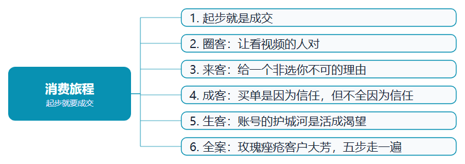

## 1\. 起步就是成交

### 1\. 五个步骤先整体过一遍

锁客、圈客、来客、成客、生客，这五步解决的是五件完全不同的事，一句一句说清楚。

锁客就是锁定你的成交客户群体；圈客就是让看视频的人对；来客就是传递购买理由；成客就是让用户走完买单旅程；生客就是建立巨大的渴望，让用户生生不息。

|**环节**|**解决什么**|**达标的样子**|
|---|---|---|
|锁客|锁定成交客户群体|起步就成交|
|圈客|让看视频的人对|对的人在看|
|来客|传递购买理由|非选你不可|
|成客|走完买单旅程|越刷越认可|
|生客|建立巨大渴望|顾客生生不息|

**⚠️ 这五步不是理论排序，是给你一套判断自己账号卡在哪一步的方法。卡在锁客的，拍得再好也白拍；卡在来客的，流量再大也不来钱。**

### 2\. 只有成交能够证明你是对的

这五个步骤要实现一个目的，叫：起步就是成交。

起步就得成交。很简单，因为只有成交能够证明你是对的。没有什么太多的方法可以证明你今天所做的东西是对的。

有的人说，我起步做账号，第一条视频像我一样讲自己被包养的故事，获得了很大的流量，可以证明我们是对的吗？不一定。

如果你起步做到一百条视频，你有很多的客资，但这些客资没有转化，它可以证明你是对的吗？证明不了。它只能证明你现在的方向可能有一些问题——也许是客资不精准，也许是客资不对，也许是客资对你的信任度不够，等等的一切都有可能。

如果你想要证明你的起步是对的，那就只有成交。当我们在发出前几条视频的时候，就拿出成交了，说明我们的方向、我们的策略是对的。

### 3\. 芭比：纽约华人不会找她买单

举一个例子，芭比。她当时总觉得纽约的人都找她，那就是她的目标人群。

我们先看这个女生，她在美国纽约帮别人卖房子。她的专业度不错，形象也不错。你认为，什么样的人会愿意找她、委托她来卖房子？

现场的答案：华人；在美国读书的华人。

当时我们也问过芭比这个问题。我们说，你的客户是谁？你想要什么样的顾客？她说，我认为纽约的华人都应该找我。因为她认为自己是最会卖的——服务能力、交付能力、方方面面，她都认为自己是出彩的。

我跟芭比讲过这样一段话。我说，芭比，如果你认为美国纽约的华人都会愿意找你买单，你一定做不好。

为什么？我说，比如讲，华人当中的男性就不可能找你。

想想为什么。在美国纽约有非常非常多的福建人，福建经商的商人。一个福建商人，带着自己的老婆孩子，在纽约定居。老婆也没有什么安全感，因为老公很有钱。那个时候家里要卖一套房子，老婆让老公去安排。老公说，找遍了纽约，觉得找她最合适。

我问，那么多中介不找，你非要找她？老公说，因为我觉得这个女人最专业。

楼下就有我爱我家的门店，楼下就有链家，你不找，你说她家最专业。哪儿专业？眉毛专业还是鼻子专业，还是嘴巴专业？不可能的。一个男性几乎不可能去找她。

所以这就导致一个结果：如果芭比的视频，看视频的用户是男性，他能买单吗？不能。

这就是第一个要命的问题：你的产品能够一击即中的人群，你是否设定得足够正确？什么样的人是刷到你的视频一定会买单的？

我们过去总是会认为，只要这个人有需要，他就一定会买单。事实上，一个人从有需要到买单，还有很多步。

男性有没有需要？有需要。那为什么不买单？中间卡了一道坎。

### 4\. 后来发现：整个纽约都不可能有人找她买单

我们后来跟她合作了一段时间之后，两三周之后，我们发现了特别惊人的一件事——不是男性不找她，是整个纽约都不可能有人找她买单。

她说我的客户应该是纽约人，但事实上，只要是纽约人都不可能买。

纽约可能有点远，换个例子。如果你是上海人，你在上海有一套房子，现在准备把上海的房子卖了。我问大家一句，上海的房子好卖吗？好卖。

这个时候，你会选择楼下的我爱我家的负责人，还是不远万里、费尽千辛万苦去互联网上甄别谁是更靠谱的？

为什么你会选楼下的？因为走起来更有安全感，你看得到，联系起来也方便。

可是线上这个人说，我更专业呀。你会选择他吗？不会。因为线上你根本识别不了谁更专业，你认为离你更近是一种更靠谱的选择。纽约人也一样，他们一定会选择楼下，不会选择互联网上面的。

那换一个角度想，什么样的人会在网上找中介？

你是上海人，在上海有套房子。最近因为孩子上学，或者因为你自己工作的原因，全家搬来杭州了，在杭州定居了十二年，但上海那套房子你准备卖掉。你没有办法回到上海，回去很麻烦。这个时候你会怎么卖？你会选择在网上找一个上海当地的、你认为很靠谱的中介帮你卖这个房子。

也就是说，芭比虽然在帮美国纽约的人卖房子，可是因为她是线上的，她真正的客群其实是在美国留学以外的人——异地的人。

那异地的男性还是女性？异地的女性。只有符合这些条件，她才有可能在线上刷视频刷到她。

所以我们要考虑一件事情：一个人有需要，他就会刷你的视频吗？不是。你要想的是，什么样的人不怕麻烦，愿意刷视频来找你。这是两个概念。

什么样的人不怕麻烦，愿意刷视频找账号？这件事很麻烦。然后什么样的人一定会找你买单？他不会选择几个替代方案，他会选择找你买单。

我明明有朋友的推荐，我楼下就有很多人，我明明可以找朋友，我为什么非要在网上找？

### 5\. 律师：不是每个犯罪人员家属都会上网找律师

做律师，现场有些律师。律师是一个很有意思的群体。我问大家一件事，律师群体的客户是什么人？

犯罪的家属——犯罪人员那边关着嘛。

那我再问一个问题：是不是每一个犯罪人员的家属都会去找律师？一定的吧，因为他必须得打官司。

那我再问一个问题：每一个犯罪人员的家属都会在网上找律师吗？

什么人才会在网上找？一个人没有社会关系，他才会在网上找。

你在生活当中遇到一件事情之后，你的第一选择是什么？打开微信，找你最好的资源，让他推荐一个律师。你不会上网去找。

但是如果发生了一个情况：你通过社会关系，所有社会关系都无效了。到了某一个时间，你发现你自己所找的社会关系全部无效了，这个时候你开始意识到，你只能在网上找律师了。你会不会去找？

律师也是这样子。不是一个人有需要就会在网上找人。是什么样的人愿意克服线上刷视频的麻烦？什么样的人不会选择他生活当中那些默认的解决方案？他才会去网上找。

这个人群才是你真正该锁定的人群。

上午我只是想告诉各位一个非常重要的概念：你在线上能成交的人，不能宽泛地说是一个有需要的人。确切地讲，应该是一个愿意克服麻烦的人。因为刷视频很麻烦，找朋友推荐很简单，自己去网上甄别其实很麻烦。

### 6\. 牙科医生：不会有人为了便宜来找你

我最近在做牙，所以今天早上讲话有点大舌头，因为我那个牙床里面打了东西。

我跟我们的牙科医生聊天，他说他想做线上。我说你做线上，我们要重新讨论一下你的人群——你到底要服务什么样的人？

他说，我觉得每个人都要做线上啊，每个人都要做牙，就像你这样牙不齐的人都要做牙。

我说这不可能。我给你举一个例子就好了。生活当中，比如你觉得自己的牙不好，你想要整牙，你会干嘛？问朋友。你会问朋友找的是哪个医生，你就去那个医生那边做。

好，就算你在网上、大众点评去搜，抖音去搜，小红书去搜，你会搜什么样的人？你会搜一个便宜的、有团购价的。而我那个比较贵。

那什么样的人才会真正意义上不怕麻烦来找你？曾经做过一次牙、做坏了的。修复的时候，他才会来网上找。因为一旦他要修复，他会不会在网上去对比多家？对比谁好谁坏，对比谁更专业。这种时候他才可能找你，因为那种时候他才不会怕麻烦。

每个行业都是这个样子。你真正的客户群体到底是一群什么样的人？这本身是非常值得讨论的。

一个客户群体，你只有对它定义得足够精准，你才能够让他非常丝滑地买单。

### 7\. 男性情感：追白月光半年左右的人

今天现场有一个我的朋友。以前跟一个做男性情感的人聊天，我觉得他说话非常有意思。

我问他，男生在什么时候会买一个情感咨询或者情感服务？

他跟我讲的答案我觉得很奇妙。他说，首先，男的如果现在有一个对象，是不会在网上求助别人的，因为他认为自己还有两把刷子——要么长得好看，要么有钱。

我说，所以一个男的追一个女生，始终追不到，他才会找你，对吗？他说也不是。一个男的追一个女生超过一年，他就会变成一种莫名其妙的新的相处方式和共生方式，他也不会找人。

他说，一个男的找他买单，最高峰的时间段是什么？追自己的白月光，半年左右。就是半年左右，他还想继续追，但同时也知道自己没有方法、自己的方法没有用。在那个时间段，他才会在网上寻找一些方法，或者付费购买一些方法。

所以你真正愿意在互联网上寻找自己问题解决方案、并且选择购买解决方案的人，其实并没有你想的那么多。他们需要一些更细化的定义、个性化的定义。

五个行业摆在一起，表面客群和真正客群的差距一目了然。

|**行业**|**表面上的客群**|**真正会成交的客群**|
|---|---|---|
|卖房（芭比）|纽约的华人|人在外州、女性、卖过半年没卖掉|
|律师|犯罪人员家属|社会关系全部用尽的人|
|牙科|牙不齐的人|做坏了、来修复的人|
|男性情感|追不到女生的人|追白月光半年左右的人|
|玫瑰痤疮|大红脸的人|找过三家医院治不好的人|

### 8\. 一条真正的精准用户私信长什么样

回到芭比。我们说了，芭比真正的目标客户群并不是纽约人，同时也不是男性。所以我们给她做了一条视频。

视频是这样讲的：人在外州，远程卖纽约的房子，到底要做哪些准备呢？现在搬去佛州、加州的人真的蛮多的，还有一些子女常年都是在外州居住，现在要把父母接过去养老了，那么纽约这边父母的房子就要卖了。远程卖房，最头疼的就是房屋的整理。

看视频的人是什么人？人在外州，帮父母卖房子，房子比较漂亮，需要找一个懂审美的人帮忙来卖。

我们再看她的客户群体。小红书上有一个客户，不看他说什么，我看这张脸——就是标准用户画像的脸。人在外州，女性，有一点点审美。所以她会选择找一个同样是女性、并且认为懂她审美的人帮她卖这个房子。

是因为我认为你比我懂我的房子吗？你会看到这张脸，你会觉得就应该她，她就应该会把你的房子卖好。

当时这个客户发了一段私信，她说：芭比晚上好。我经常刷到你卖房的视频，我感觉你非常的专业。我在法拉盛，我有一套三室一厅两卫的房子想卖掉。我之前也有找经纪人卖了半年没有卖掉，所以我想找你聊聊，麻烦看到回复一下，谢谢。

为什么？因为她只有经历过自己找的经纪人没有用，她才会在网上寻找。

这就是一个非常标准的、性别、年龄、阶段都符合的精准用户的画像。只有当对于你目标用户的识别和精准度到了这样的程度，你的视频才会出现在对的人面前。

我们要的是什么？叫视频出现在对的人的面前。而这个"对"本身是需要策划和识别的。

### 9\. 这条私信拆开，是四个条件同时成立

这条私信值得一句一句拆。

人在外州，是第一个条件。她不在纽约，回不去，楼下的中介用不了，这是物理上的"默认方案失效"。

女性，是第二个条件。她要找一个同样是女性、并且懂审美的人，因为她对这套房子的判断是"漂亮、要卖相"。

三室一厅两卫，是第三个条件。她有资产、有决策权，不是租客，不是看客。

之前找了经纪人卖了半年没有卖掉，是第四个条件。她的默认方案已经用过了，失败了，所以她才愿意克服线上的麻烦。

四个条件同时成立，这条私信才会发出来。少一个，她就是"有需要的人"，但她不会私信，也不会买单。

所以锁客不是锁一个标签，是锁一组条件同时成立的那批人。

**⚠️ 很多人会有一种很灾难的想法，以为有需求就是精准人群。不是。因为线上刷视频其实很麻烦。你的产品的定价，有的人高、有的人低；你的气质，满足了很多人的需求。线上刷视频的麻烦感、产品的定价、IP 的气质，筛掉了非常非常多人的需求。**

这就是圈客营销第一问。今天下午你们上完，就要回答我一个问题：你的产品到底在成交谁？你只有知道你的产品在成交谁，你才能知道你的视频做给谁看，你的视频的内容选题才会发生变化。

所以第一步叫锁定客群，牢牢地去锁定你的目标客群。来的人对，才有可能转化。

📌 一句话总结：五步是判断账号卡在哪的工具，只有成交能证明起步方向对。

## 2\. 圈客：让看视频的人对

### 1\. 第二问：看视频的人对吗

圈客营销第二问，叫你的视频看的人对吗？

两件事。首先是我们刚刚讲的锁定。芭比，你的客群是不是纽约人？不是。律师，你的客群是已经动用完社会关系的人。口腔，你的客群是那些已经做砸了的人。等等这一切。

所以第二个问题是：看视频的人，对。他们是否真的在看你的视频？

你想要什么人，不代表这些人真的在看你的视频。

我今天早上在讲餐饮的时候，那个"餐饮老板如何运营私域"的内容，餐饮老板不要看营业额。我讲这些事情，我非常知道我需要在座什么样的人来看我的视频。我需要的是想创业的人来看我的视频。

我有没有用视频找到这样的人？没有。我找错人了，我把人找歪了，我把人找错了。我的视频并没有呈现在对的人面前，或者说，我并没有把一个对的视频放在对的人面前。

### 2\. 播放量根本不告诉你来的人对不对

很多时候是一件事情：没有任何数据能告诉你来的人对不对。

你说你这条视频 5000 播放量，看的人一定对吗？你这张图片 8000 播放量，看的人多，对吗？不一定。

芭比早期是自己做的，做出了一些视频，她并不知道这些视频为什么对。那个时候我们来看第二件事，叫看视频的人对不对。第一步是识别目标客户群体，第二步是要去判定目标客户群体有没有在看你的视频。这个时候，看人，不看播放量。

### 3\. 芭比的三条视频：看的人全都不对

第一条视频讲的是：纽约新机遇，政府砸了 20 个亿，这个区域将变身纽约最便宜的社区。大白话讲解一下，现在适合入场买房和卖房吗？

你认为看这个视频的人是什么人？是关注房产信息的人。这些人是卖房的人吗？

换到上海，如果说出一条视频，上海武康路什么楼盘新机遇，你觉得看的人是什么人？买房的人。

那我再问一件事：上海武康路政府将会花 20 个亿在这个地方盖一个什么样的楼——看的人是谁？有需要买房的人。这些人现在手上有钱吗？或者说，这些人准备什么时候买房？现在准备三年之后、五年之后买房。

他不是那种我现在就要买房的人，他是那种我三年、五年之后准备在这个地方买房的人。难道我做一条视频涨了粉之后，我等他五年之后来找我买单？就这个道理。

这个人群首先不对。然后这批人群，难道我指望这批人五年之后来买单吗？匪夷所思。

第二条，网红咖啡店。我说上海网红咖啡店这条路上怎么样、怎么样、怎么样。跟我们刚刚所设定的发帖的人群一样吗？完全不一样。

第三条，最近有一个朋友让我帮忙看房，这里有个很大的房子。看视频的人是我们刚刚所设定的人吗？还有很多人问我，政府准备在那边盖 1\.5 万套，现在适合买房吗？

这些人是不是买房人群？有没有需要？有。这批人什么时候买？五年之后、十年之后买。甚至五年之后、十年之后，他也可能不买。

能要这样的人吗？这样的人他不会找你买单。也就是说，你的视频有没有曝光在对的人面前？

所以第二步我们叫圈客。圈客的目的叫做让看视频的人对。我做视频是为了让我的目标用户看，而现在我的视频没有让我的目标用户看，看视频的人是不对的。

### 4\. 贝壳出来的同事：带看视频一点意义都没有

前阵子我们有一个同事回来交流，他原来是贝壳的。他说他最近做卖房子，卖得很有心得。

我说你有什么心得？他说，经纬老师，你知道吗，那种"看一个房子有多好"、带看这种视频，一点意义都没有。

我说流量也很大呀，为什么没有意义？他说很简单，用你的话来说，看视频的人根本都没有想好要不要换。他只是看到这个房子好看，他好奇而已。那他具体买单是不是还很远？

他说我现在在杭州卖房子、租房子，我的视频开头都这么讲：上个礼拜刚搬来杭州，入职哪一家公司，然后这个小区的什么样的房子。

你为什么一定要这么讲？他说，我现在用视频，我的视频就要找买单人群。我要找那种一周之内就买单的人群。

什么样的人一周之内一定会买单？上个礼拜刚来杭州、刚报完入职的人，他一个礼拜一定会买单。

上礼拜刚搬来杭州，刚办完入职，这些人一定会买单。所以我在视频里面就去找这样的人。比如滨江区或者某一个区，上个礼拜刚入职。这样的人看完我的视频之后，当天就会发私信，周末就会来看房，看房的时候就会交钱。

这就叫看视频的人对。这是两件事的结合：首先我要识别谁是一定会找我买单的人，而且是一定会在最近一个月之内给我买单的人，而不是三年之后给我买单的人；其次，第二步我要用视频来找到这样的人，让这些人愿意看我的视频。

这样子做，你就会提高概率，实现你的商业化的结果。

所以圈客营销第二个问题：你的视频看的人对吗？你想要这批人来看你的视频，那请问这批人现在真的在看你视频吗？

📌 一句话总结：先锁定必成交的人，再确认视频前的人就是他，别看播放量。

## 3\. 来客：给一个非选你不可的理由

### 1\. 第三问：看完视频，凭什么选你

第二个问题解决完之后，第三个问题叫来客。

什么是来客？来客的意思是稳定获取高客单客资。也就是说，我们需要让这批客户群体看完我们的视频之后，相信你、喜欢你、选择你，愿意给你买单，愿意找你买东西。

我们要在视频里面下钩子，要在视频里面传递成交理由，要在视频里面传递购买理由，要让用户看完之后选择你这个人，完全没有问题，愿意找你买。

短视频是这样子的：产品不是要曝光。短视频得让用户看完之后愿意找你付费。

### 2\. 八万人的体育场，你说什么他才买单

这个事情其实蛮难的。

我们可以想象一件事情：如果今天在一个体育场里面，坐了 8 万人。你怎么样说话？你说什么，他才会愿意找你买单？

我们可以做个小小的示范。我先问一下，你是做什么的？

——我们是做心理咨询的。

——心理咨询，培训还是咨询？

——我们是咨询。

好，那我问一个问题。比如说现在你在一个体育场里面，现场有很多人，你要去介绍自己。你能不能说几句话，给自己打个广告？别人为什么一定要找你做心理咨询？

她的回答是：首先得有这个需求，我们国家 8 万人里面都是有的。那 8 万人都有，那就是看你的专业性怎么样，就是你每一句话能不能说到对方的需求里面、心坎里面。

然后她开始介绍：我们做的是一个特殊的心理咨询，我们做的是赌博戒赌。现在这个社会上，这个群体在任何群体和层次里面都有，有一般家庭，也有很有钱的家庭。

现在大部分赌博的人，基本上我们那里接触到的是百分之百都是网络赌博，赌球、百家乐。年龄是零零后和九零后。

她说，今天在座的，我们有九零后，也有八零后，可能有做父母的，还有做妻子的，还有做老公的，也可能老公或者自己接触过赌球、百家乐。

然后她讲了一段很精彩的定义：有时候我们很多人对赌博这件事的认知会非常模糊。我在什么情况下叫赌博，什么情况下叫成瘾？其实我们对这个东西是模糊的。

你比如说，我 2 块钱买个彩票，算不算赌博，还是算娱乐？我觉得现在是娱乐。但是我给大家定义什么是赌博成瘾、什么是病理性赌博。

当我拿 100 块钱，又中了 100 块钱，我觉得这个事儿很好，我觉得这个事儿能做——其实这个时候你已经是病理性赌博了，因为你认同了这件事。

当你把这赢的 100 块钱也好、1000 块钱也好，又输出去了，这个时候我内心里面有了不甘心，我想把这钱赢回来——其实这个时候你已经是进一步的病理性了。

如果说你借钱、贷款，也想翻本的时候，你这个时候一定是严重的病理性赌博。这个时候我们靠自己想解决，没有任何可能性了。你必须要找专业的机构做脱敏治疗。

### 3\. 讲得好，但没有回答"为什么是你"

讲得挺好，但有一件事跑题了：怎么让大家找你买单？

先说她答对了什么。她答对了三件事：需求是真实存在的，而且不分阶层，一般家庭有，很有钱的家庭也有；人群是具体的，网络赌博、赌球、百家乐，零零后和九零后；她还给了一个界定标准，什么叫娱乐、什么叫成瘾、什么叫病理性赌博。这三件事都是"教育"，都是让听的人承认"我可能有这个问题"。

她漏掉的一件事是：全程没有一个字在回答"为什么是你"。

我们回想一下，在今天的短视频时代，一个用户如果他愿意去刷视频，他是不是除了会刷到你，还会刷到别人？会刷到非常多的人。

刚刚说了，要找到专业人士。我如果今天愿意刷视频，我可以在今天晚上最起码刷到不下 50 个做赌博成瘾的。有些人可能是医生，有些人可能是像您这样的心理咨询师，有些人可能是做了 30 年的，有些人是 20 年的，有些人是 10 年的。有些人可能是同城的，有些人可能是北京的，有些人可能是美国回国的、留学的。

各种各样的资历。你说你有案例，有些人说我也有很多案例；你说你有大案例，他说还有明星案例；你说你有结果，别人也说有结果。

在这种情况下，我们请问一个问题：他为什么还要选你？

如果用大哥刚刚的话来说，你觉得作为一个消费者看完这个视频之后，他会干嘛？他会说：大哥你真不容易，你刚刚讲了三分钟，我给你点个赞。然后我就找别人。

因为谢谢你建议我去找专家，然后我找到了一个专家，我给专家付钱，然后那个专家感谢你给他培养了一个顾客。这就是结果。

**⚠️ 你也许能培养一个顾客，你也许有流量，但是你收不到那个人的钱。因为你没有在视频里面给到这批人一个非选你不可的理由。**

### 4\. 开书店的学员：脑子里有一堆答案，但没有一个是"非你不可"

现场一位开书店的学员。我问他，你的成功案例是什么？

他说，关注了 12 年，今天选择来这里，是我跟他讲穷则思变，已经遇到了生存问题。生存问题会让人兴奋。

我问他，你认为哪边是成功案例？他说，我想怎么把我们的书卖出去？确实很难回答。

我觉得很好，因为他其实完全能理解我要表达什么意思。因为我相信他在表达的时候，他脑子里面有很多答案——我有五种案例，我干这行很多年，我很专业。可是这些理由都并不是非选你不可的理由。

你有成功案例，坦白讲，今天没有成功案例的人，连账号都不敢做。敢做账号的人，他多少有案例，这个各位认同吗？那当所有人都有案例了，你的案例又算什么呢？

除非你是超级案例。俞敏洪老师跟你一起开个书店，那你超级案例；莫言跟你一起开个书店，完全 OK。如果你不是超级案例呢？成功案例还有用吗？没有用，因为所有人都有。

你说你很专业，大家都说他很专业，你怎么证明？

说是什么病理性的，我能理解吗？我不能理解你的专业。你说你帮我分析问题，我还没有买单，我并不能理解你分析得对不对。

你说你干了多少年？这个就更简单。你说你专门干这个的，他也专门干这个，所有人都专门干这个，把名字改一下就可以了。经纬专注开书店。然后明天有个人叫张伟，专注开书店 12 年；今天再来一个人，李伟专注开书店 25 年。没有意义。

### 5\. 你把门关上，用户只能选你；短视频不是关着门的房间

所有这些你认为可以打动用户的理由，如果你独立地去看，好像都可以打动用户。或者这么讲：今天在这个房间里面，你们都出不去。我说我有案例，我说我很强，我说我有背书，我说我干了多少年，因为你接触不到别的信息，你会不会选我？会。

可是短视频里面，它是不是一个密闭盒子的信息？不是。短视频是算法推荐。当一个用户在搜这个信息的时候，他会在一个小时之内刷到几十个人。每个人的看法都不一样，每个人的说法都不一样，一下子所有的东西全部轰炸过来。

你怎么让消费者在那么多人里面识别出你、选择你？

这个问题如果你不回答，或者你不知道该如何解决，那么结果是什么？结果就是，你会发现你始终在做流量。你会发现你就是没有客资，你的客资就是很少，就是很稀缺，就是时灵时不灵。你不知道什么视频他们就来客资了，你不知道那条视频为什么就不来客资。因为你根本不知道用户到底为什么被打动，你并不知道如何在视频里面给到一个非选你不可的理由。

### 6\. 三个康复师，三个答案

很多时候过去我们有一种灾难的想法，叫用户因为看懂了我的水平而来。这货其实看不懂你的水平。用户其实看不完全，完全看不懂。

我最近膝盖有问题，有点痛。我在杭州找了一个康复师，是非常有名的一帮篮球运动员的康复师。他给我做了一个诊断，他说我的软组织退化，因为一直有压迫感，组织退化。

然后前两天又出了一个上海，上海有一个康复师，这个康复师从美国过来，他现在在姚明的健身房里面当康复教练，也是给一帮篮球运动员做康复。那个人说：你的软组织一点都没有退化，一定是大腿肌肉不够。

然后我去了上海华山医院。华山医院的医生说：没有用。

三个人，三个答案，都不一样。

这就是今天的消费者没有办法理解你的专业，他没有办法知道你讲的对还是不对。你知道自己讲得对不对，但是消费者没办法知道。

所以你让消费者通过你的专业来判断"你真的能解决问题"，怎么证明？你说你有案例，别人都说你有案例；你说你比别人更专业，消费者怎么知道？消费者不知道。

### 7\. 做线上真正难的从来不是流量

如果你今天做线上还比较早期，你还不知道我说的这个问题有多关键。如果你做线上已经超过一年，你大概就能理解：做线上真正要解决的问题，从来都不是流量问题。

真正难的就是在一堆信息里面，你给消费者到底传递什么样的东西，消费者才会愿意选择你。这个其实比做流量要难得多。新手没有办法理解，做了一年的人就能理解了。

今天现场有一个我的好朋友，从香港过来的，做了一整年。结果呢，作品就是一推一拉都不是很好。你说他这一年有没有流量？他其实有。是因为他没有找到一个打动用户的理由。

### 8\. 做了一年的人和新手，差在哪

新手会把这件事理解成流量问题。数据不好，就想着换赛道、换形式、追热点、多拍。做了一年的人会知道，问题不在流量，在于你没有给消费者一个选择你的理由。

这两拨人的分水岭，不是拍了多少条，是有没有开始琢磨"看完这条视频的人，为什么要把钱给我"。

一个账号有没有流量，很多时候不由你决定。但一个看你视频的人会不会选你，是由你决定的。

📌 一句话总结：视频必须回答为什么是你，否则只帮同行培养了一个客户。

## 4\. 成客：买单是因为信任，但不全因为信任

### 1\. 选择找你咨询，和选择找你付费，是两个概念

我为什么要选择你？我选择你，仍然有两个部分，叫选择找你咨询和选择找你付费。这是两个概念，尤其是重决策。

什么是重决策？影响我一生的决策。眼科手术、医美、买房、车、戒毒、律师，类似的都属于非常重的决策。

重到什么程度？重到说，我不能把这个决定做错，因为错了之后影响我的一生；不能把这个决策做错，因为做错了之后价格非常非常昂贵，那个成本我负担不起。所以我必须得找到一个真正靠谱的人，我才愿意买单。

这六件事摆在一起，共同点是三条：结果不可逆；错了代价极高；消费者自己判断不了专业好坏，因为他看不懂。

所以他会咨询多家，但只在其中一家付费。咨询和付费之间那道坎，就是你要在视频里提前铺完的东西。

可能会找多家。那我咨询了多家之后，我为什么愿意找你付费？我为什么愿意在你这里交 5 万块钱？我怎么愿意在你这里交 20 万、交 30 万、交更多？我为什么把一个影响我一生的问题交给你来解决？

### 2\. 顾客买单之前，要看多少条视频

如果要理解这个原因，我们要先识别另外一个问题：顾客找你买单之前，他需要看多少个视频？

我不知道各位今天卖的是什么。有些人卖药，有些人卖服务。我问你，你觉得以你今天卖的东西，顾客要看多少条视频才愿意找你买单？

现场有一位做影视的，他说起码十条。

一位做 AI 培训的，解决职场人士的工作效率问题。相对来说比较简单，看的条数会少一点。

一位做开发商获客的，单价 100 万，房子 100 万、110 万都能买。

一位做全包装修的，基本上 50 万左右的装修费。他认为十条不够，因为这么多家水平，你不可能通过两三分钟就可以打过。

现场的答案很说明问题。做 AI 培训的说"相对简单"，做影视的说"起码十条"，做 50 万全包装修的说"十条不够"，做 100 万房产的更不用说。

客单价越高、决策越重，顾客要看的条数越多。这意味着你的账号不是一条视频在工作，是几十条视频在一起工作。

那我们是不是要解决一个问题：怎么样让顾客刷我们的视频，他对我们的信任、对我们买单的意愿水涨船高？叫越刷我越觉得你是对的，越刷我越觉得你就是我要的，越刷我越觉得只有你最适合我，最终我愿意找你买单。

要把成交铺垫全部做到位。

### 3\. 只管进线、再用销售去洗，是很糟糕的想法

这方面有的人说，我只管进线，进线之后用销售去洗。还有人想，管那么多，我先把流量捞进来再说，到时候我的销售能力很强。

这是一种很糟糕的想法。

你想想看，今天如果一个消费者对你有很多的疑虑，他会跟销售说话吗？大多数时候，消费者不会说。我对你有疑虑，可是消费者他不说，因为我说了就是跟销售成交了，这就不说了。

这时候就会出现一个困难：如果你没有办法让消费者在买单之前把疑虑全部打消、把信任全部铺垫完，那这个消费者就会变成一个潜水状态。他不说话，你也不知道他有需要，他也不会告诉你。

这是一种很糟糕的状态，尤其是高客单。

### 4\. 雷军：每一条视频都在不同维度增加信任

比方说，今天你要买一辆车，你买谁的车？如果华为的车整体没有什么问题，小米的车也没有什么问题，正常的情况下，你会找谁买？

我们可以看一些视频。第一个看余承东的账号。视频里是"想见 S9，隐形司机已上线，感恩同行，不负期待，鸿蒙之行，大成之作，给三位领导司机一拍即合"，一个 PPT、一堆图纸，等等一切。

看完之后，会买吗？你对他的信任有没有增加？没有。你买车的意愿有没有增加？没有。这是一种状态。

还有一种状态，我们来看雷军的。你作为一个三四线城市的人，你一直听说小米的车不错，然后你点开雷军的账号，你选择来看一看。

一开始坦白讲，你对小米其实没有什么太强的好感。然后你点开看了一条视频，叫"珠三角交付中心"，跟大家汇报一下交付细节。你感觉这辆车还可以，最起码交付起来还是很用心的。这个时候，你对这辆车的信任和兴趣到多少了？百分之十有没有？多多少少有一点，因为之前也听说不错。

可是这完全没有到你愿意买单的程度。于是你愿意点开往细看，多刷一刷，看看这个人、这家公司、这个车到底怎么样。

往前刷，刷到"国产三 A 大作，你们玩了吗"。你发现这个老板关注年轻人，好感多了一点点。

再往前刷，拜访王传福和何小鹏，感谢他们的帮助和建议。你发现这个人是一个尊重友商的人。这个时候，你心里对这辆车的感兴趣程度到了百分之十五。为什么？因为你知道现在车圈是什么样的状态，所有人都在说大话，所有人都在拉踩同行。而雷军这么一个关注年轻人、也尊重友商、不踩踏友商的人，你认为这样的人是值得信赖的，你认为这个人不会骗你，不会害你，不会吹牛。

可是雷军这个人品不错、能力不错，不代表你的车好。我买车最关心什么？你有没有售后？你的售后是不是靠谱的？

所以这个时候，我们刷到一条视频，说"有史以来最好的季报"，也是小米汽车第一次财报。你发现这家公司很有钱。有钱说明售后有保障，你悬着的心又稍微放下来一点点。这个时候你买单的意愿度到多少？百分之十八。

可是你仍然会想：这个人不错，售后也不错，不代表你的车好。我还是很关心你的车。

于是你开始了解车。自驾直播，途经火焰山山脉，在沙滩上冲浪，漂移到底，沙漠漂移都可以，揭秘苏七 Ultra。你发现这辆车可以开沙漠，可以耐高温，性能非常卓越，速度也非常高。质量不错，符合你的期待，可以度假，可以交友。这时候的信任有多少？百分之二十五有没有？

那这个时候，你仍然还有一个心中的疑惑。王传福、比亚迪、长城魏建军这些人，他们当年卖车，都是做了十几年车的人，他们其实非常懂车。你雷军是一个卖手机的，是一个做互联网的，你真的懂车吗？你造车有没有可能车是你下面的人做的？

于是雷军出了一条视频，叫"怎么样完成 180 度掉头、倒车、漂移和刹车"。于是雷军向我们证明了一件事情：我造车，我自己躬身入局，我甚至为了造好一辆车，我去考了一个驾驶证。

消费者看到了什么？看到了你的态度，看到了你的投入度。你雷军不是在用造手机的逻辑在造车，你真的有在好好造车。而且你公司有钱，而且你的车不错。这个时候信任度到多少？百分之三十有没有？

当然买车我还会很在意的事情，就是你的车耐不耐开。于是最近出了一条视频，叫《小折叠 50 万次是怎么测出来的》。他向你证明，小米对于测试这件事非常非常认真。小米的每一款设备都会经历上几十万次、几百万次的测试才会发行。于是我对于这款车的安全增加了进一步的信任。

七条视频，七层信任，一层一层往上垫。

|**刷到的内容**|**打消的疑虑**|**信任度**|
|---|---|---|
|珠三角交付中心|交付用不用心|10%|
|国产三 A 大作|关不关注年轻人|—|
|拜访王传福、何小鹏|不拉踩同行，人品可信|15%|
|史上最好季报|公司有钱，售后有保障|18%|
|沙漠漂移、火焰山|车性能卓越，耐高温|25%|
|亲自考驾照、180 度掉头|躬身入局，真懂车|30%|
|50 万次折叠测试|测试认真，耐不耐开|40% 以上|

你发现没有，我们看雷军的视频，每一条视频都在增加信任，而且每一条视频都在不同维度增加信任。

我担心你这个人的人品有问题，你告诉我人品没有问题；我担心你造车其实不懂车，你告诉我你其实懂车；我担心售后不好，你告诉我你们公司很有钱；我担心车的性能不好，你告诉我车性能很好；我担心你们家车的长期使用寿命不好，你告诉我这个寿命使用非常好。有什么担忧，就有什么回答。

所以我对你的信任度非常高，到最后有百分之四十多。这个时候就会出现一个情况：我愿意去 4S 店看一看。

那去了 4S 店，就会出现一个很奇妙的事情。销售员说：先生你好，要不要带你看一看，带你讲解一下？你会怎么说？

"我都了解了，带我开一下就可以了。"

这是真实的经历。我自己的网球教练，两个礼拜之前买了一辆小米。我问他，你怎么买的？他说我去小米 4S 店，直接就跟他说试驾一下，试驾之后觉得它好，然后当场就买。他整个买单过程就这么几步。

在这个路径里面，消费者买单过程当中很多好奇的、担忧的、渴望了解的东西，其实都已经完全被传递信息了。

把两个账号摆在一起看，差别在每一层。

|**维度**|**余承东的账号**|**雷军的账号**|
|---|---|---|
|讲的内容|发布会话术、图纸|交付、财报、测试|
|顾客听到的|与我无关|我的担心被回答|
|信任变化|没有增加|一条加一层|
|最后的结果|不会去买|愿意进 4S 店|

同样是老板亲自出镜，一个是把发布会搬进短视频，一个是把顾客的疑虑一条一条拆开回答。差别不在制作，在有没有回答"我凭什么信你"。

### 5\. 顾客买单有旅程：先知、信任、对比、首单、复购

那你说顾客为什么会买单？顾客买单是因为信任，但不全是因为信任。

如果我们一定要说，顾客买单有这样的过程，它是一个决策的旅程：先知，到信任，到对比，到首单，到复购。

|**阶段**|**顾客心里在想什么**|**你要给什么**|
|---|---|---|
|先知|我还有这种解决办法？|让他知道自己有病|
|信任|你这个人靠不靠谱|多维度铺垫信任|
|对比|凭什么选你不选他|给一套判断标准|
|首单|你的产品长什么样|把交付具象化|
|复购|我还要不要继续找你|活成他的渴望|

这个顾客最开始是不是对你有信任？是。但是会出现一个情况：信任不足以让顾客买单，因为我相信你，我也可以相信别人。

先去看病。杭州第一人民医院和杭州第二人民医院，两个医生，你会不会都信任？会。那你为什么选第一人民医院的？

所以信任后面距离买单还有什么？叫对比。

### 6\. 对比：给他一套判断标准

对比的意思就是，我告诉你，用什么样的标准来选择。

我去看膝盖的时候，康复师跟我说了一段话，我印象很深。他说，你可以去医院找医生，但是你不要找 50 岁以上的医生，你最好找 35 岁到 45 岁的。为什么？因为 50 岁以上的人，他的知识已经不更新了，35 到 45 岁的更合理。

所以我就去了那个医院，找了 35 岁到 45 岁的。

跟信任无关，是因为他给了我一个对比的方法，我知道该怎么判断了。我相信你，我也相信他，可是我怎么判断谁更适合我？你给了我一个判断的标准，而这个时候我才能做出决策。

这就是对比。

### 7\. 首单：让顾客知道你产品长什么样子

对比之后还有叫首单。什么叫首单？首单就是你要让我知道你产品要长什么样子。

一个消费者买单，是因为经历了信任，信任之后经历了对比，对比之后经历了产品的通知，他才会找你买单。它有一个决策的过程。

所以这个时候第四个问题出来了：你的客群能够通过看你的账号就买单吗？

你自己去刷你的视频，你会不会觉得你的消费者刷你的视频会越刷越喜欢、越刷越认可？如果没有，你的顾客不找你买单就是合理的。因为你并没有主导他的消费旅程，他的买单率就不高。

📌 一句话总结：按先知到复购五阶段逐条打消疑虑，让用户越刷越认可。

## 5\. 生客：账号的护城河是活成渴望

### 1\. 同行会抄，流量会掉，获客的终局是什么

最后叫生客，生生不息。什么意思？我怎么样让我的顾客一直都有，让我的顾客源源不断？

你做账号，不管你什么时候做，一定会遇到这样的问题：同行会抄你的视频，你的流量会下滑，你会拍不动。那你获客的终局是什么？

我们的流量是一定会掉的。同行会不会抄你的视频？一定会抄的。那获客的终极是什么？如果你拍不动了，怎么办？

也就是说，我们在回答一个问题：个人账号的护城河在哪里？你怎么样保住你的业务？怎么样让顾客越来越愿意找你买单？

难道是因为你流量大吗？如果是因为你流量大，你能守护这个竞争力多久呢？其实没有多久。

我以前问过现场很多同学，我说你认为获客的终极是什么？有个同学答案非常有意思，他说获客的终极就是获顾客。对嘛，总归是要死的。

但这不是真正的终局。看我们自己，现在活得还不错——我们的流量也是越来越小，但是我们的获客量没有变，我们的业绩还增长了 4 年。

### 2\. 想活过三年，要扔掉"满足用户需求"这个认知

**⚠️ 一个线上账号如果想存活 3 年以上，你需要扔掉一个认知，叫满足用户需求。**

如果你想要持续获客，不能再去满足用户需求。因为满足用户需求是什么意思？就是我要当一个工具人。我这个账号干嘛用的？有问题，打开这个账号，寻找解决方案。

而工具的价值，本身就不会长久，一定会有更好的工具来代替你。消费者有问题的时候找你，没问题的时候就不找你。要你的时候就看看，不要你的时候他就会离开。

而且你想一件事情，如果你是一个工具，如果你在不停地回答问题，你觉得你能回答多少个问题？

比如说戒烟。戒烟有多少个方法？20 个方法。20 个方法拍了 20 条视频，那你第 21 条干什么？再看一遍。第 30 条呢？再拍第三遍、第四遍、第五遍？

问题的解决方案总有拍完的时候，干货总有讲完的时候。而讲完，你还能再讲一遍吗？再讲一遍，用户说不新鲜了，不看了。这个市场解决方案就那么多。

工具的代价就是，工具是没有办法存活很久的。工具不会成为一个账号的护城河。

两种账号的活法，摆在一起看很清楚。

|**维度**|**工具型账号**|**渴望型账号**|
|---|---|---|
|回答什么|用户的具体问题|用户想要的生活|
|内容寿命|干货讲完就没了|越讲越厚|
|竞争壁垒|更好工具就替代|用户只认你|
|用户关系|有事找你，没事走|追随你这个人|
|价格|被反复比较|不谈价|

同样的赛道、同样的专业，一个越做越窄，一个越做越宽，分水岭就在这里。

### 3\. 不要回答问题，要去讲渴望

更好的办法是什么？更好的办法是不要去回答问题，而是要去讲渴望。

这个账号的存在并不是用来回答问题的，这个账号的存在是不停地去传递：我能给你带来一个什么样的美好的渴望。

我们来看一个做装修的账号，看完之后，你想不想买单？

他说：如果你是懒人，那你家装修就把握这一个核心点。真正的懒人化装修，你抓住这四点，绝对一天至少可以省一个小时。

懒人是什么？我本人实话说，我就是个懒人。四大特征：回家衣服乱扔；不做饭，做的饭不喜欢；回家就是摆着躺，一动不想动。

那我们分析这 4 个特征。第一点，你回家就是一锅乱的问题，我们怎么解决？让懒人没得选择，就在三平米之内完成他所有的做饭，那个区域里面不用打扫。

第二个特点，懒人不做饭，点外卖，点完外卖拆完之后打完包直接扔。那你的厨房用得少，但是你餐厅用得多。所以用得多的地方面积要给大，厨房太大，把厨房的面积给到餐厅。

第三个就是吃饭不刷碗。吃饭不刷碗，就一定要把好的设备都提供好，别心疼那点儿钱了，买一个好的洗碗机，洗得干干净净。

你把前三点做好了，你最后一点不也是省时间吗？那回到家我就可以各种躺，我可以花那个时间看电视、听听音乐。

实际上我们理解的懒人装修，就是你花时间最多的在哪，然后你就优化了。比如你洗衣服的时间最多，那你就把动线做得行云流水。如果你不喜欢做饭、不喜欢刷碗，那你就把厨房动线优化，设备可以多投入点，交给人工智能，你的时间就可以去躺了，去学习，去看书了。

先看看自己的时间，算算数据，再去做优化，再去做设计。直接抄，直接套模板，因为那些不一定真正适合你。

我看完了这个装修的内容，他有没有在回答问题？你问他怎么装修，他告诉你装。他告诉你他会怎么贴瓷砖，多用心。这个视频到底在干嘛？

你看完之后，是不是有一种想买单的冲动？

### 4\. 贴瓷砖：信任全给足了，为什么还是不买

再举个例子。比如大哥刚刚讲，怎么样识别是病理性的赌博和非理性赌博。那装修这个行业，怎么样识别瓷砖贴得到底是严丝合缝还是不严丝合缝？你就看第一点、第二点、第三点。如果这个装修公司他们在贴瓷砖的时候是这么贴的，就说明这个瓷砖贴得非常严丝合缝，那这个瓷砖将来就不会出问题。

想买单吗？

可是你明明信啊。不信任你怎么不买呀？我都跟你讲我怎么贴瓷砖的了，我都跟你分析了什么叫瓷砖严丝合缝、什么叫不严丝合缝，我都跟你讲了很多专业了，你为什么不买？是不信任吗？

然后我再跟你讲，我干这个干了多少年，别墅我们也设计，找我们的很多人都是非常有钱的人，甚至找我们的很多人都是找过别的装修公司的。

我们接的很多顾客，那都是有钱人，并且找别的装修公司发现不满意，然后来找我们设计的。为什么？因为我们设计得细，因为我们施工施得很好，因为我们瓷砖贴得非常严丝合缝，因为我们也没有那么多施工问题，而且我们售后有保障。你信不信呢？

听完我刚刚那么讲完之后，你想不想买？你不想买。

我给你把信任铺垫完了，售后我给你讲了，专业我给你讲了，案例我给你讲了，从业时间我给你讲了，都给了你这么多信任了，你为什么不满足？因为别人也有。

还有一个特别特别重要的原因：是因为我没有告诉你，我会带你实现一个什么样的结果。

在我的设计方案下，你的房子会变成什么样？在我的推荐下，你的房子会变成什么样？

你有没有发现，我刚刚在讲话的时候，你对你的房子没有任何想象力，你想象不到你的房子长什么样子。

### 5\. 成交用户本来也不完全靠信任

所以账号的终极护城河不在这里，不在信任。或者说，成交用户本来也不完全靠信任。

有一个特别特别重要的东西：一个巨大的渴望。你要告诉我，我为什么要买你的房子？我为什么要买你的设计？

这个渴望不光是赚钱。我将来的人生、我的社会关系等等的一切、我的生活方式会变成什么样？

如果你持续做这样的一件事情，你这个账号最终就活成了一种渴望。

你能理解我的意思吗？叫你这个账号就活成了一个渴望。

我最终找你这个账号买单，不是因为你的工具很厉害，不是因为你的答案很厉害——因为我看不懂你的答案，我看不懂你的工具，看不懂你的表达。而是因为我看到你这个账号，我就看到了我买了你的产品之后，我会过上什么样的人生。

我就能看到，我就能感受到，我就能听到：如果我买了你的产品，我会过上什么样的生活？我会有一种什么样的社会关系？我会拥有什么样的画面？

活成了别人的渴望，那这样的账号就是一个能够长久存在的账号。

所以圈客营销第五问：你给用户建立了一个什么样的渴望？

要强调，不要始终认为顾客买单是因为信任。你的顾客买单，信任是一个非常非常小的一部分，不完全是因为信任而买单的。

### 6\. 渴望要落到画面上，不能停在"赚钱"上

渴望这个词很容易被讲空。它必须落到具体的画面。

你买了我的设计，你的房子会变成什么样？你回家之后，第一眼看到的是什么？你的太太、你的孩子在这个空间里怎么生活？你请朋友来，他们坐下来说的第一句话是什么？

这就是"我就能看到，我就能感受到，我就能听到"。

所以这个渴望不光是赚钱。它是我将来的人生，是我的社会关系，是我的生活方式。你把这三样讲清楚了，用户才不是在买一个服务，而是在买一个他想要成为的人。

### 7\. 五个模块，一句话一个

圈客营销里面有五个部分：第一个模块叫锁客，第二个叫圈客，第三个叫来客，第四个叫成客，第五个叫生客。

|**模块**|**一句话定义**|**落到哪个问题**|
|---|---|---|
|锁客|锁定你的成交客户群体|你的产品到底成交谁|
|圈客|让看视频的人对|看视频的人对吗|
|来客|传递购买理由|凭什么选你不选他|
|成客|让用户走完买单旅程|账号能不能直接成交|
|生客|建立巨大的渴望|顾客为什么生生不息|

我们最后再串一次。用一个大方（大芳）的案例，把锁客、圈客、来客、成客、生客完整走一遍，你会看到这套东西不是概念，是可以直接改出一个人的营收的。

📌 一句话总结：别当工具人讲干货，讲渴望，让账号活成用户想要的人生。

## 6\. 全案：玫瑰痤疮客户大芳，五步走一遍

### 1\. 她原来一年营收 200 多万，说顾客都是神经病

大方是做玫瑰痤疮的。先解释一下什么叫玫瑰痤疮：冬天的时候，在暖气房里面，有些人脸颊两边会非常红，像玻璃一样。像我们初中同学、高中同学，有些是这种人，空调房里面脸很红、很热。

这是一种病。因为这个病严重的话会变成更糟的样子，再严重一点，它就会有一些溃烂之类的东西，非常非常糟糕的情况下，会很麻烦。

大芳原来一年营收大概 200 多万。这个钱挣得很辛苦。为什么？用大芳的话来讲，所有的顾客都是神经病。

我说为什么你喊你的顾客叫神经病？因为这批人常年受这种皮肤问题的困扰，情绪不稳定，动不动就发火，一言不合，他就会觉得你对他服务不周。说白了，情绪不好。所以她做得很辛苦。

我们用锁客、圈客、来客、成客、生客带她走一遍，感受一下这个过程。

### 2\. 锁客：不是有病的人，是找过三家医院的人

第一步叫锁。锁什么？锁百分百买单人群。

大芳作为一个做这个的，你认为她的顾客是什么人？她的客户是什么人？

有病的人。不完全是。因为她并不是一个医生。所以我们要想：什么样的人不找医生，而找她？

跟你们讲一个很匪夷所思的事情。这个病你去找医生看，医生会给你开膏药，膏药多少钱？300 块钱。你知道大芳的客单价多少钱吗？10 万。

医生 300，她 10 万。

而且大芳原来干这行之前是干什么的？在公司里面当 HR 的。她自己就是病友，她自己得过这个病，然后自己自愈了。就这么一个没有背书的人，客单价那么贵。

那买单的人是不是有这个病的人，或者有这个病的家人？

我们一点点分析。我们当时在看的时候，发现了一个情况：市面上所有的人都在讲这个病该怎么治。

你看这个人讲，这个人是皮肤科医生；这个人讲，这个人是一个专注敏感肌的美业老板娘；这个人是一个 10 年专注敏感肌的老板娘；这个人也是专注敏感肌的老板娘。然后这个人讲什么？"你一定要试这个小东西。"这个人试那种小东西。

所有人都在讲。这条视频"你一定要试试这个"，那条视频"一定别试这个，你要试那个"，还有"你一定要用国产的，你不要用国产的，你要用进口的"。无非就这样子。

你让顾客怎么买呢？

突然发现，整个线上所有皮肤科医生、问题肌同行都在抢生意，大家抢都不抢，都不抢。而且几乎所有同行都在做这个生意，刚刚发现自己有大红脸客群的生意。

你如果今天自己发现脸红了、有病了，你的第一选择是什么？去医院，找医生。你不可能找大芳。

所以有这个病的人会找大芳吗？其实不会。那什么样的人才会找大芳？

找了最起码 3 家医院，发现医生治不好的情况下，而自己的脸还在越来越重，才会死马当活马医来找大芳。只有这种情况。

所以我们要锁什么人？她真正能成交的人群，是已经找过医生的大红脸顾客，而不是大红脸顾客。

这样做，才能做到起步就是成交。

### 3\. 圈客：23 个赞、7 条评论的视频，人是对的

第二步，圈。圈是什么意思？让这些人看我们的视频。所以第二步，我们要做出能够圈客的短视频，用短视频圈住产品表达人群。

我们来看这两条视频，看视频的人对不对？

第一条：去皮肤管理店搞脸，怎么搞自己都不满意，就是觉得自己这个脸很脏，毛孔又大，整个肤色很暗沉。你看一下，这就是去别人那里搞了 1 年的脸，我们带他 3 个月的时间。

看视频的人是什么人？脸没搞好的人。

过去你会怎么看？你往下看，说哎呦，这个人的视频 23 个赞、7 个评论，好像数据一般。因为它数据很一般，这算是一般的数据。但我们现在不看这个。

不是看播放量，看人。

事实上，如果大芳的视频，看视频的人都是刚刚发现自己皮肤有问题的人，我们一个都成交不了。

为什么现在市面上都说"大牌搞不好""皮炎脸搞不好""玫瑰脸搞不好"，甚至很多病友都说大牌看不好？因为这段讲的也是已经知道医生搞不好的这批人。你已经知道医生搞不好这个点了，于是人就是去找过医生的人。

圈什么人？圈那些已经找过医生的大红脸顾客，圈进优质客群。

所以看视频的人是对的。

### 4\. 来客：不是解释专业，是传递价值

第三步，传递一个让他愿意购买的理由，让他愿意来找我，让他愿意给我发私信。

不是向你解释我的专业，而是向你传递我的价值。

比如说，没有什么资格戴口罩，北方的冬天戴口罩难受死了，摩擦的。这个部分你看完之后，你会感觉大芳很懂你。

然后再看一条视频，直播间买一些什么东西往脸上涂，是不是 1000 个坑。相关视频里，我在试图告诉你：我的整个治疗方案长什么样子。

这就是实现稳定获取高客单客群。

### 5\. 成客：199 面诊，直接升 10 万

然后再来叫成客。什么是成客？让用户刷我们的视频之后，越刷越喜欢，越刷越认可，直到愿意直接买单的程度。

大芳的商业价值是这样子的：面诊完了之后报价、报预算。

刚才大芳说了一件事情，她说我的客单价比别人还高了。我的首单升单率，就是 199 的升单率——199 是面诊，面诊之后直接把 199 升 10 万。她原来卖 5 万，现在卖 10 万，然后 199 的客单价翻了 1 倍。

在这个过程中，我想告诉各位：大芳的客资量有没有变？其实没变。大芳的流量有没有变？也没变，播放量也没变。

但是大芳的营收从 200 万到 800 万，区别是什么？客单价翻了 1 倍，转化率翻了 1 倍。

这里要算清楚一笔账。199 是面诊，是入口，它的作用不是赚钱，是把一个刷视频的人变成一次真实的接触。面诊完了报价、报预算，直接把 199 升 10 万，主单在 10 万。

她原来卖 5 万，现在卖 10 万，客单价翻了一倍；199 的升单率也翻了 1 倍。客资量不变、流量不变，两个翻倍叠在一起，营收就从 200 多万变成 800 万。

这中间没有多花一分钱去买流量。

那这个转化率翻 1 倍是怎么来的？是因为我们像那个邻居的账号一样，让用户越刷越认可、越刷越信任，于是导致了高客单的转化率翻了 1 倍。

前后一对比，改的到底是什么就很清楚了。

|**维度**|**做之前**|**做之后**|
|---|---|---|
|年营收|200 多万|800 万|
|客单价|5 万|10 万|
|199 面诊升单率|基准|翻了 1 倍|
|流量与客资量|—|没有变|
|顾客姿态|我是顾客，快回复我|求老师收下我|

### 6\. 生客：活成用户一直在找的那个人

最后一个叫生客，主导客户的消费旅程。

一旦顾客看你的账号之后，他刷完之后会有一种感觉叫做"你就是我要的"，单就会很高，而且你成交也会更容易，顾客来了之后就能直接买单。

最后再来一个升：引领用户需求解决方案，让客户生生不息。

不是去当一个工具人，而是去强调理念。干什么呢？我成为了用户心中渴望的人。

我的账号并不是在回答问题，我的账号并不是在解决问题，我的账号是在活成渴望，活成你想要找的那个人。我的每条视频都在论证：我就是你三生三世一直在找的这个人。

大芳自己讲的一段话：我店里最贵的设备就是那台谢老师给我们配的华虹光，我们 1000 万。为什么呢？其实并不是说他花 1000 万去买，而是它至少给我省了 1000 万。

我从开始创业在公寓楼里面的一个 70 平的小店，到现在 400 平的店。一张张烂的、红的、痒的、流水的、黑的，一张张扔到那里，明显的好看的、干净的，这份自信靠的就是这双手跟这眼光。

其实我常常觉得很可惜，很多的老板娘，她真的是用心在公司，她买好的、认得某威、某正、郭某子，真的是什么好她就买什么，因为确实都做了这些项目，但搞完之后干巴巴的、红的，甚至有的黑的，毛孔仍然是大的。

这一行，我就是要把它干好。

我活成了一个你一直在互联网上试图寻找的一个人。

所以大芳可以做到：她现在在长沙，她的 C 端门店全国的客户慕名而来，不谈价，只认她——你多少钱无所谓，我只认你，别的医生我不找，别的人我也不找。

然后她的 B 端培训，100 人的规模，她现在这个行业第一。

### 7\. 顾客的态度，是怎么变的

我们来看她的顾客今天会发生什么样的变化。当你一旦主导了客户的旅程，短视频给了顾客找你买单的理由，并且主导了客户的旅程，你的顾客会发生什么样的变化？

她原来的顾客是这样讲话的：老师你好，找大芳老师治脸需要怎么做？大芳说，你好，朋友圈置顶你看了吗？这个人说，阅读了，要多久才能找老师看脸治疗？希望得到老师的指导和帮助，希望在老师的指导下早日上岸。

这是一个什么样的人？这个人认为自己是顾客。当然她态度也挺好，就是一个非常常规的：我是顾客，我找你买单，你快点回复我，你告诉我能不能帮我解决问题，能我就付费，不能就不能。

原因是什么？因为大芳那个时候是一个工具。我们对工具是不会尊重的。我们对工具的期待就是：你能不能帮我解决问题？

那如果大芳是一个有初心、有价值观、有理念、活成了你心中渴望的一个人呢？如果你确认大芳就是全中国最能帮你解决这个问题的人呢，你会怎么样？

你会尊重她。

顾客的话就变了：老师，我决定好了，我想跟人体系统修复。我昨晚也跟家人商量过了，请老师收下我，给我一次机会，我会认真配合治疗。

还有更夸张的。另外一个顾客写了一大段：大芳老师，不好意思，真的求你收下我吧。我的脸又肿了，眼皮也肿了，然后我开了激素药膏，我现在下巴也有一点皮炎。大芳老师，我已经做好了所有的准备，我决定要好好治疗，遇到再疼，我也能坚持下来。

我真的求求大芳老师收下我吧，我想好好生活，我不想被别人嫌弃。我也看了你的朋友圈，每个人要好起来都要经历爆疼，我准备好了，你不用担心，我不会焦虑，因为我无比相信你。我喜欢湖南，我喜欢湖南的那座城市，我坚信我的脸在您那里能看好，求大芳老师收下我，拜托了。

如果今天你求医，你在普通医院找一个专家医生，跟你去北京协和找最著名的医生，你的态度一定会发生变化。

为什么会变？因为我们给了她买单的理由，我们主导了她的旅程。我们让用户在互联网上随便刷任何一个人的账号，她仍然可以确定：大芳就是她要的，大芳就是唯一能帮她解决问题的人。

是因为她的短视频把铺垫做到位了。当用户看完这个视频之后，已经确信你就是最好的那个人的时候，他就会成为你的追随者，以及一个不看价格的追随者。

你说大芳今天是 5 万还是 10 万，还重要吗？这已经不重要了。

这其实就是前端的营销铺垫做到的。

而做到这些，大芳全网粉丝还没超过 2 万。她的视频号 4000 多粉，小红书 5594 粉，抖音 5652 粉，而且还经常封号——因为毕竟涉及到一点点医疗，多多少少还有点风险。但这并不影响她本身的营收已经翻了，如果加上 B 端的培训，她已经过了 1000 多万。

### 8\. 这套东西的底层逻辑：不赌运气，不赌天赋

圈客营销是什么逻辑？底层逻辑就一个，叫我们不赌运气，我们也不赌天赋。

我们不靠你今天做了一个爆款来做线上，我们也不靠说你有没有天赋、你有没有离过 3 次婚、你有没有几个娃、你有没有破过产。我们不靠那些东西。

我们也不把营收寄希望于流量规模和销售能力上。不是说你有了更多的流量规模，你就能做出更大的营收，不一定。

我做大芳，我们也并没有帮她做出更多的流量来。小众的赛道里面，本身就不会有很大流量，但是我可以提高转化率，我可以提高客单价，我可以提高人设。

我们也不需要很强的销转。大芳整个团队到现在为止只有 4 个人：一个她，一个她侄女，然后两个门店里面负责操作的护士和医生，总共 4 个人。都没有销售。

所以大芳经常不回消息。一方面是懒得回，还有一方面就是回不过来，只有 4 个人。

我们不靠流量规模来做获客，我们也不靠销售能力来获客。因为我认为这两个东西本身，流量规模是由一个人的人生底色决定的，是由你的人生素材决定的。你离过婚、破过产，你的流量规模就会大。也跟你的行业有关：你说你像大哥一样做赌博、戒毒瘾，你不可能有流量规模；你如果做财经，你的流量规模就大。这个东西具有巨大的不确定性。

销售能力呢，也有巨大的不确定性。不是每个人都愿意打陌拜的，不是每个人都有能力打陌拜的，不是每个公司都有 10 个、20 个、30 个销售的。那是一种更成熟的创业状态才会有。

我们自己那么多顾客，说实在话，我们后来发现，顾客当中真正意义上具备销转能力的人，了不起，没几个。

销售能力是一个非常非常大的能力。在互联网里面，我们更多的是用商业的确定性来啃下流量的不确定性。

大芳这个案子，你要看清楚她改的到底是什么。人没换，团队还是 4 个人，没有销售；产品没换，还是那个方案；流量没变，播放量还是那个量级；客资量没变。改的只有一件事：视频里讲什么、按什么顺序讲。

先让她只圈"找过医生"的人，再让看视频的人对，再在视频里给一个非选她不可的理由，再让用户越刷越认可，最后活成用户一直在找的那个人。

顺序换一下，同样的人、同样的流量，营收从 200 多万到 800 万。

什么是商业的确定性？今天上午我跟你讲的所有的方法，就是：特定人群、找到人群、传递购买理由。用的就是全世界非常经典的营销方法论和商业方法论。我们不会用一些所谓的短视频玄学来解释这个问题。

这就是圈客营销的闭环。

下午两点开始，我们讲锁客，锁定你的产品买单人群，让各位起步就拿到成交。当天晚上还有加餐安排，会挑典型的行业和典型的问题看号。

📌 一句话总结：人、流量、客资不变，只改视频讲什么和顺序，营收翻到800万。

# 三、第1天下午（上）｜锁客：锁住「必定下单的成交时刻」

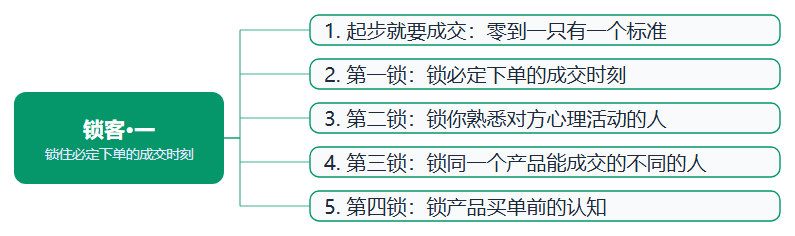

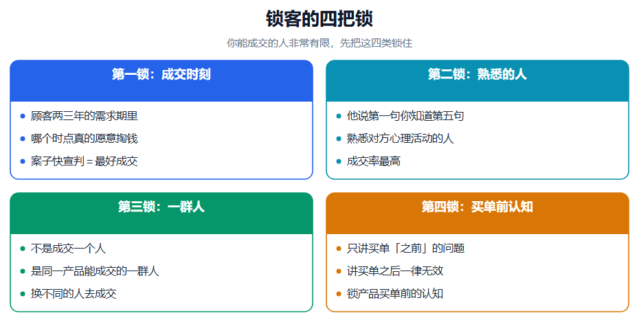

## 1\. 起步就要成交：零到一只有一个标准

### 1\. 下午进操作，第一个动作就是获客

早上把系统获客的逻辑说完了，下午开始进操作的部分。操作的第一个部分，就是获客。

今天下午的第一句话：起步就要成交。我们要一开始就确保路线是对的，不是先跑起来再说。

就像早上讲的，只有成交才能证明你是对的。今天现场有很多人，有些是零到一刚刚起步，也有一些是起步了一段时间。我们可以先讨论一个问题：如果你现在已经有了一些不错的成绩，当初做线上的时候，第一个月见到钱了吗？

现场有多少人第一个月就见到了钱？我相信不多。因为以前我们做过调研，绝大多数人做线上，百分之六十、百分之七十，基本上要花3个月、5个月甚至更久，来探索一条对自己而言正确的路。

还有一种现象更常见：有一些客户已经做了1年、2年、3年甚至更久，但在我看来效率很低。因为一直以来都没有成交一些非常非常优质的顾客，他仍然不在一条正确的道路上。

### 2\. 周洋帆：半年花100万，找"我的主题是什么"

有一个比较典型的例子，我一个好朋友，叫周洋帆。如果你做情感赛道，基本上都知道她。

当年她是一个比较知名的情感博主糖糖姐公司的CEO，主要负责后端的接流转化。她自己从事情感行业、女性情感行业很多年，也是很资深的人士。

23年年关将近的时候，她托朋友的关系找到我，付了一笔咨询费。23年是情感行业非常非常火的一年。

我们两个人聊天，我记得很清楚，她问了我一个问题："你觉得情感行业下一个时代的主题是什么？"

我说我怎么知道，我又不做情感，我根本不知道情感还有下一个时代的主题。

她说这个问题很重要。你看曲曲现在在讲的是什么金贵关系，别人又在讲什么东西。她认为每一个情感人士一定要找到自己的主题、找到自己的关键词，只有找到了主题和关键词，才能做好线上。

我没顺着她讲，我当时换了一个命题。我说你有没有想过一件事情：今天情感行业全中国可能有几千、几万个从业者，一个人的心理问题就这么点。什么样的人，遇到了什么样的问题，他还要来找你？什么样的人遇到了问题，找曲曲解决不了，找刚刚也解决不了，找其他的人解决不了，他为什么还要来找你解决？你能告诉我吗？

她说这个不重要，你告诉我下一个主题是什么。我说我没有办法告诉你。

这次聊天就这样告一段落。这个人确实有钱，花钱也比较厉害。后来她跟我讲，在我这边聊完之后，她花了30万去北京，给北京一个知名的商业博主付了一笔服务费，也叫咨询费，也没有找到答案。

然后去深圳找博商，也没有找到答案。再后面去了大理，找网络校长，找布达哥。那时候布达哥还在疗愈、还在修行，她跟着在一个茅草屋里修行了一个礼拜，每天打坐、向内求。

有一次我们两个通视频，就在那个茅草屋里，大大的一个茅草屋，打一个坐，寻找内在的自己，找自己真命所属，找生命的意义，大概就是这样的东西。

前前后后，她真正意义上挣到第一笔钱花了多久？半年。花了多少钱？100万。这里交一点，那里交一点，包括大理的住宿，乱七八糟的，整整100万。

我后来问她，你这半年都在干嘛？她说我这半年一直在寻找。她说最痛苦的事情就是，这半年里面我一直以为我在寻找方向。

很多人一张嘴就是：你告诉我我的定位是什么、我的方向是什么、属于我的方向是什么。其实从来没有想过换个问法——什么样的人在遇到这个问题的时候，是最愿意找他的？

### 3\. 关在公司3个月：说爽就行

她想明白我当初跟她讲的逻辑之后，干了一件非常非常笨的事：把自己关在公司里面，3个月不出门。基本上任何人找她，她都不出门。

这3个月她在公司干嘛？每天拍视频。把她认为所有说了会爽的事情都拍出来。

用她的话说，老子不管你爱听什么，反正我说爽就行。从睡觉到恋爱到学习，什么都讲。每一次下播，她就去记录：这次讲的东西，大家反馈是好还是不好。

3个月之后，她突然发现，所有用户愿意听她讲的东西，都有一定的规律——基本上是一些一半逻辑、一半感受的情感内容。

找到自己的人群之后，我问她：你的客户群体跟别人的客户群体到底有什么不一样？今天情感行业那么多人，为什么还有一批人需要你？

她说：我的客户群体就是那帮上过很多情感课、已经疗愈自己疗愈了好几年、感受自己感受了好几年，最后发现感受没有什么鸟用的人。他们开始想找方法了。那批人就是我的人。

我说，OK，你终于找到了你自己成交的人群。后面她就越做越大，越做越好。

在这个过程中她有没有实现过营收？有。有没有拿到过流量？也有。她直播间到过100人，到过50人，也到过300人，后来也到过1000人。

### 4\. 零到一有特点：永远没有办法证明真伪

零到一就这个样子。零到一的特点是什么？你永远没有办法证明真伪。

你说你今天做线上，你有流量，你到一了吗？如果这么算就到一了，那我当初被包养的时候就到一了。可那是我最痛苦的时候。

**⚠️ 有流量不能证明你是对的，甚至有流量可能证明你错了。**

那获客了呢？获客了就对了吗？也没有。因为这些客户未必会愿意买你的正价品。

我讲那个做肚脐的，一个月11000个客资。你说我们做成了吗？做出零到一了吗？事实上他后来改变了自己的内容策略，根本没有在做当初我们给他设计的那批内容，后面我们改了大概一个多月。虽然大量获客了，但是客资不精准，客资不是我们要的那批人。我们仍然认为，其实没有真正意义上的零到一。

零到一证明方向正确，我们认为有且只有一个标准：正价。你要卖的最高客单价的产品、最有利润的产品，它需要什么样的人群？为什么不一开始就找这样的人群？

### 5\. 为什么要锁：先策划，再拍视频

所以我们要锁定。做线上的时候、零到一的时候，我们要策划。什么是策划？我要策划，我将来到底要用短视频去锁定什么样的人群，怎么去锁定。

给大家4个方法，四锁：

第一，锁必定下单的成交时刻。

第二，锁你熟悉对方心理活动的人。

第三，锁同一个产品能成交的不同的人。

第四，锁产品买单前的认知。

这四把锁锁的不是同一件事，各管一段，判断标准也不一样。

|**锁什么**|**它要解决的问题**|**对着什么判断**|
|---|---|---|
|锁成交时刻|顾客什么时候才听得进|他开始理解产品价值|
|锁心理活动|他凭什么愿意关注你|你说中了他的纠结|
|锁不同的人|一个产品只能卖一类人|同一产品多个入口|
|锁买单前认知|上门之前怎么被引导|先铺认知再谈成交|

四把锁里，前三个属于识别，第四个最难，属于铺垫。这一段我们只做识别，选题、文案、拍摄都放到明后天。

### 6\. 编导朱越那句话：找到人群，最少变现10万

我们内部有一个编导叫朱越，是一个很优秀的小姑娘。昨天晚上我跟她两个人开会，她说了一段我无比认同的话。

她说，在我们这家公司成立的这4年里，渐渐形成了一个认知：在我们经手的所有项目里面，只要我找到了人群，只要我能说清楚我的人群是谁，只要我能找到我的买单人群，这个账号一定能变现，最少10万。

这是我们共同的认知。从这个逻辑你也可以判断出来，我们认为你有流量未必一定正确；你拍出了自己想表达的、说出了自己的故事，也未必正确。

如果说失败，百分之七十的原因是：没有找到那个人群。

当然没有找到有好几种原因。也许这个人群不存在，也许是我们的产品竞争力不够，有可能是项目的原因，可能是时间不够，都有可能。但大多数时候我们失败最主要的原因就是这一件事：没有找到一个真正意义上属于我们的人群，一个一定能成交的人群。

所以今天下午的方法，就是试图去寻找：什么样的人，我一定能成交。

📌 一句话总结：零到一唯一标准是卖出正价品，先策划锁谁，再拍视频。

## 2\. 第一锁：锁必定下单的成交时刻

### 1\. 需求一直存在，但他没意识到你的价值

第一个锁，锁必定下单的成交时刻。

这个命题的第一句话是：需求是一直存在的。但是你的客户经历了什么，他开始意识到你产品的价值了？

这句话我再重复一遍：需求是一直存在的；但是你的客户经历了什么，他开始意识到你产品的价值了。

自己需要的人很多很多，但是真正愿意购买产品的人很少。

举个例子。你需要变美吗？需要。那你为什么不花5万块钱、10万块钱做医美呢？你说没有钱，预算不足。预算这么不足，你为什么要贷款买房子呢？因为房子刚需。那房子如果不刚需，你这辈子有没有买过一枚5万、10万、1万的东西？一定买过。那个东西就一定刚需吗？也不一定。

你不能总说自己没钱。我们很多东西都需要，可是我们真正买的东西，不是所有我们需要的东西。

在这个世界上，说自己需要的人很多。每个人都需要变美、变有钱、变瘦。每个姐妹都说自己要减肥，那减肥是刚需啊，不减不行啊。为什么不减呢？你说以前减肥很困难，现在减肥有很简单的东西，替尔泊肽，有减肥针，200块钱一支，你为什么不打呢？

我们都需要。真正的需要不是一个消费者嘴上说的。消费者嘴上什么都会说，我需要。真正的需要是消费者愿意付出实际的行动、愿意付出实际的成本，那才是真的需要。

### 2\. 北京那堂课：每个人都需要线索获客，但每个人都不需要

我当初有一个经历。我去北京上一堂课，那个老师认识我，因为我在业内还比较有名。

他当时说了一件事，他说："经纬，你这个业务太好了，你的产品很多人都需要，每个老板都需要线索获客，起码这里的每个人都需要。"

我说，你这里的每一个人都不需要。为什么这么说？因为我知道他那里的人主要是做渠道相关生意的，我知道那里的每一个人都不愿意真实出镜。

每个人都不愿意出镜，他们连出镜都不愿意，所以他们其实并不是需要。他们只是想要我的产品给他带来的结果，但他并不是想买我的产品，他们也并不想去拍短视频。

很多时候，你的消费者愿意花钱买，不单单是因为他需要，而是他终于开始意识到产品的价值了，开始意识到我非选你的产品不可。

### 3\. 咖啡机：我天天说需要，真送我我就不要了

前年的时候，我的朋友送了我一个咖啡机，被我挂上了咸鱼。我朋友至今都不知道。

我平常是一个爱喝咖啡的人，因为我们两个人认识，他认为我很爱喝咖啡。我也曾经跟他一直念叨：将来买一个咖啡机，将来自己家里面搞一个咖啡机。

他送了我一个咖啡机，我完全认为我朋友是好意，我也完全不认为我朋友对我有什么别的意思。可是当我真的收到咖啡机的时候，我其实并不想要。

为什么？家里面没有那么大地方，那个咖啡机有点大，放不下，家里没有那个位置，我只能选择把它挂咸鱼。而且我也觉得咖啡机真的好麻烦，又要自己清洗，又要买奶，又要磨豆子，又要给豆子保湿，很麻烦。

一个平常天天都在说"我需要咖啡机"的人，为什么真的给我，我就不要了？因为我根本没有真正意义上理解咖啡机的价值。

### 4\. 我这十几年，只有几个晚上会刷到咖啡机

换个角度想。我喝咖啡喝到现在十几年了，这十几年相当于3000多天。

你认为我今天晚上下了班回去，会莫名其妙刷到一个咖啡机的视频吗？明天晚上呢？可是我一直是有这个需要的。我有这个需要，但我并不是每一天都会刷到咖啡机的视频。

那在我这么多年里面，什么时候我有可能在短视频里刷到咖啡机的种草和推荐？

买房子的时候。我最近买了个房子，准备装修，因为我要提前做一个咖啡机的柜台，这个时候我会开始搜咖啡机。

准备开咖啡店的时候。我作为一个咖啡爱好者，自己准备开一个咖啡店。

还有就是去朋友家，喝到一杯朋友给我做的咖啡。我觉得这个咖啡跟星巴克的不一样，我带着那个味觉，当天晚上回家就开始搜。

这三个时刻之外，平常的任何一个晚上都不会。

|**什么时刻**|**我当时在想什么**|**结果**|
|---|---|---|
|买了房子要装修|得先留一个咖啡机柜台|12个月内可能下单|
|自己准备开咖啡店|我是爱好者，要开店|会主动搜咖啡机|
|朋友家喝到好咖啡|这味道跟星巴克不一样|当晚就可能冲动下单|
|平常任何一个晚上|我有需要，但没在想|刷到也不买|

这就是在我这十几年、3000多天里面，容易刷到咖啡机的时刻。

### 5\. 咖啡风味再好，也得在你正想买的时候出现

那我们紧接着再想一件事。如果你认为一个顾客有需要他就会买咖啡机，你会做出一个什么样的视频？你会做一条叫"什么样的咖啡机适合在家里面买"。

可是你做出这样的视频，我能抓得到吗？刷不到。就算我今天莫名其妙刷到了，你觉得我会买吗？

你现在做一条视频说"为什么你们家咖啡机做出来的味道不一样"，蹦到了我的面前。此时此刻，我作为一个对咖啡机有需要的人，我刷到了，我会买吗？不会。因为我没有进入到成交时刻。

什么是成交时刻？就是我开始意识到我真的要付出改变，我真的理解你产品价值的时刻。我到了吗？我没到。

也就是说，你做出一条视频叫"为什么你的咖啡机做出来的味道非常浓郁、咖啡的风味非常好"，它得蹦在我面前，我才会买。它得在我今天早上去朋友家喝完一杯咖啡，你只有在那天晚上蹦在我面前，我才有可能冲动下单。

或者说，你只有在3年前的5月份到8月份，我正在装修、正在规划家里的路线和柜子的时候，你出现在我面前，我才有可能在12个月之内选择下单。

在这10年的时间里面，如果不是我装修的那个时间段，如果不是我去了朋友家、我对咖啡机最感兴趣的那个时间段，其他任何一个时间段，就算你的咖啡机出现在我这么一个所谓的有需求的精准人群面前，对不起，我不会买单。

所以什么叫时刻？成交时刻就是你的用户在他有需求的漫长的时间线当中，到了其中一个阶段，他开始意识到你产品的好，他开始理解他非你的产品不可。

行业都会不一样，但逻辑一样。

### 6\. 少儿教培：家长的第一选择一定不是小班课

我们这边曾经来过一位做少儿教培的，他说的答案非常经典。

他是做小班课教学的，5个人、8个人，给初三的孩子做提分辅导班。我问他，你的客户群体是谁？他说是家长。我说 no no no。

家长如果孩子成绩不好，他补课的第一选择一定是大牌。也就是说，如果他做了一条小班教学的种草视频，或者一条讲小班课有多好的视频，放在家长面前，这个家长会买单吗？不会。

家长必须得先上完大班课，找完家教，最后才会选择小班。

所以他真正要获客，他要拍的选题并不是小班课有多好，而是"为什么大班课对孩子提升没有用"。那才是那个阶段的用户愿意收的东西。

这就是成交阶段。你的顾客在那么长的时间线里面，到了什么阶段？他经历了什么样的事情，他对一件事情的认知会发生一个变化？而我们要找的，就是处在那个阶段的用户，就是进入成交时刻的用户。

### 7\. 律师和大房：都是被上一个方案逼过来的

对于律师而言，什么时候他进入成交时刻了？他发现他之前的律师没有用，他发现他朋友给他介绍的律师没有用的时候，他才会在网上找。

大房的产品定价很高，10万块。你问一个刚刚发现自己有大红脸的人，有没有需要？有需要。可是有需要不代表能理解为什么你值10万块。

只有当他找完医生，发现医生不管用了，他才会愿意花10万块找大房。

### 8\. 网球手肘：38块8的护具，和800块一小时的康复

我有个同事最近跟我一块打网球，手肘扭伤了。受伤之后第一时间上淘宝买了一个护具，38块8，把自己的手固定下来。因为他认为这只是一个扭伤，只是一个小小的扭伤而已。

然后前阵子去了医院，医生给他做了一个诊断：你这辈子不可能好。这实际上是一个非常重要、非常严重的伤，只是发生起来很容易，叫TFCC，就是这里扭伤，这个地方是没有血管的，一旦扭伤之后永远不可能好。

医生跟他说：你永远不可能好，你没有任何机会，找任何医生都一样。

听完医生的看法之后，他问了医生一句：那我做康复有用吗？

从医院出来，因为医生说已经不可能好了，于是他开始找康复师。康复师说，如果你这里的肌肉量、你小臂的肌肉量稍微更大一点，也许会好一些。康复多少钱？800块钱一小时。他买了十节课，8000。

如果他受伤的第一时间，他会花8000吗？只有当医生跟他讲你这个病很严重、这个病永远不会好、你这辈子永远不可能拎毛巾、永远不可能拎重物、永远不可能做运动、永远不可能做得了俯卧撑的时候，因为他不甘心，他才愿意花8000。

### 9\. 你的用户不是某一种职业，是某个阶段的需求集合体

所以这里说一个小概念：你的用户并不是某一个职业的人，你的用户并不是有需求的人。你的用户确切地讲，是在某一个特定阶段下的需求结合体。

是在某一个特定时段、或者某一个特定认知下的需求集合体。你不能说他是"中年男性、三十五加、手头上有1000万"，这没有意义。特定时间段的需求集合，结合这个才有用。

### 10\. 上海卖房：手上有2000万，不构成买单理由

有客户在上海卖房。我问我们客户，你需要什么样的人？他说我需要我的客户手上有2000万。因为没有2000万，你买不了房子。

可是如果我这样去找手上有2000万的人，他来看房子，他为什么一定要买我们？而且为什么现在买？可以明天买，可以后年买，可以大后天买。这没有意义。

我们换一个说法，叫特定时间段的需求结合点。

如果我的客户是手头上资金充裕，他的小儿子最近上初一，可以换学区房吗？

再说一个。我现在诚心卖房子，如果我的客户家里面有两个孩子，之前在城东，大儿子已经上高中了，小儿子刚刚开始上初中。小儿子上初中，我们要给他换一个学区房，他需要去城西的张伟小区换房子。

请问这样的人，他的买单有没有进入到买单时刻？因为他不买，小孩子上初中就上不了，最低就得换。

那我跟他介绍房子的时候，是跟他介绍这个房子朝南朝北更能打动他，还是跟他介绍这个房子更有性价比更能打动他？作为学区房，我重点要讲的是：相比于城东的学区房。

每一个行业都一样。你的顾客一直都有需求，但是他的成交阶段不一样。在什么阶段，他才开始真正意义上理解你产品的价值？什么阶段他会改变认知？

你只有找到这个，他们感兴趣的话题、他们感兴趣的东西会完全不一样。

我没找医生的时候，我感兴趣的是：我这个病到底是什么病？我找完医生之后，我感兴趣的话题叫：我是不是这辈子都没救了？

愿意刷的东西已经发生变化了。每个行业都是如此。

### 11\. 现场示范：赌博受害的家属，什么时候才会找你

我们做一个小练习。给大家三五分钟，跟同桌互相介绍一下，认识一下。你要跟同桌介绍你的产品和客群，并且说出：什么样的客群是你的产品一击即中的？就是这个客群到了什么时间段，是一击即中的。

同桌互评的时候，有一位原来做情感教育的学员说：自己养了一堆自媒体人，客资拿不到多少，视频也没多少播放量，很急。同桌给的判断是：企业自媒体获客现在已经出了好多派系，每个派系都有一些好的IP在外面，怎么触达到他们，这里有一批很大的客户。

说得出来"我需要什么样的客户"，和说得出来"他在什么时刻最需要我"，是两件事。这个练习要分清的就是这个。

先示范一个。大哥，你的客群是什么人？

**答**：我们的客群是赌博受害的家人和父母。

**问**：这个人群能成交吗？换句话说，这些人进入到了看完短视频就买单的那个成交时刻吗？他的家人可能赌博赌了十几年。比如说我的老婆赌了10年了，每天打麻将，我今天晚上会打开短视频吗？不会。

那我再问，在你过往的经历当中，你的顾客在发生什么样的事情之后，在接下来的7天或者15天，他会非常非常想找到你？

**答**：很多家庭到我们那里，就是输得走投无路的家庭。

**问**：他怎么就走投无路了？

**答**：会输很多钱，在我们那里输几百万、几千万是很多的。

**问**：一个常年赌博的人，怎么莫名其妙就输了几百万、几千万？

**答**：现在大部分赌博的是90后和00后。这些孩子一旦触碰上赌博以后，会想尽一切办法去借钱，押车、借高利贷。借高利贷前期是放贷。

**问**：那我能不能理解成，这些家属是上个礼拜突然发现自己的孩子在外面借了一笔高利贷，而且家里面根本无法偿还？

**答**：对。

那他会在当天晚上找人来解决赌博的事情。

也就是说，他们并不关心你到底善不擅长解决赌博的问题。他们关心的是：借高利贷这件事该怎么办？他后面还会不会继续借？这件事到底还有没有解？

他并不关心赌博，他关心的是高利贷。

因为他家上周刚刚发生了一件事情，彻底改变了他们全家对这件事情的判断。

### 12\. 第一次发现不会找你，第二次才会

我们再换一个方法。你的顾客当中，有没有一些人并不是刚开始发现自己家的家人、老公或者孩子赌博？曾经也有过类似的情况。

**答**：有，就是那种曾经忏悔的、然后又是好人的那种。

**问**：为什么他们第一次发现自己的老公、孩子在玩，不会找你？

**答**：第一个是觉得赌博这件事没那么严重，第二个最大的问题是面子，怕丢脸。然后他们会去查那个人的经济来源，把钱掐断。

对，你发现了。当一个人第一次发现自己家里有人赌的时候，他会认为我只要把你的钱掐断了就行。而且家丑不可外扬——我养出了一个孩子，我的孩子是个烂赌鬼。所以他们会去网上找吗？不会。

你做什么样的视频，他都不会刷到你的。

那他什么时候才会开始找你？第二次。就是我把你的钱掐断了，我发现你在外面借钱、在借高利贷，你宁愿借高利贷都要赌。我开始意识到，这件事是你人生当中非常非常需要解决的问题了。于是我才愿意在网上找专业的人士来解决。

|**阶段**|**家属当时怎么想**|**会不会上网找你**|
|---|---|---|
|第一次发现|没那么严重，掐断钱就行|不会，怕丢脸|
|第二次发现|掐了钱还去借高利贷|当天晚上就找|

那如果一个已经是第二次发现的人，老公的钱已经掐断了，老公在外面欠高利贷，他在网上刷视频，他会刷早上那位大哥说的那个话题吗？他会刷什么？

他一定会刷一条视频，这个视频的名字叫："为什么一个平常很正常的人，借高利贷也要去赌？"

他会不会刷"到底是什么心理，让他借高利贷去赌"？会。

他会不会刷"这些借高利贷的赌徒，最终的归宿会怎么样"？也会。

他会不会刷"要不要帮这个人还高利贷"？因为如果偿还了，他下次还继续借怎么办？到底该怎么办？他是不是也会关心这件事？

第二次，已经第二次帮他还高利贷了，后面该怎么办？如果后面还有，我是还还是不还？离婚还是不离婚？

一步一步加大。一定会抓到。

### 13\. 道理再正确，顾客没到那个阶段也不听

这就是一个小命题。

**⚠️ 如果你识别不了一个人的成交阶段，你就只能像大哥一样，早上去讲一些道理上非常正确、但是用户根本懒得听的东西。**

什么叫病理性赌博？正不正确？正确。能不能解决问题？也能解决。那为什么顾客不听？因为你的顾客没有到愿意听的那个阶段。

你根本就不知道一个顾客到了这个阶段想听什么。

卖咖啡机，如果我讲咖啡机，我一定卖不掉。你只有识别了真正的客户成交阶段，你才能做出内容，然后去设价。

他如果最近正在遭遇这样的事情，他当天晚上在床上躺着，十点多钟刷短视频，他会刷到什么？而你要做的，就是做出那条视频，然后出现在他面前，他就会找你买单。

当一个人进入成交时刻，他那天晚上刷到你的视频，他就找你买单。而如果你的视频没有出现在他面前，就没有意义。

### 14\. 现场示范：孩子学画画，什么时候才轮到专业老师

**答**：我们做的是小升初，还有初升高，然后让孩子能够考上央美附中。

**问**：那所有学画画的小孩子都会去找你吗？

**答**：不是。是那种小学生，他发现小朋友在学画画，但是他身边没有专业老师教，身边没有能够专门去带一支的。

**问**：也就是他们家已经做完了一个决定——我们家小杨将来要考央美附中，但是发现身边的老师都是教画画的，没有人教我怎么考试。他才会开始意识到要找你，对吗？

**答**：对。

所以你已经做过介绍了，也还不错。你现在能理解，其实只有这样的人，你才能比较好成交。

**答**：就已经掉到百分之十以内了。

这就是细节问题了，我得看你的账号才行，这个我没办法在这里做点评。

### 15\. 现场示范：7家婚宴连锁，什么房东才会找你

**答**：我是宴席婚礼连锁品牌的创始人。

**问**：你做多少家婚礼的宴会中心？

**答**：现在7家。

**问**：你是放加盟，还是自己找客？

**答**：赋能，别人来加盟我的品牌，我的品牌给他带来一些流量。

**问**：一般来说，你的加盟商应该是一些老的宴会中心的老板？

**答**：对，没创过业的人，没有干过。因为干酒店、干客房。

那我问你一个问题：一个房东，他一直都有一些把自己的房子更高效率利用的需求，他在什么时候才会考虑你？

**答**：持续租不出去。

这是一种情况。还有吗？

你刚才说了一个非常非常关键的信息：他并不是租不出去，而是他已经把客房租掉了，他发现他的商品房并没有租掉。我到底是整块租给你、用你的品牌，还是租给餐饮？

更具体一点：我的一楼和二楼，本来是想租给商户的，我发现我租了3个月、租了4个月，租不满，还空了很多，而且租起来非常费劲。可能是沟通、合同，包括物业、消防，很多问题很麻烦。于是我这个时候考虑，我能不能省心地把它租掉？

甚至还可以再细一层：我的房子之前12年都租给了某一个餐饮连锁品牌，最近合同到期了，我现在已经不准备再跟餐饮人打交道了，我准备跟别人打交道，这个时候我才会开始跟你合作。

**答**：是，我完全能理解。而且办宴会可能更干净、更卫生一点，也更简单一点。

所以你知道，这样的人如果在这个时刻，他愿意刷的视频并不是你有多好，而是想听你一起吐槽：餐饮有多不好。

他这个时候更想听你吐槽的是餐饮有多不好。

### 16\. 现场示范：同城刑事律师，锁定的是公安阶段

**答**：我们做刑事，以女性家属为主。就是家属刚刚被抓进去的时候。

**问**：一定要是刚刚抓进去的时候？

**答**：目前来找我们的，这类数量是最多的。更多是公安阶段的。同城。

他说了一个非常非常关键的信息。你们不做律师，不了解。我一听就知道他应该是做同城。

因为只有在同城的时候，我才会在第一时间找一个本地的律师。如果是做全国的，像杨璇他们做全国，就不会找公安阶段的人，一定要到检察院——当家属发现自己同城的律师帮不了他的时候，他才会在全国找。

所以这跟你的定位有关系。你做同城，公安阶段是合理的。

### 17\. 收束：锁客是策划，不是拍视频

通过刚才3个判断，我发现大家基本都能理解了。最起码你理解了一个部分，叫：你的客户是谁。

至于怎么做选题，这不在我们今天下午的主题。早上讲了，今天在讲锁客。锁客是策划的部分，就是我将来到底要锚定什么样的人来买单。

至于怎么做选题、怎么写文案、怎么拍摄，那是明后天的内容。我们一个板块一个板块来，各位不要着急。你不能把所有的问题放在一块解决，一块解决的话你就崩了。

这就是第一个锁：锁定必定下单的成交时刻。你的客户在什么时刻开始理解你产品的价值？

这个时候其实我已经给大家做了一点点延伸：当你能够锁定客户的成交时刻，你已经能够发现一件事情——这个顾客感兴趣的话题不一样了。

刚才每一个人我都做了一个小小的示范。你只有锁定成交时刻，你才能做出真正意义上当天晚上他能刷到的视频。而你只有在那天晚上出现在他面前，他才有可能在接下来的5天、7天、8天就立刻给你付费。

### 18\. 获客短视频的简单逻辑：出现在他最想买单的那个晚上

所以很多时候你说获客短视频怎么做？获客短视频有一个非常简单的逻辑：让你的视频出现在用户最强买单的那天晚上。

不是出现在用户面前，不是出现在有需要的人面前，而是出现在他最想买的那个时间段的晚上。

这样他才会买单，这样你的视频才会获客。否则你就得等。

手上有1000万的人，他得什么时候突然间想明白了，我最近想买一个房子了？我最近手上有50万，我突然想明白了，我想买个车了？1年、2年都有可能。

如果你有很大的流量，那没关系。如果我一条视频可以让1000万人看到，没关系，我等你们再来买车子的时候找我。那如果我流量不大呢？

我只能去找一些更能够成交的时刻，这才是效率更高、成功率更高的方式。

📌 一句话总结：锁被上一个方案逼到绝境的人，视频出现在他最想买的那个晚上。

## 3\. 第二锁：锁你熟悉对方心理活动的人

### 1\. 不懂他，他就懒得关注你

锁完必定买单的时刻，我们还要去锁一个东西：锁你熟悉对方心理活动的人。

逻辑是这样：如果你不懂他，他就懒得关注你。

用户都是在短视频里面寻找自己的集体性共鸣。一个用户为什么愿意将来给你买单？因为他认为你是最懂他的人，他认为你所解决的问题跟他是最对口的，他才会找你。

今天的用户都一定会找细分问题的解决方案，而不会去找很综合问题的解决方案。这是一定的。今天这个时代只会越来越细分。

当短视频无限发展、越来越成熟之后，消费者一定会有能力和有意愿，在短视频里面去寻找一个对他而言最适合的问题解决方案的提供商，也就是提供一个细分问题解决方案的人。这是一个必然的事情。

所以，你如果不懂他，你其实没有办法去俘获他的心。

### 2\. 从大锅饭到算法：每个人都被包进自己的偏好里

人是这个样子。在过去那个贫瘠的时代，80年代，中国人穿衣服都是同款的，每个人没有自己的个性化需求，每个人都是吃大锅饭，男女老少穿的衣服都一样。

但这个时代不一样了，尤其是最近这个时代。算法出来之后，算法干了一件特别特别操蛋的事情：算法把每个人都包裹进了自己的偏好里面。

所以今日头条做了一个slogan，叫你关心的才是头条。

你在短视频里面寻找的并不是真相，而是你喜欢看的信息而已。

你们知道昨天晚上美国发生了一个暴乱，死了5000人吗？不知道。你们不关心这件事。当然本来也是假的，我编的。

这个世界上每天发生很多很多的事情。有些事情是大事，有些事情是小事。对别人而言是大事，对你而言是小事。

所以我们在算法里面干嘛？每个用户都在寻找对自己而言最愉悦的、最个性化的、最定制化的内容，或者叫问题解决方案。

甚至比如说美女。我们过去认为每个人都爱看美女，其实不是的。在算法时代下不一样，因为这4种人都叫美女，每个人喜欢的美女不一样。你说第一个叫美女，还是第二个叫美女？是第三个叫美女，还是第四个叫美女？你喜欢的和别人喜欢的不一样，很少有男的四个人都喜欢。

你可以理解成，现在每一个用户在刷短视频的时候，都被关在蜜蜂窝的那个小窝巢里面。他其实根本就不了解世界，他只是在寻找一个对自己而言舒服的人。

所以就出现一个情况：如果你不了解他，你不熟悉他的心理活动，不熟悉他的所思所想，你做出来的短视频会让他觉得跟他无关。

### 3\. 两个幼儿园园长，谁做得更好

比如说这两个人都是幼儿园园长，你觉得谁做的视频会做得比较好一点？

左边这位的做法，叫"一镜到底走起来"。拍视频前先规划好路线，老师站哪，镜头怎么走，让观众好奇下一个画面到底是什么。再配上一点热门的背景音乐，画面直接拉满。只要园区环境不是太差，评论区肯定有"这个幼儿园在哪"。

也许是对的。那为什么你不愿意看呢？

右边这位园长，讲的是我到底在幼儿园经营当中，具体遇到什么样的困难。

|**两位园长**|**视频在拍什么**|**用户看完的反应**|
|---|---|---|
|左边这位|一镜到底走园区、配热门音乐|只记住环境好看|
|右边这位|讲经营里具体的难处|觉得在说我，愿意信|

如果你今天做短视频，只会在讲一些正确的道理，那这些道理现在APP里有、Cloud有、AI里面都有，我没必要听你讲。

如果你是靠道理来打动用户，那AI越强，你就会越弱。

到最后，用户为什么愿意买？因为他认为你能够理解他的痛苦，你能够理解他到底在纠结什么，你能够知道他到底在好奇什么、担心什么，他才会愿意关注你。

否则我为什么要关注你？没有理由关注你。我之所以愿意关注你，不就是因为你每条视频都好像在说我吗？

你现在想想看，在你关注列表里面，视频号、抖音关注的那些人，除了那些明星艺人，你为什么关注他？你为什么关注这个康复师？你为什么关注这个医生？你为什么关注那个人？

你如果不了解一批人，那批人你也没办法去成交。比如说我也成交不了电商老板，因为我不了解电商。

### 4\. 正确的道理，和理解他在想什么，是两件事

正确的道理和理解用户到底在想什么，这是完全不一样的。

大平台上没有教学，没有资深顾问，没有专业的团队——这话对不对？对。这是正确的道理。

但真正有效的不是知道什么是正确的道理，而是知道：如果这个正确的道理对着你讲，你会怎么想。然后针对你冒出来的那个想法，继续跟你往后沟通。

各位能看得出来对不对？

由此而言，你也可以理解一件事情：如果你今天所设定的人群，你跟他说了一段话，你都想象不到他会怎么想、他会发生什么样的反应，那你做出来的也都会是一堆空洞的道理，没有人愿意关注你。

### 5\. 这一关最难：老板已经离一线太远

这第二个部分在锁什么？锁你极度熟悉他心理活动的人。

你不熟悉他、你不熟悉他的心理活动，这个人群也许很好，但你没有能力去服务他。

事实上这一关相当之难，因为很多老板已经离一线业务很远了，很多老板已经离消费者特别特别远。这是很难的一件事。

很多人在找懂自己的人买单，所以你要锁的，就是要你本身就足够懂的人。

📌 一句话总结：只锁你真正懂他纠结的人，靠正确道理打动人的会被AI替代。

## 4\. 第三锁：锁同一个产品能成交的不同的人

### 1\. 一个产品不是只能成交一类人

第三个部分，我们要锁同一个产品能成交的不同的人。

前面说了，你的产品会锁定一批人的成交时刻。但比如说，我们拿这个大哥来说，你说他的用户只有一种人吗？也不是一种，是好几种。

一个产品不是只能成交一类人，本质上来说，这个产品能成交好几种人。所以在你的账号里面，其实可以面向不同的人来做内容。

同一个产品可以卖给不同的人，同一个人也有不同的维度。

### 2\. 4款产品能不能放在一个账号里

今天早上有一个人问了我一个问题：我公司里面有4款产品，我能不能在一个账号里面一起做？各位觉得可不可以？

有的人觉得可以，有的人觉得不可以。觉得不可以的原因是什么？因为你会认为标签会乱。我做4个产品，那标签不就乱了吗？

可是你知道吗？你本来就挺乱的。

这个账号就像是一个瓶子，是一个空壳，什么都没有。你发布了一条视频，这个账号就面向了一群人。你第二条视频呢？

你第一条视频面向的人群是张三、李四、王二麻子，难道你第二条视频看视频的人还是张三李四王二麻子吗？所以你第二条视频就换了一批人。第三条视频呢？也换了一批人。

你做账号的每一条视频，只要在更新的时候，它就已经在变得很乱了，一直都挺乱的。那再乱一点，有什么好担心的？

### 3\. 雷军：卖车、卖手机、卖书、卖月饼、卖西瓜

甚至你要说乱，谁不乱？雷军又要卖车，又要卖手机，又要亲民，又要技术硬核，又要卖家居，又要卖车载纸巾盒。太多了。

这条视频今天见到刘振云老师，看视频的人是什么人？刘振云的粉丝。

第二条视频，实地操作，精准稳定，什么人？对车感兴趣的人。

然后呢，在武汉跟英系的车主喝下午茶，什么人在看？武汉人。这表明武汉过早非常丰盛，什么人？普通老百姓。

这条视频在盐城实验场考个新驾照，什么人？有可能是盐城的人。

这条视频，央行出席参观小米定制服务中心，看视频的什么人？雷军的粉丝。

太乱了。这条视频卖书，这条视频卖车，这条视频我也不知道在卖什么。接下来你卖车厘子。中秋节的时候雷军卖月饼，夏天的时候雷军卖西瓜，这两天雷军还要卖手机、卖折叠屏手机。

那你说雷军到底卖什么？乱到了什么样的程度？他每条视频都在面向不同的人。

乱到这样的程度，可不可以？可以，有什么不可以的？账号本来就是个空名字，它并不会影响什么，它本来就是一个段子。

所以各位理解一件事情：大胆更新。只要你不光屁股，你更新什么都可以。为什么光屁股不行？因为光屁股会违规。

它本身是不存在乱的，因为你本来就挺乱，你每条视频本来就在面向不一样的人。而我们要利用的，恰恰就是让你的视频呈现在不同的人的面前。

### 4\. 男士增高鞋：营收翻倍靠扩大人群

我今天现场有一位老同学，是我的老学员，他是卖男士增高鞋的。他今天早上跟我分享了一个案例，我觉得非常典型。

他一开始卖男士增高鞋，10厘米的男士增高鞋，卖给谁呢？卖给男模，韩国夜场的一些男模。日本叫牛郎，中国叫男模，上海叫鸭，都一样。

我问你一件事情：如果他的营收要翻倍，有什么办法？一个简单的办法：扩大人群。

怎么扩大人群？我可不可以再出一些视频，去面向小个子男生？或者面向一些男性模特，那种正规模特，是不是也可以？

所以你知道一件事情：我们做生意的人都知道，很多时候你业务的增长并不是来源于流量的增长，而是来源于人群的扩大，来源于有效人群的扩大。

我们恰恰可以利用"乱"这个特点来进行人群的扩充。

### 5\. 我那12条视频，每条锁一批人

这是我其中一个账号的一页封面，我做了十二条视频。我们来看看这些短视频都在讲什么。

"短视频进阶2\.0，什么样内容能获客"——看视频的人是新手还是老手？老手。也就是那些已经做成账号、有营收的人，我是为了打动他们出的。

"自媒体真的害人不浅"——老手会愿意看这个东西吗？这是给小白看的。

还有一条是我们一个卖化肥的客户，这是给三农IP看的。

"做短视频的第一步"——这是给小白看的。

"流量的成功不等于商业的成功"——说明这些人是不是已经流量成功了？给有流量的人看。

"教培还是好做"——是给教培人看的。

"我去医院了"——这是给老粉看的。老粉已经不想再找我学任何东西了，老粉就爱看这些胡七八糟的东西。

"从百万到千万必须完成的跨越"——给那些已经年营收百万的人看，给百万营收的IP看。

"豁不出去，你就别吃这碗饭"——一个人还在意自己要不要豁出去，看视频的人是什么人？脸皮薄的小白。

还有逗老虎玩的，搞一些花里胡哨的东西，就是逗粉丝玩。

我跟刘思义分享了一段内容——这条是刘思义的粉丝看。

"吸引不到想要的人，答案在这儿"——这是给客资不精准的人看的。

所以你可以说，今晚的客户是谁？今晚的客户是想获客的人。但是我的客户其实又有好多种：有小白，有教别人的人，有三农人，有短视频老手，有100万级的IP，有带自己粉丝来的，我也有一些1000万级的IP的客户，我都有。

我的每条视频就在面对不一样的人。

为什么业务会增长？因为我找到了更多的人群。这些人本来就是我产品一定会买单的人。

所以很多时候，短视频不是要去做出更大的流量，我们也不是要去锁更大的流量。我们要锁的是更多的人，是说给不同的人听。

增长来源于你找到更多的精准人群。

### 6\. 每条视频就是一个新的销售渠道

你可以这么理解：每一条短视频发出去之后，有几千几万的播放量。所以每一条短视频发布出去，就是建立了一个新的销售渠道。

只是这个销售渠道是面对教培人在销售，那个销售渠道是面对三农人在销售，那个销售渠道是面对小白在销售，这个销售渠道是面对谁在销售。

每一条视频就是一个新的销售渠道。

甚至看似是不同的人，但其实又是同一个人的不同维度。可以说是不同的人，但又是同一批人。

你说短视频老手、有流量的人、百万IP，他是不是就是刘思义的粉丝？这4个人可不可以是同一个人？也可以是同一个人，只是我用不同的切入方式来唤醒他而已。

### 7\. 杨璇：一个刑事律师的四条视频

我们有个客户叫杨璇，是一个刑事律师。他以接C端客户的案子为盈利方式，主要接当事人家属的案子。

我们来看他的客户群体是谁。

第一条：案子进了检察院半个月。这是不是一类客户群体？各位可能听不懂，我解释一下，案子进了检察院的意思是，过几个月判刑了。

我们认为，一个顾客的案子快宣判了，是他最容易成交的时刻。我是不是在找成交时刻？

第二条：珠三角任务结束，前往长三角继续加油。我在找谁？我在说珠三角和长三角的人。为什么要选珠三角和长三角的人？经济发达地区犯的罪比较大，比较有钱。

我不能说"东北铁岭出差结束，接下来去西藏徒步"，没有这种说法。或者说"我接下来出差河南省新乡县什么镇"，没有这种出差的方法。经济不发达地区，你犯什么罪？偷了邻居家一只牛。

第三条：掩饰隐瞒犯罪所得罪到底怎么回事？看视频的人是什么人？犯这类罪的人。

第四条：我又从苏州看守所出来。为什么我要讲这句话？关在苏州看守所的人，犯的罪都不简单。或者说，我又从河北省张阳县出来，那个地方的看守所里面都没几个人。

|**这条视频在说什么**|**锁的是谁**|**为什么锁这类人**|
|---|---|---|
|案子进了检察院半个月|当事人家属|快宣判，最容易成交|
|珠三角结束前往长三角|两个三角洲的人|经济发达，罪大有钱|
|掩饰隐瞒犯罪所得罪|犯这类罪的人|罪名对口才听得进|
|我又从苏州看守所出来|苏州本地的家属|关那里的罪都不简单|

这四条视频，请问乱不乱？其实挺乱的。这条视频家属在检察院，这条视频长三角珠三角，这条视频是这个罪，那条视频苏州看守所。每条视频都很乱。

换个角度来说，每条视频都在找成交人群，都在锁定成交人群。

### 8\. 锁地区、锁罪名，才有高客单

甚至我们会更乱。

我们用短视频来锁地区。各位看，我刚从深圳出来，我在锁什么地方的人？深圳人。我又要出发去浙江了，浙江人。因为我们在珠三角这边，然后去广西那边，往西。我在锁这4个地域的人，因为这4个地域的人办的案子比较大，价格比较高。

第二是锁罪名，锁高频的、高客单的罪名。新型诈骗案件有多严重？这是什么罪名？诈骗。侵犯著作权罪，线下开设赌场，掩饰、隐瞒犯罪所得罪。犯这些罪的人都有，所以我们有团队找这样的人。

那我为什么说，如果我拍一条视频叫"倒卖香烟"，倒卖香烟罪，能成交吗？一个人都去倒卖香烟了，他们有多少钱找律师？他能有多少钱找律师呢？

我不是说他不会，是很难。

### 9\. 杨璇的数据：单月5000客资，单月营收600万

所以我们在做杨璇的时候，本质上并不是因为我们流量做得很大，而是因为我们找到了更多的成交人群，锁定了更多的成交人群。

杨璇的账号，在自然流的情况下可以做到单月5000加客资。这5000个客资怎么分配的？抖音2500个，视频号1500个，小红书1000个，3个平台加起来5000个。没有矩阵，没有投流，没有直播，单一账号。

营收我们做到了，大概在10万粉到12万粉的时候，单月的营收大概在600万左右。

今天晚上会让我的合伙人分享，杨璇这个案例在锁客的过程当中，我们当初是怎么锁的，怎么锁到更多的客户，怎么判断这个客户值得我锁。这个部分今晚讲。

📌 一句话总结：一个产品能卖给多类人，增长来自扩大人群而非扩大流量。

## 5\. 第四锁：锁产品买单前的认知

### 1\. 买单前是引导，买单后是解决

讲完了三个，接下来讲第四个。第四个也是我们最难锁的部分：锁产品买单前的认知。

前面那些，说实话我觉得各位现在已经能理解了：成交阶段、成交时刻、你熟悉心理活动的人、同一个人的不同维度，这些我相信各位都能理解。

大多数时候，大家真正要锁的是产品买单前的认知。

什么叫买单前的认知？一句话：买单前是引导和上门，买单后是带领客户解决问题。

这个部分有的同学听了三遍，也没听懂我在说什么。讲三遍都没听懂。

先歇一会儿，换换脑子、透透气，待会我们来学今天最难的部分。

📌 一句话总结：买单前是引导和上门，买单后才是解决问题，先铺认知再谈成交。

# 四、第1天下午（下）｜锁客：你能成交的人非常有限

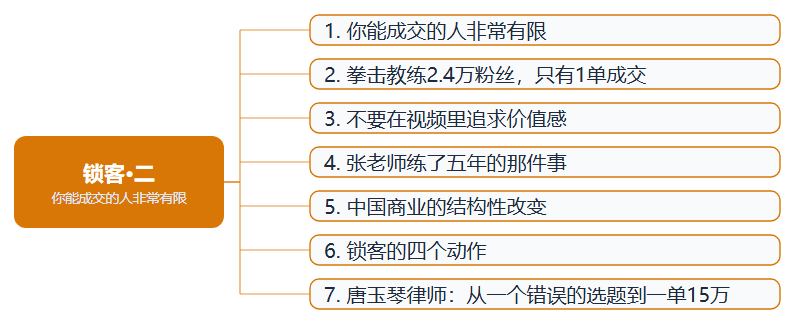

## 1\. 你能成交的人非常有限

### 1\. 先别急着问"我要不要换人群"

下午花了两个多小时，其实只确认了一件事：到底该对谁说。课前总有人来问，我要不要换人群，我要不要换人群。

我的答案是——你能够成交的人是非常有限的。

有些人是优质人群，但是你成交不了，各位认同吗？还有些人，你现在成交的并不是优质人群，或者说他还没有到成交阶段，这个各位也认同吧？

所以真正能成交的人是谁？画三张图就清楚了。

### 2\. 第一张图：用户的心智变化

一个人一直有需求。

但他在什么时候才算是优质顾客？进入到你产品的成交阶段，那个时间段，他才算优质。

也就是说，我们找的并不是某一个职业的人，而是在这个时间段里的那个人。

这个"时间段"有多长？大概两到三年。一个人从"我有这个需求"到"我必须解决"，中间会晃很久。刚有需求的时候，他只是刷一刷、看一看；到了某个节点，比如家人的案子进了检察院，比如房子已经交了定金，比如体检报告出来了，他才真正进入成交时刻。

同样是这个人，早半年你跟他讲方案，他只会收藏；晚半年你跟他讲方案，他已经找别人了。人没变，时间变了。

### 3\. 第二张图：两个圈的交集

第一个圈是用户，第二个圈是你了解的那批人。

左边是用户，右边是你了解的人。什么样的人不是你的用户群体？一批用户他没有进入到成交阶段，他是你的顾客群体吗？不是。还有，这批客户已经进入了成交阶段，但是你又不熟悉他，他也不算。

我们真正能成交的，是你自己足够熟悉、并且已经进入成交阶段的人。这就是你最好的成交路径。

所以你不能单一地去看。你说这个职业很好——可这个职业你又不了解，你怎么评价它呢？光说"这个主题我很熟悉"没有用，得找到他的成交阶段，两个圈的交集，才是你能最好服务的客户群体。

### 4\. 一个最简单的判断标准

那你怎么问自己：我到底最熟悉谁？

最简单的判断标准是——什么样的人出现在你面前，他说第一句话，你就能知道他第五句话。那就是你熟悉的群体。

### 5\. 第三张图：他买单前遇到的那个问题

第二张图结束之后，我们是不是已经找到了一类人？就是一个客户群体。那接着要问：我们到底在帮他解决什么问题？

再回到第一张图。这个用户在这个时间段进入了成交时刻，产生了购买行为、找你买单的行为。我们到底在帮他解决什么问题？

我先做个小示范。上次不是做钢牙吗，现在做正畸。我问你，你觉得我为什么要去做正畸？为了解决什么问题？

不是为了解决"不好看"——拍摄不好看、咬合不好，类似的问题。

也就是说，我为什么会购买产品？是因为我有一个问题要解决，所以我需要通过购买产品来解决它。这是我的问题一。

好，那我买了正畸之后，正畸医生跟我讲，我的手术应该怎么做、我的方案应该怎么做。请问这个正畸方案在解决什么问题？是不是在解决如何让这个牙变得更好看的问题？这个时候出现了问题二。

问题一，在解决我的人生命题。

所以在我买单的前后，是不是有两个问题？我在生活当中遇到了一个问题，需要买单来解决；我买单之后，服务商给我解决了我买单当时的那个问题。

带着这两个问题来理解。买单前遇到了一个问题，需要买你的产品来解决。

### 6\. 保险：手上有200万，该往哪儿放

举个例子，万一我们是做保险的。我为什么找你？我找你是为了解决什么？

是为了解决我的财富规划。我现在手上有200万，我不想买黄金，我觉得前面是高点；我也不想买房子，我觉得房子也不行；我也不是一个风险偏好者，所以我决定买保险。所以我需要你帮我分析的，是我的资产分配。

这是我遇到的第一个问题。我需要通过买一个产品，来解决我生活当中正在遭遇的问题。

而他作为专业人士，当我给他付了一笔钱——比如说我开始找他咨询了，我给他付了一笔1000块钱咨询费——他作为一个非常非常专业的保险顾问、理财规划师，他开始跟我讲：那我确定要买保险了，我应该怎么买更合理？

那我问大家一件事：解决问题一，最终的结果是买单还是解决问题？最终的结果是买单，对不对？

比如我朋友帮我解决了财富规划的问题，最终他说：经纬，你现在不适合买黄金，你现在不适合买股票，你现在不适合买房子，所以你应该买保险。而后面的专业部分，在解决我的买单是否足够科学、足够合理。

而这一段如果做好了，带来的结果是利益最大化，是效果。

也就是说，这个世界上有两段内容，有两段干货。第一段干货在解决消费者买单之前的问题；还有一段干货，在解决消费者从不会到会、从不熟悉到熟悉、从不擅长到擅长、从解决方案不科学到科学的问题。

### 7\. 星巴克两点半：上门前后的分界线

我们现场做个小实验。如果我现在是一个医美顾问、美容院的顾问，我告诉你怎么样护肤、怎么样操作，请问这是问题一还是问题二？问题二。问题二解决完了带来的结果是效果更好，顾客会买单吗？不会买单。

再举个例子。一个牙科医生发视频说，这个牙如果是我们来做，我们会怎么做、我们会注意哪些事项，这是在解决问题一还是问题二？问题二。

我们过去讲了一堆干货，这个问题怎么解决、那个问题怎么解决，你们在解决一号问题还是二号问题？你们解决的是，当一个顾客已经花完钱之后，他希望买到一个科学解决方案时，所需要的内容——从不会到会，从不熟悉到熟悉，从不擅长到擅长。

它带来的结果是：谢谢你，产生了很好的口碑。

而短视频获客的原理是什么？有位老师问我，获客的本质是什么。我说获客的本质很简单，顾客愿意上门找你就可以了。那获客的本质在哪一段？左边这一段。

我今天手上，举个例子，我现在手上有300万。我不想买黄金，我也不想买股票，我不想买车，但我觉得这些钱不保值。我的朋友是港大毕业的，非常优秀。我愿意听他跟我讲买寿险吗？我愿意听他跟我讲哪个保险机构更好吗？

在买单之前，我愿意听什么？我愿意听"现在手上有300万，应该怎么花"。我只愿意听你分析我这个问题。分析我买单之前正在遭遇的那个问题——是什么问题给我带来了困扰，我需要通过找你买单来解决。

保险是解决我财富规划问题的解决方案。你需要跟我聊的，是我正在遭遇的一号问题。

当然，听完他的内容之后，我觉得非常靠谱，我觉得我现在确实需要买一个保险。但保险又有国内保险，又有海外保险，又有中国人寿的保险，又有中国平安的保险，每一个保险又不一样，我到底应该怎么样去买？将来售后会不会有问题？

所以这个时候，我给我的朋友说，今天下午两点钟，我约他在星巴克喝咖啡。我跟他聊了半个小时。这半个小时里面，他让我确定我应该买保险。

从两点半开始，我开始关心什么问题了？开始关心买什么了。可是这个时候，我已经上门了。

而短视频获客，是让顾客从家里出发去星巴克，才对吧？

短视频的目的是干嘛？是经纬遇到了一个财富规划的问题，看了这个人的短视频，于是决定给他发一个私信：兄弟，明天下午有空吗。

短视频的作用始终出现在这一段，它不是出现在右边这一段。所以你们分析的问题错了。

不是你不专业，不是你没有干货，不是你没有能力，而是你所有的能力都在这一段。你的能力、你的干货，对那些已经确定要买单、开始真正关注产品交付问题的人有用。可是你的内容、你的干货，对那些还没有觉得自己有问题的人，逻辑上能听懂吗？

### 8\. 这一关卡死了百分之九十做线上的人

我们真正要分析的是什么？这一关起码卡死了百分之九十做线上的人。

不相信？来看。我这三年听过最多的一段话就是：我太专业了，我们交付很厉害，我们后端很厉害，我的产品很厉害，我的售后很厉害。

这些话对消费者来说是没有意义的。因为消费者还没准备上门呢。

我什么时候开始关心他的后端？当我出现在星巴克的时候，我才会关心。什么时候在意他的交付？当我出现在星巴克的时候，我才会在意。

所以你的那些东西没有用，用在了错误的时间。这是一个巨大的流量泥潭——你们去搞流量去了，你们根本没有搞清楚该对谁说。

现场做一个小小的调研：我们现场有没有一些人，曾经是多年讲线下课的，或者常年做交付、交付非常厉害的，然后从自己公司里面以"交付非常厉害"的身份出来创业，然后发现自己短视频没办法获客、没办法推广、没办法有流量的？有。

你认为你的内容很专业，但事实上你的内容永远在解决一个顾客买单之后的问题。一个人买了单，他才会想要去了解承担之后的风险。在他没买之前，他会在意这些事儿吗？

你常年做交付并不是优势，你很专业也并不是优势。

我举个例子。你做了10年交付，客户满意度很高，你手上有一整套SOP：第一步做什么、第二步做什么、出了问题怎么补救。这些东西值钱吗？值钱。但它值钱的地方，是在客户已经付了钱、坐在你对面的时候。

客户还没付钱的时候，你跟他讲第二步怎么补救，他心里想的是：我还没出事呢，你跟我讲出事怎么办？

这就是时间错位。你的能力没有贬值，是你的能力上错了货架。

所以我常说一句话：获客能力，是让一个原本觉得这件事不重要的人，觉得这件事重要。交付能力，是让一个已经觉得重要的人，把事情做对。这是两种完全不同的手艺，练一种不会自动长出另一种。

### 9\. 黄执中：一个很会说话的人，线上一个月不到5万

黄老师今年50岁。他有一个产品非常好，15000块钱，叫说服课。

黄老师常年讲线下。你说黄老师是不是一个很会讲话的人？《奇葩说》的辩手，他对于表达、沟通、关系一定是非常非常擅长的。我觉得没有人会说黄执中这个人不太会说话，这不可能。

我问过他们团队：黄老师的账号，一个月在线上通过后台客资变现的金额有多少？他们团队说，不超过5万块钱。

因为获客是不行的。

为什么呢？因为黄老师的内容是这样的——你听：

"其实存在很大误解。似乎只要一提到我要去说服对方，就意味着你要去压制、去劝诫，甚至去诡辩。好像说服的前提必然是一方觉得正确，而另一方觉得错误。可事实上完全不是，这是一个消除两人对立的过程。"

这段话在解决买单前关心的问题，还是买单后关心的问题？

这是交付的内容。这个内容没有办法让顾客上门。你们看完之后，有一种想学说服的冲动吗？没有。这个内容是干嘛的？是让你从"已经想说服"的状态，更了解什么是真正的说服。

所以它是交付的内容，是二号内容，解决二号问题的。这都是已经想解决问题的人关心的。

你注意这里面的落差：一个15000块的课，一个在表达领域全国都排得上号的人，团队也不算弱，一个月线上客资变现不超过5万。而后面我要讲的唐玉琴律师，一条没人点赞的视频，一单就是15万。

差别不在名气，不在口才，不在预算，在于你讲的那段话，是站在顾客掏钱之前，还是站在他掏钱之后。

### 10\. 手术医生和那句"你放网上一定火"

再来。我们有一些人自认为自己比较会说话，所以会把自己跟顾客聊天的过程、在线下讲课的过程，拿出来放在互联网上。

我见过一个手术医生。一个神经外科手术医生，如果每条视频都在告诉你，他做手术的时候这个神经黏膜是怎么剔除的、剔除得有多干净——你现在发的视频，就跟那个手术医生展示手艺一样。

你们在解决买单之后的问题。

所以有一次，一个人的朋友跟他说：你在公司里面给我内训讲的那段，非常精彩，你放在互联网上，一定火。

我冷笑一声。我心里想，只会成为一个牺牲品。不是你的观点好就有用。

甚至给各位一个警钟：如果你在生活当中说了一段话，你的老学员、老顾客、老朋友、老同事说好，那他一定不好。

为什么？因为你的老学员已经确定自己要解决这个问题了。他说好，是什么意思？是你刚刚说的那一段，特别能解决我买单之后的问题。

你的老顾客说"质量特别好"，什么意思？你刚刚说的那个方法论，特别能解决我买单之后的问题。

老同事说"那条特别好"，什么意思？你刚讲的那段内容，是我们这个行业里面特别能解决客户买单之后问题的方法。

所以老同学、老同事、老顾客、老学员，他们说好，一定是不好的意思，一定是获客属性上不好的意思。

### 11\. 两段内容的差别，一张表看清

把买单前和买单后放在一起，差别一目了然。

|**维度**|**问题一：买单之前**|**问题二：买单之后**|
|---|---|---|
|顾客状态|还没觉得这是问题|已经决定要买|
|他关心什么|我这事该往哪走|怎么买才够科学|
|内容干什么|让他意识到要解决|教他一步步做对|
|带来的结果|顾客愿意上门|效果、口碑、转介绍|
|谁会说好|陌生人|老学员、老顾客|

所以短视频是干嘛用的？短视频是给顾客上门之前看的。我们做的就是顾客买单之前那个阶段，最终目的就是让顾客愿意上门，这不是我们的目的吗？

📌 一句话总结：只服务你熟悉、且已进入成交阶段的人，两个圈的交集才是客户。

## 2\. 拳击教练2\.4万粉丝，只有1单成交

### 1\. 家居的老顾客评价那么好，说明什么

先看两段内容。上面是一个老顾客，下面是一个老学员。这个应该是卖家居的。

老顾客在评论区写：感谢孙总的选择，说明牛。

这个老顾客评价这么好，你有感觉吗？你证明了他的服务有多好吗？你可能根本不知道他在说什么。

### 2\. 李老师：学员已经确定要解决问题了

下面这段是一个学员发来的：李老师，在卖之前，你先把你的产品规划出来。你到底卖什么？你的方法论是什么？你的打法是什么？还是亲自学，还是这种会，还是这种母会的会员制，还是什么商学院？要把你的产品规划出来。

这个学员已经确定了：我要解决这个问题。而你们在讲的是，买单之后如何交付得更好、如何更好地把这件事做成。

也可以理解成，通俗点说，这就叫所谓的专业性的内容。比如讲康复，人体有多少组织、有什么，这些都是已经想解决问题的人关心的。

没有人打开短视频是为了看这个。所以你们分析的问题错了。

### 3\. 拳击教练：2\.4万粉丝，1个人买单

再来。这两个人是非常专业的人士，一个是拳击教练，一个是普拉提教练。两个人做专场做了2年了，吭哧吭哧的。

教练特别有意思。我的拳击教练做账号做了2\.4万粉丝。我去找他学拳的时候，我问了他一个问题。他说：2\.4万粉丝，只有1个人找他买单。

你不要以为那是我。我是遛弯过去的，那1个我也不让他来。那1个人哪来的，他自己也不知道。

他不知道为什么自己做到了2\.4万粉丝，但是没办法成交用户。

来看一看吧，以你现在的水准，应该能看得出来他为什么不能获客。这一段是什么内容？这是一段教学视频。

一个人只有买单之后，才会关心我的左拳漂不漂亮、右拳漂不漂亮、左勾有没有打好、右勾拳有没有打好。

你说看这个视频的人是什么人？是想学拳的人吗？当然也对。具体来说是什么人？已经交了钱、已经在练拳的人才会看这一段。

像我这种练拳练了1年的人，我就爱看这种视频。我就看，这个左拳，这个右拳打得很漂亮，我们就会说，这打得真漂亮。我们很多时候，作为一个业余爱好者，是不是就喜欢评价别人这个东西？

这也有可能找他买单，但这是解决"换教练"的问题，只是这条视频不应该长这样。

### 4\. 普拉提教练：腰椎间盘突出

再看普拉提教练，明显了吧。

我以前一开始不会说答案，我会逗大家：是不是没有讲故事？是不是画面没有冲击感？你们会给出这样的答案——跟这些无关，跟表现力、跟故事一点关系都没有。

否则就是找错问题了。找对的人，他没有；我们是应该分析这个人买单之前正在遭遇的问题，还是买单之后的问题？

有学员问：这个不也在成交过程中吗？

我说，你说的也对，只是这是一个深度的问题。你应该具体分析，还是给出一个方向的规划？这是侧重的问题。

比如说你拍一条视频，讲现在什么什么容易，如果有300万，你看怎么去做，讲个一分半。讲完一分半之后，我们要讲什么？很多人现在也已经关注了保险，然后你会发现市面上有好几种保险，有寿险，有海外保险，有国内的保险，你应该建议他做什么样的配置。到这里就够了。

但你千万不要延伸到"怎么样去看条款"。因为看条款属于买单之后才能理解的东西。

这是侧重点的事情：你是捎带手说，还是给方向性地说，还是具体讲解地说？

很多学员看到这类视频会说：这个画面不高级、这个镜头不美、这个人不出镜。我说跟这些都没关系。你把镜头换成电影级，把灯光打到最好，只要讲的内容是"腰背为什么会痛"，它就能获客；反过来，你讲"普拉提的六个动作要领"，拍得再美，也只能招来已经在练的人。

你看这两个人的动作有没有干劲？他已经进入到非常具体的细节讲解了。而一个顾客在买单之前，他需要的是一个方向上的指引就够了。

所以你们有时候会有个特点，就是喜欢在视频里讲细节。你以为你把细节讲得很好，那个细节恰恰是犯了大忌——顾客听不懂。

这件事就像神经外科医生跟你讲这个神经怎么处理，那种细节没有意义的，顾客听不懂。顾客买单之后才听得懂。

### 5\. 一段能获客的视频长什么样

我们来看真正能获客的视频，拳击的和普拉提的长什么样子。

"你觉得这个世界上打拳最好看的人是谁？"

"你是说最具有美感的？"

"嗯，对。有一句话叫做，上帝用百分之八十的零件创造了泰拳，用剩余的零件创造了柔拳。"

你看他的比赛，永远是在台上飘一下。

那段内容在讲世界上打拳最好看的人是谁，这是一个完全没有任何讲解的内容。他在解决什么问题？在买单之前的问题。

我不敢去回答很细的问题。我跟你们说，我在买单之前，关注的就是这样一个选题。

后来我跟我的拳击教练讲，我说我来找你之前，我看了一条视频。他说，啊，这种视频有什么好看的，都没有任何价值。

我选了3个月之后才去找他。这就是买单之前。

### 6\. 普拉提那条：从腰背开始

再看普拉提这条。

"腰椎间盘突出，这个不会痛。你平时是不是挺挺松啊？你刚才这样子，对，开肩开背，对。当时做完了也很舒服，但是却不能真正根治、缓解你的问题。其实你这个疼痛的问题，就是因为你平时日常过度挺胸导致的。所以这一段腰椎间盘是这样僵硬的，其实你要做的反过来。"

"站起身还原，你好像要去做这种屈膝的动作。"

这个内容现在看懂了。这段内容是有获客属性的，对吗？

因为他在分析的是一个顾客从不上门到上门这个阶段遇到的问题，是一个腰背的问题。普拉提是在干嘛？普拉提是在解决你腰背酸痛的问题，所以你愿意上门来学普拉提，所以你愿意上门来问那些问题。

不是基于一个顾客上门之后再问什么去做视频。大家千万记住：一个顾客如果已经上门了，他问的问题已经没有获客属性，已经没有顾客的意义了，因为他已经确定。

他买单了，他开始关注你的产品细节，开始关注你的交付，开始关注你的后端，开始关注这些东西了。当一个顾客已经上门之后，他问的问题已经没有意义了。如果一个顾客付完费再问的问题，就更没有意义了。

**⚠️ 就是我说的，老学员、老顾客、老朋友、老同事感觉很有共鸣的话题，千万不要发到互联网上。有的用户会教你做人。**

### 7\. 方向给到就够了，成交理由属于下一个模块

有学员问：如果是专业领域的，我们面对客户还是会面临一个问题——名人他是怎样的，或者这个身体情况其实应该怎么样去做？

我说，你说的是一个很好的命题。之所以我这么讲，是因为我的教学设计：我把所有模块拆分了。我们现在在学的是，你到底视频拍给谁看。我还没有教你在视频里怎么让他看到选你的理由，这是两个模块。你现在问的模块是第三个模块，就是怎么样成交。

我可以给你答案。比如他刚刚是不是在说那个动作？我在视频里只要加一小段内容就好。

加一段什么样的内容？就刚刚那个练拳的人是不是女生？我在视频里只要加一段：尤其是你这样的小个子的女生，之前如果没有训练、没有任何训练基础的话，你特别要注意什么。

随便说，比如说我可以加一段：我擅长解决什么问题，我擅长为小个子解决没有任何损伤风险的训练方法。

那是不是就找到买单的理由了？

对，但这是另外一个模块，并不是今天讲的东西。

我今天再复述一遍：你今天学完，需要去确认一件事情——你能够用肉眼看你的视频，能看出这条视频是有效还是无效，能看出面对的人群是对还是不对，就 OK 了。这就是今天的命题：能看出你的视频有没有锁定一个你真正能成交的人。至于说怎么成交，那是后面的事。

### 8\. 留学机构两条视频

这是一个留学机构的两段内容。你们用肉眼能看出来，今天就合格了。

第一条：

"你知道出去留学带给你最有价值的东西是什么吗？出国留学根本就不是为了那一纸学历。所有说留学就是出去水学历的人，你一定要远离他。出去留学带给你最有意义的东西，就是你在外读书那几年的经历。一个人扛着三四个大行李箱，从熟悉的城市、熟悉的家人身边，到一个完全陌生的地方。上课讲了2个小时，实际上听懂没几句，回去了还只能靠自学。一有时间就去打工。"

这段是买单之前的。

第二条：

"如果你们上课听不懂，是不是废了？大部分留学生刚出去肯定是听不懂的，但你得知道你的听不懂是哪一种，再来看该怎么办。"

这个人已经出现在英国的某一个大学里面了，他已经听不懂了，然后这时候看到这个视频——你还能再卖一次留学吗？没有意义了呀，已经买了。

而这个人会非常鄙视左边这个人。比如说我有一个同行，交付能力一坨狗屎，后端一坨狗屎，这是大家的评价。一般来讲都是这样：如果你常年做交付，你认为你的交付能力不错，在别人嘴里就是交付一塌糊涂。

张嘴就是"会骗"——那个人，那个张老师，就是嘴巴厉害一点。从文化角度来说，是因为这个人很会分析消费者。

### 9\. 三个账号放在一起看

三个账号，粉丝和数据都不差，结果完全不同。

|**对照材料**|**内容在解决什么**|**结果**|
|---|---|---|
|卖家居的老顾客好评|买单之后的满意|没有新客|
|拳击教练2\.4万粉|左拳右拳怎么打|只有1个人买单|
|普拉提教练|腰背为什么会痛|有人上门|
|留学机构右边那条|已经出国听不懂|没有二次成交|

判断标准只有一条：这条视频在讲顾客买单之前的问题，还是买单之后的问题。

📌 一句话总结：视频只讲买单前的问题，讲打拳细节只能招来已交钱的人。

## 3\. 不要在视频里追求价值感

### 1\. 别墅设计公司的客服

我们有一个学员，他跟我讲了一个真实的故事。他做别墅设计的。他跟我说：线上做得还不错，当初线上做得还可以。

但他说他不是设计师，设计师是他的合伙人，他的合伙人是全中国非常有名的别墅设计师。

然后他跟我讲一段事。他说：你知道吗？我们公司只有我一个人做线上，而且我还不是设计师，我是公司的客服出身。

我说，我怎么不能理解呢？你的设计师合伙人一定会觉得，做线上每天要忽悠客户、每天要招摇撞骗，他张不了这张嘴，觉得自己败自己的名声，所以让你来干，是不是？

他说：对对对，原话。

他最开始被看见，是因为一条短视频，叫《如何花最少的钱装出高级大别墅》。他开始准备装修别墅，因为他做别墅设计，这条就是买单之前的内容。

### 2\. 获客的需求，和证明自己是好人的需求

所以这个时候，做线上最最最重要的事情就来了：不要在视频里面追求价值感，不要追求自我实现感。

我们好多人会把这两个需求合在一起。什么需求？一个叫获客的需求——这个你们一直都没有实现。但是有另一个需求，你们一直都实现了：向消费者证明自己真的是一个好人，向消费者证明自己不是一个坑蒙拐骗的人。

你知道为什么很多人做线上很痛苦？因为他既想让消费者知道自己是一个交付能力很好、不坑人、不骗人的人，同时他又想实现很好的顾客诉求。于是他就会干嘛呢？"看我的交付多厉害""你看我的品控多厉害"。

这就是那个小小的矛盾。

### 3\. 你越能解决问题，越舍不得放下

黄老师有一段肺腑之言，是私下课上课的时候讲的，团队剪出来之后我看到了。

他说：我不是很习惯放数据，我其实是一个长论述的人。你光听我们今天一天的课，会发觉我最大的优势在于，一个看起来很简单的概念，我会把它拆得非常细，然后娓娓道来，这是我擅长的。

你为什么会喜欢这一段？越能解决问题，越能收获到专业上的自我肯定；越能解决问题，越能收获到行业口碑的肯定；越能解决问题，越能收获到行业地位。

理论来讲，当你越来越能解决问题的时候，你的行业地位就增加了，你的口碑就越好了，你的自我实现感和社会实现感是不是就越来越高？是的，这就是马斯洛需求里面非常高的那一层。作为一个德高望重、业内口碑非常不错、所有人都感谢你、给你锦旗的人。

而如果你只是一个还没意识到问题的人，你同时还会收获什么？同行说你只会张嘴逼逼赖赖，同行说你只会吹牛，同行说你交付不好。而那些顾客，从他没意识到问题到意识到这个问题，给你很多很多的正反馈。

很多人就会沉浸在此，沉浸在解决问题当中。

### 4\. 中国文化里的"踏实做事"

尤其是在中国文化里面。中国文化一直以来喜欢强调一个人叫什么？踏实做事，帮助别人解决问题，老老实实赚钱。中国文化很喜欢强调这个部分。

在这种土壤里面，我们作为每一个中国人，9年义务教育一路长大，我们成为了一个专业人士，所以我们一直以"能够为客户解决问题"作为非常非常自我认同、自我肯定的来源。

这就形成了一种小小的矛盾。获客最大的难关就来了：你可以自我实现，可以收获很好的口碑，但是请你放弃你想表达的真相。这些内容在短视频里面发出来，对消费者来说毫无价值。

短视频既然是做给消费者看的，它只能承担一部分消费者教育的任务，它没有办法帮你实现别的作用。很多人就是绕不出来这个关。

### 5\. 获客就是锁

所以获客在哪里？获客就是锁。

什么叫锁？锁买单之前那个用户阶段，锁他要解决的问题。而不是锁一个顾客买单之后他在咨询：第一步怎么做、第二步怎么做、注意事项是什么。那不是顾客在意的事情。

我见过很多很多的人，认真做流量，没有结果，非常非常非常多。

想告诉各位：不是平台的错，也不是表达能力的错，更不是什么讲故事、表现力、场景的错。

你只会解决问题，你不会吸引顾客上门。

是你只知道当一个顾客交了钱、坐在你面前向你咨询问题的时候，你告诉他怎么解决，甚至亲自上手帮他解决第一步、第二步、第三步；你并不知道怎么让消费者意识到这个问题很重要，你并不知道怎么让消费者意识到这件事值得他付出行为、付出成本。

你不知道怎么去帮消费者分析、指引那个问题一，那个买单之前的问题一。所以导致各位的短视频一直以来，同行很认可，自己很认可，老顾客很认可，就是没有新顾客认可。

📌 一句话总结：别在视频里证明自己是好人不坑人，那是自我实现，换不来上门。

## 4\. 张老师练了五年的那件事

### 1\. 他原来是考研招生讲师

再看一个人。没有任何不敬的意思，我只认为张老师是我们每个人都知道的人，所以我拿他来举例子。

这段内容是张老师非常非常年轻的时候，在全国上班的时候录的一条短视频。各位知道张老师在做这家公司之前，他是在做什么的吗？他是什么工种？

他是一家考研机构的工作人员。那你知道张老师在进入考研行业之前，在考研机构是负责当一个学生家长付完钱之后，帮助这个家长选学校，还是负责去全中国各大大学吸引那些大学生考研？

他是一个考研招生讲师，他并不是一个考研交付负责人。

张老师的职业经历是干了5到6年的考研招生，而不是考研教辅。这个我们可以去查。

所以张老师当年为什么是一个很会说的人？因为他当年可以一年出差100到200个大学，去那些大学里面给大学生做招生、做考研讲座。

一个阶梯教室，里面坐了500人，坐了800人，然后他在这个阶梯教室里面眉飞色舞、口若悬河，跟那些学生分享。而他分享的内容是在干嘛？

"同学，你一定能考上。"

就是这段话。同学，你一定能考上。你听完之后，想考研。

### 2\. 不是因为会说，是因为练了五年

所以我想跟各位讲一件事情：张老师之所以能够成为今天考研界最厉害的人物，流量最大、影响力最大——我们提到考研，基本上就会想到张老师。

他为什么能成为这样的人？不是因为张老师会说，不是因为张老师长得帅，不是因为张老师有团队，不是因为张老师投流了，不是因为张老师做得早。

最大的原因是什么？是因为张老师持续4到5年在练习干一件事情，叫让顾客上门。

他练了5年。如果没有那个基本功，团队、投流那些放大的工具，在他身上会失效的。

你说张老师今天做成，是因为他赶上了创始人IP这波红利吗？当然可以这么说。你说他能够成为中国最有影响力的考研IP、考研讲师，是因为他赶上了短视频的红利吗？我完全认同。

那为什么这波红利他抓住了，你没抓住？为什么这波红利别人抓住了、别人没抓住，他抓住了？因为他练了5年。

因为他在获客这个能力上练了5年。什么是获客能力？让你从觉得这件事不重要，到觉得这件事重要；从对这件事不感兴趣，到对这件事感兴趣。

这5年他练的是什么？不是口才，不是段子，是站在一个阶梯教室前面，看着底下500个、800个本来没打算考研的学生，用40分钟让他们从"我再想想"变成"我要报名"。这个动作，重复了100到200所大学，重复了5到6年。

**⚠️ 你让一个从来没干过这件事的人，直接去买流量、搭团队、投Dou\+，会怎么样？钱花完了，人还是不来。因为放大的前提是你已经有一个能转化的动作，没有这个动作，投放只是把错误放大得更快。**

于是有很多人——大学的教授、考研界的同行、教育界的同行、无数人指责张老师，说张老师为了流量不择手段。但张老师走的时候，那么多的家长、那么多的学生都来感谢他。

为什么张老师所做的事情，同行不认可、学校不认可，却是真正有价值的？

### 3\. 两个家庭：谁创造的价值更大

我们来设想一件事情。

今天在中国，有一个小学学历的农民家庭。家庭收入也不是很高，父亲50岁，身患重病，家里面入不敷出，两个人一辈子都是农民。这个时候孩子高考，孩子上大学。

你说张老师给他讲了一件事：同学，你一定能考上，教育改变命运。对这个家庭来说，这个价值是什么？

还有一个家庭。北京，是中国教育界最好的地方。在北京有一个清华家庭，父亲是清华的老师，母亲是医生。两个人养了一个孩子，这对父母本来就非常重视教育。

孩子也不错，考上了一所普通的二本，也不算很好，但也不差。这个时候孩子上大学了，他开始纠结一件事情：要不要考研？

我完全认为应该考研，因为父母自己享受了学历的红利，他们认为学历很重要。所以这对父母有钱、有认知、有决心，也有资源。于是这对北京的清华家庭的父母，花了重金在北京当地找了一个非常专业的考研老师，帮助他们的孩子做考研规划。

你觉得是张老师创造的社会价值大，还是北京那个最专业的人创造的价值大？

因为北京的那个老师，他只是让一个本来就不会踩坑的人，得到了一个正确的解决方案而已。

你创造价值了吗？你当然也有。可是你让的是一个本来就已经能够识别问题、本来就觉得这个问题很重要的人，走上了一条本来他也会走正确的路。今天没有你这种北京的老师，他也能找到更专业的人，因为他们家里本来就重视。

而张老师创造的价值是什么？是让你从一个弥补的状态，知道该往哪个方向去走。

只是很多同行不认，因为同行会说张老师不专业。有没有可能是因为张老师知道，在短视频里面和直播里面讲那些专业的东西，你也听不懂？

### 4\. 两种价值

所以什么是创造价值？有两种价值一直都存在。

一种是辅助用户判断、让用户意识到这件事很重要，这是一种价值。一种是让用户买到了一个更好的产品，让一个本来就不会踩坑的人不踩坑。

再来一次。如果我今天作为一个用户，我不认识我的朋友，我手上有300万，我干嘛呢？我买了一套房子，最后房子跌了。

有一个人帮我规划，说你不应该买房，你不应该买黄金，你应该买保险，这对你来说是一种更稳健的投资方式，因为未来世界是不确定的，因为有你，我的300万得以保证。这是一种价值。

还有一个人是什么人？这个人常年买保险，国内的也买过，海外的也买过。他本来也认为保险这件事情很重要，于是他经过朋友打听，自己在网上做了很多笔记，他找到了你，找你买了一款保险。有没有很大价值？

孰轻孰重？我认为前面那个更大。

因为后面那个人本来就不会踩坑。我们一直在执着于自己的专业，其实是执着于自己的自我实现。

懂吗？你并不是在执着于真理，你并不是在追求真理。

你今天吐槽你的同行，说你的同行不专业，说你的同行交付不好，你跟那个大学教授吐槽张老师，其实没有什么区别。

我这里稍微说重一点，各位应该不介意：我们没有资格去评价那个人。真正要干的是，拼出比他更努力，要比他更会骗。

所以以前有一段话：奸臣要当一个奸臣，需要很奸。那如果你要当忠臣呢？更奸。

如果你今天想为社会创造价值，你要干什么事情？你要比那个你所谓的、你口中所说的那个骗子更会骗——你把那个本来就迷茫的、没有任何判断能力的人，骗到你的这边来，然后你给他更好的服务。

有时候我认为你不是一个张嘴闭嘴的人，否则我们其实都是跟那个大学教授没有什么区别。

今天在市面上，一切成功的IP本质上来说都在关注用户，都在帮助用户分析那个买单之前困扰他非常非常久的问题，并且提供解决方案。而一切失败的IP，就是觉得自己很牛：我交付这么好，我复转这么好，我的产品这么好，我的专业这么厉害。

为什么平常没有流量？每个人不一样。这3年我见过几千个学员和客户，大家的认知都一样，大家都是这样的看法。我认为这是一件非常非常糟糕的状态。那些做得好的人，是有一定自己的东西的。

### 5\. 三个人的对照

三个人的分工与结果，差别如下表：

|**角色**|**干的是哪一段**|**结果**|
|---|---|---|
|张老师|让人从"不重要"到"重要"|影响全国|
|北京考研规划师|帮已决定的人做方案|一单生意|
|大学教授|评价别人专不专业|没有用户|

📌 一句话总结：获客是练五年的手艺：让原本觉得不重要的人觉得这件事重要。

## 5\. 中国商业的结构性改变

### 1\. 二十年，靠什么赚钱

这时候我要告诉各位一件事情，这个可能你会认为有点虚。

我们去看最近20年中国财富的变革。20年前，在中国，你做个生意就能赚到钱。10年前，你要有个黄金铺子才能赚到钱。5年前，你要在线上买流量才能挣钱。现在，你要懂得吸引顾客关注，才能赚到钱。

我们会发现，从20年前到现在为止，是不是一直以来就是这样的规律？20年前，开个店，开个超市。10年前，黄金铺子的超市。5年前，超市你得做线上，你得开线上店铺，你得开天猫店。今天呢？像山姆超市一样。

这是一个什么样的趋势？这个趋势代表了一个规律：中国的流量红利已经消失。人口红利和城镇化红利消失，带来了中国流量红利的消失。

红利的消失给我们带来一种财富的变化——因为你理解顾客，你知道顾客要什么，你才能开发出顾客想要的产品。

### 2\. 零售行业：品牌不存在了

我自己很喜欢研究零售。零售是什么？零售就是商场超市、连锁超市和普通大超市。

如果你但凡是一个零售行业的人，你知道今天所有零售行业的人都觉得——零售行业今天发生了一个最大的变化，叫零售行业品牌不存在了。

过去去买东西，你会买某个牌子的洗发水、高露洁的牙膏。我们进一个超市，我们是不认超市的，我们认各种各样的产品。今天你去超市，你还认吗？

你认什么？你认胖东来，你认胖东来严选，你认盒马严选。今天盒马超市里面，自营的产品超过多少了？

如果你去日本，去日本711，711更夸张。日本711里面总共有百分之八十的商品是711自研的，从工厂到配送到零售，全部都是711自己自研的。

为什么会有这样的一个趋势？

因为在今天零售行业里面出现了一个情况。举个简单的例子，零售行业里面有一个非常经典的产品叫三只松鼠，当年是中国零售坚果品类里面非常销量的冠军。可是为什么这样的品牌、这样的好产品，慢慢落伍？

因为他不理解消费者。

### 3\. 三只松鼠：听不到一线的声音

三只松鼠作为一个品牌方、作为一个工厂、作为一个供应链，他们把大量的时间用来研究供应链效率、产品配方之类的东西，但他根本就没有机会去听到消费者的声音。

三只松鼠的工厂，听得到一线消费者到底喜欢什么样的坚果吗？多大的坚果、什么口味的坚果、什么工艺的坚果、多大包装的坚果？

听不到。因为一线的消费者后面还有经销商，经销商后面还有二级经销商，二级经销商后面还有一个总包，总包之后有厂长，厂长之后有研发师。

层层分包下来，到了一个三只松鼠的配方研发师，那个研发师工资多少？工资2万块钱。他有没有动力去改变这个东西？

没有这个动力，听不到声音，没有动力改变。所以导致今天的三只松鼠根本就无力去开发出消费者真正想要的产品。

你说这些产品为什么死掉了？为什么这些企业死掉了？为什么这些创业者死掉了？不知道消费者到底要什么。

所以他做出来的产品，慢慢地就没有人吃了，慢慢地就没有人吃了。消费者需求反馈太慢。去年三只松鼠总金额为110个亿，利润只有4900万，剩下的钱全部给渠道了。

### 4\. 山姆：改到刚好一个半月吃完

我们来看另外一家。这是山姆超市的坚果。

山姆超市有自己的会员体系，它能够根据自己的货柜，知道全国山姆超市每天货柜到底卖掉了多少坚果、这个礼拜卖了多少、下个礼拜上了新的工艺又卖掉了多少。它能够通过实时的数据，去反馈它的坚果到底好还是不好。

山姆超市的坚果经过了很多轮、很多轮的改变。

消费者说：你们家坚果吃了有一股油哈喇味儿。马上改，废掉了油炸工艺。

消费者说：你们家的这个坚果，手上捏了有点油。他们砍掉了自己的供应链，砍掉了巴西果，因为巴西果容易出油。

然后他们自己有会员体系，他们发现很多会员买了坚果，买回家之后放了2个月、放了3个月吃不完，潮掉了。于是他们的包装一改再改，最终改到了一个消费者正常家庭、三口之家能够在1个半月吃完的分量。这个分量就刚好1个半月能吃完。

山姆的这款坚果卖得特别的好，GMV 11个亿，利润1个亿。

### 5\. 两家企业，一张表

同样是坚果，一个在猜，一个在听。

|**维度**|**三只松鼠**|**山姆**|
|---|---|---|
|谁在听消费者|隔了四五层|会员数据直达|
|靠什么改产品|供应链效率|货柜实时销量|
|改款速度|慢|一改再改|
|结果|110亿营收、4900万利润|GMV 11亿、利润1亿|

### 6\. 只会做产品的人，已经没有存在的必要

这是一个中国的老牌企业，你说他是不是一个成功的创业者？是一个成功的企业，他当然算是。而今天为什么他们的结局完全不一样？

是因为如果你只会闷头做产品，你慢慢地、慢慢腾腾地接触一线用户，你其实已经没有存在的必要了。只是因为渠道还没死，所以你还没死。

今天整个发生的是什么呢？零售行业、律师行业、地产行业、培训行业、咨询行业等等的一切。

培训行业也是一样。我们这边线下课来过很多很多培训讲师，说自己张嘴是闭嘴，说自己很厉害。我们一打听、一了解，拿的是20年前的课件在讲。相信吗？说他自己很专业，那是很专业。你一门课讲20年，你当然很专业。

见过一个培训师，他那个课件开场第1天，说话跟贯口一样的。

这就是我看到的趋势。今天中国发生了一个特别特别大的结构的改变。没有城镇化红利、人口出生红利消失之后带来的人口红利没有，所以就意味着，不管你是渠道方，中国有大量流量，你只要做出一款产品就能卖——没有那么好了。

所以你有了黄金的铺位、你有了很好的渠道、你愿意花钱投流，你的ROI只要能打正，你就能赚到钱。现在你会花钱也没有意义。

昨天你说你们做出很好的产品，可是你不接触一线消费者，你做的东西就没有意义。

今天各行各业、中国的各个渠道方、供应商、总包、分包、一级代理、省代、城市代理，各行各业供应链的各个层级，都在去理解消费者。贴近消费者这样的人，能够拿到更大的结果。这就是一个结构性的改变。

我说得再直白一点：过去渠道是护城河，现在渠道是隔音墙。你躲在墙后面，听不见消费者在骂什么、想要什么，你只能听见经销商跟你说"今年这个款还行"。等你自己发现不行的时候，库存已经压了半年。

三只松鼠不是不努力，它比谁都努力，它把供应链效率做到了极致。但它努力的方向，是"我怎么把已知的东西做得更便宜"，而不是"消费者现在到底想要什么"。这两个方向，在供给短缺的年代是一回事，在供给过剩的年代是两回事。

什么是结构性？结构性的改变就是你这辈子、我们这辈子，接下来50年、100年都这样，它不会出现波动。

所以，我们今天在讲的东西，并不是一个短视频获客的技术，而是我认为是一个当代创业者的入门能力。

开一个超市，你会做产品没有意义。你需要去理解消费者，你需要像山姆超市一样去理解消费者，你需要去选择消费者，你需要去选择细分人群，你需要更深入地去理解消费者到底需要什么东西。

你今天如果是当一个律师，你很会打官司没有意义，你需要能够跟消费者讲清楚。

各行各业、社会各层级都需要去解决这个问题。我们过去赚钱靠产品、靠专业，那是因为我们生产在中国，我们生产在中国流量红利、人口红利最黄金的年代，可以靠产品、靠专业。但是现在不是了。

在AI真正彻底改变人类之前，整个中国商业社会的主旋律，这10年到15年的大的趋势、大的结构性改变，也是我们全客营销底层的原理，叫理解用户。

我们今天一整天在讲起步就是成交，我们在讲什么？我们并没有在讲怎么做短视频，我们在讲底层的原理：你们要吸引消费者上门。

📌 一句话总结：渠道从护城河变成隔音墙，不理解消费者的人正在被淘汰。

## 6\. 锁客的四个动作

### 1\. 四个锁，串起来

我们把今天下午讲的四段串一遍。

第一个，叫锁定下单的成交时刻。你的顾客在他那两到三年有需求的时间段里面，到底哪个时间段他是有需求的、是愿意买单的？然后在这个时间段，他感兴趣的话题已经变了，想听的内容已经变了。

第二个，锁你熟悉的人。你最熟悉谁的心理活动？别总说这个顾客有钱，有钱他也不一定把钱给你。

第三个，不是成交一个人，而是成交一群人。我们可以换不同的人去成交。

第四个，你找到了这个人，找到了这个人的成交阶段，你是在帮他分析买单之前的那个问题，还是在帮他分析买单之后的问题？你是在教他买单之后应该怎么做，还是在帮他分析问题一？

如果你帮他分析的问题错了，也没有用。所以第四个叫锁产品买单之前的认知，一定是他产品买单之前的那个部分。

**⚠️ 千万不要试图教他买完单之后该怎么做。不要教他打拳——怎么打左勾拳、怎么打右勾拳。这不是消费者在短视频里愿意看的，也不是消费者看完之后愿意买单的东西。**

这四个锁是有顺序的，一环扣一环。

先有时刻——你得知道他在哪一段才愿意掏钱，不然你连"他现在算不算客户"都判断不了。再有人——时刻对了，但这个人你不熟，你也接不住，因为你不懂他心里那句话。再有群体——一个人能成交不代表一类人能成交，只有这一类人都成立，你的账号才养得起来。最后是认知——人对了、时刻对了、群体也对了，你讲的内容还必须落在他买单前的那个问题上，落错一步，前面全白做。

顺序反了会怎么样？先想内容，再想人群，那就是先有锤子再找钉子。大部分人做账号就是这么做的：我会什么，我就讲什么，然后抱怨没人看。

四个锁，其实就是市面上说的"定位"。人群到底是谁？你的产品、你的账号到底定位是什么、定位什么样的人群。

|**动作**|**要回答的问题**|**判断标准**|
|---|---|---|
|锁成交时刻|他哪段有需求|愿意掏钱那一刻|
|锁熟悉的人|你最懂谁的心里|一句知五句|
|锁一群人|这类人能不能批量成交|换人也成立|
|锁买单前认知|你在讲问题一还是二|讲完他愿意上门|

📌 一句话总结：按顺序锁成交时刻、熟悉的人、一群人、买单前认知，反了就白做。

## 7\. 唐玉琴律师：从一个错误的选题到一单15万

### 1\. 她的条件，几乎无可挑剔

我拿一个案例来串联。我们在合肥——我老家——有一个顾客，叫唐玉琴律师。

这个人在合肥是一家律所的主任，中国政法大学毕业，上学的时候罗翔是她的老师。身份好不好？学历不错。

第二，长相好。最起码她是一个非常看起来很正的律师形象，而且也不丑，算是美女了。小小的美女，最起码在律师行业里面她也算是美女了。

第三，她自己也是律所的主任，专业能力完全过硬。

学历、形象、身份、专业，四样东西她都齐了。这种牌面放在任何一个行业，都应该是碾压式的。

我拿这个案例，不是要说她不努力。恰恰相反，她是我见过最配合的客户之一，团队说拍什么就拍什么，数据也确实做起来了。问题不在执行，在方向。方向错了，执行力越强，跑得越远。

在这种情况下，她自己的新媒体团队——她在合肥找了一个新媒体团队帮她做流量。这个团队帮她做出来的流量怎么样？做得还不错。你会看到她的视频数据都还可以，尤其是这一条，2479的转发、547的赞、124的评论，那是非常高了。

这些数据都已经非常好了。作为一个律师而言，这个数据已经是中等以上的水平了。

知道1个月营收有多少吗？8万。没有她的工资高。

匪夷所思，不可理解。获客是不行的。

是不是不能理解为什么？不能理解没关系，我带你们看。

### 2\. 第一条：非法经营烟酒，销售金额5万

来看这条视频：非法经营烟酒，销售金额5万的判刑。

我问你，如果你今天非法经营烟酒，销售金额5万，你的利润有多少？利润率高一点，25000，百分之五十的利润率。你赚了25000，你花多少钱找律师给你打官司？

你花5000块钱找他，你能花5000块钱找他吗？

### 3\. 第二条：诈骗罪关在看守所，不要盲目退赃

再看这条：诈骗罪关在看守所，大家不要盲目退赃。

看起来很合理，对不对？你想想一件事情：一个人是诈骗犯，有没有可能会喜欢这张脸？

一个诈骗犯的家庭，就是我们所谓的、社会相对来说比较底层的江湖人士，会认为这样的人是足够专业的，还是认为这样的人太过于书生气？

我认为这样的人不够专业，太理性。

所以你们如果光看数据，会认为这个人的数据做得非常好，但事实上她的锁客锁得根本就不对。她所锁定的这些人——诈骗罪、经营烟酒的人——她根本成交不了。

第一，她的产品根本成交不了这种附加价值。第二，她也不了解这样的人。

一个搞卖烟酒12万的人，平常能出现在她办公室里面吗？能吗？根本就不理解那批消费者，那批消费者也不会认为你懂我，当然不会找她买单了。

她过去也做出流量来，但是没有意义。

### 4\. 磨了两个月，发现她最熟悉的是判官

作为刑事律师，她真正要锁的是什么人？应该是家人的案子进了检察院之后的人，因为进了检察院之后，案子才走向宣判。

第二件事情特别特别重要：一个主任，她根本不了解社会精英、社会比较中上阶层的人怎么想。

我后来分析，我们就一直在跟她探讨：你到底最熟悉谁，你到底最了解谁。我们大概跟她打磨了2个月。

到第二个月的月底，这姑娘最熟悉判官。

所以我们帮她找到了贪官群体。

为什么是贪官？首先，安徽这个地方大家了解，贪官巨多。然后，她又是独立组的主任，一般找到她的案件会比较大，很容易是贪官的案件。

### 5\. 两条烟酒视频，看视频的人是谁

左边是她过去讲非法经营烟酒，流量数据非常好，上千的赞、上百的评论。

"倒卖香烟一趟能赚5万多，1个月做五趟能赚1年的收入。看着是找到了闷声发大财的路子，其实半只脚已经踏进了犯罪。我们团队干了十多年的刑事案件，发现烟酒行业常见的案发类型就三种：第一是回收别人的真烟，然后去出售……"

"卖了两条香烟，把它卖到了烟酒店。你以为只是赚点差价，但其实已经违法。"

好，再往下问，看视频的人是谁？加3个选项：A，正在倒卖烟酒，刚开始干，觉得有点害怕；B，已经倒卖烟酒，人被抓进去了，刚刚抓，情况不明；C，倒卖烟酒很久，罪名比较大，人关在局子里面，已经准备宣判了。

A还是B还是C？看视频的人是什么人？

昨天刚刚做完案，担心自己被抓、担心自己犯法，上网查一下的人。

各位想一下，如果你昨天晚上倒卖烟酒，卖了几批、卖了几包假烟，刚赚5万块钱，这个时候晚上刷了这个视频，你愿意赶紧掏个3万块钱打个官司吗？你愿意吗？

刀口舔血的日子，找什么律师啊？我干的事情就是把头拴在裤腰带里面。

所以这样被看到的人不可能买单。这批人正在倒卖香烟、白酒，他讲的还没多少。他讲的是什么？倒卖香烟一趟5万，1年四趟，四趟就赚了1年的钱。

一个年收入20万的家里，你好歹讲点什么叫赚500万，对不对？

我换个想法：跨国倒卖烟酒，一条船就是500万，1年跑四趟船，就是2000万。我们团队办了很多这样的案子，这个就比较好。那种人比较高知，跨国罪犯他会找中国政法大学毕业的。

一个倒卖烟酒一趟5万、1年四趟就满足家庭的人，他会找她吗？把自己的段位拉低了。

她也太不理解别人。所以你知道，因为她是律所主任，她的产品客单价会比较高，愿意买她产品的人，根本就不是倒卖烟酒的人。而她寻找的这个视频里面的人是什么人？是刚刚正在倒卖烟酒、钱还没赚够的人。怎么会买单呢？

律师服务费10万块钱，觉得有没有任何可能买单？没有任何可能。

她为什么会犯这个错误？因为团队说这个话题比较爆。因为她的新媒体同事说，最近这个字很火。团队跟她讲：老板，最近这个字很火，你也出一条。

是代表大家关注很多，但是那些很火的人群，是你能成交的人群吗？

### 6\. 新选题：职务犯罪的案子送到检察院

后来我们发现——当然我们也是摸索出来的——什么样的人出现在她面前，三下两下就能拿下？

家属。

所以我们做了这么一条视频：

"职务犯罪的案子，你送到了检察院，除了能去找关系，咱们还能做点啥？我有一个同学，他老爸就是合肥市底下某一个县的领导。他老爸在职的时候真的还挺风光的，关系也都挺硬的。因为这个同学，他也知道我在合肥是律所的主任，大大小小的职务犯罪的成功案例也比较多……"

"是亲戚、朋友、老同学、老同事介绍过来的，还是说……甚至乡和镇，人情世故还是……"

我们来问：第一，看视频的人是什么人？职务类犯罪的家属，也就是贪官的老婆。

第二，这些人的成交阶段在哪里？或者叫成交时刻在哪？人全部关进去。

那我再问：人被关进去了，他会选择我吗？不会。因为他能够做一个贪官，他的社会关系会怎么样？非常具体的社会关系。所以看什么？看人已经被关进去了、并且已经找过社会关系、发现没有用的人。

因为他已经动用完自己身边所有的社会关系了，他才会愿意在网上有可能寻。

要多久时间？可能要三五年时间，要很久。

我们在视频里面懂不懂他们？懂啊。我跟他讲了，因为我知道安徽下面就是什么情况。

如果我在视频里面只讲"安徽"，根本就不懂。你必须得让顾客觉得你非常非常懂他。

### 7\. 不敢点赞的评论区

到什么程度？来看点赞评论：点赞16个，转发24个，评论没有。

做到今天为止，我们的评论区基本上就没见到人。

你敢不问吗？你给我评论试试看。你今天给我评论，明天纪委给你打电话：老张啊，昨天晚上在视频号里面刷到你，刷到你给一个视频写评论了，下午有没有空啊，到纪委来喝一杯。

那你为什么不敢点赞呢？点赞是会被别人知道的，对不对？你能知道谁点赞了。你点赞了，你明天早上去办公室：老张啊，昨晚看到你给一个人点赞了，什么情况啊，到我这边来喝两杯。

转发没人知道，你知道吗？所以转发比较多。转发会怎么样？"你那个事情处理一下呀。"

基本上这样。我们后台的私信——因为涉及到客户隐私，我们就不发了——后台的客户私信非常礼貌，因为基本上都是一些高知贪官的老婆。虽然她老公进去了，非常礼貌，约我们的时间怎么样、怎么样。

而她过去1个月的营收，是线上的营收，1个月反正几千块钱。她自己本人、律所的收入还是非常高的，但线上其实一直做得都不太好。

### 8\. 报价与成交：一单7万，一单15万

现在呢？她是这样子的。

做完三关之后，我们这里委托一个职务犯罪，全阶段7万，先付2\.5万。1单7万。

职务类犯罪3个阶段15万，当天晚上已付5万，本周付清。1单15万。

房屋的这个月另外委托了2个阶段，又收了35000，一共4万。

骗税的那个案子委托了一共15万。

这是她一天的付费情况。

而她今天成交这样的用户，跟过去会有什么样的不一样？她今天1个月成交累计的营收大概在40万到50万之间，1年大概就是500万到600万左右。

而她最最重要的事情是，她强调这个预售，她是不需要销售的。她只需要带2个助理，就可以把这些案子全部办完。因为客单价足够的高，转化足够的容易。她不需要销售，不需要客服，不需要搭一个很大的团队。因为所有人来了之后就买你的产品，这些人本来就是正价产品的买单人群。

我为什么反复讲"不需要销售"这件事？因为大部分老板的模型是反的：先招5个销售，再投流，再压转化率，最后靠人海把单量堆出来。她的模型是，视频先把人筛到只剩"职务犯罪家属、人已关进去、关系已经用尽"这一种人，剩下的事情就是谈价格。

这两种模型的差别不在团队大小，在于你前面那一关做没做干净。前面筛得越干净，后面越不需要人。前面什么人都有，后面就得靠销售去淘。

### 9\. 同一个律师，两种选题

同一个人、同一个专业、同样的拍摄能力，换的只是"对谁说"。

|**维度**|**旧选题：烟酒、诈骗**|**新选题：职务犯罪家属**|
|---|---|---|
|看视频的人|刚干、钱没赚够|人已关、关系用尽|
|能不能掏10万|不能|能|
|数据表现|上千赞、上百评论|点赞16、评论0|
|结果|1个月8万，不如工资|1个月40万到50万|

数据好看，不等于锁对了人。这条视频没人点赞，但一单7万、一单15万。

这里还有一个反常识的地方：她的新视频，点赞16、转发24、评论0，数据差到没法看；旧视频上千赞、上百评论，数据好得能拿去做案例。结果一个是1个月8万，一个是1个月40万到50万。

所以判断一条视频好不好，不能看数据。数据只能告诉你"有多少人看见了"，告诉不了你"看见的人里有没有能付10万的人"。有些内容天生就不会有互动——因为看的人不敢互动。

当天安排：下午的课程到这里，晚上七点由合伙人上台做账号分析和锁客经验分享，中间留时间休息吃饭。

📌 一句话总结：选题要锁付得起钱且你熟悉的人，数据好看不等于锁对了人。

# 五、第1天晚上｜账号分析与现场实操：杨璇从零到月营收 600 万

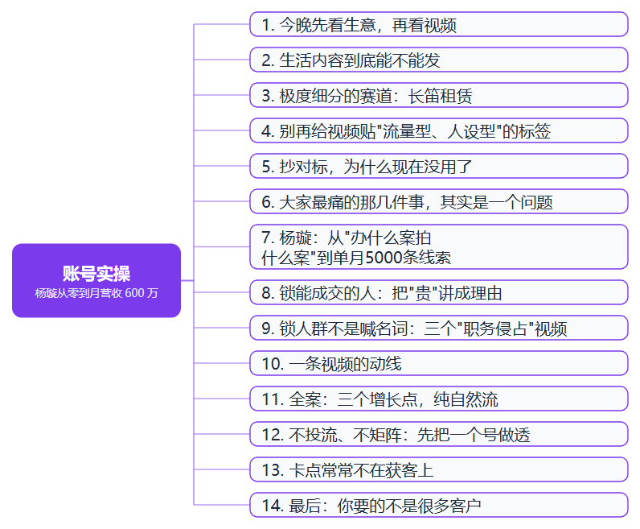

## 1\. 今晚先看生意，再看视频

### 1\. 点评账号之前，为什么要先问这么多

今天白天我不在，去看医生了，手腕的问题。下次再上线下课，估计就得戴护具，没办法这么自如地比划了。

在座有不少面熟的：两年前就合作的客户，做情感的浩威老板——那时候我们还在做直播板块，算是行业里做直播的头部团队，合作得很愉快；还有复训的老学员，也有被老学员带过来的老板。

今天晚上有两趴。一趴是点评34个老板的账号；另一趴是把方法论的全貌讲一遍，重点是"锁客"这个知识点。明后天会按每个知识点，拆执行的部分。所以今天听懂了、但不太会落笔执行，不用担心，那是明后天的内容——我们先把全局给到大家。

我挑了几个相对有代表性的账号。没选到的，明天在小屋里一对一过，每人一个时间段；不在的就跳过。

第一位是上饶"10月空间设计"的唐雨堂。她介绍得很实在：江西上饶的设计师，做全案，从设计、施工、软装落地一直到服务；账号做了一年多，也有客资；之前像一个小孩子从一年级读到六年级，今年算进初中。

她自己说了一句：之前也是有获客的。也就是说，她不是没有客户，是不知道客户为什么来。这种账号最可惜——内容不差，只是没锁人。

她写的目标客户群体是：40岁左右的女性，对审美、家居收纳有需求的客户。

我问她：为什么把"对收纳有需求"写在上面？

她说，第一，我是女性设计师，在这块有优势，孩子妈妈这些；第二是个人生活经历；第三是市场需求——现在到了物质过剩的时代，物品怎么更好地收纳管理，是有需求的。

这个点说得挺好，只不过她不知道"前端语言"和"后端语言"的区别。你跟我聊天，讲的是现状；但在短视频里，你的客户群体大概分两类。

一类是改造需求——对收纳和改造有需求的那部分人；还有一类是毛坯房需求，就是装修之前就找全案设计的人。

我看了一下她的账号，客户里涉及几类不同的施工阶段：有的人找她装修第一套房子，有的人是第二套。以前的客群都是置换型的，别墅、大平层；经济下行之后，今年开始接一些初装，比如婚房。

我问：你的客单价大概在什么价位？

——10万、40万、50万、100万都有。

你说最大比例的那一档。

——大部分在20万到50万之间。

20万到50万，在市面上这个赛道里算什么水平？

——中等。

你们那个城市是几线？四线，江西上饶。

四线城市、20万到50万、中等。

那你是只做本城市吗？

——也做，但少。

是想做，还是做不了？

——一般是上饶人在杭州、在上海，以前的房子找我们装过，因为我们理解能力强，他希望我们再去。上饶之外的地方，大部分是转介绍。

那我知道了。你的客户群体其实就是上饶本地。你原来哪怕接到了上饶之外的客户，也是本地客户转介绍。

### 2\. 为什么不能把"线上客户"和"转介绍客户"混在一起

我为什么要在他账号之前先问这么多维度？因为老板给我传达的，全是"他对客户的信息"。各位老板的客户也是这样：大家经常把线上来的客户，和来过一次、又给你转介绍的客户，混成一件事。

你要在抖音、视频号、小红书上获客，第一步能考虑的，只能是你线上会被什么样的客户吸引。

只能是这个。

线上来的客户，转介绍的那部分人，帮你干什么？帮你增加信任背书，帮你多几个案例展示的环节。

你不清楚这件事，会有什么后果？尤其在座有多少是零到一阶段的——零到一，就是我虽然拍了很多视频，但客资几乎为零，或者变现很少，偶尔来那么一两个客户，但你并不知道他为什么来、是哪条视频来的，这些统统在我们看来都是零到一，都还没到"一"之外。

原因就是你把人过往对客户的感知，混得更糊了。你并不知道线上的客户在意什么：为什么有人会选择线上一个设计师？他的需求和线下找设计师，有什么区别？

所以我才说，先别急着问"我要不要换人群"，先把"线上会被谁吸引"这件事想清楚。

零到一最典型的症状，不是没有播放，而是"有播放、没客资"，或者"有客资、但不知道哪条视频来的"。

这两种，本质是同一个问题：你的内容不是为某一个人拍的，是为一个行业拍的。

行业会给你播放，但不会给你客户。

### 3\. 一条置顶视频里，哪些点值得放大

我们打开她的账号。既然今晚是点评账号，我还是希望给被点评的老板一些实用建议：究竟哪些部分可以做得更好。我不会说得特别多，尽量锁定今天的点——因为一个账号的问题，可能是产品的问题、定位的问题，不单单是视频本身的问题，今晚我们先聚焦视频本身。

她置顶的那条，其实很能让人产生真实信任。我就借这一条，给大家看三个你们常犯的点。

看的时候我会暂停。先问一句：在座有哪些老板装过房子、花过设计费，或者即将装房子、打算花设计费的？

（举手）

我估摸现场大概有十位。那再问：你们是线上找的，还是线下找的？

——线下。

——也有线上找的。

好，那我们看看这条视频当时是怎么打动人的。

视频里她带着镜头逛一套刚交付的房子：鞋柜不是传统的门套形式，旁边刚好是配电箱的位置，就把它隐藏进去，这个地方还做了抱色，回家可以放手机；这个位置做成了柜子，客户自己住，朋友多，平时点餐可以顺手放这儿；冰箱做了明嵌入式，因为整个空间的色比较合适；油盐酱醋这些小东西，就放在柜门里面，柜门做了下柜，可以拉下来，用起来方便。

然后她说：这个地方因为客户人比较高，所以当时就考虑到把台面升高。洗碗机放在这里，吃完饭清一点垃圾，清完就可以放进去洗；炒菜的时候在这里拿碗也方便一点。里面有燃气表，这里做了开放区，因为他喜欢喝咖啡，个子比较高，高度就按他的需求来。窗户这块，窗帘和窗户的使用一定要考虑进去，这里做了三个窗套的形式来修饰，窗户的开启一定要考虑，三扇窗里有一扇做了推拉，保证通透性；厨房做了下拉。这些大部分都是装修时容易忽略的小常识。

### 4\. 所有设计师都会讲的那句话，打动不了人

看到这儿，我问大家：有没有感觉到，所有设计师拍这样的视频，都会说这些话？

我进门这里为什么这么选择，我要考虑怎么隐藏配电箱，怎么怎么样——都会讲。

但是不同人在意的点，一定是不一样的。

像"开门的时候容易放一些钥匙"这种需求，我认为是难以打动客户的。

先说一个分类，这个分类决定了你到底能讲什么。

|**设计师类型**|**交付到哪一步**|**最能讲的内容**|**客户凭什么选你**|
|---|---|---|---|
|只出图纸|交完图就结束|风格、手法|便宜、快|
|图纸加落地|管到施工完成|落地还原度|省心|
|图纸加落地加装修|整案交付|使用细节、避坑|少踩坑|

设计师分几种：我只设计图纸；设计图纸加落地；设计图纸加落地，我还帮你装修完。

老板，你应该是最后一种——整一套的。所以在我看来，你有很多很多东西可以讲，刚才视频里那些点就应该是你的内容：这些都是大家装修时容易忽略的小常识。

那视频里是不是要重点呈现你整套房子的设计？其实不用。但我往后看，看到了一些小巧思：考虑到这家的户主身高比较高，所以在餐台的位置给他做了高低台；考虑到他经常接待朋友，又在什么地方做了什么。

这些才是能拉开差距的东西。

|**视频里的细节**|**是不是人人都会讲**|**能不能拉开差距**|**该怎么用**|
|---|---|---|---|
|进门怎么藏配电箱、放钥匙|都会讲|拉不开|一句带过|
|餐台做高低台，因为户主个子高|少数人会|能|单独做一条|
|洗烘一体上方做抽拉、留插座|很少有人讲|能|单独做一条|
|猫抓布沙发、丝绒单椅，因为养猫|很少有人讲|能|单独做一条|
|三扇窗做推拉、窗套修饰|都会讲|一般|不必展开|

### 5\. 亮点被你自己埋在了后半段

接着往下看：洗烘一体，上面做了抽拉，洗完衣服可以先挂一下，再挂到上面去；里面都留了插座，是给洗衣机、洗地机用的。这里原本有一根不能打的承重柱，她利用承重柱包到这里，又做了一个柜子，弱化又美化。这个不是皮的，是猫抓布，因为大家有猫；选单椅的时候选丝绒，猫随便躺。

视频里还有一句："这四把椅子都一模一样。我们在做每一套设计，是先把家具饰品选好，再来做效果图。"

这几个点，非常值得讲。

因为你的目标客户群体是40多岁、懂审美、懂收纳的女性，那"插座和洗地机"这个部分，就应该是你放大的部分，甚至可以单独拿一条视频讲。后面提到给客户选猫抓布沙发，也是非常好的点。

现在想打动客户，一定不是对比设计图、对比你的专业和身份，反而往往就是这些。因为你的价格不是最高那一档，是中产以及中产之上都消费得起的那一档；他要的是一个接下来三年五年都不会被毁掉、被打断的装修。就是这些点，值得放大。

但我今天刷大家账号，发现一个共性问题：你们好多人的亮点，都在视频的后半段，甚至在快结束的地方，我才能感受到——哦，原来你在这个行业里挺资深的。

### 6\. 用户只给你十五秒

请大家记住：所有用户刷你的视频，最开始不会给你超过二十秒，甚至只有十五秒。

这还是有装修诉求的前提。因为我们做的是专业客户，包括律师——如果家里没出事，他平时刷律师就是刷段子，他不会找一个专业律师来要答案。而一个真有家装需求的人，很多人也不会给你到"后半段"的机会。

但这些点恰恰是用户关心的点。

所以你在剪一条视频的时候，要问自己一句：前十五秒，有没有一句话是他一听就知道"这说的是我"？

她把整条视频的重点放在"我做了哪些设计"，但客户在十五秒里找的是"我家会不会也这样"。

前者证明你做过，后者证明你懂他。证明你做过的人太多了，证明你懂他的人很少。

这就是我说"亮点在后半段"的意思——不是后半段的内容不好，是它来晚了。

那为什么装修里这些地方容易被忽略？我给几个原因，老板你听听有没有：

第一，有一些设计师没有落地经验，他不知道这些以后户主用起来会不方便，他只在意那个设计完不完美。

第二，有一些设计师虽然知道，但做起来非常麻烦，时间成本、改造成本偏大，所以他选择不告知户主，也就不做。

你是专业的，你脑子里应该还有别的可能。就是这些"装修容易踩坑、容易忽略的小常识"，才会让你的客户感受到你和别人不一样，和市面上那些线下装修机构不一样。因为你是这样这样的——这就是后面经纬会讲到的"购买理由"。

在这些里面，我看到了你可以被放大的点，但被你自己埋得很深，一句带过了。你把所有内容都平铺直叙地讲知识点，平铺直叙地突出这些东西。

请记住一句话：一条视频里，大家并不需要讲清楚自己的十个优点，讲清楚一到两个优点就已经非常好了。

我刚才给你的这两三个点，其实每一个都可以是单独一条视频。

### 7\. 一类设计师，只能吸引一类客户

还有一句话，我觉得对你、对在座所有专家都有启发：一类设计师，只能吸引一类客户。

这句话反过来说也成立：你想吸引所有人，最后谁都吸引不到。

她写的是40岁左右、懂审美、懂收纳的女性，但视频里讲的是所有设计师都会讲的东西。这就等于对所有人说话，也就等于没对任何人说话。

装修这个赛道，人太多、城市太多，你不可能靠"我什么都做"被记住。

把你最能吸引的那一类客户找到，这一类客户的数量其实非常之大。不要总想着"我这个是不是也行、那个是不是也行"。

当然有些赛道除外。比如做长笛的那位老板，赛道太小、太细分了，你去做那些生意是合理的，一会儿点评你的账号我再跟你说。但装修设计这个赛道人太多了、城市太多了，所以如果你想未来不止吸上饶，还想吸别的地方，就是靠这个部分。

你的价格是中产以及中产之上都消费得起的，他要的是一个接下来三年五年不会被毁掉的装修——这就是你该反复讲的那件事。

📌 一句话总结：先问客单价、客户来源、城市，再谈视频，别把转介绍客户当线上客户。

## 2\. 生活内容到底能不能发

先给一张判断表，只有一列是真正要看的：这个"人味"跟你要卖的东西有没有关系。

|**内容类型**|**和产品有没有相关性**|**用户会不会因此买单**|**结论**|
|---|---|---|---|
|和妈妈相爱相杀的情绪|没有|不会|可发，但要改落点|
|给妈妈改造操劳的那个角落|有|会|这才是该拍的|
|因为养猫选猫抓布、丝绒|有|会|直接放大|
|打球、康复、延迟满足|看人群|可能|落到专业上才有效|

### 1\. 唯一判断标准：跟你要卖的东西有没有相关性

能不能在视频里拍自己的生活、展示自己的性格和人味儿？

可以。好的点在哪？客户找一个人买单的时候，他买的不是只有你的专业需求，还有"你这个人值得让我信任"。

但大家注意，我只提供一个判断点：你这个信任点，跟你最终卖的产品，有没有相关性。这是你能不能发这条生活的唯一参考点。

### 2\. 乐平卖保险：我到现在说不出那个产品叫什么

举一个我自己的例子。

坐在老板旁边的乐平，是之前小P介绍我认识的朋友，做香港保险。我现在是他的客户，被他成交了几十万。

我完全不懂他给我推荐的是什么产品，我到现在也不懂，甚至说不出来那个产品叫什么名字。

但我确实因为一些人上的点，觉得他不会骗我，他也不至于害我。中间还有介绍的人陪我买了一把一模一样的产品——我的信任背书足够了，所以我不需要懂那个产品。这就是我这一类人群的决策链路。

所以乐平成交我，不是因为产品讲得多清楚，是因为"他不会害我"这四个字。

而这是因为中间有人替我把关，我才敢不懂产品。

### 3\. "和妈妈相处也是修行"这条，问题出在哪

再看这位老板的一条，写的是和妈妈相处也是修行。

先看内容：住了41年的老房子；我们明明很爱自己的父母，但是却没有跟他们在一起相处。这次带我妈一起去闭关，7天同住在一起，对我来说也是一种考验。出发之前跟她说好了，到那里只许闭关，不能玩手机，不能找陌生人聊天。但没待两天，她就忍不住了。说实话，当时我看的时候挺生气的。但后来想一想，这跟我们小的时候，他们对我们不是一样的吗？

我妈他们那个年代没饭吃，所以在我们小的时候，他们就把自己认为好的东西都给到我们。比如每天得吃多少饭，我现在都还记得那时候我是多么下饭。再比如零食，那时候有甘蔗，她总说这个东西会上火——你小的时候哪知道上火呀。

所以现在我妈但凡跟我说你要不要吃这个、要不要吃那个，我内心那个无名火就上来了。你跟爸妈永远有一个底线是不能碰的。如果今天这个鸡蛋是我爸说你要不要带走，说不定我就拿着走了；但今天早上是我妈说这个鸡蛋你要不要带走，我肯定是绝对不拿。

真的，跟父母在一起就是相爱相杀。小的时候他们累积在我们身体里的一些情绪都没有排解出来，现在我们是家里的顶梁柱，但我们在很多时候也把自己的好东西强加给他。所以还是那句话，相爱容易相处难，你说对不对？不知道你跟你的父母小的时候有哪些没有缓解的问题，可以在评论区跟我说一说。

我问大家：这种真情实感的流露，对他的账号有增益吗？

有学员说：听了会让人觉得这个人是值得信赖的。同样是两个专业水平一样的人，我会更愿意选一个真情实感表达的，会增加我的信任感。

我问他：你装修过吗？花过全案设计费吗？

——没有。

### 4\. 十万块的康复费：你会因为真情实感相信他吗

我举一个不太恰当的类比。

我现在不是在治网球造成的这个手腕病痛吗？前前后后治下来，康复付费是1000块钱一个小时，我们打球费大概500块钱一个小时。如果全治愈，可能也得10万块钱打底，而且还不一定完全康复。

那我会因为一个人跟我讲的真情实感，就相信他吗？

你能懂我的点吗？他可以有他的真情实感，但这件事牵扯到他要付一笔20万到50万的费用——因为你不是他的用户，所以你会觉得"我会信任他"。真正掏钱的人，不会因为这些买单。

跟父母的感情也好，加一点小巧思也好，这些点可以被利用，但不能这么用。

我非常不指导老板这么做。第一，这是你的真情实感，是你非常想表达的点。但大家做账号的时候，往往会忽略一件事。

### 5\. 如果要改写，落点落在哪

如果我来帮你小小改造一下这条视频，我还会让你说跟妈妈之间的情感，但落点会落在别的地方。

比如：妈妈在家里帮你操劳家务、收拾东西的时候，老家总有一些地方布局不好、设计不OK。那以你的专业，动用一个小角落，能对她有什么改变？

现在大家相爱相杀，是因为我们这一代人不会把爱挂在嘴边，不会对上一辈说感谢。但你可以化在行动上。比如你刚跟她发了火，又不想道这个歉——我给我妈把她经常操劳的那个部分，通过收纳改造，打造成了什么，从而让她达到了什么目的。

我是不是既把感情说了，又结合到了我的专业？让这个想买我产品的人知道：我在洞察各种用户装修落地的方方面面。

能理解我的意思吗？这就是——今天我们谈一个不是自己专业的话题，怎么落。

顺便说一句，经纬的账号近半年发生了非常大的变化。以前运营还能抄个选题，现在已经完全不能抄了，没有多少专业性的选题、模板类、结构类的东西可以copy。但他今年其实是业绩最好的一年，每个月的业绩都在翻倍，全案今年已经不接了。上上个月开会还反思：我们接全案有时候没有去年那么严格了，要重新严格回来，对IP的审核会更严格，报全案的门槛会更高。

为什么？因为今年大家信任的门槛高了。你只讲专业，别人是不能信任你的。

所以我在这个老板身上看到了潜力。什么是潜力？这些东西你可以张口就来，你是有感受、有东西的，只是现在不知道怎么落在"跟产品相关、用户找你买单"的地方。

### 6\. 本人和身边人的意见，为什么不可信

刚才那位老板给了我一个启发。在座有很多是IP合伙人、操盘手、运营，大家特别爱听身边人的意见。就像我刚才问"你会被打动吗"，有人说会，有人说不会，然后大家就听信这些意见去改自己的账号。

但这里有一个非常大的点：尤其是IP本人表达的，或者身边人表达的，有时候是不可信的。

我说的不可信，不是他说的话在骗你，而是这些人跟你在一个范围里太久了，已经没有外部视角了。

就像你们可能都觉得"相爱相杀"这个点有道理——可如果跟你的产品没有关系，那就太远了；或者说那个概率只有百分之一，我为什么要在账号里做一件概率那么小的事？

这个问题我讲杨璇的时候还会讲。

### 7\. 客单价越高，生活内容越危险

再补一句：客单价越高，生活内容越危险。

因为这位老板的单子是20万到50万。到这个价位，客户不会只因为"你是个好人"就把房子交给你，他要的是"我不会被坑"。

所以生活内容不是不能发，是发之前先问一句：这条内容，跟你最后卖的东西有没有相关性？

有，就发；没有，就改落点，或者不发。

📌 一句话总结：生活内容只发跟产品相关的，客单价越高，无关的生活内容越危险。

## 3\. 极度细分的赛道：长笛租赁

### 1\. 一个几乎没有竞品的生意

第二位是长笛老师。她从小学长笛，工作室去年年中开始，"教学和租赁两条腿走路"。

教学只做一对一，上限比较低，所以她一直在从教学往租赁上走。租赁这件事，是因为她本身有很多线上的国外学生，都是华人，跟她们教学的过程中，了解到她们本地学琴的整个流程，就发现在国外租长笛已经很成熟了，国内没人做。她把这个理念拿进来落地。

落地过程里，很多长笛老师除了教学以外的内容都不懂，她自己研究，一点点做起来了。

"我们是国内唯一一家做中高端长笛租赁的。"

我问：你没有竞争对手是吧？

——没有，国内没有人做。

这是好事。但我多问一句：你现在的客资和成交率怎么样？

——都还算可以。客单价谈不上很高，因为行业放在这里；但相对于很多同行，我的日子算比较好过的。

那你今天为什么来上课？

——我自己凭天然的直觉做这件事，觉得跟你很多理念比较接近。但我发现，如果我想打穿这部分人，单纯靠直觉和感觉不够。

你以前上过课吗？

——从来没有。我非常抗拒额外付费，因为我始终觉得，只有自己悟到的才是自己的。

那我多问一句：那你为什么来经纬了？

——我现在面临的问题是，我们的租赁分入门、中端、高端。入门和相对中端这部分，国内应该算没有对手，本身也没几个人在做，基本上每个月都租光。但我希望能把中偏高段、特别是有租转购意愿的客户承接过来。国外做租转购的业务跟我们差距很大，我落地化之后发现，你需要把租赁和购买这两件事，让客户感受到一个没有风险的衔接——你租了，觉得合适想买，我的租金是退给你的。

她是靠直觉做到今天的，而且做到国内唯一。

她关注经纬大概一年。这不是短期看到某一个东西就被打动，而是长期觉得他在做的事情，跟自己一直想做的事情比较接近，只是他做得更系统。

### 2\. 没有竞品的两个原因

我点评她，是因为她代表了非常非常细分的一类人群。

以前很多老板问过我同一个问题：我这个团队太少了，我这个业务太少见了。比如我是搞律师的，但我只搞某一类律师，非常小众，还不是股权、继承、家办那种大众的。所有细分一点的老板，都认为自己那个业务市面上没人能干，自己那个人群市面上没人能理解。

这位老板代表了一种类型：她几乎没有竞品，在她的抖音上是独一份。但她有她的bug。

大家想一想，一个东西没有竞品，只有两个原因。

第一，赛道窄。长笛本来就是乐器，这已经是非常窄的人群，而且这个乐器还不大众，是非常小众的、可能高端人群才愿意碰的。

第二，变现天花板有限。所以真正成熟的人不会入局。

但对她而言，这为什么是好事？因为她是一个小工作室，或者就是自己来做。所以我只看她自己的话，她有太大的优化空间——不管是从产品设计，还是产品设计之后在短视频里怎么呈现。

### 3\. 她的问题不在流量，在产品线没有串成线

你看她写的：前端既做中小学生，又做艺考的学生，又做普通人想学长笛的，又有租赁，又有购买，又可以找你一对一。

我在前端看到的是所有的信息。她并没有把自己的产品线梳理过、串成线。

为什么产品线要串成线？因为一个还不了解你的人，第一次不会买你最贵的东西。他需要一个门槛很低的东西，先跟你发生一次关系。

前端产品的作用，是让最大的人群进来；后端产品，才是你赚钱的地方。

她现在是把所有产品平铺在一个平面上：中小学生、艺考、普通人、租赁、购买、一对一。用户看到一堆选项，不知道第一步该迈哪一个。

用我们自己举例。我们的产品有线下课、方案营、全案，还有经纬的一对一咨询——很多人来到这里才知道我们也有咨询。比如很多律师找我们咨询，是因为知道我懂律师这个赛道；我们也有小伙伴非常懂教培，教培的老板会找他。

但这些产品，我们很少在前端露出。这不是说不能提，这是策略，是产品策略。

对商业来说，我前端要的是最大的人群；但我最大那个人群，只要能筛出一个全客户就可以了。

所以你的问题本身有产品的问题、有产品设计的问题。今天我们先抛开这一部分，假设你没有这个问题，只看视频。

我认为你最有优势的部分，在账号里一点都没有展现。

"抖音是我做得最差的账号。"

她主要的获客渠道是小红书和视频号。视频号上有一条讲自己十几年转型的视频，我觉得拍得不错。

### 4\. 开头说"普通人"，后面全讲专业

我们快速刷几条，刷到十五秒就换下一条。

开头是这么说的："普通人该用什么样的思维学习长笛，在半年左右达到一个自然的水平。"

那个"自然的水平"，原话是"自然地看着五线谱"。这个承诺对小白其实很有吸引力，可惜后半段把它丢了。

我先考大家今天学的知识点：这个开头锁的是什么人群？是不是成交人群？这个人群优不优质？

大家回答：普通人、新手、小白。

我先替她澄清一点：她的客户里确实有普通人，有那些小白想学的，所以这条肯定就是想对那部分人说的。

但再看后面："答案你可能从来没听过，叫做用音乐母语化的思维。"

后面全是在讲这个理念，讲得很高深。

|**维度**|**视频里怎么讲**|**客户真正要什么**|
|---|---|---|
|人群|普通人、小白|想学会一首曲子的人|
|目标|半年达到自然水平|快点会吹、能拿得出手|
|语言|音乐母语化、学院派|听得懂的人话|

结果就是：普通人没被吸引，专业的人也不会看——因为你开头说的是"普通人"。这条视频就没有意义。

### 5\. 普通人学长笛，要的到底是什么

我问大家：普通人学长笛的诉求是什么？

会吹。还有呢？缓解情绪。还有考级。

对，普通人就是想会吹，或者有一个简单的需求，让身边的人觉得他对这个乐器有熏陶。他想听的不是"用母语化的、科学的、学院派的方法"，他要的是"最快地学好、吹好这一首"。

我为什么这么知道？因为我曾经想学钢琴。我绝对不会去问别人"怎么用专业的母语化思维让我学会钢琴"，因为我知道那是长达十年才能达到的东西，我不是要那个结果。

所以你认为你是在讲一个专业的理念，但你用了一个不好的点去讲。这条视频里，你既没有吸引到普通人，你的理念也不会让专业的人看——因为你开头说的是"普通人"。

这条视频就没有意义。而你大部分视频都是这样的。

我为什么一直说你最好的点没有展现？不管在哪个平台，你都几乎没怎么展现。

往下翻，看她吹长笛的那条。我问：什么人会知道你吹得厉不厉害？

专业人士。

她解释：每个老师录作品都有自己的偏好，第一是偏好，第二是意图。现在互联网上做演奏类视频的老师非常多，但她只想吸引那些真正想学古典的、纯粹一些的学生。她最早发的都是非常古典、非常专业的内容，也确实因此招到了一批只想跟她学古典和专业的学生。现在准备切换。

### 6\. 别用"我只想要什么样的人"给自己设限

我跟所有小伙伴说一句话：不要在心里给自己设限——"我只想要什么样的人，所以我只做这个动作"。

我举个例子。你最大的优点是什么？你最大的优点是一看就很有气质，你是漂亮的、好看的，你和你做的这件事完全不违和。但我看你的账号，大部分视频都是口播。

如果今天我是一个陌生人看你的账号，我会给你几条机会？

能明白这个道理吧。除非是像经纬这种，你们关注他一年两年，在追更，你知道很多。但我们成交的很多人，几乎还是以3个月内为主、12个月内为主。你们来这里学习，不就是想源源不断地获取新客户吗？

那你就得非常清楚：不能指望用户刷到两屏、二十条之外，才接受你那个教育成本很高的东西。这就是为什么我说你前端的产品太杂。

很多人进来之后，可能还会转化你别的产品，但你不要在前端这么想，不然你会做得很累。而且就像你说的，你并不知道大家为什么来。

所以我给你一个建议：优化你的服化道。虽然我们平时不屑于讲服装这种事，但对你而言——你穿旗袍呢？你穿那种一看就能有流量的东西呢？你这么好看，穿出那种让普通人也觉得你很有气质的衣服，不要给自己这种限制。你做了这样的视频，那些想学的普通人会更愿意找你。

她问：我还是希望慢慢转向更商业化。

这不冲突。你的租赁人群也要划分。哪怕是租赁这种类似口播的视频，也存在"不清晰"的问题。

她一直在用一个动作证明"我是专业的"——发纯古典的演奏。

这个动作帮她招到了一批只想学古典的学生，也把她锁死在了那一批人里。

设限不是别人给你设的，是你自己用一个又一个动作设出来的。

她现在要转商业化，不是把过去推翻，是在原来的基础上再加一层：让普通人也能看懂你在干什么。

细节我们下来讲，因为跟大家聊得太深了。

📌 一句话总结：产品线要串成线：前端低门槛引最大人群，后端才是赚钱的地方。

## 4\. 别再给视频贴"流量型、人设型"的标签

### 1\. 那句"我这是流量型视频"，害了很多人

刚才长笛老师自己也说，她最近把视频分成几大类：能力的、理念的，还有什么私聊的。

以前来看账号的时候，我记得非常清楚：有个做餐饮培训的老板，带着两个运营，就坐在这个位置，大概四个人。我们看他的账号，问"这个账号在锁什么人群"，他回答说：我这个做的是流量型视频。然后又指下面：我这个是人设型的，我这个还不是变现型的嘛，我的变现型视频在哪里？

就是产品介绍，他称之为变现型。

今天大家来了经纬的课，我讲一点掏心窝子的话：请大家不要再这样定义自己的视频了。

你这样定义，你会发现不了自己的问题。为什么？因为任何人都可以给自己定义"我是流量型"。我今天只要在抖音上谈个马斯克，我就可以说这是流量型；或者说个最近的热点——欧洲那个什么、notion，或者娱乐圈什么事，反正都算热点。

你如果自己给自己的账号这么归因，你就没有办法进步。

### 2\. 我们内部只有一个词：线索型

不管你是流量型、人设型，我们内部从来不这么分。我们所有的视频都叫线索型。

今天我哪怕让经纬谈一个自己的个人品质，让他在网球场上拍一条"对老板的延迟满足"，我都不会称它为人设型视频。因为那条我获客了、我变现了，它就是获客型视频。

所以大家看的不是"这条视频我想传达什么"，而是"这条视频有没有这个作用"。你得看单条视频的内容。

你的内容现在是不好的，不是说你给它归了个类型，它就是那个类型。

📌 一句话总结：只留一种分类叫线索型，贴流量型标签会让你永远发现不了问题。

## 5\. 抄对标，为什么现在没用了

先看用户凭什么信你，这张表比"怎么抄"重要。

|**用户判断的维度**|**他会怎么判断**|**你抄的后果**|
|---|---|---|
|谁先发的|看发布时间|你成了抄袭者|
|谁粉丝多|认头部、认熟脸|你给对方送人|
|谁有案例|看真实交付|你什么都没有|

### 1\. 两个律师账号：几乎一模一样的稿子

今晚有两位律师提交了账号，问题几乎是一样的。

我不重点讲解，因为这两个账号在我看来是同一个问题。

我问：老板，你现在的账号是不是几乎没有原创？

——对，洗稿写得比较多。

我为什么这么知道？因为你们现在抄的视频，我都写过。你应该能看到影子。

### 2\. 用户会同时刷到你们两个人

我问大家一个问题：如果你现在去洗对标，洗的还是行业里数一数二的对标，你认为你的用户不会同时刷到你们两个人吗？

会吧。

你在关注一件事的时候，你在网上搜、去刷，同样的视频，你不会刷到好几个人在讲一模一样的稿子吗？会。那你会相信谁？

第一，你会看时间，先发的那条是真的，别人是抄他的。第二，看粉丝量——浩威你现在多少粉丝？四十多万，是行业头部的博主了。第三，看谁有案例、谁是真交付。

你抄人家第一第二的，你就是给别人做嫁衣。

所以抄对标这件事，最后拼的不是谁抄得快，是谁有资格被相信。

### 3\. 诈骗罪律师的定位，不在"诈骗最好做"

这位律师只做诈骗罪，粉丝估计都不到1万。

他以前做经济纠纷，具体是强执：别人打完官司赢了拿不到钱、法院执行不到位，就来找他。他做到全国腰部以上，坐得很舒服。

为什么转型？他说是产品设计有问题：交付周期太长，他又不想违背良心——前期收5000、8000，后面定额收，回款100万收18万。他是真的想帮人把钱追回来，但交付非常费劲，因为现在的司法环境。

这个行业有个头部，一年能做到1\.5个亿。模式他很懂：收前期费用，后面不指望，手里十几个律师在全国晃，去到法院执行；执行不回来，就直接跟当事人说"你们那个法官收钱了"，往法官身上推。他做不到。

所以他筛案筛得非常严格：销售先筛，筛完他自己再筛，筛完觉得可以了再面签。到这一步，他只要把价格往下降一点，成交率就特别高。

去年他歇了一年，做得很不愉快。因为经过疫情，尤其是"赢了官司拿不到钱"这种事，当事人本身对司法环境已经很失望，负面情绪特别多，尤其是四五年、十来年的老官司。

今年3月他换赛道做刑事。所里总部有1300多个律师，他团队里有十几个合作比较好的刑事律师，所以后端的消化不是问题——以前就死在消化上，"憋死"。

现在的数据：一个月30万左右营收，全是线上来的，没有线下客户；一个阶段收8万到10万；一个月大概8个客资，成交两到三个；咨询费一小时2000块。

我追问了一句：8个客资成交两三个，剩下没成交的呢？

——那些就是收咨询费，一小时2000。

所以你前端一个月进8个客资，成交两到三个，就是30万营收。

他为什么擅长诈骗罪？因为他有财务功底，善于捋资产线索。以前做强执，别人弄不来的他能弄，能从蛛丝马迹里找到线索。诈骗罪到最后，还是一个算账的问题、财产线索的问题。

但这条视频他是这么拍的："这条视频建议你收藏。诈骗案件从公安到法院，家属最容易踩三个大坑。"还有"被判诈骗罪之后怎么办""家人涉嫌诈骗罪怎么办"，以及大量共情的内容，像杨璇那种"为什么最痛苦的就是……"。

我跟他聊了这么短的时间，我就知道他的定位该是什么。一定不是"诈骗最好做"这件事。

诈骗罪确实是刑事案件里最高发的类型，数量最多，因为下面有很多细分：新型诈骗、老诈骗、请托型诈骗。但"诈骗最简单"这句话，消费者不认。

一个家属，自己的爱人、老公因为诈骗罪关进了看守所，他会认为诈骗罪很好做吗？不会。诈骗罪的家属和任何一个罪名的家属一样交集、一样慌。你站在律师角度觉得诈骗最好做，但用户分不清这些事。

他后面讲的那句话才是关键：诈骗罪到最后都是算账的问题、财务的问题；因为他有什么功底、做过什么，所以他会比别的律师做得更好、更有优势。

这些东西，账号里一点都没有。

消费者认不认，比你说得对不对更重要。

"诈骗最好做"是律师的判断；"我老公能不能出来"是家属的判断。

你在视频里说前者，他听不懂；你说后者，他才会停下来。

### 4\. "我亲自交付"不是卖点

他还发了一条："我建议你一定要去会见一次。"——这跟杨璇的产品说得一样。那我为什么选你？

他说：因为我是自己交付。

我问：如果今天在座的是律师专场，经纬在前头做账号，我坐在这里，你认为"经纬亲自做"是卖点吗？大家会不会不选我、选你？

现在我更愿意选你。也不是现在——我给大家讲个实话：本质上，现在经纬的交付水平，不如我们团队70%以上的操盘手。

我不是说经纬能力不好。是一个好的操盘手，他要深入项目。深入项目是什么意思？我达不到律师的专业水平，但我会和家属了解得一样多。我这三个月持续在那个项目里，怎么可能只是方法论？

方法论再牛，到每一个客户的时候，大家有没有发现，刚才点评那三个账号，每一个人群的洞察都是不一样的。

用杨璇的例子说：为什么这个人交付诈骗案会比我更好？——因为没有案例。

可以讲的点太多了，并不是说你没机会。

### 5\. 律师最容易犯的毛病：在自己的专业思维里太久

我跟律师接触得太多，几乎可以说是"非常讨厌律师"——加引号的，不是人身攻击。因为他们真的在自己的专业思维里太久了，那个东西很难往外掏。

但我不认为这位老板是这样，我认为他弹性很高，因为他刚才讲话不死板。现实中间跟短视频里完全不一样，现实比较活泼。

📌 一句话总结：别整条照抄对标，用户会同时刷到你们，你只是给对方做嫁衣。

## 6\. 大家最痛的那几件事，其实是一个问题

### 1\. 现场采访：你们现在最痛苦的是什么

不管你是IP还是运营——IP要自己拍视频，运营要给IP拍视频——我先问一圈：现在最痛苦的事情是什么？

第一位老板：没有顾客，没有人。

那拍视频的时候痛苦吗？——不知道。

第二位：选题痛。

你给别人拍视频，但拍完没有获客、没有留资，就不太愿意拍了。

第三位是资深老IP。他说：两年前上完那一波课之后，业绩和进线直接就拉爆了。当时的服务是直播，业绩double。

但现在的痛苦是：每次不管是写东西还是拍视频，都觉得特别恶心。因为很多痛点都讲烂了，讲得非常疲惫。

这是一位拍过1000条以上视频的老IP，绝对是细分行业的头部。他的痛苦不是没能力，是重复。

第四位：我不知道拍什么，不知道拍什么是能获客的，不知道怎么挑选题。

这四位的痛苦，其实是同一件事的四个切面：没顾客的，是不知道对谁说；说选题痛的，是不知道说了给谁听；拍过1000条的老IP，是对谁说都说过一遍了；不知道拍什么的，是手里没有一张"该对谁说什么"的图。

### 2\. 到后面，视频是可以融进生活里的

为什么会有这些痛苦？因为大家还停在"我要去做一条视频"这个动作上。

用经纬的账号看会更明显。到经纬这一步、到杨璇这一步，已经可以把视频融入自己的日常生活，自然愉悦地输出可以获客的短视频。

举个小例子。前天我们去上海求医，我去华山医院看这个手腕，门口他就拍。

什么叫自然地融入自己的生活？就是你身边发生的任何事情，都可以成为内容。

因为我们的客户在追更。

追更的意思是：他不是今天才知道你，他看了你十条、二十条。

所以你不需要每条视频都从零解释。但前提是，你前面那二十条，得让他愿意留下来。

不管你做的是专业赛道还是什么赛道，客户都在追更。律师今年是不是会有新的法规？情感赛道，不同年龄段的男生是不一样的，你今年的认知和去年的认知也不一样。

再比如最近的某个热点事件，全网都在讨论。同一件事，你看到的和别人看到的不一样，这本身就是一个选题。

无论怎么样，我想告诉大家的是：跟你行业有关的事、跟你专业有关的事，以及人群的变化，其实是时时刻刻在变化的。

你就是可以根据你身上发生的事情，万物皆可选题。

### 3\. 我去看手腕，也是我们赛道的事

我受伤的这个胳膊去找专家——这跟我们赛道有没有关系？

我们的定位，就是给有专业能力的专家、创始人、老板做获客。我去寻医，也是全国各地在找名医。

我们做专家IP，所以我们才知道：一个消费者要想识别一个真正的专家，非常难。

所以在座如果有真的是自己行业里资深专家的人，我非常衷心地希望你们把账号做起来。

真的太难了。因为医生他不做账号，我们没有办法在账号里识别他。

我到现在为止，一个月的时间，找了5个医生，每个医生说的完全不一样。你能想象这种痛苦吗？每一个说的都不一样。

所以经纬的下一步策略是：找最贵的。

我想说的是，我们做事的时候，可以突然来一个灵感，自然愉悦地拍出不错的短视频。刚才大家说的那些痛点，本质上是这件事。

杨璇现在也是这样的。上次去成都，跟他们吃了个饭，现在就是这种生活状态——就这样，还在拍着短视频。

📌 一句话总结：所有痛点都是没想清对谁说；客户在追更，万物皆可选题。

## 7\. 杨璇：从"办什么案拍什么案"到单月5000条线索

先看这三个阶段，整段案例的骨架就在这张表里。

|**阶段**|**当时的问题**|**做的动作**|**结果**|
|---|---|---|---|
|第一次|有播放没客资，不知客从哪来|锁最熟悉的买单人群|业绩涨一倍|
|第二次|客户不优质、周期长|锁成交阶段、锁能成交的人|又涨一倍|
|全案|获客不错但增长见顶|三个增长点，纯自然流|月营收翻倍|

### 1\. 为什么今天讲杨璇，要从她第一天讲起

我们现在讲杨璇的案例，跟以前有点不一样。

我们接她全案的时候，她已经是月营收200万到300万左右的人了，两百多万已经有了。我只是把她从两百多万变到了六百多万，翻了一倍。我认为这也很牛。

但如果完全按我们接全案的过程讲，会离很多人的阶段有点远。因为大部分人现在不在"月营收两百万怎么翻倍"这个阶段，你在"第一条视频拍什么"这个阶段。所以现在讲杨璇，我从她做自媒体的第一天讲起：她经历过哪些挫折，为什么今天能做到团队化管理，中间有哪些转折点。这些对大家都是普适的。

今天晚上只讲一个事：怎么通过获客型的内容做一个账号——在不投流、不矩阵、不拼流量的情况下，结合今天的知识点，先做对一部分，然后成为细分行业里的头部。

不同的行业人群不同，但今晚涉及的内容是一样的。律师里边很深的专业知识，我今晚不讲，所以大家的行业都适用，关键看你怎么思考。

### 2\. 接手时的样子：一个95年的小姑娘

我第一次接触她，是24年左右的线下课。那个时候我还没来经纬的公司。

她在行业里其实没有名气。粉丝量只有六七万，现在可能已经30万了，这几年涨得比较厉害。她很年轻，95年的，在律师这个行业里，没有人会觉得一个这么年轻的小姑娘在专业上有什么能力——这个行业里就是这个现象。

但杨璇的专业能力是OK的，我们做过多方位的考证。

她的运营一直是蔡蔡，就是她老公。蔡蔡其实是经纬的粉丝。但凡有点段位的运营，应该都觉得经纬的能力还可以——只不过他嘴比较臭，老骂人。但没有人骂过他的能力，都是在骂他说话难听。

那个时间段，她的播放量是5000到1万。刚开始拍完视频，她会一直看后台。蔡蔡下面有两个助理给她写选题，写的都是同行的爆款，她会反馈：这个选题我不想拍，那个我说不下去。

### 3\. 第一次：办什么案子，就拍什么案子

她当时的做法是什么？办什么案子就拍什么案子，遇到什么问题就拍怎么解决的，就是在回答问题。

现在市面上很多课也在教这个：你怎么解决业务，就拍出来就好了。

这是最低版本。你们现在听到的"真的要让你们这么拍"，本质上，你交付什么就拍什么——你在买单之前，没有刻意训练过、没有设计过，你的很多内容其实是在自嗨。

你浪费了很多获客的机会。不能说完全没用，这个时候有获客吗？有。但因为没策划、没聚焦，没有锁任何人，所以就出现了长笛老师那种情况：我并不知道客户是怎么来的。

为什么这个版本低？因为它把"你正在做的事"当成了"客户正在搜的事"。

你办的案子，是你的事；客户要解决的，是他的事。这两件事只有一部分重合。

重合的那部分，就是你能获客的内容；不重合的那部分，就是自嗨。

### 4\. 第一次调整：只锁自己最熟悉的买单人群

第一次上完线下课，回去干的第一件事是：锁人群。

当时她还没有锁人群的概念，上完课就锁了——锁自己最熟悉的买单人群。

为什么是"最熟悉"，不是"最高价"？因为熟悉带来的是对话能力：他一开口，你就知道他在怕什么。

不熟的人做不到。你只能讲行业里通用的话，通用的话，谁都会讲。

今天课上讲到"熟悉"这件事：唐玉琴那个例子，她对什么样的人更熟悉？职务犯罪？贪官？

她是对"贪官家属"最熟悉，因为她跟那类家属打交道最多。

那我再问：唐玉琴和杨璇，你们看他俩的感觉，能吸引的人是一样的吗？

不一样。

所以我说，锁自己的——你看，现在所有人做律师赛道，最基础的常识就是"我要做家属"。但在24年、几年之前，还有很多人发视频是发给当事人看的。什么叫当事人？就是关进去的那个人。

那个时候大部分律师做的是这样的内容：我是怎么分析这个案子的，这个案子那个那个，话语只有专业律师听得懂。因为他的专业在那里，他只会讲办案的内容。

所以那个时候，她锁了刑事案件的家属。

### 5\. 为什么"家属"这两个字对杨璇特别成立

为什么这对杨璇特别好？

因为杨璇不是官儿，她是一个普通律师。她原来在自己的律所就是个普通律师，所以她非常懂普罗大众的家属。

她懂的不是贪官的家属，是各种类型、最常见的、可能客单价没那么高的家属。她非常懂大量的家属，因为她是一线的人。

唐玉琴是主任。一个人做到律所主任的时候，很多案子他就不接了，就像这位老板现在已经开始先选案子了。

所以我说：锁你们最熟悉的。

### 6\. 抄她"共情家属"的选题，为什么抄不对

也正因为这个，很多人抄她共情家属的选题，已经抄不对了。

因为她是真的懂、真的共情，其他人是在抄她。你没有真的在懂那个人，所以你会干枯。你会跟她用一样的话，但她可以源源不断地产出这部分内容。

这就是为什么，同一句话，她说出来是活的，别人说出来是死的。

你抄到了句子，抄不到她在一线见过的那些家属。

所以她可以源源不断地产出，抄她的人抄完这一批就没了。

只圈了家属，业绩就涨了一倍。

### 7\. 副作用：白嫖的人全来了

但随之也来了问题：很多来白嫖的，问问的都来了。

大家看这两张图有什么问题？这是市面上大部分人做的大流量选题。

第一条："家人进去了，先别掏钱，先找我免费聊一次。"

第二条："冤贫苦弱，穷人用不起法律。"——穷人根本用不起法律。

我问：他在锁什么人群？

不找律师的人。看别人热闹的人。家庭困难的委托——你们真的有减免吗？找就行，这帮人就不会找。

还有一条评论："我儿子进去看守所74天了，盗窃罪，我就咨询一下严不严重。"

这就是很多人在做账号时的内耗：好不容易来了流量，来了一个自己想要的人都没有。

再往透里说一层。这类选题的问题，不是它没有流量，而是流量来的人，从第一天起就不是你的客户。

**⚠️ "家人进去了，先别掏钱，先找我免费聊一次"——这句话锁的是"还没打算花钱"的人。他一进来，就是来领免费的。**

"穷人用不起法律"——锁的是"我付不起"的人。他自己都认为付不起，你怎么成交？

"我儿子进去看守所74天了，盗窃罪，我就咨询一下严不严重"——他要的是"咨询一下"，不是"请你办"。

所以这类内容不是没有流量，是流量来了也留不住，还得消耗你的客服和你的情绪。

### 8\. 内耗的三段

第一段，没有流量的时候想要流量。

第二段，来了一个爆款，开心得不得了。但爆款之后，不知道怎么拍视频了，因为爆款是随机碰上的，你并不知道怎么复制。

第三段，也来问自己事儿的人了，但发现都不是自己想象中的优质客户。

我采访一下：你们加了经纬的私域、找他报课、跟后台私信沟通，有多少老板几乎没问什么，直接付费的？

（有人举手：我什么也没问。）

我告诉大家：经纬的后台账号上，大概85%到90%的老板什么都不问，直接问时间地点怎么付费，最多问问能不能坐前面、先来的能不能先上。

为什么？因为你的内容，你内容所锁的人群，导致来的人是那样的。没有其他任何原因。

他们也锁人群了，他们也锁的是家属。但不是"只锁家属"就对了，这里面还有别的维度。

### 9\. 第二次调整：锁成交阶段

第二次来，解决的是三个问题：客户不够优质、成交周期长、客户沟通成本高。

这三个问题，其实是同一个问题：你锁的人，还没到"必须现在解决"的那一刻。

人来了，但他不着急，你就会陪他聊、陪他等；聊得越久，你越累，成交率越低。

因为杨璇当时出了大量共情内容，共情了就会有很多人在后台问：杨律能不能帮帮我们，我们家真的太困难了。这非常让人心力交瘁。

所以我们做了第二件事：锁成交阶段、锁成交时刻。

同样一个家属，人在公安阶段，你跟他讲检察院的不起诉，他没有感觉；人在检察院阶段，你跟他讲取保候审怎么申请，他也没有感觉。

阶段错了，人群再准也没用。

今天课上讲的"成交阶段和成交时刻"，就是这个意思。

### 10\. 一个常识：刑事案件的三个阶段

刑事案件发生之后，分三个阶段：公安、检察院、法院。先是公安，再是检察院，再是法院。

我问一个常识：如果你家里人有天犯事了，你的第一反应是什么？

找熟人。

对，第一反应是找熟人。第二反应呢？查一查，这也是很正常的动作。还有吗？问豆包。现在也会问豆包——但豆包只是问问，你不会选豆包给你辩护，律师这个事还是要实地的。

第一是找熟人，第二是找熟人推荐的律师。这是大部分常人都会做出的决策。

那我问：这两步走完之后，如果他还在网上找律师，是什么情况？

这个案子一定不是一两天了。一定过去了十几天、二十天，甚至一个月。

也就是说，他如果在网上做这个动作，那个时候案子已经到了检察院阶段。

所以你在网上遇到的家属，大部分不是"刚出事"，是"已经被人服务过一轮"。

这就是为什么"找过一次律师"成了最准的钩子。

所以很多律师在那个年代——我们做这个改编的时候是24年底到25年左右，当时还是很先进的——都在做检察院的选题。我为什么现在还要讲这件事？因为现在这种情况也失效了，在座几个律师都在抄这种选题了，都在抄检察院的选题。但在那个阶段，有这种意识的还是非常少。

### 11\. "锁检察院"不是说了检察院三个字

我们当时所有的选题，都是围绕检察院出的。

比如："检察院在什么情况下会给出不起诉？"——这个应该是家属非常关心的。

"案子移送检察院，真不一定是坏事儿。"

大家看，我们说"锁"，不是说了"家属"两个字就是锁家属了，也不是说了"检察院"三个字就是锁检察院了。不是的。锁的是"成交阶段里面的那个人"，是他为什么要找你——也就是明后天会讲到的购买理由。

"案子移送检察院，真不一定是坏事儿"，家属会怎么想？他会觉得有希望、有救。如果我说"案子移送检察院你就完蛋了"，我也不会找这样的律师。

我们在方案营经常讲一个例子：工程律师李永潇的账号。他之前出的视频全部是悲观的——什么难呀、不容易呀，这那那这的，最后悲观收尾。因为那是自然流拍摄，对面有一个人采访他，采访只能到哪截到哪。

他说的事情都是对的。但对的东西，一定会让人买单吗？

对的东西，是你在专业视角里觉得对的东西。就像刚才那位律师觉得"做诈骗罪的律师是有尊严的律师"，这是他以为对的事。我作为一个家属，我管你有没有尊严？你通过一些门道把我老公放出来了，我孩子能让你做没尊严的事，我也可以。人都到那个程度了。

他没有心思在"尊不尊严"的角度上看你。我说的是家属。所以大家可能是没有这个视角。

📌 一句话总结：先锁最熟悉的买单人群，别再按自己办过的案子拍视频。

## 8\. 锁能成交的人：把"贵"讲成理由

先看价格带，你自己的产品在哪一档，决定了你该锁谁。

|**价格带**|**在市场上的位置**|**意味着什么**|
|---|---|---|
|800到3000|低档、走量|拼的是线索数量|
|5000|常见价|竞争最挤的一档|
|1万|第一档|必须锁"已经吃过亏"的人|

### 1\. 先问自己一句：我的客单价在行业里算哪一档

什么叫"产品能成交的人"？

你们想一下自己产品的客单价。在座各位都给自己的产品定了价，那它在你的行业里属于什么水平：比较低的那一档、中的那一档，还是非常非常贵的那一档？

然后再想：你说什么样的内容，凭什么能吸引到愿意支付这个价格的那部分人群？

如果是最低那一档，你锁的就该是量；如果是最高那一档，你锁的就该是"已经吃过一次亏、正在疼"的人。

价格越高，越不能靠"我很专业"去锁，必须靠"我知道你踩过哪个坑"去锁。

### 2\. 杨璇的会见加阅卷1万，市面上3000、800、5000

杨璇当时会见加阅卷一次的价格大概1万，在市面上算贵的，属于第一档。

大部分律师的第一次费用大概3000，便宜的还有800，5000是常见的。而他们团队当时已经非常贵了。

所以我们怎么锁？

### 3\. 一条选题拆开看：案子到检察院半个月

第一条："案子到检察院半个月了，律师说还要再等半个月才能阅卷，再问就是忙，我这边都要急死。"

我在锁什么？

首先锁了检察院——"案子到检察院半个月了"。第二，"律师说还要再等半个月才能阅卷"，说明他已经有一个律师了。第三，"再问他就是忙"，这个律师已经不跟他交代过程了。第四，"我都要急死了"。

这种人是什么人？是已经找过律师的人，再叠加一个状态：非常非常着急。

所以如果这个时候出来一个能解决他问题的人，他的付费意愿度和紧迫度是非常高的。

能懂吗？我的视频动线就可以是：律师应该在什么阶段告诉你什么进展，而不是问什么都是忙。——当然，这里面还有别的很多专家可以讲。

### 4\. 地域也是锁：珠三角、长三角

第二条："珠三角任务结束，换往长三角。"

第三条："我又从苏州看守所出来了，什么什么罪名。"

本质上，这都是在圈一些高质量地区——会犯经济类犯罪，或者是比较大的官的那种犯罪的看守所。在圈那样的人，那种人一般犯的事也比较大。

还有一个原因：杨璇的团队在长三角、珠三角有自己的直营团队。所以我们考虑了她后端成交的部分，才给她做前端的选题。她总部在成都，但在另外两个地方有点，再加上那群人比较好，我们综合了很多维度做这个部分。

出差的展现形式、去律所的展现形式，都是这么来的。

### 5\. 罪名也是锁：高频、高客单

再往下，就是高频高客单的罪名。

同样是诈骗罪，但我让杨璇再圈"新型的诈骗案件"，也就是近一两年的。选题是："为什么我们团队能把新型的诈骗案件办好""新型的诈骗案件为什么老律师办不好""新型诈骗犯罪难在哪"。

还有"线下开设赌场罪有多严重"。开设赌场分线上和线下，某一段地区会根据当时的政策变化。虽然都是刑事案件，但每个城市抓不同罪名的严重度是不一样的。

比如我们做过长沙的律师，涉黄的案件就非常多，这是跟地域相关的。

所以做细分类型的律师是很有优势的。你那么有优势，在你的视频里完全没展现出来——哪怕展现出来一点点，我都会觉得你对获客有一点点领悟。

但我刷到你的账号时，好处是你真的空间太大太大了。如果你真的意识到自己该往哪个方向跑，再也不用抄别人的选题，那可能就是你真正稳定获客的开始。内容上对你来说是下一关的挑战，但这一关已经非常非常重要，不然你会一直走错路。

### 6\. 越锁越小：窄就是宽，宽就是死

这么做有一点难。难在哪？

因为我们越锁越小。

到今天，我给那些律师、给大家的建议都是：很多人在零到一的阶段，真的要越锁越小。

为什么？因为每个人既有流量贪念，又有成交贪念。刚才那位学员说"我什么都能干"，大家几乎都是这么说的：你尽管给我来客资，来了什么我就干什么。

结果就是什么都得不到。

我也看过其他老板的账号，包括刚才做全案设计的老板。如果你真的锁定一类自己最想要的客户，客单量反而会非常的大，尤其是零到一阶段。

过来人可能会非常清晰：窄就是宽，宽就是死。现在做自媒体就是这样的。在一个点上打透，活下来，再有资格谈快速扩张。

很多人在网上吐槽获客怎么怎么样，为什么我们完全不受这些声音影响，还是一直这么做？因为我们打透了这个点。

打通点是第一步。很多人会先去打磨产品，这是不对的，因为你并不确定你这个产品在前端能不能吸引来人。

我们吸引来人之后，中途做过很多产品的变种。我们甚至还开过几期直播方案营，是偷着开的——前面完全不宣传，只给来线下课和来方案营的学员开放。好评非常之高，所有上过直播方案营的、还有我们一对一聊过的人，都想报全案，但我们会拒绝。我们从来不宣传。

大家可以看到，今年我们从来没有在全端宣传过任何关于直播的东西，但我们团队原来是只做直播最厉害的团队，我现在身上也还有直播能力，只不过不做了。

为什么？因为你做得杂、什么都做，客户就会觉得你什么都不专业。前端就是这样的。今年认识经纬的人，已经不知道他做过直播这个业务了。

### 7\. 结果：一周10个案子，原来一个月5单

做了这几个动作之后，在当时那个阶段是立竿见影的。

因为我们提珠三角，广东的案子就多了。当时是一周就有10个案子，原来可能一个月才5单。

那是当时的竞争环境，现在不行了。

📌 一句话总结：价格越高越不能用专业锁人，要用“我知道你踩过哪个坑”去锁。

## 9\. 锁人群不是喊名词：三个"职务侵占"视频

同样是"职务侵占罪"这四个字，三个人讲，锁的是三种人。

|**版本**|**锁的人群**|**客户能否听懂**|**结果**|
|---|---|---|---|
|讲给同行|同行|听不懂|评论区说听不懂|
|讲给业务员|业务员|听得懂|太下沉，付不起|
|讲给老板|老板，还锁阶段|听得懂|精准，能成交|

### 1\. 先说清楚什么是职务侵占罪

就是在同一个公司，利用职务便利——比如副总、财务、业务员——偷用公司的一些职务便利去干别的事，占用了公司的好处。

这个罪名有意思的地方在于：它是公司内部人之间的战争。股东失和、控制权争夺、高管被查，最后都可能落到这四个字上。

所以同一句话，讲给股东听、讲给业务员听、讲给老板听，是三种生意。

三个人都在说同一个罪名，也都说了这个罪名本身。但锁的人群完全不一样。

### 2\. 第一条：他锁的是同行

第一位是这么开头的："今天我想和大家聊一个在股东纠纷中频繁出现、且杀伤力极大的刑事罪名——职务侵占罪。一旦股东失和，职务侵占常常被一方，尤其是失去控制权的小股东，当作核武器，对掌握实权的大股东或者其委派的高管提起刑事控告。这已经成为股权斗争中一种致命的……"

我问：他锁的是什么人群？

大家说：公司老板、大股东、小股东、高管。

我跟大家讲，他都没有。他锁的是同行。

为什么是同行？因为他提到的这套话语体系太专业了。"刑事控告"这几个字，是我做杨璇的时候都不知道的罪名和说法，我是后来做长沙一个专门做控告业务的律师，才理解刑事控告是一个什么样的业务。他后面完全讲的是专业术语。

我问大家：你们平时刷视频，会给一个视频多长时间的机会？哪怕是这个事情是你自己搜的。

今天你们是被我按着看，所以我必须让你看进去，你们才有耐心分析他圈的是谁。但他的用户群体是家属，甚至是当事人——哪怕是当事人，也不懂这么专业的刑事控告的词。

这就是为什么很多人很难自我复盘，或者团队内很难自我复盘：因为你们有同样的视角。

我当时看这条视频，我上来就没看懂。没意义。

我问旁边一位老板：你是做什么的？——没听懂。你没听懂就对了，因为他讲得太专业了，他就是对同行讲的，这就是一条没意义的视频。

再举个家装的例子：涂料里那个PV什么玩意儿应该怎么怎么样——我作为一个要付钱的人，我真的关心到那个程度吗？

越专业的人、越在一个赛道里的人，越容易犯这个错。

大家有没有发现，经纬的线下课主题叫什么？叫"圈客营销"。我在短视频里讲过"圈客营销"这四个字吗？从来没有，因为解释成本太高了。我的用户不需要知道我产品的名字。

一样的道理，很难绕个弯儿，是不是？

### 3\. 第二条：锁业务员，太下沉了

第二位能听懂了："北京时间二十二点整，刚刚把一个当事人送走。这个当事人还没有案底，因为他觉得自己的行为有可能构成职务侵占，所以找我来做咨询。那他做了什么？简单来说，就是作为一个业务员，他背单了，他把一个客户介绍给了他朋友的公司做。"

他锁的是业务员。业务员有什么问题？

——背单多一点。

不是。我问的是：锁业务员有什么问题？

——应该是没有什么钱。

对，只有这位小姐姐说对了：太下沉了，没钱。

请一个律师坐下来，可能3万、5万也要了。业务员自己那个钱可能都没到那个程度。他那个事儿都没到那个程度，我还花3万5万请律师吗？

你对着业务员喊，说实话，就相当于很多白嫖的人来问问你而已。他没有那个能力付。

### 4\. 第三条：杨璇锁老板，还锁了阶段

杨璇是这么说的："5月份，我们团队连续接到了三起公司骨干人员涉及职务侵占罪这种类型的案子。当中有两起，在公安还没有立案之前就已经找了我们；还有一个是在取保了之后才找我们的，因为他最开始一直觉得不知道……"

她锁的是谁？老板。

而且她还锁了阶段：有的是在公安没立案之前就找到我们，有的是取保之后才找我们。

我又锁了阶段，又锁了人群。为什么能这么锁？因为她对这群人有足够深刻的洞察——我跟她的销售调研了所有职务侵占罪他们接的案件情况，才得出这个结论。

所以这一条视频有获客、且获客很精准，是因为对人群有足够的洞察。但在短视频里，我把这些都锁进去了。

评论区第一条是"听不懂"，一个大拇指。第二条是在夸律师"怎么把头发剪了"——因为第二位算是网红律师，账号里有很多粉丝，他的用户很多并不是律师。

而我们那条"职务侵占，关在拘留所7天了怎么办"，非常精准。

为什么精准？一句话里有三个信息：什么罪、人在哪、关了多久。家属一听就知道说的是自己。

同行一听，也知道这条是给家属看的，不是给他看的。

什么视频来了成交，很多人是不知道的。但当时我们是能锁定一大部分视频的：广东的客户多了，我就知道发的一些动作是对的；职务侵占那部分来的多了，我就知道那条视频是有效动作。

所以杨璇的账号，一年之前一直被模仿，今天看了各位的账号，我觉得到今天还是一直被模仿。因为同行或者运营在拆解的时候，只能看到表层的东西。抄是没有意义的——你的产品、你的人群、你的价格、你的定位、你的团队、你擅长的东西，跟杨璇都不一样，所以没有任何参考性。

做完杨璇之后，我们又接了几个律师，没有一个律师跟杨璇用的手法是一样的。哪怕我接下来又接的律师，我都没有再抄杨璇的选题。因为我自己知道，如果我抄杨璇的选题，这个人就出不来，而且是给杨璇做嫁衣。

**⚠️ 给大家一个忠告：你在自己的行业里，能不抄就不抄，尤其是一模一样的抄。抄一些灵感、抄一些"他为什么能"，还可以；不要一模一样地抄。**

### 5\. 精细到"这个阶段的家属能听懂哪个词"

当时做杨璇精细到什么程度？

我会洞察到一点：一个家属在公安阶段、检察院阶段、法院阶段，能听到的名词是不一样的，能听懂的名词也是不一样的。

所以我在短视频里的用语，会结合这个阶段的家属最大概率能听懂的那个词。

比如一个客户已经在法院阶段了，我就不会跟他解释什么叫取保候审——这是一个法律专业名词。但如果一个客户刚被抓进去，就要普及一下什么叫取保候审。

再往深一层：同一批家属，在公安、检察院、法院三个阶段，最怕的东西也不一样。

不是一套东西打天下。你要根据客户当时的认知阶段，也就是成交时刻和成交阶段，去做视频。

有点难，所以今天不展开更难的部分，先认知到简单的部分。对于有一些赛道而言，其实完全不卷，这一套完全可以通杀，这跟大家目前所在赛道的卷度有关系。我一直觉得律师已经很卷了，直到今天刷到了来现场几位律师的账号，我真的觉得不卷——我们现在做的还太前期了。

### 6\. 还有一条最狠的锁法

第一条锁"贵"，用800和2000做对比；第二条锁"地区"，用珠三角、长三角、苏州看守所；第三条锁"罪名"，用新型诈骗、线下开设赌场。

但最狠的一条，是锁"人已经吃过一次亏"：找过一次律师、被800和2000坑过、现在案子到了检察院、律师还不告诉他进展。

这几种锁法叠在一起，来的就是同一批人：已经吃过一次亏、案子到了检察院、正在着急。

三条都不是"我要讲什么"，而是"我要谁来"。

📌 一句话总结：同一罪名讲给同行、业务员、老板是三种生意，要锁付得起的人。

## 10\. 一条视频的动线

### 1\. 什么叫动线

很多人把动线理解成"节奏"。其实它是"顺序"：先锁谁、再说什么、最后给什么理由。

顺序错了，节奏再好也没用。

同样一条素材，动线不一样，获客结果完全不一样。

### 2\. 家装那条：开头在自证，亮点在后半段

她的开场是："你还有一句话说'哇好看'。我说好看是有很多原因的，我们做天然的、自然的、环保的、时尚的。"

然后带看，讲鞋柜、讲配电箱、讲冰箱嵌入、讲油盐酱醋放哪、讲洗碗机、讲燃气表、讲三扇窗、讲下拉、讲承重柱、讲猫抓布、讲丝绒。

最后才来一句："我们在做每一套设计，是先把家具饰品选好，再来做效果图。"

这就是动线错了。

如果是我，我不会从"介绍"的维度去拍这一条。因为所有人的亮点都在后半段，而用户不会给你到后半段的机会。

### 3\. 杨璇那条：开头锁人，中间扎心，结尾给理由

第一条："为什么不做这种800呀、2000的会见呢？刑事案件当中找到我们的家属，基本上百分之七八十，之前都是已经请过律师的。"

开头这一句，锁的是"找过一次律师、而且吃过亏"的人。

中间给的是他此刻最急的那件事：律师应该在什么阶段告诉你什么进展，而不是你问什么都是"忙"。

### 4\. 取保那条：只圈"接电话"那一刻

开头："取保后突然接到办案机关电话该怎么办？"

中间：检察官通知你明天、后天过去做认罪认罚；你问量刑建议是多少、打算判多久，对方就是不说，只说"你到时候去签的时候你就知道了"。

结尾：为什么我更靠谱。

一条视频只对着一个时刻、一个人群说话。这就是动线。

### 5\. 动线错了，专业越强越没用

长笛老师那条也是一样：开头说"普通人"，中段讲"音乐母语化"，结尾没落到"跟我学能最快吹会一首"。

结果就是：普通人听不懂，专业的人也不会看。

律师那条"建议你收藏，诈骗案件从公安到法院，家属最容易踩三个大坑"，开头是对的——锁了家属、锁了阶段。但后面全是"三个大坑"的通用知识，没有落到"我是谁、我凭什么"。

所以动线不是文案技巧，是你在一条视频里，先锁人群，再锁成交时刻，最后给购买理由。

📌 一句话总结：动线是顺序：开头锁人、中间扎心、结尾给购买理由。

## 11\. 全案：三个增长点，纯自然流

三个增长点，一张表就能看清它们各自咬住了什么。

|**增长点**|**洞察**|**前端动作**|**结果**|
|---|---|---|---|
|更多精准客资|七成以上找过一次律师|拿800、2000的会见做钩子|线索第二个月见顶|
|提高转化率|客户只认本人交付|锦旗、感谢信、入职率|接受率到95%|
|深刻理解人群|取保后接到电话才急|只圈接电话那一刻|多出一块营收|

### 1\. 全案阶段的问题：获客不错，增长见顶

到全案这个阶段，问题变了。

第一，他已经获客不错了，但增长遇到瓶颈。每期来线下课的各地老板里，总有那么几个：业务还不错，但不知道怎么增长，而且看到同行的态势比较猛，想来看看有没有办法稳住自己行业头部的位置。

第二，团队转化率上不来。

第三，找到我们那个阶段，他已经在考虑用投流、直播和矩阵去放大量了。

我们做全案之前，在洞察人群的同时，要先看一件事：如果这是一个一到十的客户，靠什么动作能帮他最大程度地增长。

所以第一个策略点就是：如何锁到更多的精准客资。

全案项目之前都是要介入客户的——你们是我们的客户，但我们要介入你们的客户，去寻找高频成交的用户画像，找新的切入点。

### 2\. 增长点一：70%以上的人，找过一次律师

我当时跟销售沟通完一圈，在团队里泡了一周左右，发现了一件大家从来没总结过的事：

所有找杨璇的客户，70%以上都是找过一次律师的。

这个点现在在律师行业里已经不新鲜了，因为好多律师在做；但在当时，还没有人洞察到。

所以我们做的是一个"别人还没看见"的洞察，不是一个"更漂亮的文案"。

文案可以抄，洞察抄不走，因为它是你跟销售、跟客户一通一通电话聊出来的。

我们只看第一句，你看我怎么做：

"为什么不做这种800呀、2000的这种会见呢？刑事案件当中找到我们的家属，基本上百分之七八十，之前都是已经请过律师的。"

我怎么锁的人群？我锁的是家属，但不是一个笼统的家属——是"找过一次律师的家属"。

我用什么锁的？不是喊"找过一次律师的怎么怎么样"，而是用"为什么我们不做800、2000的会见"。

因为这句话背后有一个事实：之前很多人是找了市面上两三千的律师，被骗了，然后又来找杨璇的。

大家锁人群、锁阶段一般怎么锁？直接喊。你想锁找过一次律师的，你就说"找过一次律师的"；你想说检察院，你就说检察院。

但其实不是只有名词才能锁人。

我不知道大家之前有没有听过经纬的一个观点：沉迷做交付的IP做不了好IP。

很多老板现在还执着于一线，要把每一个客户亲自一比一地交付好。有吗？非常多，律师也很多。

短视频不是让你说完全正确的观点。短视频是让你说"你想要的那部分客户"的营销性观点。

我到了线下，才可以教育我的客户：为什么一步一步地，你不能沉迷于交付。但短视频不会给我那么多时间，让我把一件事情的正反两面都说清楚，而且大家也不爱听。

这也叫一种洞察。我并没有说"IP要怎么样""IP要怎么做交付"，我没有用这样的表达。我用的是"2800，为什么我们不做这样的会见"——我也锁了这个人群。

后面那些观点，全部是我从销售那里反复验证过的信息。

### 3\. 溯源怎么做：问销售、听录音、旁听电话

反复验证分几步。

第一，问销售。销售的水平是不一样的，有些销售能清晰表达，有些只能大概说说、总结两句。我尝试问过一些销售，问不出来。

但问不出来，不是销售不想告诉你，是你问的问题太笼统了。

你就问"你为什么来的"，别人不知道怎么说；你问"你为什么打动他"，别人也不知道怎么说。

我所谓能力高，高在哪？我比较擅长洞察人说的点，然后在某一个点上抓住去追问。我能问出来那个人最开始来的时候是什么样子。

第二，听录音。有一些销售的话我没有完全听，所以我去听了他们的录音。

第三，旁听。我在现场跟着几个销售，听他们家属给他们打电话的时候，我坐在旁边听，听那些家属是怎么表达的。

所以我非常确认我的来源是正确的。我们内部文化墙上有一条叫"成交溯源客户真实信息"——我们所有的东西，不都是IP本人告诉我们的。

因为IP会说谎。不是刻意说谎，是IP会说自己感觉的东西。

所以为什么我们到今天还活得比较好？因为获客这件事真的是一件要做很深的事。它不是表面上给大家传递的"我们又更新版本了、这是4\.5、这是5\.0"——那些是把你们吸引来的东西，但你的业务深度要做到那个程度，你才敢说这个话。

不然没有口碑。如果大家听了三天课全是骂他的，今天怎么都活不了。你还是要两条腿走路：前端流量要做好，产品要磨，交付团队也要做好。

### 4\. 增长点二：解决"我只要你本人办"

第二个增长点，提高线索转化率。

因为相当一部分人指名道姓要本人交付。你们做IP、做运营的，在网上吸引人，但他说"我不想让你团队交付，你自己来给我交付"。

前期OK，前期可能就是因为"亲自交付"这件事被打动。但你接的案子是一片一片的。

一个刑事律师一年撑死十几个案子，简单的可能20个，疑难杂症可能就十几个，撑死了。诈骗可以多接点，但也是有限度的。我不可能把自己排满去做那些事。

销售成交难度也很大，因为当时后端已经养团队了。我守着杨璇的后端，几乎天天都有这样的信息：

"杨律，我那天是凌晨六点接的，我想找你本人办案，能不能直接跟你对话？如果是你本人，我就给你电话。"

我告诉他不是本人。因为要说实话，你不能骗人家。

他说：那就算了。

所以"本人交付"这四个字，在前端是加分项，在后端就是天花板。

**⚠️ 而且这件事会渗到销售环节。销售每天接到的第一句话，不是"你们专业吗"，是"是不是你本人办"。你说不是，他就走；你说是，你骗他。**

我们内部有一条：不能骗人家。所以这类客户就只能流失。但这部分流失是可以解决的，只是以前没有在前端展现出来。

### 5\. 一墙锦旗，和23\.6%的入职率

我们怎么解决的？把团队展示出来。

大家看：这是4月份的锦旗，这是3月份的，还有这里、这里、这里——这个柜子已经塞不下了，全是今年的锦旗；这两边的柜子也全部塞满了，之前的都收在仓柜里面。

第二条视频："这个月我们连续收到了八份家属给我们的感谢信。今天也想跟大家分享一下，为什么我们团队办理的这些案件，家属的满意度都比较高。很大的一个原因，是我们团队针对每一个律师办案，都经过了非常严格的筛选。我觉得不算是万里挑一，也算得上是百里挑一了。"

"今天刚好给大家逛一下我们律所，说一下我们团队到底是怎么筛选律师的。我们的考核合伙人也在，让他来给大家分享一下。"

"我先给大家说一个数据：我们律师的入职率只有23\.6%，这是去年的数据，今年的最新数据还没有统计出来。"

大家觉得23\.6%高不高？

——低，很低。

但是很低代表什么？代表我们团队的人是精挑细选进来的，都是到这个水平才能进来。

这些内容，杨璇以前不做。我们洞察到这件事之后，觉得要在前端凸显，所以做了改良。改良之后，杨璇仍然不接客户，但客户的接受率已经到了95%。

评论区里会有人直接说"黄丹律师不错"，用户也会说"我们的案子给他办得真的很好，没想到找到那么负责任的团队"。

注意，这条视频里没有一句"我们很专业"。全是可验证的东西：锦旗有多少面、这个月几封感谢信、律师入职率23\.6%、考核合伙人直接出镜讲筛选标准、评论区里客户点名某个律师。

客户怕的从来不是"团队"两个字，是"你们随便给我塞个人"。你把"进你们团队有多难"讲清楚，他就敢把案子交给团队。

### 6\. 增长点三：把"不要的"取保候审人群捡回来

第三个增长点，叫深刻理解人群。

刑事案件里有一类人，叫取保候审的人。你们在网上看一些律师连麦，很多人问"我这个案子怎么怎么着"，那些人一般都是当事人本人——他们也犯了事，但流落在外面，就跟各种律师连线，问这个事怎么解决。

以前这部分人我们是不要的。

为什么不想要？因为取保候审有1年时间，他不着急。他在外面可以安全晃荡1年，没有一件着急付费的事。所以这1年他会干嘛？到处问，到处白嫖，问各种各样的律师。这是一个正常人会走的路径。

所以杨璇团队的成交才那么快：有的来了2天就成交，1周之内成交的非常多。因为他没有要这部分人。这对律师来说是非常不内耗的事，这也是你们想要的那种：来了能跟我同频，别问我事情了，直接买单。

但我后来发现了一个特殊情况。要做增长人群，你就要有跟别人不一样的洞察。在原有的东西上优化，我可能能帮；但杨璇的能力已经很强了，蔡蔡一直在跟着经纬学习，她能学到经纬80%的东西，她也是一个非常优秀的运营。我们团队再给她做增量，一定不是单条视频的优化，而是更深刻的洞察。

所以我把他们原来完全不要的取保候审人群，又加进去了。但我要的是哪个阶段？

取保候审有1年，我选的是这一段：家里人在取保之后，突然有一天接到了检察院的电话，说案子已经送到检察院了；甚至可能是检察官直接打电话来，通知后天或者明天就要过去做认罪认罚。你问量刑建议到底是多少、打算判多久，对方就是不说，反正说"你到时候去签认罪认罚的时候你就知道了"。

我在锁谁？锁的是"突然接到检察院电话、法院电话的人"，圈的是家里人。

他在取保候审，本来在外面晃着，突然有一天接到办案机关的电话，让他一周之后过去。

紧张。这个时候人还会这问问、那问问吗？不会了。这个时候人会快速找一个他认为最靠谱的人下决定。

所以后面我就加入了"为什么我更靠谱"。这条视频开头，我只圈了"取保后突然接到办案机关电话该怎么办"。

这个洞察的关键，不是"取保候审的人"这个人群，而是"他突然接到电话的那一天"。

人群是静态的，时刻是动态的。

我是不是要了一群高付费准客户的通联？在当时那个阶段，又增加了一部分营收，还挺大的。

### 7\. 用户疑虑，要在前端解释掉

其实还有大量客户疑虑，今天已经讲了不少。

比如"刑事案件家属一定要珍惜说真话的律师"——为什么做这条？因为洞察到很多律师在市面上打包票："我一定可以怎么怎么样。"家属在那种情况下，其实会被那些人第一波吸引，因为太痛苦。被坑过一次的人，会怀疑所有人。

再比如"如何看待网红律师"——杨璇已经到了那个体量，前端出现频率很高，一定有人怀疑她是不是靠流量、不靠办案。

再比如"为什么你们都是成功案例"——市面上大量的人在问：你们发的都是赢的，输的呢？

那个阶段，我们解释了大量的用户疑虑，这些也都是真实的用户疑虑。这三条，问的都是准备付钱的人。

我在视频里解释了，他在后台就不会问了。

我问大家：你们现在很多后端接到的客户问题，是不是因为你们前端从来不说？你在前端省下的事，全浪费在后端一遍一遍解释。

前两天有个培训师——同时也是做美业培训的——他的一个客户想来了解我们的产品。为什么？因为他看到了我们的文化墙，觉得非常吸引他：一个是"成为一家不需要获客的公司"，一个是我们内部坚决不准用AI、不准洗稿。他觉得市面上现在都在教AI，你们怎么反着来？他产生了好奇，来问我怎么报课。

我只问了他两个问题。

第一，老板，你看过经纬的账号吗？他说刚刚知道这是经纬，刷了一下。

第二，老板，你做账号了吗？大概什么体量？他说我还没做，但我准备做，我是一个企业家，非常有钱。

他跟我说：我想详细跟你聊聊你们这些案例是怎么做出来的，你能跟我讲讲吗？

我说：老板，我们不能讲。

我知道他离找经纬还太远，只有这个原因。所以我告诉他：没关系的，你关注一下经纬的账号。你刚才问我的所有问题，他账号里都有，我不需要跟你讲一遍。你对他所有的了解和疑问，都可以在账号里得到答案。如果你觉得他OK，你再来。这个阶段我介绍你没有意义。

我们平时非常不怎么接待转介绍的人，这就是我们团队内耗少的原因。

线下课我们欢迎，因为线下课我们算是交付了一套系统的东西；但方案营、全案，我们不会接受一个非常有钱的人拿着钱来砸我们。

江湖上有一句话："你只要给我的钱够多，我肯定能接。"不是那样的，我们内部没有这样的文化。你没有足够的认可不行，因为这一套方法论在我们看来非常好，但它一定保证100%成功吗？

不能。

所以认可经纬这套方法论的人，一定是他认可了底层逻辑、也认可了团队的能力，他认为大家只要100%尽全力，可以把他做到哪个阶段，他愿意跟我们共同成长。

所以我们的客户交付起来，能拿到案例。

杨璇能拿到这么大的案例，难道是我第一个月就做得非常优秀吗？不是。那个时候我对刑事案件一无所知。到今天我们能接这么多律师案例，但当时我接杨璇的时候，经纬没有任何一个律师案例。

很多老板会问：你们没做过那个行业，能行吗？我告诉他：我做杨璇的时候，经纬公司一个律师案子也没做过。所以那不是最重要的事情。

### 8\. 结果：第二个月底，线索到历史巅峰

做完这些事之后，蔡蔡4月份给我发消息：上个月线索到历史巅峰了。

那是我们合作的第二个月底。第二个月底线索到历史巅峰，第三个月成交就到巅峰——因为线索多了，成交才会多。而且因为我们圈的人群比较精准，并没有要很多泛流量，来的都是往成交走的人。

线索是原因，成交是结果，这中间有一个月的滞后。你只盯成交，会觉得没变化；你盯线索，就知道后面会发生什么。

所以做杨璇，每个月的营收都在上涨。

开心，但那个时候真的每天晚上干到两三点，很痛苦。

杨璇说：我要的一直以来就是客资。

原来在一些打法上，大家到了瓶颈之后，总会想打法的事：是不是要投放？是不是要矩阵？但没想到，纯自然流，业绩就多了上百万。

我认为在座的老板，70%以上——虽然我没看所有人的账号——你们还不至于到打法的阶段。尤其是做优质赛道、相对高客单的赛道，还没有到"不值得拼内容、只能拼打法"的时候。尤其是团队在35个人以内的，我都不建议大家先去想打法。

### 9\. 到后期她不接案子了，营收为什么没掉

还有一个细节，很多人会忽略。

到后期，杨璇几乎不接案子了，一年可能接一两个自己特别想办的。

那不接案子的情况下，怎么让家属愿意找团队办案？

其实她不接，也没有影响营收。这就是你在方法论里要做的部分。

内容形式也变了：有"给自己做一顿饭"——那条其实是对家属说的；有"我老公的这个案子"；有侵犯著作权罪，因为刑事案件有很多罪名；有"成功案例怎么说"——我们又成功打破了当地法院的惯例，这是什么样的成功案例值得说；还有她的研讨会、团队内训会，也会拍。

这些就是方法论里的理念型选题、信任型选题、成交型选题、通知型选题。

但我也可以告诉大家一句实话：杨璇和经纬的内容，都不下十三或十七种选题，比这个还要精细得多。

我们不用这种类型来讲。就像今天跟大家说的，不要讲什么流量、人设，多去看一条短视频里，有没有把那句话弄对。

### 10\. 把"被动营业"改成"主动享受"

最后一点，我觉得比较重要。

我希望大家以后拍视频，不管是运营还是IP——你给IP写东西，还是IP自己拍东西——多把自己从心态上"被动营业"变成"主动享受"。

以前是每天拍，没有获客就不想拍，不知道拍什么就很痛苦。

但真的把这条方法论吸收进去，先不说100%，就算吸收60%，我认为你也会有客资、有进线，只不过可能没有那么好、没有那么多。

现在拍视频的心态就不一样了：因为他知道每条视频是给谁发的、有什么用；他知道这条视频不来客资，我是在干什么；他知道十条之内我是怎么布局的；我是一个新账号怎么布局，我是一个一到十的账号怎么布局。

心里有事儿。

📌 一句话总结：去销售录音里挖洞察做钩子，不投流也能让线索到历史巅峰。

## 12\. 不投流、不矩阵：先把一个号做透

### 1\. 前端只卡"顾客"一个标签

到今天，我们还是死死只卡"顾客"这一个标签。

其实我们可以做的维度还挺多的。甚至有一段时间，我们做过一个律师号，精锐专门赋能律师，因为那段时间接的律师单特别多，但后来也战略性地放弃了。

有人问：能不能做几个号、做矩阵？取决于你真的觉得，同样的时间精力，你现在一个号的作品都不够优质，你发到很多账号上，就来了很多获客吗？

现在大部分的人没有资格谈矩阵。在今天的卷度下，你如果团队没有那么大、运营能力没有那么强，先把一个账号做好，尤其是高客单的。当然有一些非常低客单的，那是另外一种打法。

### 2\. 团队不在前端嚣张，本质是自信

我们团队为什么不在前端摆出很嚣张的形象？不要那么嚣张跋扈——本质上，是对自己团队的能力有足够多的自信。

不是说我们没有做砸过客户，不是说每一个客户交付的都是成功案例。不是的。是我们敢于及时认错。

如果我们真的觉得这个客户能做出来，我们就会完全做出来；如果不能，会在最快的时间内结束，给客户退费就好了。

大家在自己的经营过程中，也是这样的。

所以我们现在到这个交付体量和交付标准，已经有资格筛选客户了。所有来找我们的人，我们会先在池子上筛一遍。

📌 一句话总结：团队不够强先做一个号，别急着投流做矩阵，那只会放大错误。

## 13\. 卡点常常不在获客上

### 1\. 邹律：婚姻家事做不下去，做成"特殊宝宝"第一

我们内部有一句话：识别问题，才能解决问题。

有些时候，大家解决问题的方向是偏的。你以为是流量不够，其实是产品没设计；你以为是内容不行，其实是人群锁错了。

比如邹律。他原来做婚姻家事，做婚姻律师，发现这个赛道做不下去。后来偶然间做了什么？做了代孕、代孕妈妈的落户，他们叫"特殊宝宝"赛道，一下变成了这个赛道的行业第一。

一个机缘巧合的机会做的，然后变成了行业第一。那他遇到的卡点是什么？

不敢报价。

自己亲力亲为地交付，一单可能也就3万5万，然后要很长时间自己去跑、自己去弄。这些人典型的，就是"报价羞耻"——做专家IP常有的点。

报价羞耻是什么？就是明明交付很重、成本很高，但一到报价就心虚，总觉得自己不值这个钱，总怕客户嫌贵。

结果就是：单价上不去，单量也上不去，因为每一单都要他亲自跑，时间全被占满。

所以他来上方案营。方案营第一天是经纬讲产品，从头来规划产品。

### 2\. 一个几千块的前端产品，别交付到天荒地老

产品这件事，很多时候是因为大家不知道怎么管理自己客户的预期。

你的每一道产品，你恨不得一个前端产品、一个几千块钱的产品，就要给人家交付到天荒地老。

客户问你什么，你都解决什么。其实是你自己没有介绍好，没有把控好每一道产品的预期，所以你的客户才会无底洞，你才会很累。

还有一些是：10个客户里有1个不满意，你就会怀疑自己。

我们有很多专家，就像刚才那位老板说的"我要做一个有良心的专家"。

在你看来的那个产品是有良心的；但在一些商业模式看来，那个人设计的产品，不一定没有良心。

### 3\. 卖楼老板那句话：到了那个段位，良心就是不违法

以前我们这边有个卖楼的老板，非常非常有钱。

中国人的文化里，大家对"善良"的定义都不一样，认可吧？有些人觉得善良是礼仪谦让。

那个老板就说：我们也见过一些非常高个的、非常有钱的人。到了那个程度、那个段位的人，良心就是不违法。

对外展现的公众形象，只是想让大家知道的公众形象；在企业管理和商战中，其实还是杀伐果断。

这不是让大家去做违背自己良心的事，是你要正确地看待商业规则。

### 4\. 方案营最初46000，后来降了价

什么叫商业规则？我举个例子。

我们也会测我们的产品。测产品的过程中，也会有一些客户感觉受到了一定的伤害。

比如我们最开始方案营是46000块，比现在大家拿到的价格要贵很多。我们最一开始的发行是非常非常贵的，后来相对于降了一点价。

伤没伤害之前的客户？伤了。

那我们要不要一辈子不变价？

其实不是的。

因为你一旦承诺"永远不变价"，产品就冻在原地了。市场在变，人群在变，你的交付能力也在变。

但事实是，测的过程中一定会有客户觉得受到了伤害——这是商业规则的一部分。不是让你去做违背良心的事，是你要正确地看待它。

### 5\. 直播转短视频：业务最好的时候转

再举例。之前经纬做直播方案营，后来结束直播方案营、转成短视频获客。

转的时候，其实是业务很好的时候，直播那个产品并没有下滑。团队的人也不同意，但经纬还是毅然决然地转了。

作为一号位、作为老板，他就是转了。

这个东西在很多人看来是不可理解的。很多人都觉得：我现在能活得很好的，我就活着嘛，我就等这个产品吃空嘛。

但到今天再来看，他这个选择一定是对的。

为什么转？因为我们要调整人群。

我们想从更"老师"的视角、更"运营"的视角，调成更"创始人"、更"老板"的视角。

大家觉得，一个真正的老板，他会天天做直播吗？

不会。尤其是年龄相对大一点的。

经纬当年是靠直播成功的那一波，他的新闻定位是这样的；但不代表公司在变大的过程中要一直用那个定位，中间还是会有比较大的战略调整。

我希望大家也是这样的：你要去洞察，哪些东西你的坚持是有意义的，哪些是没有意义的。

### 6\. 5000万以内的业务，才在我们的辐射范围

我们做百业，看到过很多很多行业的变化，有卷的、有不卷的。

我们自嘲说过一句话：5000万以内的业务，还在我们的辐射范围；上亿的，现在我们也不会解决。

我们团队的能力现在在这儿。我们不会像市面上说"我们这个客户有几亿"——当然，卖楼的那个老板他可能有几亿。但我们的业务模型现在解决到的，就是能力范围的这个范围。所以我们也不夸大，也不宣传。

### 7\. 美业培训：做到赛道第一，今年突然没有客资

这个老板是美业培训赛道的。

两三年前做短视频，在抖音上发那些科普的东西，就做到了赛道第一，流量非常之大。

但今年流量急剧下滑，没有客资了。不知道为什么，而且都在抄他，他非常迷茫。

来了之后，在视频号上发的第一条，就有人来问了。

他已经过了"流量"这个阶段。

流量阶段的打法是抢曝光，获客阶段的打法是锁人群，这两个阶段的动作是相反的。

### 8\. 棕榈：5万涨到15万，接得反而更轻松

这位也是律师。他的卡点是什么？

他找我单独付了一对一咨询，最后问我的一个问题是：你觉得律师的意义是什么？

很多人的卡点，你盘点不出来，它有时候不在获客上。

因为大家听完这三天，尤其是明后天，可能会有一种感觉：这是在讲营销，是在讲不是我内心想讲的话。

他会觉得：我花了十几年训练出这套逻辑体系、这套专业化的语言、这些行业黑话，你现在让我拍短视频的时候不讲？

所以他有时候会怀疑自己。

我们会帮他解决这些问题。他现在已经完全零卡点，因为他知道：他不讲这些话，才会被真正需要他的人看见。

过程还是很复杂，但底层是这个东西。

然后这位，5万的客单价变成了15万，接得还很轻松。涨价之后并没有接得不轻松，因为他知道怎么塑造自己产品的价值、怎么设计自己的产品，再通过产品反推短视频。

### 9\. 瑞瑞：23天成交，短视频不是只负责获客

最后这个是瑞瑞，在经纬短视频里出过镜，新加坡留学回来的小姑娘。

她原来经营私域，觉得短视频来的量越大越好，经营私域再筛就好了。她以为短视频不是用来成交的，应该是短视频获取客资、私域再成交。

其实不是的。短视频拍得好，私域就会像"机会的私域"一样，人来了就问多少钱、直接买单，不需要你在朋友圈里再去怎么经营。

所以她23天就成交了，从零开始，变现超过10万。

还有很多，我没有一直发上去。

她原来的判断是：短视频负责量，私域负责成交。

这个判断在低客单成立，在高客单不成立——高客单的客户，是要在视频里就把"你是谁、你值不值这个钱"看完的。

### 10\. 这几个人的卡点，都不是"不会拍"

把这几个人放在一起看，你会发现他们的卡点各不相同，但没有一个是"不会拍视频"。

邹律是不会报价，一单3万5万，自己跑，跑到没时间接新单。

做棕榈的那位，是不会塑造产品价值，5万的客单价摆在那儿，他自己都觉得贵。

瑞瑞是把短视频当成了流量入口，以为成交要靠私域慢慢养。

美业那位是流量打法失效了，还在原来的位置上等客资。

这四个卡点，对应的是产品、价格、成交路径、内容阶段四件事。

所以"识别问题才能解决问题"。你把一个产品问题当成流量问题去解，投多少钱都没用。

📌 一句话总结：先识别卡点是产品、价格、成交路径还是内容阶段，再动手。

## 14\. 最后：你要的不是很多客户

### 1\. 知识诅咒与行业诅咒

唯一的难点，就是刚才采访大家的时候发现的：这套方法论是有知识诅咒和行业诅咒的。

什么叫知识诅咒、行业诅咒？就是大家陷在自己的行业里面，用自己的认知、用自己身边的认知，去理解自己的人群。

行业诅咒是什么？你在一个行业里待久了，会默认所有人都知道那些词。比如"取保候审""阅卷""认罪认罚"——对你来说是常识，对家属来说是外语。

所以你越专业，越容易把客户挡在门外。这不是能力问题，是视角问题。

你们缺的是外部视角。

我们非常相信，这套东西只要做到位了，绝对会有结果。它只是难一点。

我从来不讲"敬畏"的东西，很简单。但是难的东西，一定是最终有效的东西。

我们团队对自己的要求是：时刻领先市场半步。是领先市场，这是我们在获客这个领域对自己的要求。所以是真的在迭代，不是噱头在迭代。迭代靠什么？靠做出来的新案例。

我做经纬大半年了，之前做了45个全案客户，然后又来座谈；可能到今年年底左右再出山做个项目。做积累的同时，我也在写选题。

大家不要认为到今天这样，我们所有人就不用保持一线手感了。积累自己，也要给自己写选题。虽然他张口就能来，但也要自己有这种体感。

我接下来可能也要接一两个客户，为什么？除了在这个赛道，还要去另外一个赛道建立体感。因为我们相信，不是理论学来的，是要在一线中磨出来的实际结果，再反哺方法论。

所以结尾这些方法论，真的都是我们做出来的案例结果反哺的，没有任何东西是缝缝补补的。你问任何一个细节，都有出处——包括溯源要怎么溯。如果只是简单说"你要问一问"，那是无效的，就会出现刚才那种什么都问不出来的情况。

### 2\. 五分的专业，只能背四分的客户

如果这套难的东西大家坚持下来了，我真的希望大家可以通过实践方法论，完成身份认同的转变。

其实并不是想说大家获了很多客户，应该是：获了很多你想要的客户。

你想要的高成交客户，是他已经在视频上认可了你的价值，他已经在视频上看到了这些事情。他来找你的时候，就是被你这个人吸引的，被你的专业理解了你和其他人的不同，他也理解了你可能能把他做到什么程度。

这种客户成交起来不内耗。因为他不是被你说服的，是你早就把话说在前面，他自己走过来的。

你不需要成为每个行业的第一，你不需要成为最大的博主，你不需要成为什么。

其实只要你真实地展现那个事情，你就OK了，你就应该获得你的客户。

你五分的专业水平，可以背四分的客户，他也只能理解到那个程度。你讲三分，也只能背两分。

所以，别指望在短视频里把一个人教育成专家。

这也是为什么我们不去接那些"要从零开始教"的客户。不是他们没价值，是这件事的交付成本，跟我们团队的能力不匹配。

### 3\. 我们主动选择不接小白、不接宝妈、不接大学生

今天我们自己是不是也有现状？我就是服务不了小白客户。

我不是说小白客户没有价值。小白客户也有很多人在训练他们的表现力——你跟着我突破镜头，我跟着你布置灯光。有没有人在买这个单？有，市面上有。

但是我们团队做不了，我们也不接。是我们主动选择了走专业深度更深的那部分。

所以来找我们的人，几乎没有非常小白的。我们也不接宝妈，不接大学生。我们给自己的定位是专家定位，是这样而已。

有所舍，才有所得。

所以如果大家今天能坐到这里，就证明在某种意义上，大家和我们的理念是相同的。

希望大家可以被自己同频的客户需要、被尊重地做好自己的客户。这是我真心希望大家去经营自己未来账号和生意的方式。

这三天线下课，可能会让大家觉得听得非常有收获，但落地会非常难。

拖堂了五分钟，不好意思，大家早点回去休息。明后天的信息量也会非常大。

📌 一句话总结：要的是认可你价值的客户；五分专业只能背四分的客户。

# 六、第2天上午（上）｜圈客：开头定生死

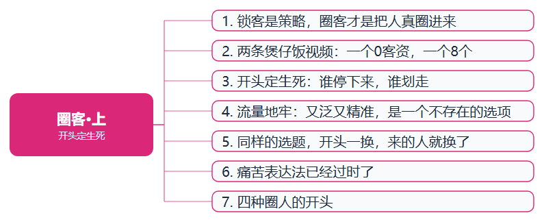

## 1\. 锁客是策略，圈客才是把人真圈进来

### 1\. 昨天讲的锁客，是账号最早期的那张图纸

昨天讲锁客。锁客是什么？你可以把它理解成人群定位。

它不在拍摄环节，也不在剪辑环节。它是在账号早期，我们做营销策划、做策略部分的时候，就要先设计好的东西。

前两年我经常听到有人讲：我的定位是什么？我的定位是什么？最开始我不太理解，这个"定位"到底什么意思。后来我大概理解了——很多人嘴里所谓的定位人群，其实是"优势人群"。

所以昨天讲锁客，解决的就是这中间的一部分。

市面上很多人都在讲，要做高客单，要做优质人群，要挑客户。我一直有个不太一样的看法：原来你服务年入50万的顾客，现在你不要了，你要去年入500万的。为什么？因为他对你的产品价值更能理解，买单的紧迫性也更高。我认为这才叫优质顾客。

### 2\. 有钱不等于优质：上海的两套房子

举个例子。在上海，一个人有5000万现金，我们卖一套房子给他，他一定是优质顾客吗？

同样在上海，另一个人只有1000万现金，但他家小孩要换学区房，12个月之内就要开学，他准备买单。你说哪个是优质顾客？

卖房子赚的是佣金。一个有5000万但不着急的人，和一个12个月内必须买的人，谁的佣金更好赚？

所谓优质顾客，我在锁客的逻辑里再强调一次：我们不认为一个人有钱就是优质。他未必愿意把钱花给你，有钱也未必愿意马上买单。

### 3\. 拆迁户穿拖鞋、大学生买iPhone：有钱和买单是两件事

我们一些同学聊天，常说我的顾客不是很好，我的客群不行。好像形成了一个逻辑惯性：一个人没钱，他就不是好客户；一个人愿意买高配、愿意买贵的服务，主要就是因为他有钱。

真的是这样吗？

如果一个人有钱，他就会轻松下单买东西，那上海、杭州那么多拆迁户，手上几千万现金，他怎么不买？还穿拖鞋。广东有那么多包租公、包租婆，也穿拖鞋，怎么解释？

如果一个人有钱才会买贵的东西、没钱就不买，那买iPhone的大学生你怎么解释？杭州有大量月薪7000、8000的白领，一个月工资8000块，愿意攒一年的工资买一个3万的包，你怎么解释？月薪7000多，去掉房租、去掉吃饭，一个月可能只剩2000块，他还能每三个月花5000块去看王俊凯的演唱会，去买一张印着王俊凯的签名卡片。

这不是有钱没钱能区分的。

一个人是否愿意买单，最核心的要素不是他手上有多少钱，是他有没有理解产品的价值，他是不是一个能理解你产品价值、服务价值的人。

怎么判断一个人有没有理解你的产品价值？他识货了，他自然就愿意买，因为你的说服成本、产品介绍成本已经非常低了。这就是我定义的优质人群：他能理解我的产品为什么这么贵，沟通成本、说服成本、成交成本、成交周期都相对低。这样的人，没钱他也会咬牙。

所以锁客的背后，是我们对优质人群的理解。而我们对优质人群最在意的一件事，是降低沟通成本。

### 4\. 圈客：一条两三分钟的视频，就是一个圈

今天讲圈客。什么是圈客？圈客就是圈进优质客群。

昨天说的锁客，很多时候是策略——它并没有真正进入短视频的环节。锁客只是我们脑子里的想象：我要做这批人。

但这批人有没有真的在看我的短视频？他们有没有刷到？我所设想的人，有没有进入我的短视频场域？这是另外一件事。

所以要用短视频把人圈进来。什么叫圈？你可以理解成，一条两分钟、三分钟的短视频，它就像一个圈。我们要让这批人进入这个圈，并且把这条视频看完。

### 5\. 看视频的人对你，才有可能成交

很多时候我想告诉各位一件事：看视频的人对你，才有可能成交。

我们过去的注意力永远放在播放量上。这三天最核心的一个概念，就是看人，别看播放量。

永远要看那个人。看视频的人是谁？他的心智变化是怎么样的？因为他的心智变化，决定他是否会买单。

一个人看视频的时候，他是不是我要的那个人？他是我要的，才有可能成交。

### 6\. 2022年我也用市面上的方法拍过

我曾经也踩过这个坑。

昨天晚上一敏下班之后来跟我同步上课的情况。很多同学发现，我们这三天讲的东西跟别人讲的不太一样，跟市面上讲的是反着的。

我不是有意要反。我试过，我发现反着没有用。

2022年的时候，我也用市面上主流的方法在拍：采访、讲故事、讲观点、晒过程、发表行业话题，这些方法我全用过。不是去年用，不是前年用，我四五年前就在用。

所以我今天不是要标新立异。我经历了四五年的变化，越来越坚定：反是不对的。

📌 一句话总结：有钱不等于优质，能理解你价值、沟通成本低的人才是优质客户。

## 2\. 两条煲仔饭视频：一个0客资，一个8个

### 1\. 都是3万播放，差了8个客资

2022年我拍过两条视频，讲的东西一模一样。

左边这条，播放量3万；右边这条，播放量也是3万。但右边带来了8个客资，左边是0个。

两年后我才理解，为什么当初会带来不一样的结果。

那是一个做煲仔饭的加盟品牌，老板姓梁，在宁波有一百多家店，是当地的连锁品牌。

### 2\. 左边讲了什么：我成本低，大牌成本高

左边这条是这么讲的：

前面几个副牌，麦香村、肉夹馍、九毛九的"两颗鸡蛋"、海底捞的"十八座"，都往社区下沉，但是做不好，他们的成本决定了大手笔去做。

梁总加了一个油炸炉，供小吃，那个炉子170块钱，好不好买？也能用。十八寸的一个油炸炉，功能是一样的，大牌要3000块钱。各种成本不叠加上去吗？社区店拼的就是性价比，成本要放在这里。

他讲的核心是：西贝、九毛九这些大牌做了，但做不好，因为他们成本更高，而我们成本更低。

### 3\. 右边讲了什么：内核一个字没改，换了一个视角

右边这条，讲的东西一模一样：

好多品牌开始做社区店，西贝开了多少个社区店，麦香村开了五六家，其中那些品牌做不好社区店……

主题一样，主要观点也一样，内核一样：大牌做不好，我们做得好。

这个世界上，关于信息有两个概念：第一个叫"你说了什么"，第二个叫"你怎么说"。

这两条视频，"说了什么"是不是都一样？都是"大牌做不好，我们做得好"。一字不差。

那差别在哪？

现场有人答得很好：第一条讲的是现状，第二条讲的是趋势。第一条是餐饮老板的视角，第二条是运营者的视角。第一条讲成本，讲的是固定成本这一个角度；第二条讲的是大企业为什么进不去，是基因，是管理。

这些回答都对。但我要给一个新的视角：客户视角，或者说刷视频的那个用户的视角。

### 4\. 两条视频放在一起，四个维度就分开了

同一件事，摆到一张表里就清楚了：

|**对比项**|**左边视频**|**右边视频**|
|---|---|---|
|视角|餐饮老板看现状|运营者看趋势|
|第一句|大牌做社区店做不好|好多品牌开始做社区店|
|停下来的|连锁同行、连锁老板|想开店的夫妻|
|播放量|3万|3万|
|客资|0个|8个|

### 5\. 我们到底是怎么刷视频的

我们可以回想一下：今天刷视频号、刷抖音、刷快手，我们是怎么刷的？

基本上是在一个无意识的状态。因为我们最近很闲，打开手机，随便打开一个软件，无所谓，都一样。手指无意识地往上滑。

那我问你一个问题：什么时候你会选择停下来？你的这个无意识，什么时候会停下来？

是不是当一条视频的前三秒、前五秒——也就是市面上所谓的五秒完播率那个东西——让你觉得感兴趣？

比如我最近脱发很严重，正好刷到一条讲脱发的，我是不是就会停下来？我最近脚踝很痛，正好刷到一条讲脚踝的，而且跟我的症状一模一样，我是不是就会停下来？

再举一个例子。我完全是一个不在意明星的人，刷到一条"刘德华入驻视频号"，点赞数是 100 万。可是我对刘德华一点兴趣都没有，我会不会点赞？会不会停？

不会。播放量再大，跟我没关系。

所以我们在刷视频的时候，都是主观的选择，选我自己感兴趣的内容。

### 6\. 三五秒，一两句话，就定完生死了

那你说，我们会花多久来判断这条视频要不要往下看？

平均两三秒、三五秒。

两三秒、三五秒是什么概念？就是两三句话，一两句话。

我们刷到一条视频，会主观地选择要不要停下来，不是客观地选择。什么叫客观选择？哇，这条视频点赞好高，我咬牙看吧——也会有，但坦白讲，大多数时候我们还是主观的。

而且如果那条视频点赞很高，你咬牙也不会咬30秒，也不会咬40秒。真的不感兴趣，你为什么要咬牙？

现在让在座的男生看一个500万点赞的化妆视频，这个视频30分钟，你咬牙给我看看，你能咬多久？

所以大多数时候，我们就是主观地看两三秒、三五秒。如果这个视频跟我有关，我最近就在关注这件事，我会往下看，一直往下看，把它看完——当然也可能看到后面觉得没劲，就不看了。

这里面就有一个很特殊的情况：一条视频的开头，必须击中你。

那问题来了：我追求播放量很大，我追求开头很大，我一定能击中你吗？

### 7\. 短视频获客的一句话定义

很多人说视频号的算法跟抖音不一样，我承认；小红书的算法跟抖音、跟视频号也不一样，我也承认。

但是人是一样的。

我没听说过视频号的人刷视频不这么刷，视频号的人一定要咬牙看完30秒，不可能的。我也没听说过抖音的人用大拇指往上刷，视频号的人一定要用小拇指刷。不存在。

人是一样的，刷视频的方式是一样的。

所以短视频的作用到底是什么？精准获客短视频的作用是什么？一句话：

你这条视频出现在目标客户面前，并且有能力让他停下来。

再讲细一点：一条视频出现在目标用户面前，他能够通过开头就判定，自己值不值得为这条视频停下来。

你的客户看到这条视频的前三秒、前五秒，他已经能够判定，这条视频是不是在说他，值不值得他为你停下手指头。

这就是获客短视频的作用。

所以重点不是播放量高，重点也不是开头有多么炫酷，重点也不是什么反常识、反差、讲故事。重点只有一个：让人停下来。

### 8\. "我后半段有"——这句话害了多少老板

我以前听过一些同学说一件事，我觉得很好玩，也要跟各位分享。

他说：你这个视频我看不下去。我说你往后看，你往后看。他说这视频跟我没关系。我说我后半段有，后半段有。

很多人都会这么想。我们有一种模糊的概念：我这条视频的中心思想是这个，中心思想藏在哪里？藏在中间。我这句话想表达的意图在哪里？意图在后面。

这视频跟我无关啊。哦，我第二点有讲到——那你为什么不第一点讲呢？

这是很匪夷所思的一件事。我明明手指头只能给你三秒，你不要说"你往后看，你往后看"。

有时候在选题会上看我们家的编导，我也骂他们：你们为什么都跟古时候那个青楼女子一样，犹抱琵琶半遮面？所有你们要讲的东西，全部放在后面。

你说客户有没有可能往后看？翻个三分钟，翻个五分钟，来看你到底在想什么，是不是跟他有关？

有可能，但极低。而且如果他识别出来这跟他有关，你最好还能让他一直留在你的视频里，那是最好的结果。

### 9\. 我当初犯的错：以为播放量重要

通过这两条视频，可以看出来我当初犯了一个什么错。

我认为播放量很重要。我认为开头吸睛很重要。我认为开头吸引别人的注意力很重要。

事实上呢？事实上，吸引客户的注意力最重要。

吸引大众的注意力和吸引目标客户的注意力，这是两个概念。

吸引大众的注意力，刘德华、周杰伦就可以了。但你的目标客户，也许很讨厌周杰伦。

完全有这种可能。

📌 一句话总结：同选题换视角，3万播放0客资对8个客资，关键是谁停下来。

## 3\. 开头定生死：谁停下来，谁划走

### 1\. 拆左边开头："线下还有流量洼地吗"

我们回到那两条煲仔饭视频，不说多，就说开头。

左边这条的开头是："线下现在还有流量洼地吗？你就看看大佬在做什么，就知道了。"

五秒钟。

谁的手指头停下来了？

同行。连锁同行。

我们再看这句话："线下现在还有流量洼地吗？"什么样的人，会用"洼地"这个词来形容开店这件事？

你如果只是准备开一个店，你不会在意"线下有没有流量洼地"。你三十多岁，准备跟老公一块开一个店，你会说"现在线下有没有流量洼地"吗？我们开一个蜜雪冰城，不会这么讲话。

什么样的人会关注线下有没有流量洼地？连锁老板。手上有50家店、100家店的连锁老板。

第二句话也印证了这一点："你去看看大佬在做什么，就知道了。"

### 2\. "大佬"这两个字，只有同行才会用

比如说，就在这个会议室里，我们都是餐饮人。你说贾国龙是谁？我们会喊他"贾总"，会喊"大佬"。因为我们都是同行，我们才会认为他是大佬，才会称呼他为大佬。

那如果你是消费者呢？

你作为消费者，是不会喊一个餐饮品牌创始人为"大佬"的。"大佬"这个称呼，只有连锁老板和同行才会这么叫。

所以这两句话——"线下现在还有没有流量洼地""你去看看大佬在做什么"——五秒钟结束之后，什么人留在这个视频里，停下来继续看？

连锁创业者、连锁老板。

什么人认为这条视频跟他无关，选择划走？打算开店的人。

有没有可能有一个打算开店的人，捏着鼻子把这条视频看完？"反正这期视频跟我没关系，我一定要把它看完。"各种可能都有，但很低很低。

### 3\. 一个连锁老板，不可能跑来加盟你一家店

这条视频从开口就在筛人。五秒结束之后，看视频的人只剩下连锁老板；随着视频往后推进，看的人会越来越集中在这个群体里。

那问题来了：能不能转化连锁老板？

一个连锁老板，自己放弃自己的连锁品牌，跑来加盟某一家店，有没有可能？

没有任何可能。

**⚠️ 所以他圈进来的人看起来"很精准"——全是同行，全是连锁老板，全是懂行的。但这些人恰恰不会买。这就是左边这条3万播放、0客资的原因。**

### 4\. 拆右边开头："好多品牌开始做社区店"

我们再看右边这条。它又让谁停下了手指头？

"好多品牌开始做社区店。"

这是一个趋势。

你设想一个场景：昨天晚上，你跟你的老公，或者跟你的老婆，准备夫妻创业，开一家店。但你们也很紧张，觉得现在创业不是一个很好的时间段，你们并不知道该开一个什么样的店。

于是你们很纠结：老公，你说我们到底是开奶茶店呢，还是开餐饮店呢？到底是开汉堡店呢，还是开中餐店呢？我们也不知道怎么开。

这个时候，女方刷视频，刷到"现在好多品牌都开始做社区店"。

会不会停下来？会停下来。

那你说，你会在抖音停下来，在视频号就不停下来？

为什么？因为人都一样。

所以这两条视频，在三秒钟、三五秒之后，已经定完生死了，没有别的可挽回的余地。

### 5\. 大众注意力和目标客户注意力，是两套打法

这两者的差别不是程度，是方向：

|**维度**|**吸引大众**|**吸引目标客户**|
|---|---|---|
|用什么人|刘德华、周杰伦|行业里的大佬、同行|
|开头怎么讲|演唱会、热点、八卦|洼地、成本、趋势|
|谁停下来|路过的人|有这门生意的人|
|结果|播放高、客资零|播放低、人能成交|

### 6\. 周杰伦到底有没有才华：反的是谁的常识

我今天如果要追求开头很大、流量很大，要吸引大众注意力，怎么讲？

我可以讲：最近周杰伦又有什么样的演唱会？相对来说，看的人会多一点，零零后多一点。

那如果我要吸引客户，我应该怎么讲周杰伦？

我应该讲：像周杰伦这种歌手，一点诚意都没有，他怎么会火？

零零后会来跟你争。因为对零零后来说，"周杰伦没有才华"是他们的常识，你讲"周杰伦其实超有才华"，那才叫反常识。

而对于在座的各位，我跟你讲"周杰伦其实完全没有才华"，才会反你的常识。因为你们的常识是"周杰伦很有才华"。

所以外面有人说，做短视频要反常识。不是的。每个人的常识是不一样的。

你们的常识可能认为周杰伦很有才华，但有一部分人认为周杰伦没有才华。什么叫反？是反你目标客户的常识。

### 7\. 1000播放量，就是1000个人在看你

我们今天上午在讲一件事：1000播放量就是1000个人在看，1万播放量就是1万个人在看。

所以重点是什么？重点是这些人真的是你要的吗？

我们很多时候只关注那个数字，不关注数字背后的人。

难道你的视频有1万播放量，背后不是1万个真实的人吗？当然是。所以我们应该关注的恰恰不是播放量，我们应该关注这些人到底是谁。

那些我们所谓的对的人，有没有在看这条视频？有没有存在于这条视频里面？有没有为这条视频而停留？

我讲的东西可能对各位来说有点颠覆认知，但请各位理解——这句话我不知道谁能推翻：

如果看视频的人都不是你要的，你凭什么能获客？

我都不能理解。

昨天有个人说：经纬讲的东西跟别人不一样，但是感觉逻辑好。

我并没有在用逻辑解决问题，我在用常识解决问题。

获客只有一个标准：看视频的人是你想要的。看视频的每一个人如果都是你要的，都是能够被成交的，你当然会变现很好。

### 8\. 四个圈：开头、画面、观点、选题

我们有四个标准，四个圈：开头圈、画面圈、观点圈、选题圈。

|**圈**|**解决什么**|**用户动作**|
|---|---|---|
|开头圈|让人不划走|待三五秒|
|画面圈|让人看得下去|继续看|
|观点圈|让人觉得有货|继续看|
|选题圈|让人觉得相关|看完|

开头圈是让这个人在这条视频里待个三五秒；画面圈是为了让他看下去；观点圈是为了让他继续看下去；选题圈也是为了让他看下去。

如果一条视频的开头、画面、观点、选题，都能把你的目标客户牢牢锁住注意力，那么最终我们是不是能实现一个结果：看视频的人是对的，并且你的目标用户愿意把它看完？

不是说所有人愿意把它看完，而是目标客户愿意看完。

今天上午的主题，就是开头、画面、观点和选题。开头稍微麻烦一点、重要一点，别的可能没有那么麻烦、没有那么重要。

📌 一句话总结：开头第一句就决定谁来；用同行词只会圈来不会买单的同行。

## 4\. 流量地牢：又泛又精准，是一个不存在的选项

### 1\. 在意播放量，是一件毫无意义的事

大多数的人会进入流量地牢。

天下苦流量久矣。所有人都非常在意流量，非常在意播放量。

在我看来，在意播放量是一件毫无意义的事情。

第一，就像我昨天说的，你在意播放量，可我们每个人的人生底色、人生素材是固定的，不可改变。如果你没有离婚，你没有破产，你怎么会有很大的播放量呢？

第二，如果我们在意播放量，你其实也不知道该怎么样去优化，怎么样去做正确的行动。你根本就没有关注生意的本质，你根本就没有消费者导向。

### 2\. 流量地牢里的第二件事：搞流量去了，没有圈人

前阵子有两个小孩在网上吵架。

一个说，短视频一定要做精准，一定要做垂直。另一个说，短视频一定要做泛。

一帮人吵到现在，吵了五年了，还在吵。

总有人问我：我能不能又快又精准地筛出我要的人？

那我就来解释一下：短视频到底能不能又泛又精准？

大家总觉得，我开头说泛一点，然后慢慢筛，这好像是一个逻辑上很正确的事情。我们来看看逻辑。

我们怎么刷视频？刚刚讲过，最多三秒，不感兴趣就划走。

### 3\. 装修：说"有钱人住别墅"的人，圈来的是同行

第一条视频，做装修的：

"深圳的有钱人百分之百住别墅，只有富二代为了去市中心的酒吧泡妞方便，才会住大平层。我是一个室内设计师。"

看视频的人是什么人？有钱人吗？

我们想一想：你都已经是一个有钱人，你为什么要看别人分析你？你都已经住在大别墅里，有什么好看的？

所以看视频的是什么人？没钱的人。

再看评论区。有人在下面写："真正的有钱人百分之百住别墅，限定江浙就好。"第二句："我是做装修的。"

然后下面就开始吵了：

"我做装修10年了，我跟你讲，你讲得不对。真正的有钱人根本就不是住别墅。"

"放你妈的屁！老子做装修已经做了20年了，我可以明确告诉你，我讲的就是对的。"

再来一个人："你们都别吵了，我做装修已经做了30年了，我跟你讲，我讲的就是对的。"

一条讲有钱人住哪儿的视频，评论区全是装修同行在吵架。这就是它圈来的人。

### 4\. 南通240平：开头一换，没钱的人自己就走了

第二条视频：

"南通两百四十平的大平层，到了施工过程中非常重要的一个节点——中期验收，我们团队一起来到工地。"

看这条视频的是什么人？

如果这个人在南通，他没有装修，他看不看？完全没房子，不看。

如果这个人在南通正在装修，家里只有80平，看不看？也不看。他最起码得有个150平，才会看，因为跟他有关系。

评论区也能看出来。有人直接问"要看预算"。还有个人叫"瑞福禄"，这名字就很有钱，以前的人都不敢用这个头像。

所以左边这条设计师的视频，有没有可能有钱人咬着牙把它看完？不可能。

右边这条南通240平，有没有可能没钱的人咬牙把它看完？有一定困难。相对来说，这是一件比较困难的事。

### 5\. 留学：上技校的，和家里有女儿的

再看留学的两条。

左边："我负责任地说，在中国，上技校和上大学是两码事。不要说什么学一门技术能够活得很好，不要说发大财，就说维持一个体面的生活，一线城市月薪1万。"

看视频的人是什么人？上大学的人，还是上技校的人？

上过大学的人，并不在意这种事情。真正停下来的是技校这条线上的人，是正在为这件事焦虑的人。

右边："女孩如果要出国留学，应该怎么规划？女孩留学比男孩要考虑的东西更复杂，安全性、教育质量、认可度，一个都不能少。"

你家里有儿子吗？没有儿子，你也不看。家里有女儿要出国留学，你才会看。

两条视频，看视频的人又不一样：一个是上技校的，一个是家里有女儿的。

评论区也是一样。左边那个人连名字都没有，下面这个叫"钱钱钱钱钱钱钱"，留言："没钱怎么出国？有钱出不出国又能怎么样？"这个人已经饱受生活的折磨。

右边这个人叫"慵懒的熊"，留言："咨询一下，谢谢。"

那天我看到一个同学说了一段话，我点评了一句：有钱的妈妈才可以当"慵懒的熊"。没钱，你会怎么取名字？"一直在奔跑的熊""独立的熊"，或者"AAA装修的熊"。

### 6\. 绿豆是绿豆，黄豆是黄豆，三五秒就分道扬镳

所以，能不能让这两批人同时存在一个池子里，都把这个视频看完？

事实上，这两波人在视频的前三秒、前五秒，就已经分道扬镳了。

为什么又泛又精准做不到？

因为不同人群的兴趣就是不一样的。你很难说，一条视频发出去之后，能够兼顾两种人的兴趣。

**⚠️ 大多数人发视频，不喜欢他就走了。你想先泛一点把人捞进来，再靠后面筛，等于让已经划走的人再回来，这件事在物理上不成立。**

通常的情况是：用户刷视频三五秒，就已经自动分道扬镳。绿豆是绿豆，黄豆是黄豆，红豆是红豆。

你有没有一个开头，能够把绿豆、黄豆、红豆全部装进来？非常难。

### 7\. 同行的两条装修视频，差别只在第一句

行业一样、内容一样，只有第一句不一样：

|**维度**|**"有钱人住别墅"**|**"南通240平中期验收"**|
|---|---|---|
|第一句|深圳有钱人百分百住别墅|南通240平到中期验收|
|停下来的人|没钱的人、装修同行|有240平在装修的人|
|谁不会看|真有钱的人|没房、80平的业主|
|评论区|同行吵了30年|业主问预算|

📌 一句话总结：又泛又精准不存在，三五秒就分流，开头要直接锁窄人群。

## 5\. 同样的选题，开头一换，来的人就换了

### 1\. 三组数据摆在桌上

先把今天要用的几组数摆出来，播放和客资是反着走的：

|**视频**|**开头圈到谁**|**播放**|**客资**|
|---|---|---|---|
|少女赋·左|普通美业粉丝|15万|0|
|少女赋·右|对身材有极致要求的|1万|36|
|新美业·左|新美业同行|40万|—|
|新美业·右|要转型的老美业人|3万|—|

### 2\. 《少女赋》：15万播放0客资，1万播放36个客资

《少女赋》是做妈妈产后康复的，讲少女腰、少女腹。

它是一个5天的手法松解训练，客单价1万，今年涨了价，18000。不便宜。

这个赛道很小，非常小。这种赛道要很"锤"——就是很垂直，人群很窄。我们来看两条视频，选题一样，都在讲案例。美业有一个非常有名的IP叫吉娜，所以两条视频都分享了吉娜这个成功案例。

左边这条，15万播放，0个客资。开头是：

"去年我在深圳遇到了吉娜，和她加了微信。她看到我帮助很多女性打造了少女腰、少女腹，非常好看。她问我：你是怎么打造的？怎么那么好看？能不能帮我也打造一个？"

这是一个很"锤"的开头。

右边这条，1万播放，36个客资。开头是：

"因为已经很完美了，但是鸡蛋老师为什么还要找我打造少女呢？"

两个都是很锤的开头，但圈的人完全不一样。

### 3\. 换成彭于晏，你就懂了

大家对美业这些人可能不熟，我换一个说法。

彭于晏的粉丝，有没有可能来我的健身房，花15000报一个课？

"明明身材已经很完美了，为什么彭于晏每周还要来我的健身房训练？"

这句话圈的是谁？是彭于晏粉丝里面，那批对身材有极致要求的人。

回到吉娜：左边那条圈的是普通粉丝，右边这条圈的是身材粉。同样一个案例，同样一个选题，来的人完全是两拨。

15万播放没有客资，1万播放出了36个客资。播放量差了15倍，客资是0比36。

### 4\. 新美业：40万播放圈来同行，3万播放圈来要转型的人

我们昨天给美业的工作人员也做了一个开口。

左边这条，40万播放。开头是："我们是新美业，新美业服务的是什么人群？"

看这条视频的人是谁？同行。而且是同行里偏年轻的那一批，新美业里比较新的一批。

右边这条，3万播放。同样的内容，换了一个开头：

"10年前，你的美容院之所以能赚钱，是因为你服务的是70后、80后。他们不讲究效果，更多的是我来这里放松的、休闲的，我要的是服务好，你能解决我的情绪价值，我跟你唠唠嗑。但是现在美容院的核心人群是……"

这条圈的是谁？是老美业人，是10年前赚钱、但越来越不赚钱的那批人。

我讲的是同一个主题，无非就是在讲消费趋势。可是让一个美业老板花5000块钱出来上个课，很费劲；而右边这条，圈的就是那批正在难受、正在找出路的人。

所以我想告诉各位一件事：哪怕是同样的选题，开头不同，看的人也不同。

### 5\. 能获客的开头，长什么样

我们想要视频能够获客，重点其实不是你的选题能不能火，而是你的开头能不能让顾客先进来。

在我们看来，能获客的视频开头，往往是一个圈人群的开头，是一个确认性的开头，是一个能够提起用户注意力的开头，是一个能让用户看到前三秒、前五秒就自我带入的开头。

### 6\. 一个信息差：做了两年以上的人，痛在别处

如果你做线上已经做了两年以上，我今天上午讲的东西对你而言没有那么陌生。

现场应该有些做了两年以上的。这些概念你们基本不陌生——圈人群。这就是一个小小的信息差。

有些人还没开始做，或者做了1年以内，你们会认为要做流量。但在座那些做了2年以上的，已经完全知道短视频要圈人群了。大家会有一点点信息差和认知差。

可是做了2年以上的人，又会有一个新的痛苦：你知道要圈人群，但你发现圈了人群之后，流量好像很小。

肯定小。圈人群的表达方式，肯定没有那种哗众取宠的表达、那种非常震撼的表达更容易吸引注意力，所以流量会稍微小一点。

为什么小？因为大家对"圈人群"的理解，通常只有一种做法。

### 7\. 圈人群的默认动作：拿针戳你

大多数人认为圈人群的表达方式是这样的：

"你是不是遇到了什么样的情况？""如果你现在正在遭遇什么样的痛苦？""你遇到了什么样的问题，你就应该怎么办？"

我们大多数时候喜欢这样——唤醒别人的痛苦。

什么意思？你在刷视频，我拿一根针，戳你一下：

"你是不是那里痛？""你是不是晚上带孩子的时候，你就痛苦？""你是不是那里不行了？""你是不是已经痛苦很多年了？"

本质上，这种开头就是一种唤醒别人痛苦的方法。

因为我们身边总有人说：要怎么样获客？要激发别人的痛点。什么叫激发别人的痛点？就是让别人痛苦。

📌 一句话总结：同选题换开头，15万播放0客资变1万播放36个客资。

## 6\. 痛苦表达法已经过时了

### 1\. 23年前后，用户接受痛苦的方式变了

坦白讲，23年前，互联网上的用户还是愿意接受痛苦的。

那我问问你自己，在座的体感：现在有多少人看到这样的开头，或者有人跟你讲"千万不要""如果你这样做，一定要当心"，你会很害怕，一定要把这个视频看完？

有多少人在面对别人唤醒你痛苦的时候，会真的觉得自己很痛苦，愿意把它看完？

就没有。

大家是什么反应？你说千万不要，我他妈就要。什么"皮肤管理的55个坑""8个错误"，你一定要当心——我就不当心。

你是不是？我不是。

### 2\. 全世界所有商家，都在说你不好

为什么？因为用户今天进入到了一个叫"痛点疲惫"的状态。

所有的商家都在唤醒你的痛点：说你不是一个好妈妈，说你不是一个好妻子，说你不是一个好员工，说你不上进，说你不努力，说你不够爱自己，说你身体不够好，说你不能赚钱，说你认知不够，说你不会觉察自己，说你不懂你自己……

全世界所有的商家都在说你不好。

**⚠️ 所以今天的用户就进入了一种痛点疲劳的心理：你越让我痛苦，我就越不看。**

这是一种群体性的反应。我们在座每个人都是这个反应。所以我刚刚讲那些东西的时候，你们笑了，因为你们现在就这样。

刷短视频的时候，被频繁地说"你是不是""你是不是""千万不要"，他就形成了一种痛点的疲惫。因为他有反叛心理：一直要让我痛苦，我就不看了。

### 3\. 家庭教育：一个伤口，戳一百遍

还有一个原因，我跟各位分享：他真的被说太多遍了，麻木了。

你们有没有人做家庭教育？

如果你的孩子在5岁到12岁左右，你作为父母会发现，全世界所有的老师、所有的家庭教育专家，都在试图让你面对一件事：你们家孩子拖拉、磨蹭、不写作业，该怎么办？

你一天可以被戳三百回。所有的家庭教育老师都在说：你们家孩子拖拉磨蹭，不写作业该怎么办？怎么办？怎么办？

一个伤口，戳一次疼，戳两次疼，戳一百遍呢？

"哎呀，你说吧，你说吧。"不表态了，就是这样一种反应。

所以当同一个问题被重复说的时候，用户也不看了。这就是这种方法为什么流量会越来越小。

### 4\. 为什么唤醒痛苦，流量一定小

我们内部给这种方法取了个名字，叫痛苦表达法——唤醒用户痛苦的表达方法。

我们认为，今天已经完全过时了。今天的用户其实已经完全不接受这样的叙事方式。

它流量小的核心原因，是我们在试图圈和击中用户的问题和现状。

我们在试图让用户回忆自己的痛苦，回忆自己痛苦的那个场景，试图重新唤醒他那些不舒服的画面。

而且这种画面本身是非常个性化的。你让他面对自己的现状，他不舒服、不开心、很疲惫，所以他反叛，直接划走。

### 5\. 换成快乐表达：往人的内在去找共同点

每一个人有了问题、有了现状之后，其实都会有一些不同的感受。而且我们每一个人，都会有感兴趣的话题、感兴趣的人物、感兴趣的观点。

比如我今天跟各位讲痛点、讲感受，我可以说：大家播放量降低了，从1万掉到3000，3000掉到多少，业务不好……

但这些事你们早就知道，你们已经麻木了。

那如果我们来试着唤醒大家的共同感受呢？

我们的共同感受有哪些？我们会觉得最近几年心力越来越不足。这是共同的感受。

我们还会有一个感受：我们应该如何提高自己的执行力？

再往下，我们可能有共同感兴趣的话题：AI到底有没有用？AI对于我们这帮人的未来会带来什么样的影响？

共同感兴趣的人物：张老师走的时候，我们所有人都会感兴趣这件事。

共同感兴趣的观点：这个行业到底该往哪走。

我们先是往人的内在去探索。其实我们有很多的感受、话题、人物和观点，是可以牢牢圈住各位的。

### 6\. 痛苦表达和快乐表达，差的不只是语气

把两种表达放在一起，差别就出来了：

|**维度**|**痛苦表达**|**快乐表达**|
|---|---|---|
|动作|拿针戳你|递个话题给你|
|用户的反应|反叛、划走|想听、看完|
|流量结果|越做越低|相对更高|
|适用年代|23年前|现在|

### 7\. 快乐表达，天然完播率就更高

当我谈兴趣话题、兴趣表达、兴趣人物、兴趣观点的时候，你有没有发现，你天然看到这些词，就能联想到：它是一种让你觉得轻松的、让你觉得有收获、让你又在成长的表达方式。

它并没有在唤醒你的痛点，也没有在唤醒你的痛苦。同时，我是在试图激发大家的群体性兴趣。

所以它天然完播率就会更高一点。

这就是快乐表达，也是快乐圈。

📌 一句话总结：别再唤醒痛点，用户已痛点疲劳，改用共同兴趣的快乐表达。

## 7\. 四种圈人的开头

### 1\. 四种开头，一条共同的底层

圈人的开头有四种，今天上午跟各位分享：

第一种，用我们共同感兴趣的话题来圈。

第二种，用我们共同感兴趣的表达方式来圈。

第三种，用我们共同感兴趣的人物来圈。

第四种，用我们共同感兴趣的观点来圈。

|**类型**|**圈什么**|**关键要求**|**难度**|
|---|---|---|---|
|兴趣话题|共同关心的事|话题熟、角度新|入门|
|兴趣表达|共同的语感|抽象、有梗|高阶|
|兴趣人物|圈内名人|不是社会热点|最简单|
|兴趣观点|用户已知观点|反他的常识|中等|

先不谈这四种到底怎么做，先看它们共同的一点：四种都是在激发群体性的兴趣，不是在戳个人的痛处。

它没有在唤醒你的痛点，它在给你一个愿意听下去的理由。

### 2\. 兴趣话题：话题要熟，角度要新

什么是兴趣话题？就是阐述对某一个现象、某一个话题，我们自己的看法。

在座每个人，都会有我们这帮人共同感兴趣的话题。用一个大家更感兴趣的话题来圈，我们能不能做到"看视频的人是对的"？看视频的人多一点，肯定可以。

我自己用过一些开头，效果还不错。

比如："我不是明年准备买一辆大G吗？为大G狠狠上一课。"

大G是不是我们这帮人共同感兴趣的？相对是。你不会感兴趣兰博基尼，也不会感兴趣法拉利，但大家基本上会对大G多掌握一些知识点，因为大G是new money一定要买的车。老钱不太喜欢买大G。

所以看视频的人是对的。

但紧接着，现场可能有人有想法：又不卖大G，讲大G干嘛？经纬你怎么卖课呢？这跟获客有什么关系？结尾跟获客有什么关系？

这个疑问我先放着，后面讲。

先说兴趣话题的两个要求：

第一，这个话题必须是大众足够熟知的。

第二，切入的角度必须有一定的新意。

很多人开头起不来，本质上还是角度不够新。

### 3\. 兴趣表达：给痛苦包一层糖衣

第二种叫兴趣表达。

什么叫兴趣表达？就是把你的观点，用与它一致、但很抽象的词，进行联想的表达。

一样的意思，但表达起来比较有趣味。有些人说话比较有梗，大概就是这个意思。

我们曾经拍过一条视频，开头是：

"我最近频繁地收到一些私信，说今晚好难受啊。"

后面讲的是：我终于有一点起色了，我终于敢来找你了。

背景无非是客户比较怕我。但如果我直接讲"客户比较怕我"，就显得很没有意义。用一种抽象的词去表达，就有意思了。

这方面有些博主做得比较好。我不是说大家一定要看黄段子，我是说，可以用一种抽象的表达。

再比如，一个人最难受的是什么？是满脑子有东西，但表达不出来。你也不会紧张，也不是害怕，你自己悟不出来，就找别人帮你悟出来。

很多人讲东方哲学、西方哲学，讲产品、讲方法论。方法论不算哲学，那你自己有没有哲学？

如果我这么开头："为什么你的品牌、你的产品很好、服务很好，但是讲不出自己的品牌故事？"这是一句很直白的话。

换一种开头："你是不是做出了很好的产品，做出了很好的服务，但是始终宣传不出去？"

你看，同样在戳你的问题，但直接戳，你就不看；用抽象一点、兴趣一点的方式表达，你就愿意看。因为这种表达会让你觉得，生活好像还挺有意思，让人觉得有点甜。

本质上，我仍然在解决你的问题，仍然在给你种草、给你做营销，我在向你证明我能帮你解决品牌宣传的问题。

但是我一定要在你的痛苦之上，给你包一层糖衣，让你快乐地进来，让你快乐地看完我的视频。

这个方法会比较高阶一点。

### 4\. 兴趣人物：不是社会热点，是你圈里的名人

第三种叫兴趣人物，这最简单。

你们每个行业里面，你的顾客都会有一些共同感兴趣的人。

我说的不是社会热点。我说的是：你的顾客更感兴趣的人是什么人。

有些人坦白讲完全不是公众人物，但是你们这个圈子里认为他是公众人物。行业名人、行业里热点事件的主角，都可以。

举个例子：有多少人知道贝聿铭？

知名建筑师。贝聿铭是中国著名的建筑师，也是法国卢浮宫门口那个三角形建筑的设计者。

这样的人，是一个行业里比较有名的人，你们很多人不知道。但如果我今天在设计圈里，贝聿铭家喻户晓。

如果我想让设计师跟我学获客，我可不可以谈贝聿铭？完全可以，因为看视频的人全都是设计师。

一个不在设计圈、不在建筑圈的人，不可能那么关注关于他的事。

再比如，我们今天现场聊海参，聊佟太太，基本上在座的各位都知道。有些人并不是公众人物，但他是行业用户共同感兴趣的人。

你看，用户的注意力就在这里。

### 5\. 培训圈最大的瓜，和成功学导师真正的作用

再比如，最近培训圈、讲师圈最大的瓜是哪个？

大家应该都知道。

他并不是一个公众人物，但在这个圈子里，所有老师都知道他。

本来我已经跟他约好时间见面，谈一个合作。结果谈完三天后，他就出事了。我还想着能不能出来之后再深度合作，结果一个大客户就这么丢了。

但如果你私下见过他，你会知道，他是一个非常简单、非常纯粹的人。

到什么程度？他除了上课就是看书，没有别的爱好，不参加任何社交活动，也不参加什么酒局。他的阅读量非常非常大。

今天很多人诟病他，说他是成功学大师，是骗老板钱的。

换一个视角去想：其实我们在座每一个做技能培训、做服务的，都在享受着像他这样的成功学导师建构出来的东西，我们其实都在他的庇佑下。

像这样的成功学导师、成功学讲师，他们的核心作用其实是——点亮。

只有当一个人对自己的人生重燃希望的时候，他才会去学。

他起作用的阶段，其实比你更早。当一个用户绝望、对未来没有任何希望的时候，他的核心作用是点亮。等这个人对自己的人生重燃希望之后，他才需要这些方法论。

这才是他在整个链条里的位置。

### 6\. 兴趣人物怎么找：先看你的行业里，什么不是热点

再比如，你今天做零售，我们可以谈什么兴趣人物？

家乐福、盒马、胖东来、山姆。

我今天做的是零售圈的业务，我是不是可以谈这样的一些人？

再比如，你今天做供应链、做电商，我们可以谈谁？辛巴。辛巴被全网封杀，很多人发自内心地厌恶他。

所以你回看，你可以去查看：在你自己的行业里，不是什么是热点，我们就把它做成热点。

关键是，这个热点里面的人物，是不是你的用户关注的。

车企、小米、华为有非常非常多的热点，我从来不蹭，因为这不是我的用户关注的。

但在你们行业里面，有没有一些小热点？你的目标用户比较感兴趣的热点？最近圈内有什么大瓜？最近圈内发生了什么事件？

这完全可以谈，而且它可以让你的目标用户把注意力全部给你。

这就是兴趣人物的表达方法。

### 7\. 兴趣观点：反的是你客户的常识

第四种叫兴趣观点，就是对用户已知观点的反驳、质疑、重新定义、否定。

比如：

"我们正在经历一场因为AI和自媒体带来的信息革命。这个信息革命，我认为它的内核是：干货越来越没有用，取而代之的是湿货。"

这就是对已知观点的反驳。

再比如："普通人怎么向上社交？向上社交不是希望从别人手里掏钱。"后面接一句："能量才是财富最核心的燃料。"

这都是对用户已有观点的反驳、否定、重新质疑。

市面上有些人会说，这个叫反常识。不是的。

有的用户的常识在这里，有的用户的常识在那里。

举个例子。我跟我妈讲：早饭不要喝粥，喝粥除了升糖没有任何好处。

这对她是不是反常识？是。因为我妈认为喝粥养胃，所以我跟她说"喝粥一点都不养胃"，这叫反常识。

但如果我跟你讲"不要喝粥，喝粥不养胃"，这还反你的常识吗？这已经是你的常识了。

那我对你该怎么讲？"早上一定要鸡蛋、牛奶配点粥。"

这可能又反你的常识了。

所以每个人的常识都不一样。大家千万不要把"反常识"这三个字固定地去看，因为不同用户的常识不在一个地方。

我们要比用户稍微反一点点，它是一个相对的状态。

人总是会被反认知、反常识、没见过的观点所吸引。所以开头讲一个莫名其妙的观点，后面自己解说就可以了。

### 8\. 一条讲大G的视频，怎么从头到尾把人留住

回到刚才那个疑问：我又不卖大G，讲大G干嘛？这跟获客有什么关系？

我先跟各位分享一件事：在我们的教学模块里，今天上午只解决一个任务——看视频的人对。

我先让你进入我的短视频。至于你是因为获客进来，还是因为大G进来，还是因为特朗普进来，这并不重要。因为进来的人是对的。

我们设想一件事。在生活当中，我们在饭局里一起吃饭，我当然希望给你卖课。我的目的就是卖课。

菜上来之后，我是不是一定要这样："张总，我们来干一杯，可以介绍一下我的课程"？

不一定要这样。

我可不可以先聊大G？然后聊特朗普？然后聊子女教育？最后再聊一下产品的事情？

为什么在生活当中，我们在饭局里这么聊是没问题的？

因为看视频的人没有变。看视频的人其实一直以来都没有变过。

那我只要跟同一批人，在不同时段聊不同的东西，是不是就可以了？

我可以在今天的饭局里，开场跟你聊特朗普，中场跟你聊大G，结尾跟你聊产品的合作。有没有问题？没有问题，因为这都是我们共同感兴趣的话题。

我没有必要开场跟你聊产品，中间跟你聊产品，结尾跟你聊产品。这并不是一个有效的沟通策略。

在短视频里也是一样。我为什么一定要在开头就跟你聊产品？你可以开头聊东，中间聊西，最后聊产品。完全可以。

所以在这条视频里，你看中后段我到底在聊什么，你会觉得匪夷所思：定位怎么能聊到这里？

完全可以。我解释一下你就明白了。

那条视频的中间，我讲的是：

我最近在网上刷视频、刷越野车，什么都看——五菱、霸王龙、坦克、大G、路虎。但我跟朋友说，我发现我刷到的、写得好的视频，全都是大G。所以我还是喜欢大G。

然后我问：我们为什么选大G？因为它的外观帅？设计得好？

不是。是因为所有人都说大G帅。所有人都说大G帅的时候，你在哪儿，你都会觉得大G帅。

我举个例子：你在非洲，一个原始人出来，中国人站在他面前，他不一定觉得大G帅。

难道孙悟空不帅吗？难道霸王龙不帅吗？都帅。

但当所有人都说他帅的时候，他一定帅。很多时候，人的认知是被营销出来的。

所以我说大G的产品好在哪里？它不是95分的性能，它是80分的外观加80分的性能。

而很多老板做产品不是这样。他的产品交付做到80分之后，他就想着：我怎么把产品功能搞到85分、90分、95分。

这个行业我没有那么了解。但你像我们做高端服务业，我听过最神的一句话，就是"我要保护我的客户隐私"。

我们做什么客户？留学、移民、法律服务、地产。每个人都跟我讲：我们这个行业不方便拍客户，我要保护客户隐私。

我就问一句：你的客户跟你说，他需要你为他保护隐私了吗？

你问过你的客户能不能开视频吗？

你没问，你就觉得你的客户希望被你保护隐私。

就算你问了，客户说不方便，那你没有办法争取吗？

正常人的逻辑都知道，一个女生如果皮肤不好，她肯定不希望宣传自己做过医美，肯定不希望身边的朋友都知道她的脸动过。

但这件事不可被解决吗？

套餐原价3000块，今天如果你愿意配合我们宣传，我给你打折，打到1500块。10个客户，仍然有5个不愿意配合，那也有5个愿意配合。

有的客户还说：好，你下次有这样的活动，你还找我，我愿意。

甚至就算你的客户身份敏感，比如说做移民："你给我优惠3万块，你看我愿不愿意？"

不是所有人都不可被说动。你为什么一定要提前预测这个阻碍呢？

很多今天的服务业，为什么短视频做得不好？没有客户案例，没有客户宣传，就只能在我面前讲。

你记得这条视频结尾聊什么吗？聊的还是"你为什么不宣传"。

你说这跟客户案例有什么关系？前文我也有扣回来：你为什么不宣传？你为什么不拍？

仍然在获客。

你看，在刚刚这个过程中，你有没有发现，其实你也能看得完。

### 9\. 用户是多级掉线的

这里面有一个小小的细节，是一个比较高阶的操作。

任何用户在看短视频的时候，其实是多级掉线的。

人是一种失神的状态。他并不在意你在讲什么，你只要讲的每一件事情跟他有关就好了。

就像火车的车厢一样。你这一段讲东，那一段讲西，那一段讲北，只要你确保这三段都在他感兴趣的范畴，他就可以听。

所以这就解释了：为什么我开头可以用大G，结尾一样可以拐回来获客。

因为消费者并不在意这样的事情。

高阶手法和初阶手法的区别就在这里。

有些人做视频做了3年，会有一种痛苦：方法论被你讲完了。那是因为你总是在试图用专业把人讲进来。

开头的作用，不是用产品让他进来。这是两个不一样的概念。

开头的作用，是让用户感兴趣，愿意看完。

开头的作用，不是跟你聊专业、聊产品，让你感兴趣、让你进来。这不是开头该承担的任务。

### 10\. 选题会上，我只问一句：这个开头想要谁

我们看视频，看什么？

我经常在内部选题会上讲一句话。

选题会3到4个小时，周三晚上5点开始。会上我说的最长的一段话、最常说的那句话就是：

这个开头到底想要谁？

什么意思？你的这个开头，到底想让谁停下来？

对比较高阶的人，我会讲得更直接一点：你这个开头对用户来说是常识啊。

各位也可以用这样的方法来自检：你的这个开头，想要谁停下来？

否则你将来很难有变现。

因为开头圈，就是每条视频的开头能让用户留下来，你的每一丝流量才能变成钱。

📌 一句话总结：用共同感兴趣的话题、表达、人物、观点圈人，别戳个人痛处。

# 七、第2天上午（下）｜圈客：画面、观点、选题三个圈

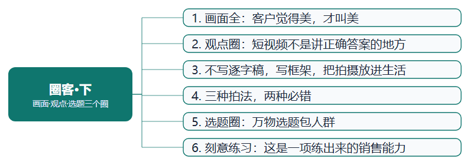

## 1\. 画面全：客户觉得美，才叫美

### 1\. 剩下三个动作，先得把播放量这件事按下去

剩下三个动作，相对来说会比开头容易一点，但很多时候还是要先改大家的认知。

大家过去非常非常在意播放量。无论我怎么强调这件事不重要，教育的成本都还是太高了，高到离谱。

我今天之所以如此相信播放量不重要，是因为大量的实践：播放量高，并没有带来实际很好的收益。你们没有我头脑里的那些数据，我头脑当中有大量的数据，你们没有这些数据去支持，所以对我说的东西多少有点怀疑，这很正常，所以我需要反复跟你们讲——追求完播率、迎合平台算法、追求播放量，并不是一个很正确、很有用的方法。

第一个要讲的，叫画面全。画面全是什么？就是你在视频里面呈现出来的画面，是不是用户所喜欢的状态。

### 2\. 我最帅的时候，是我获客最少的时候

我讲一个真实的事情。那是我最帅的时候——现在也很帅，就是偏瘦了一些——但那也是我获客量最少的时候。

在那几年里，我穿的就是那么几套衣服，穿这几套衣服的时候，是我业务下滑最严重的时候。当时我还不知道是为什么。

后来事后总结，妈的，是有一些学员跟我说："经纬，你真的最近不太……原来我还挺喜欢看你的视频，觉得你的视频里面挺真实的。最近看你的视频，感觉你好油腻。"我说："啊？我觉得我最近挺帅的。"

你知道为什么吗？因为我自己喜欢这种画面。我自己喜欢，我认为这样子比较有格调。

当时正好换了个办公室，我就跟同事说，把我的办公室稍微搞点光影，搞点场景道具，设计一下，我们认为这样比较有格调。

最可气的就在这里：我的播放量是高的。你去看，基本上都是 6000 赞、3000 赞。可是播放量高，不代表看的人是真正的客户群体，不代表他心里是喜欢你的。不一定啊，也许这些点赞的人根本不是我的客户。我当时被混淆得非常严重。

后来干了一件什么事？脱掉这些衣服，换上战袍。

我的战袍是什么？各式各样的黑色、深蓝色的卫衣，光滑的、没那么光滑的，春夏秋冬都有，我最起码有 10 套。只要穿这个东西，当月业绩就好。我平常不这么穿，可是只要有会、只要拍视频，就必须这么穿。

细节也有讲究：袖子到手腕这儿，每个人理解会不一样；里面穿白色；手表戴带点运动属性的、黑色表带的，不要戴那种非常大块的。

后来我们自己大概能理解：可能是用户认为，像我这样年纪的人，这样穿显得比较落地、比较做实事。也许是用户这么想，但我们并不知道，反正最终结果就是这样。

坦白讲，我非常不喜欢这样的衣服，然后还必须得穿深蓝色的牛仔裤。

我现在完全活成了一个格式化的人。什么叫格式化的人？就是用户认为穿成这样比较 OK、比较利落。

所以我告诉各位：我自己认为很帅的时候，就是我获客最少的时候。

### 3\. "高质感"是一门生意，不是获客方法

有一个概念我非常非常讨厌。但我每次讲，都会被人骂，别人觉得我在骂他。

今天在中国，有非常非常多的人在宣传所谓的"高质感"，我不点名，但非常多。尤其是北京那帮人——北京有非常多传媒、影视的人转型来做这个，广州就会好很多。北京那帮人全都是搞这一套的。

无非就是给你搞一个好的光影，拿一个相机，拿一个 A7M4，带一个稍微好一点的镜头来给你拍摄——老子也懂——然后后面搞一个灯，那个灯闪闪发光，你的面光一定打得不错，你整个人坐在这儿穿一身很好的衣服，沙发色调稍微暗一点，显得你的皮肤更好、状态更好。大概就是这种鬼样子。

然后他们会给你一个概念，你们有些人应该听过：今天的用户为审美买单。

特别是如果你今天是品牌创始人，你一定买这种鬼玩意儿。因为你会认为，你作为一个品牌的创始人，你自己是有调性的、是有审美的，这能够宣传你品牌的调性。所以这个故事非常击中一些连锁品牌，或者一些女性品牌，比如中式旗袍、珠宝、美业，尤其是美业，尤其是击中这样的群体。

各位有没有人为这种东西付过费？有。那我接下来讲的东西可能会有点伤害到你，希望你能接受。我希望我没有任何攻击别人的意思，我只是发表我自己的看法。

本质是什么？这种所谓的高审美、所谓的叙事方式，它的本质是：成交你的理由，是因为你梦想成为这种有审美的样子。

也就是说，你自己变漂亮了，你未必能够成交你的用户。它成交不了你的顾客。你的顾客在成交过程当中，有很多很多决策的部分，而你这个人美不美，完全不是他决策链当中一个重要的事情。

什么是高审美？高审美就是成交你的理由——因为你想要成为一个有审美的人，你想在视频里面维护自己的社会形象。这就是今天在我们圈内一个非常非常大的营销陷阱：把视频拍得很好看。

每个人都认为把画面拍得更好，会有更多流量。但其实你们没有想过，在我们内部，我们怎么重新界定美？

目的就是美。什么是目的？你的客户看完之后更喜欢你、更信任你，这就是美。不是你自己喜欢你自己，不是你觉得你漂亮。

是你的顾客看完视频之后觉得你美，你的顾客喜欢你现在的样子，你的顾客喜欢视频里的你，你的顾客觉得你这样子是亲和的、是友善的、是自然的，那就是美。

但这未必和你自己的审美相关。因为坦白讲，你自己看你自己，你一定喜欢薄皮，你一定喜欢那些非常有光影的东西。客户就喜欢吗？有时候你搞的那些光影，你客户会觉得这个人很装。

### 4\. 律师的美甲：视频里不是放全部的你

举一个很实战的例子。

我们当年有一个律师，她有一个习惯，喜欢做美甲。我们跟她做全案合作，干的第一件事情：把美甲给我卸了。就这么简单。

没有哪一个刑事案件的家属，会喜欢一个大波浪发型、涂着美甲的律师。这是你的一面，但如果这一面对成交用户没有帮助，它放在你的生活里就好了，没有必要放在你的视频里。

很多人说，视频里面就是要做自己。不是。视频里面是要去做用户所想象的那个人，是把真正的你自己当中，那一个符合用户想象的一面单独拎出来，放在短视频里面，而不是把全部的你放在视频里面。

所以我们当时会要求顾客不允许做美甲。

### 5\. 化肥父子：客户买的是刻板印象

再看另外一个人，这是我们做化肥那个客户的对标——他的同行，而且那个同行做得非常非常好。

|**账号**|**出镜形象**|**学历背景**|**去年收入**|**结论**|
|---|---|---|---|---|
|父亲|腰间挂一串钥匙|—|2300 万，净利 60%|客户买的是刻板印象|
|儿子|年轻、白净、帅气|西安科技大学|40 万|专业高不等于卖得动|

这是父子两个账号，两个人都不怎么说话，就拍化肥、拍地里的活。

**问**：你们觉得这父子俩，谁的收入更高？

**答**：儿子，儿子帅。

为什么？刻板印象。他老爸这边有一个钥匙串，那个钥匙串绝了，挂在腰上，一看就是个在地里干实事的人。他儿子正儿八经是西安科技大学毕业的，专业比父亲高多了，但没有意义，因为客户有他自己的判断。

我分享一下他们的收入：父亲去年的收入是 2300 万，净利润率 60%，复购率 50% 以上。他儿子去年的收入是 40 万。

所以很多时候，客户的购买就是那个刻板印象。你想象一下，如果今天你是一个要买化肥的农户，你会在意他儿子是不是西安科技大学毕业的吗？你看到他腰间挂着那串钥匙，你就觉得这个人实在。

画面到底在圈谁？什么样的客户群体认可你，什么样的客户群体不认可你，这就是画面的作用。

### 6\. 同一段话，三种画面圈三种人

再看我们的一个客户，郭佩言，相对来说她可能知名一点。早年她的视频长这个样子：好看是好看，就是不讨有钱姐姐的喜欢。年轻女孩子会认为这样子是好看的，但如果是 80 后、70 后、连锁品牌的创业者呢？我就没那么喜欢这个样子了，会觉得你这个小姑娘有点浮躁。

后来我们看这三条视频，三条视频讲的东西是一模一样的，但看视频的人完全不一样。

|**同一条内容**|**出镜与场景**|**圈到的人**|
|---|---|---|
|13 年美业，第一要素是筛选顾客|精致、偏年轻|70、80 的美业老板娘|
|别过度服务低端客户|年轻、直接|90 后、00 后的老板娘|
|60% 的美容院都遇到同一个问题|年纪大一点、有质感|年纪大、有钱的老板娘|

第一条她说："永远不要对低端的顾客进行过度的服务。我做了 13 年的美业，终于明白一件事：美容院赚钱的第一要素不是拓客，而是筛选优质的顾客。"看这条视频的人是谁？当然是美业老板娘，什么年龄段？70、80 的，有钱的那批。

第二条："千万不要对低端的客户过度服务，对低端的客户事儿又多，他分 200 万，他希望得到 2000 万。"喜欢这条视频的人是年轻的，90 甚至 00 后的美业老板娘。

第三条："高客单是美容院老板必须具备的一种核心技能。中国现在 60% 的美容院都遇到一个问题，就是 9 块 9。"看这条的是年纪大一点的、有钱的。

那我做了什么？我让郭佩言换了一套衣服，出现在包间里面。

还是郭佩言，她说的话一个字都没有改变，她只是出现在了一个她的目标客户群体更舒服的场景里面，穿了一件她的目标客户群体更喜欢的衣服，她成为了客户群体更喜欢的样子。

所以我介入之后，让她把自己原来的衣服基本上都换了。她生活当中还是那么穿，但拍摄的时候不可以那么穿。

### 7\. 谁说了算：你、你朋友、还是客户

这里还有一件事要警惕：你朋友的意见。伊敏昨天晚上也讲过一句：不要因为你的朋友觉得你很自然，就真的觉得你很自然。

**⚠️ 你的朋友不能代表目标客户。朋友的判断标准，一定不代表客户的判断标准。朋友会用自己的审美来判断，而且你朋友一定看得下去，因为他已经认识你了。你朋友认为画面很漂亮、说话很自然，也许你的客户觉得不自然。**

我们这样的人在给各位做判断的时候，其实并不是在代表自己。我会跟你讲：如果我是你的顾客，我会怎么想。我们是一个翻译器，我们把真实用户的想法翻译给你，让你觉察自己哪里做错了。你的朋友没有这个能力，你的朋友只会直接说自己的看法，而他的看法没有意义。

你自己的看法其实也没有什么意义。你喜欢，不代表你的客户喜欢。美甲很好看，顾客觉得美甲不好看。这是判断标准的问题。

三种判断来源摆在一起，你就知道你该信谁了：

|**判断来源**|**拿什么当标准**|**看的结果**|**能不能用**|
|---|---|---|---|
|你自己|自己的审美|精致、有光影、显好看|不能，客户会觉得装|
|你的朋友|朋友的审美|已经认识你，都看得下去|不能，不代表客户|
|你的客户|喜不喜欢、信不信任|像不像同类人|唯一可用的标准|

所以什么是美？客户觉得美就是美。在你的客户眼里你很美，那他就是真的美，否则那都是假的美。

判断依据是什么？通过顾客量和成交来判断。当然，如果目前还没有数据，一个最直接的标准就是：不要看完视频之后用自己的审美去判断它，不要用自己觉得好不好看来衡量它。你去设想，如果你是顾客，认不认可这样的形象就可以。换一个视角去看待自己，换一个视角去看待画面里的自己。

### 8\. 换三个视角：韭菜、摆盘、衣领

举几个特别小的例子。

吃饭的时候，有一根韭菜塞了牙缝，你自己觉得很丑，多影响形象。也许你的顾客觉得你很自然。

再比如，我们今天在一个餐厅拍摄，面前有很多菜。你会怎么认为？你会认为摆盘一定要非常精致，骨头一定要清理一下，酒杯一定要擦一下，所有的摆盘一定要非常非常精致才能拍，因为你认为这个画面好看。

那如果是顾客呢？顾客会认为这是摆拍。你反而就是菜稍微乱一点，只要把骨头残渣、食物残渣简单清理一下，做到干净整洁，是不是就够了？

再比如穿衣服。我们会认为衣领一定要这样，衣领一定要扣齐，这里有一点点污渍要不要紧。如果你代入到顾客角度，还重要吗？是不是就没有那么重要了？

有些问题，当我们换了一个视角之后，就会得到一些新的答案。

### 9\. 衣服是影响要素，不是决定性要素

上次有一个同学问了一个很好的问题，我要补充一下。

我讲了一上午，讲了画面圈、观点圈、选题圈、开头圈，讲了三个四个小时，昨天又讲了那么多小时。那个同学下课非常紧张、非常着急，拿着手机来问我："经纬，你快看，你帮我看一下，我穿什么衣服好？我这个衣服行不行？你帮我选衣服。"

其实这个也没有那么决定性的重要。他听了一天半，就听到了一个"自己穿的衣服不对"。

它是一个影响的要素，但它并不是一个决定性的要素。但有些女性顾客就是：哇，我听到了一个决定我账号生死的支点，就是我衣服穿得不对。

没有那么决定性的意义。

📌 一句话总结：画面按客户喜好定，不用自己审美，客户觉得美才算美。

## 2\. 观点圈：短视频不是讲正确答案的地方

### 1\. 如果只能学会一个，就是观点圈

观点圈其实是今天上午最难的，也是最重要的。

我们每次都会讲：那几个圈哪个最重要？我认为是"买单之前的那个阶段"最重要。

在今天上午所有的知识点当中，如果你只能学会一个——不是开头圈，也不是画面圈，也不是选题圈，剩下的你都学不会——我会认为是观点圈。这个其实太重要了，无比重要。

什么是观点圈？我们达到什么目的？就是让目标客户愿意看下去，看完之后想买单，这就是一个好的观点。

所以我们并不是追求观点的正确。我追求的是：我这个观点，客户看完之后有反应。我不是追求正确。

这个世界上最难的东西就在这里：要让顾客说出一个击中用户的观点，而不是说出一个角度新颖、你自己觉得很震撼、并且足够正确的观点。

说到这里你就明白了，为什么很多人拍视频拍得那么痛苦：他每一句话都是对的，就是没人看。对的，不等于有人看。

### 2\. 过年回家，我为什么说不出正确答案

去年过年回家，家里各个年龄段的人都有：六十多岁的大伯，五六十岁的表哥表姐，三十多岁的，还有舅舅舅妈，也有我父母，还有我弟弟妹妹，弟弟妹妹今年 26、28 岁。

我遇到一个难题。他们问我："请问你是做什么的？"

我最近一个女同事也遇到了同样的困难。她在外面相亲，那天跟我吃饭的时候非常认真地问我："老板，我们到底是做什么的？"我说我们做短视频获客啊。她说这个答案不好。我说为什么不好？她说我相亲的时候说不了，相亲对象不懂，我都不知道我在做什么。

一个答案，在教室里是对的，在饭桌上就是错的。不是答案变了，是听的人变了。

那我过年回家如果遇到一样的问题，我说我是做什么的？

我回答的第一个人是我的大伯，今年大概 66 岁。大年初二去大伯家吃饭，我大伯看到我第一眼，两眼发光，直接牵着我的手走进卧室，拿出手机说："经纬啊，小游戏的拼一刀总是拼不成，你能不能帮我看看是为什么呀？"

我大伯认为我是搞拼一刀的。

后来在饭桌上，我是这么回答的：我跟我大伯说，我是当老师的。我大伯说，哦，老师好，老师好。

家里还有一些 50 岁的舅舅、舅妈，还有一些表姐、表哥，我跟他们说的是：当网红。跟弟弟妹妹，又是另一个说法。

我有没有说出那个最正确的答案？没有。为什么不说出那个正确答案？因为人听不懂啊。

那为什么我不一个答案横扫所有人呢？因为每个人的认知都不一样。

所以你们可以在笔记本上先写一句话：短视频不是用来讲答案的。

### 3\. 正确的答案，只对认知跟你差不多的人有效

由此就产生了一个小小的风险：我们有非常多非常多的同事，热衷于在视频里面发表你认为正确的观点。

我问你，什么人才能对"真正的答案"产生认知？认知程度跟你差不多的，还不是同行——是差不多的同行。顾客能理解吗？

如果你试图在视频里面说出一个真正正确的答案，你的顾客大多数时候会给出什么反应？听不懂，不认同。

今天在场的各位 100 号人，你们没有任何一个人，在来到杭州之前，听我在短视频里或者直播间里说过"圈客"这两个字。你只有来了，我才会告诉你。

短视频的时间非常非常短，所以讲答案、讲你认为正确的答案，是打动不了消费者的。

但这不是骗。我在饭局里跟我大伯讲我当老师的，我骗他了吗？我跟我表哥表姐说我当网红，我骗他了吗？这不叫骗，这叫为他人着想。因为我知道你只能听懂到这一步，我在用你能理解的方式跟你沟通，我认为这是非常好的、替你着想。

很多人说，我的干货太干了，所以没流量。应该这么讲：叫做你的干货理解成本太高了。太正确，就没有量，没有量就没有意义。这不是用户的问题，这应该是你的责任。

我们生活当中什么样的人是一个高情商的人、一个讨人喜欢的人？叫做坐在你对面的人认知不同，你的讲解方式就要跟着调。我们在生活当中认为这样的人是非常友善的人，那为什么到互联网上，这样的人就变得不友善、就变成说大话的了？

我们这条视频 5000 播放量，那 5000 个人的认知在哪里？我们是不是要根据他的认知，适度地去变化你所讲述的观点，而不是千篇一律地给出最正确的那个答案？

而且这是一个相对的概念：你的顾客有一层认知，你要给他一个观点。有时候还会出现一个情况，叫做顾客会变。

### 4\. 日本定制游：我是怎么被两条视频圈走的

去年年底，我带团队去日本定制游。我带伊敏和老杨，老杨是我后端的交付负责人，伊敏是前端的，一个前一个后。我们每年都会做一次团建，带两到五个人。

当时的想法，坦白讲，一开始也没想好要去干嘛、要去哪里：是去东京，还是去北海道，还是去大阪，其实没想好。我们完全没有任何计划，只是决定说，去日本还不错，所以就去了。

在这种背景下，我在网上找日本当地的旅行社，给我们做地陪和地接。

我最开始打开短视频平台，搜"日本"。最开始跳在我面前的视频是什么？叫"日本必去的城市"，"大阪这几个地方一定要打卡"，包含一个非常非常著名的景点。

我看完这个视频之后，大概确定了一件事情：我们可以去大阪买衣服，因为大阪是一个购物的城市。所以我们当时就定在大阪。

可是我的目标是去大卖场买衣服吗？其实我是去旅游、买衣服，大概是这样。我们自己会包车，所以我的诉求，其实是希望找到一个在日本当地非常懂当地文化和店铺的人。

也就是说，我本来是没有计划的，是这条视频替我做了决定。它给我的不是"日本旅游的正确知识"，它给的是一个我刚好能接受的理由。

我搜着搜着，刷到另外一条：大阪这几个服装店已经成了……某个小众的寿司店，藏着本地人才知道。这是我当天晚上大概刷视频刷了一个小时之后刷到的。

我最终给这两个视频背后的账号负责人发了消息，我说：我想找你们咨询一下服务和价格。

这两条视频是不是都有自己的观点和看法？哪个流量大？也许是前面的。可是这重要吗？并不重要。

那我想问：这两条视频击中的是什么客群？第一条，是准备去日本跟团游的人。第二条，是自己溜达、并且预算还不错的人。

各位发现了吗？所谓的观点，并不是要追求正确，而是要追求刚好击中你的客群。并不是追求讲你所讲，而是追求正好击中你的客群。

看视频的人不同，他的认知就不同，认知不同，愿意看的观点就不同。

中国有一句老话叫"见人说人话"。不是见人说人话、见鬼说鬼话，而是见不同的人说不同的人话，见不同的鬼说不同的鬼话。我跟我大伯、跟我姨父、跟我哥哥、跟我妹妹、跟我弟弟，都是看不同的人说不同的话。

### 5\. 张雪为什么牛逼：一千人千面

我们做一个训练。

**问**：你认为张雪为什么牛逼？

**答**：坚韧。

**答**：出身低微，寒门逆袭。

**答**：活成了自己想要的那种样子。

我们每个人都在发表自己的看法，这是你们内心深处认为正确的答案。那我刚才说了什么？对顾客来说，正确答案不重要。

我如果一定要你换一个答案呢？当然也得是你认同的。

**问**：还有没有别的想法？张雪为什么牛逼？

**答**：工匠精神，干到第一。

**答**：接地气、亲民。

**答**：亲力亲为。

刚才这几个答案，我们回顾一下。

如果你认为张雪牛逼是因为寒门逆袭，这条视频就只能吸引"屌丝"。

如果你认为张雪牛逼是因为自己亲自交付，你就只能吸引刚刚创业的人——公司还不到 10 个人的创业老板。

如果你认为张雪之所以牛逼，是因为他打造的团队非常牛逼，你就能吸引一些成熟的创业者。

如果你认为张雪之所以牛逼，是因为对自己喜欢的事情极致热爱，你就能吸引普通打工人。

如果你认为张雪为什么牛逼，是因为他聚焦做一件事情，你吸引的就是新型创业的老板。

这些观点能击中不同的客群。张雪为什么牛逼？这叫一千人千面，每个人都会有不同的看法，你发表的看法正好在击中哪个客群。

我没有让你们去编一个自己不认同的，我是要在你们认同的观点里面，拎出一个刚好可以击中你客群的。这是两个概念。

如果我认为张雪之所以牛逼，是因为他努力让自己屌丝逆袭，那这条视频就会吸引千千万万的屌丝。

所以各位，正确的观点毫无意义。不同客群就是不同的认知，接触的观点不一样。

这里面多少有一点像排序：你对一个问题的看法，本身就可以提出很多。我要你根据你的客户群体，在你所有的看法和观点当中，挑出那个对这条视频刚刚好的观点。

这个会难一点。而最正确的答案，也往往意味着最复杂、最难说清楚。

所以什么是正确的观点？其实根本没有这么难。或者我们这么讲：对顾客来说，刚刚好。

这就是短视频的核心。因为短视频本质上是一对多的表达，你视频里面所面对的那帮人，每个人都有自己的认知。讲东西太复杂就没有意义。

不管是对医生群体，还是对律师群体，你们都可以按步骤来：第一步，列举自己的观点；第二步，在观点里面做一些筛选，去找那个相对的。

中午休息的时候，各位可以干一件事情：回头看看自己有哪些视频数据不好——没有什么转化效果，或者播放量很低——是不是因为过于追求正确，而不是追求对用户而言刚刚好。

你们有很多人拍视频，会有一种非常痛苦的遭遇，或者那种心境，叫"慢"，显示成本也非常高。如果今天我跟你说，拍一条视频，短视频最重要的是什么？别看播放量。我这条视频还讲，就看人，每单播放量。你认为我在短视频里讲十分钟，讲得清楚吗？

最对的东西，往往意味着它经历了大量信息的浓缩，而这种浓缩之后的观点，在短视频里面，可能就同一场场，他们 get 不到。这是比较麻烦的东西。

### 6\. 警惕第一、第二个答案，第三到第五个才是弹药

我们每个人，比如我问你"张雪为什么牛逼"，是不是能够提出一个、两个、三个、四个、五个？我们会提出很多看法。

一般来说，最正确的答案，你冒出来的第一个看法，往往是你认为的正确答案。正确答案意味着什么？往往是你最新的理解，或者是多年的浓缩理解。你蹦出来的第一个想法，是你的集中浓缩笔记。

比如说我问一个人："重度赌博最重要的是什么？"他可能会说，一定要去看是病理性赌博还是什么赌。这句话怎么出来的？是他这么多年浓缩过来的。

浓缩意味着什么？意味着浓度很高。最新意味着什么？信息的密度很高，对顾客很挑；浓缩代表着什么？很难让用户理解。

一般来说，你冒出来的第二个是什么？往往大家会说：简单一点，我来说我是怎么操作的。如果我是怎么操作的，那我跟你讲我是怎么操作的。可是你怎么操作的，往往意味着只有买完单的人才能理解。

所以我们在做短视频、提出看法的时候，真正的本质是什么？

常见的方法是这样：我们做出了一个选题，你要警惕你第一个冒出来的答案；第二个冒出来的答案也有风险；最后是什么？我们可能会有三、四、五。三、四、五是哪来的？是在你的正确答案之前往前数，把它做一定程度的、多种角度的拆解，会有不同的看法——但都是你认同的。

然后三、四、五怎么办？我这条视频说三，还是说四、说五？

如果这条视频的客户认知在三号，我就讲三号，正好匹配；客户的认知在四号，我就讲四号；客户的认知在五号，我就讲五号。

给大家举一个例子。我要讲一个观点：抖音、视频号如何起号。

你问我正确观点是什么？理解人群。说清楚，要锁客、要圈客、要来客、要成客，太麻烦，解释不清楚。

第 2 个，你问我，我跟你讲我是怎么操作的：第一步，我是怎么去锁定人群的；第二步是什么样子的。全程门槛太高，而且动作太多，是买完单之后才能理解的。比如说我跟你讲，当初我们是怎么给哪个顾客起号的，可听不懂啊，这个也抛掉。

你问我怎么样起号，我其实有很多的看法。往深一点说，叫做你要寻找自己的定位——这是不是我认同的？是。往前一点说，做好 3 个月的准备——这是不是也是我认同的？是。再往前一点，不要相信你有机会做出大流量——这是不是也是我认同的？

三号，我会说是定位；四号，我会说是心态，做好三个月；五号，我会说是放弃对流量的幻想。

这五个答案摊开来看：

|**序号**|**你心里的答案**|**教育成本**|**适合对谁讲**|
|---|---|---|---|
|1|理解人群、圈客锁客|最高|同行、极专业的客户|
|2|我是怎么一步步操作的|高|已经买过单的人|
|3|你要先找到自己的定位|中|刚开始做的新手|
|4|做好 3 个月的心理准备|低|刚萌生想法的人|
|5|别相信你能做出大流量|低|拍了一百条没结果的人|

那我讲哪个？

如果这条视频我想面对一个新手小白，我就跟你讲：最重要的是找到自己的定位。

如果这条视频我要面对的是比小白还小白、只是刚刚萌生想法的人，我怎么说？你要做好 3 个月的准备，别想着一个月就能起来。

如果我这条视频想面对那些已经拍了一百条视频、发现没有什么用的人——比如张作平这样的，做了半年、做了一年，已经拿到过流量，但是发现没有结果——我跟你们讲什么？最重要的就是不要太过于关注流量，放弃对流量的幻想。

同一句"如何起号"，对着三种人，是三个答案。这三个答案都是我对的、我都认同的，但只有一个是这条视频刚刚好的。

所以很多时候，是一和二要做警惕，三、四、五之间做跟目标人群的匹配。

你们现在看这件事情会觉得复杂，但做得好的人就是这样。而且你如果熟练了、习惯了之后，它就是你脑子里的一个闪电，闪电般的念头。我今天如果帮各位去做项目，我会快速地在脑子里挑，可能对我的大脑来说，三秒钟就足以了。

它是一种思维习惯，三秒钟就足够了。

### 7\. 两种社会现象：销冠不最专业，发言的人说得慢

这也解释了两个社会现象。

第一个，我们会发现生活当中的销冠，往往不是最专业的那个人。因为最专业的人习惯讲"正确"，而且他会忍不住讲"正确"。而销冠的能力，往往就是讲第三、四、五那个部分，讲这个就够了。他对问题有认知，但是认知又没有那么深，而那个认知刚刚好可以击中用户。

所以这就能解释，为什么有些销售专业不怎么样，但他就是卖得比你好。

第二件事也很有意思。很多经常面对公众发言的人，说话特别慢。

为什么？因为他说的每一句话都会被对手盯着，如果说错话，风险会非常非常大。

其实这些人的学习能力非常非常强。我曾经跟一些从政的人交流过，他说，其实那些人不是讲话讲得慢，那些人的聪明程度远超我们这些人。他讲得慢，是因为他的大脑在高速运转：你看到他说出了一句话，但在这一句话出来之前，他的大脑在零点五秒之内，已经删掉了八句话，然后就剩下这么一句。

一句话，那是公共表达的能力。全世界做公共表达的人，方法其实非常接近：当年美国要打伊拉克，民众为什么会支持？也是因为一段话。全世界都长这样。

我去年去日本，跟一个日本政府的官员一起吃饭，我问他一个问题：中国游客对日本旅游收入的贡献是最大的一块——欧美人去日本是不怎么消费的，背个旅行背包在山里穿来穿去；只有中国人去日本，药妆店、服装店各种各样买东西。那么日本当地开民宿的、做餐馆的、景点商家，他们不反对吗？

那个官员跟我讲了一件事：因为那位政客提出了一个口号，得到了非常非常多的票数。

正确观点是什么？正确答案其实是：日本要跟美国搞好关系，这服务于政治目的，他背后的党派需要美国的支持，也需要日本内部经济集团的支持，才能拿到比较高的票数。

但是这个话能不能对民众讲？不能讲。那怎么讲？他们把它翻译成一句话：Japan is back，当年的日本回来了。

你看，正确答案经历了层层的翻译，到了民众心里，就变成了这么一句话。这话对不对？其实它是一句刚刚好服务于民众的话。

### 8\. 公众传播从来不是讲真相的地方

全世界所有的公共语言，一旦你要说一段话，涉及到公共传播、涉及到打动用户、涉及到市场营销，那么你所说的东西，就会涉及一层一层的过滤和一点点的调整。

公众传播从来不是一个讲真相的地方，是击中用户的地方。广告学研究的不是如何传递真相。

所以这个世界其实没有什么变化，世界并没有因为短视频的出现而发生变化，只是短视频更需要你拥有这样的能力。

这个能力往小了一点说，它其实是一种销售的能力：把观点讲得更好，把观点讲得有诱惑性，把观点做一层包装，让用户听得懂。

坦白讲，我在直播间里也这么讲。我说今天如果你不会做短视频，其实没关系；今天不会做直播也没关系。但是你相不相信，如果你讲出来的观点永远只会讲正确答案，到了 AI 时代，你也不知道怎么卖自己的产品；到了元宇宙时代，你也不知道怎么卖自己的产品。因为本质上，你在线下，我给你一个旺铺、一个黄金店铺，你也不知道怎么卖。

短视频也好，直播也好，AI 也好，GEO 也好，包括线下销售也好，底层的能力就是：你要讲出一个刚刚好的观点。这个底层能力你没有，你不做短视频，线下的生意一样没办法改变，因为你不知道怎么去打动消费者。

你去融资，你不知道怎么去找投资人。AI 给你生成一个观点，你觉得"我靠，AI 这个观点好正确"，但你不知道怎么去识别 AI 给你的观点有没有用。

这个能力，只要你没有变化，你的销售能力、营销能力、卖货能力就会止步。

它跟吸引别人的能力是一件事，也是销售的能力、营销的能力、说服他人的能力、直播的能力。将来 AI 时代，也是你调用 AI 的能力。

我们今天很多的人为什么觉得自己缺客户？转化用户真的不感冒，用户真的不感冒。我真的希望通过这 3 天的线下课，大家能够真正意义上理解这件事。

因为我们那边文化墙上写了一段话，叫"识别问题并解决问题"。我自己的人生也是奉行这样一段话：如果你能识别自己的问题，这个问题就已经解决了 90%。

这 3 天我非常希望完成的一个任务，一方面是大家都等着听，另一方面，我真的希望大家识别出的那个问题是：造成今天中国市场环境内卷的真正原因，并不是那些。

现场有很多老板，过去几年也学过很多短视频的方法，也学过很多的课程，没有用的原因，真的不是因为那些。而是因为，真正的问题存在于——你张嘴说出来的东西，都是用户听不懂的正确。这个能力并没有发生迁移。

短视频，你用了最好的短视频团队，也解决不了。将来 AI 时代，你用了最好的 AI 工具，你也一样。

📌 一句话总结：别讲正确答案，挑匹配客群认知的第三到第五个观点。

## 3\. 不写逐字稿，写框架，把拍摄放进生活

### 1\. 写框架，不写逐字稿

怎么写文案？不写文案，叫写框架，不要写逐字稿。

开头必须有，用来圈人群，保证视频有效率。中间的观点和结构必须有，保证不偏题。剩下的自由发挥。

我们为什么不建议各位写逐字稿？因为逐字稿对人的要求还是过于高了。而且如果你太追求逻辑和句子的精炼性，就像中考语文一样，人一旦陷入到抠字眼的陷阱里面，你的视频就会僵硬，没有表现力。

我们推荐大家写结构：基本上就是一个开头，中间两三个观点，然后结尾收尾就可以了。

我们来看这条视频，写了一个开头，写了一个观点，剩下的自由发挥。

"月薪只有几千块钱，想成长，想让自己值钱，月薪几万也不管。这里面有几个门槛：首先是财务基础知识，你是干财务的，你基础得扎实；别拿考证，这个我认同，但是他一定要知道不能光考证，他一定要抓住一切机会去学什么叫商业，要懂生意。那其实这时候最好的老师是谁？是老板。老板天天在干商业，你如果成为老板的贴心人，老板天天在交流，老板跟你讲他为什么这么想。"

就是这样。一个开头，一个观点，剩下的是嘴上的功夫。

### 2\. 眩晕症那天：一条视频是怎么长出来的

相对来说，我们更建议把你的拍摄融入到生活当中。因为你基本上没有专门的时间，一旦有事情发生，那就是素材。

有一次我生病病倒了。中午突然间天旋地转，觉得自己快过去了。我就跟同事说，走，去医院。

走到电梯门口，突然觉得不对劲，我说把手机打开。在车上，因为我们开车去医院，我在后排，其实当时已经好一点了。编导也非常懂，说：拍一段素材，你装作自己很憔悴的样子。

我就这样，把嘴巴稍微张开一点。他问：好了吗？再拍几秒。

去了医院，所有的画面全部记录下来。量血压，看门诊、看急诊的医生，医生说我有一点点眩晕症，要给我打一针，可以让眩晕症稍微有点缓解。

那针要在屁股上打。急诊其实没有一个小房间，就是一个小护士站，加一个小窗帘。当时我就很自然地跑到护士站那边坐下，护士说：来来，打针吧，赶紧打，你不然不是晕吗？

我就坐上去了。小护士进来了，伊敏是在外面。他们拍，说：万一将来要用。

所以你知道，很多时候你们认为一些非常真实的事实——网上有句话我非常喜欢：真实的生活是来不及记录的。你要想记录下来，你就得首先永远在拍，在发生的过程当中就拍。

### 3\. 最后那一段为什么没用

最终那一段没有用。为什么没有用？因为我看得下去，我的编导也看得下去，我自己也觉得你们看得下去——结果剪辑看不下去。

我当时问我们家的剪辑，那个剪辑是一个千万博主出来的剪辑。我说：是不是看不下去？她说看着吃不下饭。我说你不想我把你开了，把那个高的开了。好了好了，我开玩笑的，你不愿意看我屁股就算了。

后面没有用。

短视频怎么来的呢？基本上就是后来我打完针之后，没有什么问题了，在医院就地我就拍了一条：

"下午的三点十二分，刚刚虚惊一场——也不是叫虚惊一场，刚刚挂了一个极冷的单子。今天是我上线下课的第 3 天，下午在跟同事讨论业务的时候，在办公室就感觉天旋地转。天旋地转的第一时间……"

后面接的是什么？遇到那种情况，第一时间你要去做 CT。

如果我们用一个正常逻辑去判断，你会知道那些画面不可能在计划里出现。观点圈也一样：不是正确的观点，而是刚刚好高于用户认知的观点。

所以拍摄量要大。我建议各位带一个拍摄助理。如果你出差、出门，任何场所，只要不是睡觉的情况，你都可以把他带着。这样可以记录非常非常多的画面，它会让你的视频显得非常有人味、非常真实，这比那些刻意摆拍要好得多。

而且拍摄助理本质上并不承担创作。

📌 一句话总结：只写开头和两三个观点，随时开拍，把拍摄融进生活。

## 4\. 三种拍法，两种必错

我们来做个小结。一个视频里面最重要的东西并不是选题，而是观点，因为观点决定了用户会不会有收获，观点能不能决定转化。

现在拍视频有好几种方法。你们集中注意力看：是不是你正在做的？如果它是对的，为什么对？如果它是错的，为什么错？

### 1\. 第一种：教"我是怎么做的"

第一步、第二步、第三步。对还是错？

错。

错在哪里？这是一个用户买单之后才关心的事情。你平常是怎么解决这个问题的，是没有意义的，因为这是顾客买单之后才关心的事情。

这当然是一个正确答案，但这样的内容没有办法获客。它只会带来什么？你的老顾客、你的同行觉得很好、很有收获。

比如：律师怎么办案子的？设计师在设计房子的时候到底在注意什么？我们自己是怎么交付的？类似这样的一些东西，都没有意义。

### 2\. 第二种：讲"你心中的正确答案"

某个话题、某个问题，你心中的正确答案。对还是错？

也错。

因为正确的答案往往意味着它是最挑顾客的，对你顾客的认知要求非常非常高。比如你问我短视频最重要的是什么？四个字，理解用户。全民拓客怎么做？圈人群。说得清楚，这当然也对，但挑顾客。

你的客户得非常非常专业，水平无限接近于你，他才能在短视频两三分钟的时间内接受这件事，才能没有那么费力地被接受，因为你的教育成本相对来说足够低。

从这两件事情上，我们就可以得出两种你一定要警惕的看法。

第一种：如果是用户买单之后解决问题的办法，往往是没有获客属性的。

第二种：你认为绝对正确、非常正确的东西，往往也不太行，因为它往往意味着对用户来说教育成本太高，你的用户根本接受不了。

### 3\. 真正该做的：往前数，找刚刚好

把三种拍法摆在一起：

|**拍法**|**讲什么**|**谁在看**|**结果**|
|---|---|---|---|
|教操作步骤|第一步、第二步怎么做|老顾客、同行|不获客|
|讲正确答案|你的最新理解、多年浓缩|认知接近你的人|太挑顾客|
|往前数第三到第五个|你同样认同的其他角度|你的目标客群|刚刚好|

真正的逻辑不是去分享正确的观点，而是：我们每一个人，比如我问你"张雪为什么牛逼"，我们能够提出一个、两个、三个、四个、五个，我们会提出很多看法。

然后在这些看法里，挑出那个刚好匹配这条视频目标客群认知的。

这就是为什么我说，一和二要做警惕，三、四、五之间做跟目标人群的匹配。

这也解释了为什么有些销售专业不怎么样，但他就是卖得比你好——他讲的那个部分，刚好是顾客能听懂、又刚好觉得有收获的那一层。

熟练之后，这是三秒钟的事。

📌 一句话总结：别教操作步骤也别讲正确答案，讲刚好的那一层才获客。

## 5\. 选题圈：万物选题包人群

### 1\. 选题圈的目的，是让用户愿意持续看

最后一个动作，叫选题圈。选题圈是什么？叫让用户看这个选题的时候，愿意持续看。

我们每个人都会有七情六欲，所以我们有一个东西叫做"万物选题包人群"。

什么意思？我们的目的是不是圈人群？我们的目的不是去打广告，我们一上午的目的，就是让用户愿意看我们的选题。

所以又有一个"流量地摊"——地摊是搞流量去了，又没有去圈人。

今天在市面上，你几乎找不到例外：99% 的代运营团队或者新媒体团队，他们做流量的方法会集中在这两个方法里面：第一叫对标，第二叫追热点。

三种做法的差别，一眼就能看出来：

|**做法**|**起点是什么**|**圈到的人**|**结果**|
|---|---|---|---|
|找对标|别人的爆款视频|别人的人群|浪费时间|
|追热点|平台的流量|看热闹的人|有流量没客|
|万物选题|客户买单前的问题|你的客群|能转化|

所有的新媒体团队，甚至一些流量导师，都会这么跟你讲：这条视频对标谁，你为对标在拍，你为什么不拍？

我来解释一下，为什么对标不能拍。找对标是最没有用的行为，有两个原因。

第一，他的人群跟你不一样。做男性的生意，你对标做女性的生意，他的视频真的能获客吗？

我们来看一个例子。

### 2\. 对标为什么没用（一）：人群不一样

当年我给郭佩言做账号的时候，有一次她跟我说：有一个人做账号做得特别好，流量非常大，3000 多赞、6000 多赞。她说："今晚我想拍这样的视频，我们来抄一下这个对标，我们来模仿一下这个对标。"

我们来看当时是一个什么样的背景。

那条视频是美容院的场景，店员在跟顾客说：不用办卡了吧？不用 3 次体验。新客户你都这么去卖卡留客，是不是这样不对？你如果是这么卖的话，你新客户留不下来，咱们这店也让你干倒。

像传姐这种，她为什么不去办卡？对办卡很抗拒。首先不知道到底能达到一个什么样的效果，其次就是她很担心你去卖她的卡。

这条视频为什么流量大？因为有剧情演绎，而且大家对这件事情都很有共鸣，所以它点赞很高：6000 多赞，650 个评论，播放量也非常大。

那我问大家：可以模仿吗？

你看这条视频里都是什么人？店里面的销售。一个美容院的销售，一个月工资多少钱？6000。销冠 3 万、4 万一个月，那是底薪。你别看销冠，就看普通销售，一个月 6000。

一个一个月拿 6000 的人，你让他花多少钱来上课？让他花 999 上课，要了他的命。

这条视频虽然流量很大，它能获客吗？它能变现吗？没有办法变现。那个账号当年很火，现在已经不更新了。为什么不更新？收不到钱。

所以这样的视频能不能对标？对标很多时候是很火的，但是它那种火是服务于某一种特定人群的。你的人群跟他一样吗？不一样，就不能直接做。

### 3\. 改一个人物，人群就变了

比如说，对服务员来说，他肯定不会去筛选人。所以我给服务员做了一些调整。

视频里是：这次服务感觉怎么样？如果说感觉好的话，可以办卡。顾客说，我觉得舒适比较好。

你看他抛的这个点，抓的就是"舒适"两个字。而且客户看的不是门店的服务员，是门店的一把手。

我特地加了一个人物在里面。把这个人加进去之后，这个视频看视频的人就变成了门店老板。

后来那个项目的编导发了一条朋友圈，他说：现在真的不是只有小团队，知名的基本团队都来模仿我们的视频。

完全不一样。我只是在用这样的形式来服务我们的顾客。而那个被对标的团队，至今已经消失不见了。

江湖上有一个传说，有一句谚语：一代版本一代神，代代版本有经纬。

当年市场上所谓的流量团队，每一年都会有那么两三个很牛逼：23 年有几个人很牛，24 年有几个人很牛，25 年也有几个人很牛，26 年也有几个人很牛，各领风骚数百天。然后过了两年之后，那帮人不是卖 AI 课去了，就是卖 AI 课去了。

我一直还在。

每一个短视频账号背后，都是一家公司带着自己的产品找顾客，这是我们每个人固有的认知。那你和你对标的顾客，一样吗？不一样。所以找对标是一种非常浪费时间的行为。

### 4\. 对标为什么没用（二）：获客是不显化的

第二个原因更麻烦。我还记得昨天讲过的：获客是不显化的，只有流量才显化。

你说你今天要抄一个别人的视频，要模仿一个别人的视频。我有一次拍完视频之后，闲着没事干，就跟朋友聊了一聊理想。我根本没什么准备，结果这王八蛋他也瞎抄。

我说：我这次真的对理想大为改观。他也说：我真的对理想大为改观。

我的后台是空的。

那是我 2025 年拍的，是我 2025 年流量最大的视频，也是 2025 年唯一一条没有获客属性的视频。正好被他抄中了。那天拍完，闲着没事干，跟朋友聊天，随便聊的而已。

我都没获客，你抄什么呢？你怎么知道我哪条视频有获客？我流量大的视频一定有吗？流量小的视频一定没有吗？

根本不知道。所以我们抄别人的视频、模仿别人的视频，是一种非常模糊和猜测的状态，因为我们根本不知道别人有没有获客。

就像我这样的账号放出来，你们根本不知道我的后台有多少。我点赞数只有 8 个，我的评论都没有，我们一个月 50 万，我不告诉你，你根本就不会知道。

我给你们看的一些账号，包括我们家的一些项目，除了账号本人知道自己有没有真实的获客、当事人自己的团队以外，没有人知道到底怎么样。

完全看不出来。

我们那个化肥的项目，点赞数五六十，我们一年 2000 万的营收，你怎么知道呢？

我们在杭州卖墓地，有些视频 56 万赞，其实没有营收；有些视频 30 个赞，我们卖了 20 万的墓碑、30 万的墓碑。你根本不知道我哪条视频在赚钱，哪条视频不在赚钱。

再比如说杨璇这样的账号，他只有十几万粉，在律师圈里面根本不是一个很大流量的账号，你怎么可能知道我杨璇真实的营收有多少？如果我不说，你根本不可能知道。

**⚠️ 所以，模仿别人的视频是一件风险很大的事情，因为你根本不知道别人是有效工作还是无效工作。**

### 5\. 流量泥潭：南京别墅设计

还有一个东西叫"流量泥潭"：有流量就出什么，有流量不代表人群对。

很多时候新媒体团队会说：老板，这个老师去拍一下热点，肖战视频拍一下，肖战视频能火。然后大家很兴奋：我靠，肖战视频果然火。

我再给你们看一个非常搞笑的。还记得这个人吗？我们的其中一个客户，他在南京做别墅设计。这个人是南京本地代运营的头牌案例，那个南京本地的代理团队，把这个人奉为他们最牛逼的案例，而且这个人的账号在整个别墅设计圈都很有名。

来看他拍的到底是什么。

请问他需要什么样的顾客？装修别墅的顾客。

我们来看他拍的这四条。

|**视频选题**|**点赞**|**看视频的人**|**在哪个阶段**|
|---|---|---|---|
|别墅庭院种什么树寓意好|5892|已经有别墅的人|装修完之后|
|别墅地下室防水防潮|200 多|已经有别墅的人|装修完之后|
|别墅花草多、夏天蚊子多|—|已经有别墅的人|住进去之后|
|别墅装修完工怎么聚会|—|已经装完的人|住进去之后|

第一条视频，5892 个赞：别墅庭院种什么树寓意比较好？看视频的人是什么人？有别墅的人。

第二条，两百多赞：别墅地下室防水防潮最佳方案。看视频的人什么人？有别墅的人。

第三条：别墅花草多，夏天蚊子多，怎么办？还是有别墅的人。

最后一条最搞笑：别墅装修完工怎么聚会？已经装好了。

那为什么大家会认为这是成功案例？为什么认为是成功的？因为点赞高、画面好看、人物有表现力。

所以你有很多同行就说：哇，你那个视频拍得好好哦，拍得好有表现力，好自然。我们会认为点赞数据高、画面高清，就认为是大号。

那我举个例子：如果你今天是一个要装修别墅的人，你真的在意他穿什么衣服、他好不好看？真的在意吗？你也不在意吧。

最好玩的一件事情来了。我当时跟他讲，我说：姐妹儿，给你拍出来的视频不能获客。

他说：没获客，你怎么会不知道呢？

我说：我有啊，也有 45 个呀，一年有 45 个成交啊。

他说：那已经很好了吗？

我在我们这个行业已经做得很好。在那个环境里面，他是不知道的，他没有办法想象别的东西。逻辑上错误，也没有意义，所以我觉得这是很可惜的一件事。

有流量，其实并不代表人群对。很可惜的是，今天市面上大多数做了账号、有了流量的人，认为自己是对的。更恐怖的是，有相当多的人做了账号，有了流量，而且也有营收，所以他更坚定地认为自己是对的。

**⚠️ 照片都白拍了，拍了有什么意义呢？会有人装修别墅的时候在意这种东西吗？全是买单之后的人才爱看。**

### 6\. 人群做对，永远是第一序列

那我们为什么不要那么在意视频有流量？因为视频有流量，不如人群做对。人群做对，永远是排在第一序列的。

如果人群做对的同时有流量，那当然锦上添花。但看视频的人群永远是第一序列。

市面上有非常非常多的方法论：爆款选题、垂直选题、泛流量选题、行业选题。做人去选题才有用，圈人群的选题才有用，说别的选题有什么意义？

我们要去想：用户买单前，他好奇什么、关心什么？这个才是我们要出的选题。

一个用户买单前，他在生活当中遇到的第一个问题，他在好奇、他在关心什么？很多人说关心学不学得会，不是的。一个用户不关心产品，不关心专业，他更在意自己想解决的问题。

### 7\. 自行车：两万块的车，该拍什么选题

我们来做一个选题训练。假如你要卖这款自行车，这款自行车 2 万块钱。现场同学有没有人来出一个选题？

应该不会有人再出选题说"自行车怎么选择"了吧？

我问大家一件事：一个人买自行车，是为了解决生活当中的什么问题？泡妞、社交、健康。

所以我们的选题不是在介绍自行车，我们是在讲生活的话题。

**问**：那现场同学出几条选题试试？

**答**：十公里自行车能减多少卡？这是一个解决健康问题的选题，这条视频其实是能获客的。

**答**：骑行圈里面都在骑什么？我跟你讲我自己的真实经历，我当时更关注的是骑行圈乱不乱，我更关心杭州骑行圈乱不乱，还有我更关心杭州西湖区某个小区的秩序乱不乱——就是我自己那个小区，这是我当时比较关心的。当然是我自己一个人偷偷刷的。

**答**：是骑行减肥效果更好，还是跑步减肥效果更好？你看，你们的思维是不是转变过来了？并不是去回答自行车的问题，因为那是买完自行车才会关注的东西。真正应该分析的是：他们因为什么生活问题而选择要买自行车？

**答**：多少钱的自行车才配进入骑行圈？我可以非常真实地告诉你，我买这个自行车的时候，我真的看了这个视频。我当时的目的就是加入骑行圈。然后那个王八蛋跟我讲：这自行车太便宜了，你要买一个 3 万的，3 万的自行车才能加入骑行圈。后来我才知道，骑行圈这个玩意儿看颜值不看车，他不看车的颜值，他只看你的颜值。

**答**：骑自行车是创业老板最好的一种解压方式。你看这个就可以成交创业老板。

这就是获客选题。你拍完这样的选题之后，如果你是一个卖自行车的，就会遇到一个同样的境遇：那些卖自行车的人觉得你很会忽悠，说你这个人根本就不懂自行车，就是很会骗消费者。

但你本身就是在服务消费者。你站在消费者视角，你就会被同行骂，但这本来就是正确的。

你们刚才所说的所有点都是对的，只要在你的行业里面做一点点扭转，就是获客选题。你会发现其实很可惜：你们过去拍了很多视频，可能最少有一半是无效的。

你会发现其实很可惜：你们过去拍了很多视频，可能最少有一半是无效的。

比如说我打网球，我刷到的一百条视频里，有九十条在教我怎么挥拍。我都在找教练了，我怎么可能会找你买单呢？教学方法、教学注意事项是不值得拍的，那都是买单之后用户才看的东西。

### 8\. 更高阶：不谈专业，谈衣食住行

今天上午最后一个知识点，会稍微高阶一点。

很多时候，顾客对这个问题也不好奇。我买自行车，我对减肥、社交、骑行圈，可能也不好奇，我并没有那么对我的小问题感觉到担忧、好奇，甚至都没有。

那怎么样呢？我只对衣食住行、吃喝玩乐感兴趣。任何一个用户刷短视频，他都对吃喝玩乐感兴趣。

我举一个例子。我们拿共享单车来讲，有些人是为了创始人解压，有些人为了减肥。我的目标是吸引在杭州想减肥、想社交的一些人。

那我拍一条视频讲杭州的网球，请问看视频的人都是哪的人？其实也是这帮人。

我讲骑行圈，很多人讲骑行就是讲社交。那我在讲杭州的社交文化，看视频的人是不是也是这帮人？也是这帮人。

我讲杭州的酒吧，看视频的人是不是也是这帮人？仍然是这帮人。因为那帮人就是：他们会关注骑行，也会关注减肥，也会关注酒吧，也会关注网球，也会关注别的运动。

看视频的仍然是一帮人。所以我们的目的是让这帮人看我们的视频。我们的目的是圈人群，而并不是非要用专业和产品来圈。专业和产品仍然是一个非常非常小众的概念。

比如说申哥，他是一个商业博主，当年做流量培训。他讲的一些选题，我觉得非常有意思。

你看他作为一个当年教别人怎么做抖音的人，他从来不讲抖音的操作步骤。他讲什么？

他讲婚姻危机；讲"女性过了 30 岁，要不要通过婚姻链接资源"；讲"核心员工走得多，就一个原因"；讲"别为上市曝光自己所有的利润"；讲"从黑产到全身而退"；讲"真正过得好的大哥，婚姻都极度和谐"。

看视频的人什么人？老板。夫妻档创业的人什么人？老板。女性过了 30 岁要不要通过婚姻链接资源，什么人？老板。核心员工走得多，什么人？老板。年会上市耗光所有利润，什么人？老板。从黑产全身而退我劝你守住三点，什么人？老板。真正过得好的大哥婚姻都和谐，什么人？老板。

也就是说，他每条视频都极度精准，最起码在人群层面上极度精准。我不是一定要教你如何做抖音，我是先用我的选题来圈人群。有没有圈到？完全做到了。

讲一件事：早就已经过了讲方法的阶段。我已经拍了 4 年，这 4 年我已经拍了有 1500 条视频了。这里面有那么多方法，值得我拍吗？根本就没有。

如果你认真看我的短视频，你会发现我从来不拍：学选题、写文案、做拍摄、找场景。

我在干什么？我讲"全力筛选人才"；讲"越是没创过业的人，越喜欢谈事"——看视频的人什么人？没创过业的人；讲"知识付费明年会变成什么样子"——什么人？从业者；讲"交付思维太重的人做不了 IP"——什么人？交付思维重的人；讲"商业讲师成不了张琪"，差距在这里——什么人？创业讲师；讲"创业不做，你已经超过 50% 的同行了"——什么人？想创业的人。

我不教东西了，可是这并不影响我获客。我可以去谈创业话题、谈营销话题、谈知识付费话题、谈交付话题，谈个人成长的话题，我都可以谈。

所以这是一个更高阶的方法：不是跟目标客户谈你的专业，而是跟目标客户谈吃喝拉撒、衣食住行。

我举个例子。我当年去广州，去诸葛的公司，见峰哥、见诸葛。我们在一块吃饭，在场的所有人都是一些我的同行，做得还不错的一些同行。

如果我们要用选题圈人群，上来就跟他谈减肥、谈创业管理，对吗？我们生活当中就是这么成交的，但在互联网上要吸引一个顾客、成交一个顾客，靠什么？不要上来就跟他谈专业。

我拍顾客短视频，我会拍什么呢？

"高能量创业者，老板每天吃什么？"跟你聊一聊。焦虑型的人不一定是个好顾客，创业者要的是赚钱的能力、改变他人的能力。这些东西没有一条是跟获客相关的。

我在跟你聊养生，我在跟你聊创业素质，我在跟你聊沟通。你有感觉的一切话题，对着你的人群说一遍。

神功大成之后，选题都不要了，我们可以直接随地大小拍。什么意思？就是走到哪拍到哪。

我今天会有很多视频是这样子的：排队吃饭、打网球、遛弯儿，走到哪可以拍到哪。我出现在任何地方，看到任何物件、任何场景、任何画面，我都可以拍。如果我想拍视频的话，我都可以拍，而且都能变成获客的样子。

所以这个方法在我们内部叫"万物选题包人群"：走到哪拍到哪，生活当中的万事万物，我拿来就可以拍，拍了就可以圈到用户，圈完用户就可以转化。

### 9\. 火车站：现场给一个题目

我每次讲到这里，会比较喜欢装个逼。我给大家留一个小小的互动：现在你们脑海里任何的一个画面、人物或者事件。

有人说长城，有人说世界杯，有人说火车站。

就用火车站。等我想一想，我想个十五秒、三十秒左右。

火车站，来来往往的人群，花的钱的价位不一样：有人坐软卧，有人坐硬卧，还有人坐不同的火车。他们为什么不一样？因为他们人生旅途的奋斗不一样。

这个主题可以，但我不从这个角度。

假设我现在正在杭州的火车站，我就拍一条视频，我可以这么讲：

"火车站来来往往的人，花的钱价位不一样：有人坐软卧，有人坐硬卧，还有人坐不同的车。他们为什么不一样？因为他们人生旅途的奋斗不一样。"

接下来是尊重客户的需求，就是要学会尊重不同客户的预期。有些产品不需要预期，有些产品的目的就是带来一定的预期。

而如果你作为一个创业者，你能够从一个做大锅饭的，变成一心一意为客户、让每一个顾客都用最好的方式走向终点，这就是产品的分层。

巨头的产品分层，就是每个顾客的体验不一样：有的顾客体验好，有的顾客体验不好。

这仍然是一条获客短视频，因为这是一个 IP。这仍然是你们爱看的东西。

当然，我可以在结尾下个钩子。我可以继续讲：在我们服务的所有行业里面，有些人做消费的，有些人做知识付费的，80% 的人，都认为这个世界上只能有一款产品。

"解决完产品问题之后，你的年营收也能从 500 万，进入到 1000 万、1500 万、2000 万的行列。在这样的行业里面，你不知道怎么去优化自己的产品体系。"

我也可以这样转过来。这就是所谓的"万物选题包人群"，走到哪拍到哪，因为火车站也是你们感兴趣的东西，都可以，只是拿一个选题跟你的目标人群相结合。

这就是获客短视频拍到最终会长出来的样子。还去写什么文案啊。

### 10\. 获客短视频到底是什么

我们听完了这一天半，你就会发现一件事情：所谓的获客短视频，就是对着某一类人，讲他会关心的话。

为什么我能拍？为什么张雪能？我们知道什么样的观点是有用的，什么样的观点是没有用的；我们知道要去谈买单之前的话题，而不是谈买单之后的；我们无数次的去练过如何成交用户。所以为什么我们拍的还不错？

我当年也是一个解决问题出身的人。那为什么今天变成这个鬼样子？一直在练嘛。

📌 一句话总结：按客户买单前的问题出选题，万物皆可拍，只为圈人群。

## 6\. 刻意练习：这是一项练出来的销售能力

### 1\. 我花 20 万，买 5 天的刻意练习

我练得比你们会更夸张一点。

2023 年的时候，我刚开始转型做前端。我找了一个我的好朋友，我跟他讲一件事：我给你 20 万，但是要你 5 天之内给我拍完。你不要管我的死活，我也不追求结果，整就完事。

各位，我在买什么？在买刻意练习。

我给他发微信，我说一百条怎么样？他还问我，一百条是不是都拿下？我说，你 5 天陪我拍一百条。

我不要结果，我不要你分批给我交付，我要的就是 5 天高强度的训练，训练我的表达能力和我的思考能力。要的就是这个。

后来我们拍，在训练的时候——2013 年，我刚从 MCN 出来，我也是一个不会拍摄的人。

### 2\. 2013 年，我带着一支笔在纸上写几个字

你们看，当年我拍摄长什么样子？我还带了一支笔，就在纸上大概写了那么几个字。

他说：要不要我帮你给你写逐字稿？我说你不用，我自己来。我出现问题了，你帮我、你提醒我就可以了，但一切让我自己来。

当年我在纸上的那几行字，就是观点，就是一个开头、一个观点，剩下的全是我自己讲的。

当年拍出来的东西，现在看是惨不忍睹的。但我在训练的时候，我始终相信，任何一个能力都是练出来的。

我要的是我的底层能力发生变化，我要的是我拥有销售式表达的能力。我要的并不是一个所谓的结果。

### 3\. 100 条拍完，到了今天功力的 60%

我当初一百条视频拍完之后，就已经达到今天功力的 60% 了，基本上就已经完全到了。

我就是这么一个屌人。我是一个匠人。

我国庆节去练网球。王一鸣胳膊废了。我们一天练 8 个小时，一天 8 个小时是国家队的训练量。但是用我教练的话来说：正常人像我这个岁数，网球达到我今天的技术，是需要一年半。我只用了 40 天。

你可能会说，可是你膝盖废了呀？那又怎么样？膝盖废了，所以我现在每天早上六点钟起床做康复训练，练到八点钟，八点钟出门过来。膝盖坏了，咱就练膝盖喽，就做康复训练喽，继续练喽，那不就好了？

我的做事逻辑其实很简单：如果这件事情不重要，我就带着玩；但如果这件事情很重要，我一定会选择最快、最刻意练习的方式来练它。

### 4\. 做成事的人，和做不成事的人

到最后我会发现，在这个世界上，能够把事儿做成的人和不能把事儿做成的人，思维方式完全不一样。

能把事儿做成的人，他们的思维方式都是：这件事做成需要什么样的思维方式、需要什么样的思考方式，我去学，我去掌握。

不能把事儿做成的人，他们的思考方式就一个：我觉得，我喜欢。

今天的拍摄就是这样。我的生活现在大概是这个样子：编导有可能会哄着我，吃饭的时候说，没选题了，吃完饭拍两条吗？可以，拍两条吧。在哪拍？就在这拍吧。

我没有专门拍摄的时间，也没有什么所谓的准备，无非就是团队告诉我缺选题了，顺道拍两条。

那就是我练出来的状态。

### 5\. 不练，找谁都没用

这个练习不会很久。

**⚠️ 短视频要的就是刻意练习，短视频要的就是销售式表达。如果你认为靠一个团队就能做好，你念都不想念，你说你时间太忙——我建议你干点别的。否则，你会跟无数先烈一样，花多少钱，你也做不好。**

只要你这个人没有销售式表达的能力，只要你这个人没有改观点的能力，只要你这个人没有面对买单前用户的销售式表达能力，今天请雷军的团队给你做，也做不好；今天请张总的团队来给你做，你也做不上；你今天找我做，我本质上来说，我也是在练你这个能力。

无非是有的人练得快一点，有的人练得慢一点。

但如果说你不想练，你说你想要结果，你找别人，你别找我。

我就是这样的性格，我自己是这么解决问题的，我也只会推荐我自己解决问题的方法。

我现在的视频号直播的销转率和转化率是行业第一，只是我们不宣传这件事，因为我们现在是一家短视频公司，我们不讲这些东西。

当天安排：下午的课改到两点半开始，让大家有充足的休息。

📌 一句话总结：获客是练出来的销售表达，五天百条硬练，别指望团队。

# 八、第2天下午（上）｜来客：顾客买的不是专业，是「感觉专业」

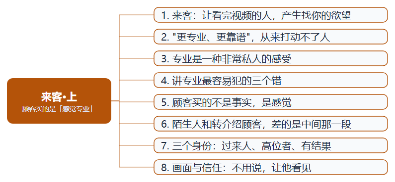

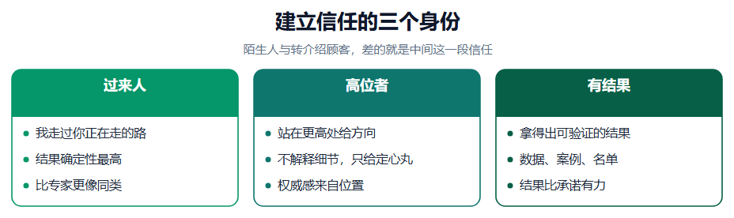

## 1\. 来客：让看完视频的人，产生找你的欲望

### 1\. 圈客、锁客做完，老板站在什么位置

我们做完了锁客，做完了圈客，此时此刻，客户老板处在一个什么样的位置？

你已经知道了你要锁定什么样的人群，并且你的目标客户已经全部在看你的短视频了。他们也许是因为各种各样的话题来看你的视频，但不管因为什么，你已经做到了精准曝光，做到了有效曝光。

这个精准是什么意思？是说那些进入到成交时刻的人，对你的产品有认知，对你的产品价值有理解，也愿意看完你的短视频。

但我仍然没办法解决一件事：他为什么要找你买单？他为什么要给你发私信？

### 2\. 顾客给你发私信，是一件成本非常高的事

我们可以回想一下自己。我们每个人每天最起码要刷上百条视频。可是你一个月会给多少人发过私信？其实非常少。

我们愿意给别人发私信，次数非常非常少。大多数视频我们看完之后，也就点个赞，写个评论，点个收藏，基本上到这儿就完全结束了，我们并不会真正意义上去联系那个人。

你可以自己算一笔账：这一个月，你主动给多少个陌生人发过私信？一只手数得过来。你的顾客也一样。

发私信是一个很难的事情。而今天下午我们就要讲一件事：如何让顾客真正相信我们，怎么建立信任，我怎么让顾客相信我真的能帮他解决问题。因为只有顾客相信你，他才会给你发私信。

大多数时候，我们都是在观察，我们都是在评估：这个人是不是靠谱的，这个人是不是能够帮我们解决问题，这个人是不是真的适合我。而真正让我们决定相信一个人，其实是一件很难的事情。

### 3\. 什么叫来客

线索来客，什么叫线索来客？客户来了。通过短视频，他们来了，他们愿意给你发私信了，他们愿意找你了，这就叫来客。

来客就是稳定获取高客单的客资，来客就是让顾客看完视频之后产生了找你的欲望。

我觉得来客是一件非常重要的事情。大多数时候，我们做的绝大多数视频都是在自嗨。你想，如果我们做完了视频，客户看完了，他不想找你，那是一个什么样的结果？等于没做。

顾客也看，也有很多人看，但他不找你。结果是什么？结果是你在给你的同行培养顾客。因为你的存在，这个顾客产生了买单的欲望，但是他并不愿意在你这里买，他是别人的客户。这不就是助纣为虐吗？你在给你的同行种草，你在帮助你的同行成交。

如果你没有做到来客，很可惜。第二个可惜是：你在等顾客自己想明白。

等他哪天突然想通了来找你。可他不会想通，他只会转头去问别人。

很多时候我们成交用户，会觉得这是最重要的一点——我们在账号里帮别人解决问题，我们发表了很多很多自己的看法。可是你的内容成了什么？垃圾。没有人看，因为顾客的问题根本没有被解决。

我们都知道一句话，商业是最大的慈善。什么叫商业是最大的慈善？当顾客愿意给你买单，他的问题才有可能真正被解决。

我自己打网球，我每天能刷到 50 个各种各样的网球教练的账号。这个人教我这么做，那个人教我那么做。我很多时候都觉得这些人好可惜，因为他教了很多很多，他花了很多时间，花了很多精力，花了很多心思在拍短视频。可是我非常清楚，他们都没有意义。顾客不会因为你教他怎么做，就找你买单。

获客的目的是什么？获客的目的就是无限接近成交。让顾客相信我们，让顾客越相信我们，越找我们买单。

但是来客太难了。我非常坦率地讲，我认为做短视频其实不难，做出一定的流量，只要你不是要爆款，难度也不高。但是让顾客找你真的很难，让顾客相信你真的很难。

### 4\. 冰岛茶：我刷了 100 款，全买了，没有一款一样

为什么今天在互联网上让用户相信你如此之难？短视频是一个开放的平台。我给大家讲一个真实的经历，你就知道了。

去年大概年底的时候，我们北京有顾客，北京顾客比较有钱。他当时来杭州找我，带我去他一个朋友家。去了之后，他朋友给我们泡了一个茶，那茶非常好喝，叫冰岛。有些茶友可能知道冰岛，正宗的冰岛非常非常贵，一斤可能要几十万。

那天下午大概三点多钟，我在我客户的朋友家。那天晚上回家，我闲着没事干。那是一个比较寒冷的冬天，11 月、12 月，我在被子里，十点四十开始刷视频，刷到十二点四十，两个小时，最起码刷到 100 款冰岛。

这个人讲，我们家是正宗的冰岛。那个人说，郑州的冰岛有什么样的特点？还有一个人说，市面上有很多假冰岛，应该怎么样识别？然后这个人说，假冰岛你要看它的叶子。那个人说，假冰岛要看什么？要看它的根茎。

还有一些人说，市面上很多人卖冰岛这款茶叶，他们是掺了料的，就是把好料跟坏料放在一起。有些人说他们是冰岛核心产区，有一个人说我才是核心产区，还有一个人说，什么是真正的核心产区？

这个人说，所谓的冰岛三代世袭，就是三代家族传承，其实都是假的，根本就不是三代。那个人说，我们是真的世世代代都在种冰岛。这个人说，我们家真的有冰岛核心产区的茶树，我们家有章，我们有政府颁发的证明。那个人说，你们在网上不要看那些证明，因为那个证明政府给村子里的每一个人都发了。

我从十点四十到十二点四十，刷到了 100 款冰岛。一百克有卖 1800 的，有卖 1500 的，有卖 1100 的，有 2100 的，有 800 的，也有 500 的。你很难判断，因为你会认为可能贵的会更好。

那我怎么办？我没有办法判断。他们都有章，他们都有证书，他们都把自己的园区拍给我看，他们都说自己是核心产区。他们都有专业，他们都能说出茶叶的细节，他们都有用户好评，他们都是五星店铺，他们都是 1 万分以上。你让我怎么选？而且他们面相都很好，都是黑漆漆的，一看就是茶头的样子。

然后我把 1800、1500、800、500 全买了。结论是：没有一款跟我喝的那个味道一样。我全送给我爸了，我爸说得让他喝三年。

这就是我去年真实的经历。我想告诉各位，在线上，视频号、小红书、抖音，这就是今天用户真实的处境。公说公有理，婆说婆有理。这是一个正常的人在今天短视频世界里面再正常不过的遭遇。

如果今天我只是买一个肥皂，买个茶叶，我买错了，我还可以放闲鱼，我总能卖得掉。那如果今天用户买的不是茶叶呢？如果这些用户是找你做咨询呢？如果今天用户是给你掏 20 万、掏 30 万、掏 40 万呢？如果今天用户是找你解决一个他们人生非常重要的命题呢？用户会怎么办？

那用户就不是像我那样花两个小时找 100 个商户了，他甚至可能找 200 个，甚至可能会刷到 300 个人。抖音上找 100 个人，小红书上找 100 个人，然后 300 个人列一个名单，从 300 个人里挑出 30 个人，然后问一下豆包，豆包说完了还不相信，再问一下他的 PPT：这 30 个人我应该选谁？

我相信，如果今天用户面对的是一个足够重的决策，非常大的痛苦——这个痛苦不是他没有需求，而是我不知道该选择谁，我没有判断能力，你们每个人都说得很好，为什么一定还要选你呢？这个困境其实真的比做流量要更难。

在算法推荐下面，你只要做出了一定的视频，它总能刷到你、抓到你。可他怎么样才能在 100 个都是有身份、有头衔、有专业、有解决问题能力的人当中挑中你呢？这就是今天下午要讲的主题。

怎么让客户来？怎么打动用户？怎么让用户在两三分钟视频看完之后——两三分钟你根本说不完，你根本说不清楚一件事——但他愿意给你发私信。

如果你今天是一个新手，线上刚开始起步，你感受不到这一个部分有多重要。如果你是老手，你知道真正难的不是做出流量，而是顾客怎么就愿意给你发私信了。

这个很难说清楚。为什么它难？因为你的同行都在努力，因为用户今天泡在一个非常复杂、信息爆炸的平台里面。不是你一个人在说话，是有 100 个声音、200 个声音同时在骚扰用户。而且他又是没有能力辨别专业的人，你还要让他来选择。

### 5\. 顾客说"因为你更专业、更靠谱"

那我们常常会认为，顾客为什么不找你买单？我现场问了几位同学。

**问**：你觉得顾客为什么不找你买单？

**答**（学员一）：感觉很靠谱。

**答**（学员二）：讲究效率。

**答**（学员三）：专业对口。

大家都有自己不一样的看法。但最常见的一件事是：如果今天你的消费者找你买单，他会说，我觉得你很靠谱，我觉得你很专业。消费者最常说的一句话就是这个。当然，有时候消费者原话不这么讲，但他意思是这个意思。

那我们就从这里开始：更专业、更靠谱，从来都打动不了用户。从来都没有。

当我抛出这个观点的时候，各位可能觉得有点匪夷所思。顾客又不是傻子，而且顾客明明自己都说了，找你买单就是因为更靠谱、更专业。

那我们会讲四样东西，如何建立信任。其中我认为第一个要开场讲的就是：怎么让顾客相信你的专业？

真的很专业，这个其实不太打动人。大多数时候，我们真正绕不开、真正解决不了的命题是：如何让消费者真的理解到了你的专业。很多时候是这样子的，顾客其实并不能理解你的专业。

什么叫真正的理解？真正的理解是不是你能分辨，到底是一百分还是八十分？就是能够分辨。

📌 一句话总结：视频目标不是流量，是让客户看完就想私信找你。

## 2\. "更专业、更靠谱"，从来打动不了人

### 1\. 一个实验：你能给行业里的十个人打分吗

我们做一个小实验。你们都关注了我很久，此时此刻你们也坐在这里，坐了一天半了。你们会觉得我很专业，对不对？

好，那你真的知道我有多专业吗？举个例子，如果今天全中国做获客的人，满分是一百分，你知道我在行业里到底是多少分吗？

我们行业里面有很多人，比如薛辉，北京有陈金和类似的人。如果我们纯粹说短视频能力，你知道薛辉到底是多少分，陈金是多少分，我是多少分吗？你能打出确切的分数吗？你能知道我跟陈金到底谁强谁弱？我跟薛辉谁强谁弱？

如果我笼统地问，你感觉很专业。可是事实上，我跟我的同行们放在一起，我们 10 个人，我们进行选美比赛，或者叫实力比赛，你能不能对我们 10 个人，每个人都给出一个评分？

没有，你没有这个能力。

虽然你已经看我很长时间了，虽然你已经来听课听了一天半了，但是如果 10 个人摆在面前，你仍然没有能力辨别。

所以在座各位已经是付费的、懂行的用户了，也就是说，你们从来没有任何一个人是真的理解。那为什么刚刚有人说觉得难？因为你感觉很专业。

感觉是一种什么样的东西？感觉是一种感性的判断，是一种模糊的判断，是一种非理性的判断。不是"张伟就是 83 分，我就选你，因为我知道你是那个分数更高的"。

不光你们找我，你们买任何东西，也都从来不知道这个人是不是真的很专业。

### 2\. 协和与杭州一院：你判断的是招牌，不是医术

我再举一个例子。如果你今天去看病，杭州第一人民医院有一个骨科的大夫，这个大夫跟你说，你这个病应该这么治。北京协和医院有一个骨科的大夫，那个大夫跟你说，你这个病要那么治。谁更专业？

其实你根本就不知道两个医生的医术，你也不知道两个医院的水平。可是你会感觉北京协和那个更好。为什么？因为它是协和。

那这个"专业"的判断从哪来的？是因为客观评分吗？不是，是因为权威背书。权威背书又是什么呢？是一种刻板印象。

它只是一种刻板印象。

### 3\. 戒毒大哥和心理咨询师：看着不像

再举一个例子。这位大哥大家都有印象，他是做建筑的。我正儿八经医科大学毕业，我也学过心理学，我也学过成瘾机制。你怎么不找我戒毒呢？

看着不像。就只是因为看着不像。你并不知道我的医术跟他的医术之间有什么样的差别。

人判断的不是"你会不会"，是"你像不像"。你像，你就专业；你不像，你说什么他都不信。

我再举个例子。我曾经师从清华大学的博士生导师、心理咨询师李尊卫，我自己的心理咨询造诣也非常非常之强。

举个例子，他也是心理咨询师。你找我做心理咨询，找他做心理咨询，你找他，看起来更温柔，看起来更专业，你肯定不会找我这样的鸟人做心理咨询。可也许我实际专业能力比他更高呢？

我们大多数时候在判断什么？你发现了没有，很多时候你得出"一个人很专业"的判断，其实并没有来源于"真的很专业"的那个分数，而是你大脑当中调用了一些刻板印象：比如长相，比如气质，比如年龄，比如头衔，甚至比如头发、发型。

我们调用的是刻板印象做判断，我们并没有在调用专业、客观、事实、逻辑分析、打分数。你找协和的医生，你就会感觉更专业；你找头发花白的医生，你就会感觉更专业。

### 4\. 王一鸣的手腕：两个医生，她选了态度好的那个

讲一件很妙的事。王一鸣，昨天晚上的小姑娘，TFCC，手腕。我带她去找了很多医生，杭州第一人民医院、第二人民医院，上海的华山医院，我们都找过。

杭州第二人民医院那个医生，是一个大概五十多岁的姐姐，人非常 nice。她怎么跟王一鸣说？她说你这个病确实不好治，然后非常耐心地看她的片子，看她的 CT，跟她讲是一个什么样的情况。最后还千叮咛万嘱咐：你现在这个情况，不管你找哪个医生，都会建议你先上支架、先固定。而且我要叮嘱你，每个医生的方案都会不一样，你一定要当心。你选择了哪个医生，你就要跟这个医生的方案走，不要这个医生听一点、那个医生听一点，要不然你很可能把所有医生方案里差的那个部分全部融合在一起。

这是杭州的医生。

去上海华山医院。华山医院是中国非常顶级的一家医院，运动康复科全国排名第二。里面有一个医生，男的，四十多岁，看起来比较凶，留一点小胡子。

"哪里痛啊？手拿砖头，看看，这里痛，这里不痛，这里痛……哦，这里痛是吧？TFCC 确实缺角了。"

王一鸣问他：那医生，我要拍一个更细的片子吗？医生说不用，你这个看得很清楚了。那你这个就是要制动，你固定，你在我们医院固定也行，你去淘宝上买固定也行，固定完之后三个月之后回来再看，所有都一样。

王一鸣又问：那我平常有没有什么要注意的东西啊？医生就讲：好了，不要烦了，就三个月先固定再说，别的事情不要管，三个月之后再说。

王一鸣特别特别着急，因为很难再挂到这个号，所以又问：那我以后还能康复吗？医生说：现在做不了决定，三个月以后再说，好吧？走吧走吧走吧。

谁是好医生？每个医生都好。出来的时候，王一鸣说：我还是喜欢第一个医生。感觉那个医生不专业。

我说，医生是这样子的，因为我自己曾经学医，我非常了解。一个人在医院里面当医生，他其实就是坐牢，一辈子都在里面坐着。所以有的医生性格到最后就是没有耐心。你相信我这样的人，我不用到 50 岁，我只要到 35 岁，我就是那个屌样子。"什么情况？好了，拍 CT 去，拍片子去。"我一定是这样的人。但能证明我医术不好吗？不能。

所以王一鸣做的是什么判断？她是基于打分做出来的判断吗？不是。一个人态度好，他就是好医生；一个人态度不好，就不是好医生；一个人愿意给你叮嘱几句，他就是好医生，不愿意叮嘱，就不是好医生。这是基于事实做的判断吗？不是，这是基于刻板印象。

### 5\. 一碗鸡汤，五十万

我今年上半年买了一项服务，花了我 50 万。后来证明那个人是个傻逼，他挖坑了。

我为什么会买那个服务？因为当时我去找他的时候，我正好说我这个伤，他听说我受伤之后，远程给我订了一碗鸡汤。

50 万，买了一碗鸡汤。

50 万的决策，最后是被一碗鸡汤推动的。你现在还觉得顾客在给你打分吗？

我最近都不敢说我自己非常理性。我们回想一下自己在生活当中所做的绝大多数决策：康复、健身、美容、瘦身、中医、养生，我们所受到的任何服务，其实你从来都没有理解那个人的专业。我们回忆一下，其实你从来都没有，从来都没有努力去理解。而且很多时候，甚至连"专业的感觉"来得都非常虚。

因为刚刚我们说，你是不是真的有能力判断市场上的专业？你们有没有发现，通过我刚刚一系列的描述，你已经可以清楚地知道：我们从来没有能力判断市场上的专业。

我们只有能力"感觉专业"。

📌 一句话总结：顾客无法给你的专业打分，只会凭刻板印象感觉你专业。

## 3\. 专业是一种非常私人的感受

### 1\. 三十分，只能理解五十分的专业

感觉专业也不是每个人都能感觉得到的。专业是一种非常非常私人的感受。

什么叫专业是一种非常私人的感受？就是你到了三十分，你只能理解五十分的专业；你到了六十分，你也只能理解六十七十分的专业。

在我们每个人的行业里面，我们都会有一种经历：你如果往下看，你能知道这个行业里面谁更牛；往上看，你能知道这个行业有谁不如你。

但是，如果你这个行业里面有一个人，他的营收比你高 5 倍、比你高 10 倍，规模做得比你大，你不会认为这个人是因为更专业所以做得更大。

### 2\. 你赢靠实力，别人赢靠运气

你今天比一个不如你的人，你会说这个人为什么不如你？你会认为那些人为什么不如你？因为业务能力不如你，因为专业能力不如你，因为解决问题不如你。

那为什么你往上看，你就觉得上面那帮人比你更厉害、比你更赚钱，就是因为比你会吹牛呢？

你不觉得很匪夷所思吗？你赢别人，你就是靠实力赢的；别人赢了你，就是靠运气赢的，就是靠碰巧赢的。有没有可能他就是实力比你高很多，只是你不能理解？

否则你没有办法解释。你一年营收 1000 万，你看得见营收 100 万的人，他为什么做不到 1000 万？商业认知不够啊。那你一年营收 1000 万，为什么别人一年营收 1 个亿？他运气比较好。

所以专业是一种非常私人的感受，它只能在一定区间内才能理解。你可以往上探索一点点，你也可以往下看，但是如果一个人比你高很多，你就已经不能理解了。

### 3\. 同一个人，三种评价

专业私人到什么程度？各位能知道我自己在这个行业里面臭名昭著，经常有人骂我。

有个人会发视频，他也不认识我，他自己写了一条视频，说：为什么我觉得他不行？他一定是以斜道为主的这么一种人，所以他就不懂 IP 的东西，他也不懂主播，他到现在也没有办法共赢和共情。他现在仍然认为斜道是唯一最优路径，但其实根本不是。

他说我不行。这不重要，因为这不是事实。

换一个人。这个人叫六六，是我的好朋友。六六是什么人？深哥门徒，深哥 IP 总运营，深哥公司外部企业家 IP 变现总运营，擅长做 IP 孵化，月变现 1000 万。账号案例有深哥新聚会、张新元、大健康李娜等十几个——是月变现 1000 万，不是年变现 1000 万。

你现在在公寓平台看到的深哥所有矩阵账号，背后的总负责人就是他。深哥整个 IP 的前端运营全都归他负责，深哥私董会也归他负责。深哥当年做 IP 全案，200 万一个，他们总共有 100 个全案，也就是说这是一个 2 个亿的盘子。这 100 个交了 200 万的客户，总负责人就是六六。

我不能说这个人很厉害，但我觉得这个人在行业地位和行业专业度上应该还不错。

六六的评价是这样子的："经纬，开年快乐，给你补上一份沉甸甸的祝福。回想这一年，最想感谢的人是你。是你的点拨让我顿悟，原来问题不是无法解决，只是之前方法不对，且缺少破局的定力。这份醍醐灌顶的帮助，我时刻记在心里。"后来六六也给我们送了一个礼物。

所以你说，不同的人评价是不一样的。我还是我，我从来没有变过。为什么评价会不一样？因为专业是一种非常私人的感受。

我在视频号里面也有一些评论，这个人说你也就那样，那个人说关键你流量也没有人家好吧。这也是一种感受和评价。你一眼能看出来，他还在一个什么样的认知阶段。

但这也不是所有人的看法。这个人叫小新姐，现场有些人做大健康，也许认识她。她是大健康领域里面非常知名的 IP，也是深哥当年最成功的案例。她做大健康一年营收 6000 万。在 IP 行业里面，这已经算是非常非常高的营收状态了。做大健康、做慢病管理的，几乎全国所有人都认识她。

这样一个人，最起码在线上获客、线上营销板块，已经做得非常非常好了，现在也是我们的客户。她给我们的评价是："经纬老师，上次听你讲一些概念，我觉得还没有学会，我能不能请你帮忙分析分析？"

作为同行，有不同的同行给我不同的评价；作为客户，有不同的人给我不同的评价。都是事实，或者又都不是事实，这都是他们内心的感受。

### 4\. 为什么没那么专业的人，获客反而更好

所以就出现了一个情况：为什么往往没有那么专业的人，获客会更好？

因为顾客往往只有三十分，而他正好三十一分。

专业是一种非常私人的感受，你比顾客高一点点，顾客会觉得你很专业；你比顾客高很多呢？他就看不懂你了。

我今天中午在介绍八营的时候，那边有一个同学，他是做地产行业的，做开发商的。三年前我就知道他，他三年前跟我的一个好朋友有一些合作。他三年前完全没有听说过我。

我问他：三年前你有没有做线上？他有在做线上，但完全没有听说过我。做了三年，他现在开始理解了。

三年前你刷到过我吗？当时什么感受？真实的感受就可以。他的回答是：不懂，觉得离你很远，好像你也没教我什么操作的东西。

那两年前、一年前有没有刷到过？两年前觉得正确；一年前开始做评论，但没有具体论证。今年他来了。

整整三年。三年我没有什么变化，我只是在等你稍微往上涨，我稍微涨一点，等着你对这件事情的认知和理解涨一点。

我问他：三年前你是一个什么样的状态？开工了没有？两年前呢，开始拍，有流量吗？没有。一年前呢，开始获客了。今年大概是什么样的状态？

他说，如果成交不好，我一年就是……哦，我感觉好像已经理解了。

你看，因为顾客的认知不一样。为什么往往没那么专业的人获客更好？因为永远是新手顾客更多，老手顾客更少。顾客往往只有三十分，而他正好三十一分，这就是一个最佳的匹配状态。

### 5\. 讲专业很简单，有嘴就行

所以我们发现，讲专业很难。讲专业其实很简单，有嘴就行。但是讲专业打动人，非常非常难。

为什么？因为我们前面说了，顾客没有办法真的理解专业，而且专业是一种非常私人的感受。其实无论怎么讲，顾客都听不懂。

甚至你们也没有真正意义上在讲专业。具体来讲，我认为你们讲的东西叫"歪的专业"——把专业讲歪了、讲深了、讲错人了。

📌 一句话总结：专业只比客户高十分最有效，高太多他反而看不懂你。

## 4\. 讲专业最容易犯的三个错

讲专业有三种典型的失败方式：讲歪、讲深、讲错人。三者的区别，看这张表就清楚了。

|**错误类型**|**典型表现**|**顾客的反应**|**结果**|
|---|---|---|---|
|讲歪|讲跟顾客处境无关的专业|觉得好笑、看热闹|有播放，没客资|
|讲深|把行业常识当成人人皆知|听不懂，划走|显得专业，无法共鸣|
|讲错人|讲给不是买单的人听|内容对口，人不对口|精准地讲给了错的人|

### 1\. 讲歪：唐山刑事律师的"警察敲门"

我们来看第一个。这是一个刑事律师，我认为他是今年欢乐喜剧人的总冠军得奖者，因为他真的很搞笑。我们当时看完这条视频，整个团队笑趴了。

他是这么讲的：

"遇到警察敲你家门，进门就跟你亮证了。你一看好几个人，阵仗也挺大，就跟着走了。你看没看清楚，他是唐山本地的警察还是外地的警察？再有一个，是正式的民警还是辅警？带没带传唤证或者拘留证？可不能口头就随随便便把你带走。仔细看看那些法律文书上面有没有你的名字，内容是不是清晰。如果对方是异地警察，他跨省异地办案，必须提前报备，并且有咱们唐山本地的公安在场。如果没有，咱们唐山当地的公安是有权阻止的。"

来，给你们翻译一下。看这个视频的人是谁？

这里面有两种人。第一种是被带走的人，被带走、被放回来的人。还有一种是没有被带走，但是担心会被带走、提前预防的人。我觉得第二种可能会多一点。

也就是说，看这个视频的人，是一个刚刚杀了人，或者刚刚偷了一个珠宝店，现在正在畏罪潜逃的人。

而他在视频里面讲了什么专业？你昨天杀了人，现在畏罪潜逃，如果遇到警察上你家敲门，一定要看清楚别人的传唤证。看他是不是唐山本地的警察，如果是，你可以跟他走；如果他不是唐山本地的警察，你可以不跟他走，你可以跟他讲，你回去，你没有传唤证，你回去。

你看懂了之后，你觉得太搞笑了。他有没有在讲专业？他有在讲专业。但那是一个没有意义的专业，那是一个对客户来说没有任何帮助的专业。

老子昨天杀了一个人，现在在酒店里面畏罪潜逃，你跟我讲敲门之后我可以不跟那个警察走。然后他说：我讲得这么专业，为什么不算获客呢？

讲专业就是这样子，你很容易就讲得完全跟用户无关，讲得根本就跟用户不关注。

### 2\. 讲深：你以为的常识，顾客根本没听过

第二个叫讲深。什么叫讲深？就是你以为你在讲一个所有人都知道的常识，可是你的顾客根本就不觉得是。

你觉得这个东西你的顾客都知道？不好意思，你的顾客只有三十分。

有一条视频在讲系统是怎么判定你违规的，系统是根据你的逻辑和意思来判定。他在讲一个平台关于违规的审查机制，他认为每个人都知道，但其实你们并不知道。

再看小新姐。小新姐是做慢性病管理的，她讲了很多关于胰岛素抵抗、关于甲状腺相关的话题。她做慢病管理，可是她真正的客群是谁？她要的是那批已经找过医生、已经自学了很多慢病知识的人。

而她拍的短视频，没有在找那样的人，她找的是一些健康爱好者。

她的视频是这么讲的："现在越来越多的年轻人已经开始胰岛素抵抗，甚至有些职场精英已经出现了糖尿病的情况。现在有非常多的人出现了跟胰岛素相关的问题。那为什么这么多的人出现了跟胰岛素相关的问题？是因为你这些生活习惯……"

这段内容对你而言很专业，但是对于那些已经确诊有糖尿病、有胰岛素抵抗、有甲状腺问题的人，这些内容有点过于浅了。他要的是"我这个指标为什么降不下来"，你讲的是"年轻人要开始注意了"。

他不知道自己要多深，于是讲深过头了；他不知道要浅还是要深，所以他直接讲歪。生意就是这样子，一不小心就讲深了，一不小心就讲浅了，然后你还讲错人。

### 3\. 讲错人：你在讲专业，但讲给了错的人

你认为你在讲专业，但其实你讲错人了。

小新姐就是典型：她要的是已经找过医生、已经自学了很多慢病知识的人，她讲出去的却是给健康爱好者的科普。内容没有一句是错的，人错了。

你讲的每一句都对，听的人不买单，等于没讲。

这就是讲专业，讲专业的风险很大。

### 4\. 网上永远有完全相反的声音

我说专业特别难讲，这世界上最难讲的就是专业。最后一个原因是：世界上任何一种专业，网上都会有完全相反的声音。

就像我买冰岛茶叶一样，永远都有人说这是对的，也有人说这是错的。你让顾客怎么选？

猪肉健不健康？这个人说一定要少吃肉，少吃猪肉。另外一个大健康专业的人说，所有人都一定要吃肉。那我是吃肉还是不吃肉？

左边这个人说，为什么要少吃碳水，更显年轻；右边那个人说，女生千万别碰，别低碳饮食。那我要不要少吃碳水？

左边那个人说，早餐不吃更健康；右边那个人说，一定一定要吃早饭。那我到底要不要吃早饭？

左边这个人说，为什么我推荐生酮饮食；右边那个人说，生酮饮食加速衰老。那我到底要不要生酮饮食？

旁边这个人说，创始人 IP 要从讲故事开始；右边那个人说，能获客的创始人不靠讲故事。那我到底要不要讲故事？

左边那个人说，泛流量开口；右边那个人说，不要泛流量开口，要做精准开口。那我到底是做泛流量还是做垂直流量？

这边那个人说，抓住视频号的红利；那边那个人说，做视频号等于找死。那我是做还是不做？

这个人说，珍惜现在短视频的红利；那个人说，流量已死。那现在到底是有红利还是没有红利？

你在你的行业里面所发表的任何看法，我此时此刻只要愿意，在视频号、在小红书、在抖音，都能找到完全相反的观点。这两个完全相反的声音，顾客又没有专业能力，又没有办法判断，他怎么选？没有办法选。

甚至有时候，顾客真的听懂了你的专业，他也未必愿意选你。

### 5\. 就算听懂了，他也未必选你：网球教练

刚刚那位同学说听懂了我的专业，说去年就听懂了。

我跟你分享一个我自己的经历：很多时候，就算顾客真的理解了你的专业，他也未必愿意选你。

我的网球教练，右边穿黑色衣服的这位。我这样讲，你们可能不能理解。左边这位男生叫吴一鸣，吴一鸣相当于中国网球界的林丹、男子网球的郑钦文，也就是中国男子网球目前 number one，世界排名三十六。男子网球可能没有女子网球那么厉害，但他是中国男子网球第一人。

而我的教练，当年在上体校的时候，吴一鸣是他的师哥。两个人的妈妈是好闺蜜、是邻居。

所以我想问大家一件事：我的教练当年可以跟中国男子网球第一名当师兄弟，他的专业能力怎么样？

应该还可以，对不对？当然，因为我的教练今天已经不打职业赛事了，所以他变成了一个私教。这并不影响他的水平。

当时在学网球的时候，我当然希望寻找一个专业的教练，一个足够专业的教练。于是我付费了。这个教练带我带得非常好，理念非常非常体系化。

于是我也希望王一鸣能够受到同样的训练。我带她训练了一次，上了一节课，一个小时。她说这个教练不适合我。她也没有说什么原因。

她找了什么教练呢？她找了这样一个教练。上了一节课，我问王一鸣：你那教练怎么样？她说：我觉得这个教练很专业。

更离谱的是，我问为什么这个教练很专业？她说：我喜欢他上课的样子。

这个教练给她上课的时候，她提出了一些看似合理其实又没有那么合理的需求。她第一次约这个教练的时候说：教练，你到时候来带我的时候，你能不能穿你这张照片里面的衣服和帽子？不要穿别的衣服，你就穿这套衣服和这个帽子。如果你不是这么穿，你就别来给我上课。

然后王一鸣说，我觉得这个教练很专业。

每个人对于专业，其实也有自己不同的看法。对我而言，我可能认为专业就是硬核，但有些人可能并不这么认为。甚至很多时候，如果你摆出一副很专业的样子，会让用户觉得很害怕。

所以我通过一系列真实的情况，再告诉你一个世界真相：专业其实很少真正在打动你的顾客成交。

首先，你的顾客并没有办法真正对你的专业进行评分。其次，专业是一种非常私人的感受，这就已经很少有人能理解你的专业了。然后你自己讲专业还会讲歪、会讲深、会讲错人，好，更少了。再然后，你的专业还要经历互联网上不同信息的批判，你的顾客还要能识别你的专业，最后你的客户还得是一个接受专业的人。这样层层削弱下来，到最后有多少人真的是被你的专业买单的？

1000 个人当中，可能只有 2 个。

或者说，这个世界上有多少人是被那个真正的专业——也就是你的干货、你的方法论——打动，他真的识别了你的方法论，真的识别了你的专业，觉得"真的是有效的"，而找你买单？100 个人当中有多少个？

我们在座各位现在再想一想，此刻坐在杭州，你是因为真的识别了我的专业而来吗？

你并不是真正识别专业而来。你可能只是听说、感觉，等等的一切。你并不是真正理解了我的专业而来，你只是感觉我很专业而来。

所以重点就得出一个小小的结论：用户为什么愿意给你发私信？他不是真的理解你的专业了，他是感觉你很专业，找你买单。

而我们在做短视频的时候要做的事情，就是让他感觉更明显一点，让他更有感觉。我们不是试图去强调自己有多专业，也不是试图证明自己很专业，而是试图让他更清晰地感觉到。

所以一切的目的已经不是在创造事实了，而是在强化感觉。

如果你大学读的是市场营销、广告学、口语传播、品牌营销、品牌传播，你一定听得懂我在讲什么。这是世界上非常非常知名的心智营销理论：用户其实没有那么多能力去理解你的专业，用户买单永远都是靠感觉，永远都是靠刻板印象。全世界所有知名的、最底层的品牌营销顾问，都在讲这些东西。

📌 一句话总结：讲专业别讲歪、别讲深、别讲错人，要讲给买单的人听。

## 5\. 顾客买的不是事实，是感觉

### 1\. 顾客的嘴，骗人的鬼

也许有人还会有最后一个想法：可是顾客明明有时候会说，我找你买就是因为专业啊。你讲了那么多，可是我的顾客曾经亲口跟我讲，他找我买单是因为专业，为什么？

因为顾客的嘴，骗人的鬼。

顾客是这个世界上最慈祥的群体。

我现场问了一位同学：你再说一次，你为什么找我买单？用你能想象到的最能精准表达的话来说。他说：因为时间是稀缺的东西。大家听过老师对时间这么看重，他们不会瞎耽误事儿。

你看，他们也说不出来。

还有一个同学说：经过你那条视频说了这个东西，我非常认可，因为这个东西很正确。

还有一位男生，我追问：你没讲实话，那你的实话是什么？他说：个人风格。

顾客说不出那条判断链，他只能给你一个词。

顾客不是专业选手，顾客的任务从来不是精准回答你的问题。所以顾客说话的时候，就会说一些比较模棱两可的感受。语言是你对世界的理解。顾客的专业度没有那么高，他只会说出"我感觉你很专业"。这并不是骗你，只是顾客的语言只能做到这一步。

### 2\. 三个"事实"，其实都是感觉

刚刚那两位，他们真的是因为这样而买单的吗？也许未必。

我曾经有一个顾客，他当时为什么找我买单？他刚刚在别人那里掏了 2 万块钱，发现没有效果。我一开始问他：你为什么找我买单？他说，因为我学的这门专业。再问，他说，啊，好了好了，那个比较便宜。

你问他为什么找你买单，顾客不会讲"因为我自己比较笨，然后你又比较便宜，所以我就找你买"。顾客不会这么讲的。

我现场追问了一位女同学。她说，因为新媒体这个行业也是一分钱一分货，所以我会选你。当时我是从抖音转过来的，后来系统就一直给她推我。

我从她的描述当中，听出了一些很有意思的事情。

首先，顾客第一时间都会讲"感觉很专业"。他可能认为说出真实答案，对他是有损社会身份的。这很正常，我们每个人都会这样。

而她在自我判断的过程当中，实际做的是这么几件事：她在网上搜到了我的一位同行，也搜到了我。她发现同行的内容在重复，而我的没有在重复，所以她感觉我更专业。

事实上，她是不是也没有判定什么是真的、什么是假的、什么是真正的专业能力？她只是通过"重复还是不重复"来判断。

第二个，我的那个同行在讲视频号，而我在讲精准获客。她通过这个关键词，感觉我是适合她的。

第三个，同行的价格比较便宜，我的价格比较贵，然后她感觉"贵的应该更好"。

内容不重复、关键词对口、价格更贵，这三个信息是事实吗？是真相吗？其实都不是。它们都只是在强化她做选择过程当中的感觉。

所以你就知道了，短视频里面打动用户的东西，并不是你说了什么，而是当用户看完你视频之后，他会留下一个什么样的感觉。

我再说一遍：短视频里面真正打动用户的东西，并不是你在视频里面说出来的观点、说出来的看法、说出来的解决方案——不是他真的识别了这是一个很厉害的解决方案。

我们从来没有被那个东西打动过。

那那个东西有没有用？有用。我在视频里面跟你讲一二三点，举个例子，你最近腰痛，我跟你讲腰痛怎么治，一二三点，每条视频跟你讲每个点，讲两分钟。那是干嘛用的？那是让你愿意把这个视频看完。

但是无论你那个第一点、第二点、第三点说得有多么正确，让用户看完的东西和打动用户买单的东西，其实是两个东西。

### 3\. 三角形、圆圈、正方形

很多人会说：可是你结尾就是很专业呀。

我们来看这条视频："那种营销模型到三点零的时候会有一点复杂，一些比较深的概念。第一个概念叫，我们是用内容包裹人群，而不是用产品……"

没有看懂。那为什么我还要发这样的视频呢？是不是会感觉很专业？

曾经这个位置来了一个男生，是哥伦比亚的。男生特别有意思，他说：我就是被你这个老师给成交的。

我说：你完全没做线上，你怎么会被这个视频打动了？你根本看不懂啊。

他说：对呀，里面有三角形，又有圆圈，又有正方形，还有光芒。

他就这么讲的，有三角形，有圆形，有长方形。

别人都没有方法论，只有你有成套的体系。

就像刚刚那位大哥说，我有底层逻辑。你怎么感觉到我有底层逻辑的？"觉得他的课就像哄人，让你嗨，很高兴的那个。然后我就觉得听你的课是从根上解决问题，找到了真正的根。"

短视频里面有大量的三角形、圆圈和长方形，那不是随便画一画的感觉。那种不哄人，给人感觉就是你非常自信。说话的语气语态，也给人传递一种感觉。

这都是什么？都是刻板印象。我们对于身份的刻板印象，对于一个人说话方式的刻板印象，对于头衔的刻板印象，对于学历的刻板印象，对于长相的刻板印象，对于圆圈、方框、模型的刻板印象。人有大量的刻板印象，所以短视频就是要利用这些刻板印象。

而你就是要去利用它。

所以讲到现在为止，我们可以提出今天的主题了：在短视频里面，要想打动用户，就是要学会让顾客感觉到你很专业。我们要学会利用和放大每个顾客头脑当中的刻板印象。

在宣传的时候，不要满脑子想着怎么去传递事实、怎么去传递问题的解决方案，而要学会给顾客的大脑留下一种感觉。

### 4\. 他记不住你讲了什么，只记得那个印象

大哥说，我只刷了你 15 天。15 天。

那我问大家一件事：你还能不能回忆起来我其中任何一条视频，我在里面讲了什么？

你回忆不起来了。

他每天要刷大量的内容，他根本回忆不起来你说的是什么。你认为你的短视频创造了巨大的社会价值，给用户避了这个坑、避了那个坑，讲了这个、讲了那个，顾客当时很爽，其实他后面全忘了。

相信我，随便换别人，你们也一定记不起来我在视频里面讲了什么。

现场有一位同学说，他记得一句：我拿着一个水杯，我说"我拿着就很和谐，你拿着就像个什么"。

你居然记得是那句。

那我问你，那句话给了你什么感觉？

顾客其实是一个很有意思的群体。顾客在说"打动人心"的时候，他也没有能力去判断你讲的是否正确。

顾客最终找你买单，并不是因为真的发现你专业了，他只是在你身上感觉到了专业。因为刻板印象是不需要学科基础的。

今天听你讲房地产，我是需要有房地产基础的；今天听你讲养生，我是要有养生基础的；今天听你讲吹笛子，我是要有吹笛子的基础的。

而我们很多人是在秀肌肉：你看我的肌肉有多强大，你看懂我的肌肉了吗？看懂了你找我买单吧。这不是一个好的状态。我们要学会把那些本身就是顾客刻板印象的部分放大、展示出来。

比如，我脑子里面对吹笛子的姑娘的刻板印象，就是赵雷那个吹笛子的兄弟。如果你不扎辫子，我就觉得你笛子吹得一般。

### 5\. 我在放大什么，我在缩小什么

我自己是怎么做的？

我几乎所有的粉丝、在座各位都知道，我们全员 211。为什么要总是讲 211 这件事？感觉我们团队更专业。

211 是否真的有那么大的帮助？坦白讲，帮助也没有那么大。

但我会选择把这件事情放大。

那我会选择把什么东西缩小？我们真实解决问题的过程，我会选择少说。

那我选择多说什么？多说"为什么我们选择 211"。我放大，是因为我知道这一段有用；我缩小，是因为我知道那一段没有用。

你们现在的方法是跟我是反的：你们会放大自己解决问题的过程，而缩小那些有助于顾客建立刻板印象的信息、画面和场景。

我们操作不一样。你在放大什么，你在缩小什么，这是完全不一样的东西。

所以到现在为止，你们可以做一个自我判断：你在视频里面是否真的给用户传递了内容？用户到底为什么来找你买单？你身上有哪些可以利用的标签？

这里来过一个律师，很有意思。她参与过国家层面的法律、法案制定。这个东西很牛逼，在我们国家能参与法律、法案制定的人非常非常少。

但她跟我讲这些，我说我听不懂。

我问了她一个问题：姑娘，你妈是做什么的？

你应该多想这个问题。这才是跟你获客有关系的东西。这就是我们常常会选择忽略的。

我要的是你把它找出来，我要的是你把它放大——放大那些属于客户刻板印象的东西。

📌 一句话总结：放大客户脑中的刻板印象，让他记住感觉而不是内容。

## 6\. 陌生人和转介绍顾客，差的是中间那一段

同一个问题、同一个答案，为什么朋友信、陌生人不动？差别只在一段信息。

|**维度**|**转介绍顾客**|**线上陌生顾客**|**你要补的**|
|---|---|---|---|
|知道你是谁|清楚|不清楚|身份|
|知道你做成过什么|清楚|不清楚|结果|
|听到答案后的反应|直接买单|还要再比较|让他信|
|成交难度|低|高|中间那段|

### 1\. 朋友问你问题，你为什么信

我们过去在生活当中，跟朋友聊天会有一种聊天的惯性：朋友问了我们一个问题，我们给出答案。

举个例子。你认识我，今天你请我吃饭，你说：经纬，我现在做律师，我遇到了一些问题，你能不能告诉我怎么办？

因为我认识你，生活当中你们找我，我给你建议了，你们为什么会觉得很靠谱？

因为你认识我。你认识我意味着什么？意味着你已经知道了，我拥有解决这个问题的经验和成果。

场上的人知道这份信息吗？

同样的，你去看生活当中，你会有很多很多转介绍的顾客。转介绍的顾客找你更好成交，你以为真的是因为你分析问题分析得很好，所以他才买单吗？不是。是因为你的身份，他已经知道了你的成果。

那互联网上的用户，跟这批线下的、转介绍的顾客，差了什么？

在问题和答案中间，有一个非常至关重要的信息，一定要把它补上，叫"为什么这个答案可信"。

转介绍的顾客之所以愿意买单，是因为他已经知道了中间这一段。你生活当中的朋友之所以遇到问题愿意找你，是因为他已经知道了这一段。

所以为什么线上的顾客不愿意找你买单？是因为他没有这一段。

### 2\. 线上缺的那一段

你在线上跟顾客沟通，问题之后给了答案，他没有这一段信息。

他跟转介绍的顾客、跟那些已经认识你的朋友之间，最大的差别就是他不知道这些：他不知道你是一个什么样的人，他不知道你曾经解决过什么样的问题，他不知道你有什么样的身份，他不知道你父母是什么样的人，他不知道你跟谁是朋友。所以他没有办法得出"你可以信任"这个结论。

再举个例子。这个人是一个律师，如果我们两个本来是朋友，他今天找我吃饭，我会跟他讲，你这个东西应该怎么办。他为什么很相信？因为他知道我做过杨璇，而且我们做过很多很多很不错的律师。

那如果今天在线上是一个陌生人呢？我要怎么跟他说话？

你问我律师怎么做账号，我跟你讲一二三步，你会买单吗？

那我要怎么跟你讲？我一定得在中间加这么一段：你现在遇到的这个问题，杨璇当初找我合作的时候也问过同样的问题。我跟你讲，我当时跟他讲的原话是什么。然后后面才是我的答案。

这两者之间的区别，就在于要补上这个信息。

这个并不是互联网独有的，它也不是一种表达套路。这个本来就是陌生人和转介绍顾客中间差的那一段信息。

短视频里面、直播间里面，你做的是公众表达。

### 3\. 线下强，不代表线上强

我们很多同学或许会有一种误解，他会说：线下来了顾客，到了我面前都能成交，是因为我话术更好。

不是。因为来线下的人本来就有这一段。

那批人，你说什么他都能成交。

所以我们生活当中会有一种情况：你过去线下很强，你一直认为你是靠话术、靠分析。所以你把这个搬到线上，你以为还有用？

不是的。你过去线下之所以很强，是因为你靠的是"他已经知道你是谁"。所以在线上，你要重复的是这一段，而不是你的分析。

**⚠️ 只有这一段是你成交用户的东西，只有这一段才是打动用户的理由。后面的东西，客户从来没听懂过。**

哪怕客户跟你讲"我听懂了，好专业"，你放心，他没听。哪怕他说"很有收获"，你放心，他根本没收获。哪怕他说"谢谢你今天帮我分析，那我买单吧"，你放心，他根本没听懂你的分析。他只是被这个东西打动了。

所以我们在线上，要把一个陌生用户转变成一个转介绍顾客，或者你生活当中的朋友对你所了解、所熟知的那个信息状态。方法就是在问题和答案之间，补上这一段。

📌 一句话总结：在问题和答案之间补上身份与成果，陌生人才敢信你。

## 7\. 三个身份：过来人、高位者、有结果

身份有很多种：职业、学历、头衔是最常见的身份。你说你曾经拿到过福布斯优秀青年才俊奖，这是不是一个身份？你的大学来源于哪所大学，这是不是一个很好的身份？你的职业成就，比如博士、博士后，这些也算。

父母也是身份。你是谁的孩子？你的父亲是什么职业？你的父亲是中国工程院院士。

举个例子，有一个宠物店的老板说：我爸爸妈妈都是医生。请问这个身份对他有没有加分？感觉这个人是有爱心的。

再比如，一个人做医美，我们会担心医美的人"阳性"、不靠谱。那他说：我爸爸是军人，我爸爸从小就教我，什么都能干，就是唯独不能干这个。你的父母是什么样的，完全可以拍一条视频——"我爸爸是一个军人，他给我的人生带来了什么"，建立一种信任，建立一种感觉。

还有一种身份叫：你是谁的孩子，你的大舅是什么人，你的舅妈是什么人。

还有你获得过的成就，还有谁是你的朋友。

谁是你的朋友？谁是你的前同事？谁是你的前领导？谁是你的小学同学？谁是你的大学同学？谁是你生活当中的酒友？谁是你的好兄弟？谁是你的好姐妹？谁是你的人生贵人？这些是不是都可以用来传递你的身份？

完全可以借助这些东西来拍视频，或者在每天的口播里面去植入这样的东西。

除了这些看得见的社会身份——职业、年龄、头衔、学历、谁的孩子、谁的朋友、谁的同学、谁的师弟、谁的师哥——我还要送三个非常"虚"的身份。它们不是某一个职业，也不是某一个年龄、某一个学历，但顾客心中有这个身份。

这三个身份，你可以随意调取，我相信每个人身上都有。

|**身份**|**核心感觉**|**关键说法**|**最适合的场景**|
|---|---|---|---|
|过来人|他跟我一样痛过|我曾经也这样，后来解决了|有亲身经历的行业|
|高位者|他在行业里是大咖|同行都认他、团队都强|需要压住场子的高客单|
|有结果|他已经做成过|我帮谁拿到过什么数据|有可展示成果的服务|

### 1\. 过来人：他脸上花了 800 万

第一个叫过来人。什么叫过来人？我曾经解决过这个问题。

我们来看一个做医美的顾客，他主要做医美招商。他的视频是这么讲的：

"很多人想要进入这个行业，需要什么样的条件和资质？我说最重要的三点。第一点，你想花半年的时间去了解，并且在这个行业里有自己的定位，大概需要半年。这半年的时间里，你一分钱都不赚的情况下，你能够做出什么？"

"我们这个行业确实是一个高风险、高利润的行业。但是首先你要知道如何规避高风险，高利润才会跟你有关系。你入行的这个人非常重要，因为他决定了你在这个行业里的意识形态。如果你真的喜欢一个行业，又找到了一个很靠谱的人带你，那么你在这个行业……超过 100 万。"

"我就是拿自己的脸去体验，在脸上花了将近 800 万，来到今天这么一个结果。但是现在的人很幸福。"

在我自己身上花了 800 万。这是什么身份？这就是一个过来人的身份。

我为什么说过来人很好用？

假设我是一个女生，我要做皮肤管理。我在饭桌上，跟两个朋友一块聊天。左边这个朋友是一个皮肤科的医生，右边这个朋友是皮肤情况曾经跟我一样、脸上有些痘的姐妹。

我说：你们看我的皮肤怎么办？

医生跟我讲，我应该用什么样的产品。右边这个姐妹跟我讲：什么医美产品，我也用过；用了一段时间好了，好了之后又复发了，我给你推荐另外一个。

我跟你说为什么。因为一个专业人士，他只能给出一个答案，叫方法。你是看不到结果的，你只看到了方法，你没有看到结果。

而过来人呢？你看到了结果，所以你天然会觉得他的方案确定性更高。因为他已经解决了问题。

什么是结果？我们买东西最害怕的是没结果，而他的结果已经摆到我们面前了。过来人的结果确定性，比一个专业人士的确定性更高。专业人士的意义是什么？叫解决这个问题的概率比较高。过来人呢？我已经解决了。

过来人还有第二个优势。专业人士给我提出的意见，我怎么知道能不能落地？我怎么知道你是不是在赚我钱？我知道你发心是友善的，可我怎么知道你不是为了业绩、不是为了成交呢？

但如果是过来人，因为你曾经跟我有一样的痛苦，所以我相信你今天不会害我；因为你曾经跟我有一样的问题，所以我相信你已经帮我把所有的坑都避掉了；因为你肯定跟我有一样的问题，所以我相信你知道落地过程当中的所有细节。

过来人天然就会比一个更专业的人，让用户感觉更信任。

事实上呢？其实专业这一点也很好，但它没有意义。消费者就是会从感觉上去判断，他会认为过来人更可信，而且会感觉你的立场是很中立的。

### 2\. 两个教谈恋爱的：上策、中策、下策

我再给你看一段演示，你就知道身份有多好用了。

这两个人是我的好朋友，中国男性情感界的两朵奇葩，专门教男生怎么谈恋爱。

先看第一位。他的视频是这样的：

"同学们，女生 3 天没有回你消息，3 天没有主动找你了，要上策、中策、下策，同学们先拼哪一个？扣在公屏上，想想先拼哪一个？同学们，上策扣个上，中策扣个中，下策扣个下。"

"感谢兄弟回答我问题。一毛钱的粉丝，如果你不差一毛钱的话，点咱的粉丝团进去，免费一人再送一次一对一，我说的。"

"上策吗？这个兄弟说听中策下策，小孩子才做选择。你们在我的中间，你们是我的兄弟，我让兄弟们既要又要还要，我全讲，可以吗兄弟们？"

再看第二位。他讲的是自己的经历：我之前也谈过一个女朋友，我也遇到了跟你一样的问题。他讲，很多男人有一个情况，我喜欢你，我和你在一起，确定了关系，那我就要对我的女儿好。

这两个人，你觉得谁更靠谱？你更想给谁付费？

是不是有一部分人会认为是右边？因为他讲"我之前也谈过一个女朋友，我也遇到了跟你一样的问题"，你就会感觉：这个问题他曾经解决过。你会天然地感觉，这个问题他有办法解决。

而左边这个人，他说上策、中策、下策，你能判定这个方法论能解决你的问题吗？不能判定。

所以顾客到底被什么打动？顾客是被上策、中策、下策打动的吗？不是。他是为那个身份买单——我听到你在视频里面说了你自己的身份，你的身份向我传递了一个信息：你能够解决这个问题。

当然，今天战局有点变化，左边这个人做得会更好一点。因为他在另外一个方面有优势：长这样，你都不缺女朋友，那你方法论也许更厉害。你长得又像这样，你不缺女人很正常；长成这样还不缺女人，那你的方法论得有多屌？

这也是客观影响。你说他俩到底谁不缺女人，我也不知道，但是我们就会主观地觉得：他虽然长得不帅，但我高低比你好点儿，你都不缺女人，那我用你的方法，我不得起飞？

顾客会不会因为他的上策、中策、下策而买单？不会。这就是世界，世界就长这样。

### 3\. 娟姐：13 年包租，4278 户

我们有一个顾客更典型，这个比较夸张。你们都觉得自己是一个小白？我给你们看一下真正的小白长什么样子。

姐姐姓娟，叫娟姐，在上海卖房子。姐姐的背景：老公做半导体，最起码有 9 个亿的身家，现金流。姐姐当年在上海做房地产公司，但其实不是大公司，就是一个很小的公司，公司里面大概有六到八个中介，就卖一个片区的房子，卖上海的一手房交易。

但其实姐姐对于房地产一窍不通，专业能力一窍不通，销售能力一窍不通，她什么都不会，她只会当年发点钱激励一下大家。当年房地产好的时候，她还能做点。现在公司不太行了，转化数据也不是很好。

姐姐的弟弟跟她讲：姐，你干脆就别折腾了，姐夫都这样了，你还努力什么呢？

姐姐说：我一定要努力证明一下自己。

然后姐姐就跑到我们这边来上课。来了之后，她就不停地问：这回我能过课吗？我能过课吗？

我跟你讲的是原话，我没有任何一点偏见。她跟我说：买房就是你看上了你喜欢就买啊。

我说：姐，你如果这样说话的话，我真的不知道该怎么帮你卖房子了。

她说：那你说我能学会吗？交完钱之后能学会吗？

你们别笑。她后来来了之后，我们看了一下她的视频号，我第一次开始怀疑我当时说的那句话：也许我姐不能。

结果前阵子，有一个手上有 1500 万现金的大哥，跑到她那边找她卖房子。

那个大哥为什么找她卖房子？原因非常奇葩。我们给她做了一条视频，加了一些网络素材，因为当时这条视频是在杭州方言里面做出来的。这条视频是这么讲的：

"在仁和冰城做了 13 年包租，累计管理房屋……哪栋楼最安静？哪套房采光最好？哪套房住进去越住越旺？甚至每套房的前业主是谁，当年为什么买，后来又为什么卖，连隔壁邻居是什么人，我心里都门儿清。就像这栋楼的五楼，是我之前帮客户买下来的。去年他们全家出国陪读，临走前打电话给我说，娟姐，你……"

"信任还有很多，这些都是这 13 年一点一点攒下来的。我的邻居怎么样，在意家人有没有被物业用心地对待，也在意小区配套的服务有没有落实到位。"

"安心居住在这里的确定性。客户考虑找我购入这个小区房产的时候，我会更理性、更客观地通过自己这些年对小区 4278 户、从 88 平到 500 平每个户型的实地了解，把每一套房子最真实的情况都如实反馈。你的朋友，如果仁和冰城也是你的选择之一……"

你们自己觉得这条视频能不能获客？

获客不太需要？但你说线下成交要不要？还是要一些。

娟姐利用了一个很好的身份：她是这个小区的业主。如果你是小区的业主，那你一定比中介更懂这个小区。这是一种刻板印象。

顾客看了我们视频之后，自己觉得我们手上有别的中介没有的房子。其实我们完全没有。

但是因为姐姐毕竟是"9 个亿大哥"的老婆，气质比中介好太多了。

### 4\. 1500 万现金的客户，她推了三次

上个礼拜，那个顾客太有意思了。那个顾客手上居然真的有 1500 万现金，然后要到仁和冰城来买房子。

我们团队的编导跟我说，那天她突然很开心。我问她：你干什么了？

她说：这个顾客看我们视频看多了，真事儿。他觉得我们手上有别的中介没有的房子，他说我们线下聊一聊。

其实我们完全没有。

这件事情还有后续。娟姐已经拒绝这个客户 3 次。

第一次说自己不舒服，第二次说自己最近不在上海，第三次才说实话：她不敢见这个顾客。因为一见他，就要谈 1500 万的房子。

一个客户拿 1500 万来见她，这姐姐整整推了 3 次。

但是你知道，如果在线上，在浅度沟通的情况下，其实做到这样就已经足够了。顾客买单是不是因为这个？是。这就是一个很好的过来人身份。

### 5\. 高位者：16 个人吃饭聊出来的学历标准

除了过来人，第二个可以讲高位的身份。什么叫高位？就是你要让别人觉得你在行业里面是一个资深人士，是一个大咖。

比如说，今天我前面跟大家展示了一段同行对我的评价。就是在那一刻，大家对我的能力、对我的行业地位，有了一个相对来说更清楚的判断。

高位的身份，就是让别人知道你在行业里面其实很厉害。

我们来看这条视频，我借用了哪些刻板印象，又是如何塑造高位的：

"作为目前国内唯一一个全员 985 的短视频操盘手团队……我们并不是先提出这个人才标准，然后去落地这个标准。我们也不是为了营销和宣传，而是我们公司大概在 16 个人左右的时候，有一天我跟同事吃饭，聊到了学历这件事。"

"也许有几个并不科学，但是我们完全个人主观经验主义的一些结论。所以我们发现，高学历的人有一个最大的特点，就是他学习能力强。"

"这是一个新兴的行业，因为很简单，操盘手是带着流量理解和媒体理解来进入你这个行业的。你在你的行业里面也许深耕了 5 年、8 年甚至 10 年。难道你希望你的员工来给你做产品分析、做你这个行业的分析？"

"我们所有人都期待一个人入职之后，能够在两三个月的时间就完全上任。而这样的人，一定得具备快速学习你本行业知识的能力。也许是心理咨询，也许是地产，也许是金融，也许是留学，也许是移民。"

"让他学那些工程条例，你觉得他学得会吗？他就算能学得会，他曾经在上学的时候，可能遇到过很多很多考试、复杂的困难。而他面对困难的时候，第一选择是咬牙把它趟过去，这是大多数高学历的人身上的特质。"

"而排难，在一个快速变化的短视频赛道里面，又特别特别重要。这个月好用的是什么？下个月可能不好用了。你这个月好用的业务策略，可能下个月就不在了。所以如果我们想在短视频这个赛马的世界里面成为头等马，我觉得更大概率的方式是……"

前段时间我带一个同事去上海买眼镜，他自己眼镜都不戴，买了一个 4 万的明德博格的眼镜，我都舍不得买。我说你为什么要买这个眼镜？他说：你推荐的。

很多时候钱就是保障因子，钱不是激励因子。我给了我们同事这么多钱，是为了保障他在公司里面工作，他能够拿到的安全收益，已经比绝大多数人在外创业要强。

你知道今天市面上在运营的，可能一个月运营费用是 3 万到 5 万，他一年可能也只接 5 个客户。

因为钱在我们这家公司拿得不少，同时在我们这家公司里面，他还有几样东西在外面是不会有。

首先，在我们公司工作的时候，你遇到的任何问题都会有前辈告诉你怎么解决。他永远有成长，永远有人可以交流，永远有人可以学习，这是在外面不会有的。

第二，这里有一个很好的机会。所有人都是 211 的时候，你就会发现这家公司里面没有一丝一毫愚蠢的气息，连愚蠢的分子都不会有。

我们有一个同事叫浩岩，前段时间刚刚入职。你跟他交流任何一个问题，他都能接住。

如果他出去创业，他会接什么样的顾客？希望改命的顾客。而在我这，我给他的是命已经很好的顾客，已经在行业里面成为中腰部选手的顾客，甚至全国知名的 IP。跟那种客户合作的过程当中，钱可以拿到，增量可以拿到，而且双方还可以互相学习，我们可以学到别的领域非常非常优质的信息。

我甚至说一个你们可能不敢相信的：学无止境，我永远有值得他学习的地方。而离开了这家公司，他就得一个人面对社会的风雨，他为什么要走？

刚刚说了什么？第一点、第二点、第三点，还记得吗？

当事人已经不记得我说什么了。这么个感觉，感觉什么？你就是这个印象：全员 211，员工牛逼。没了。这就是这条视频打动用户的地方。

我是不是加了很多很多"为什么这个答案正确"的部分？我在讲什么？我在讲我们曾经的一些客户的画面，讲我们花钱花了很多。

这段就是在利用高位这个身份，你就感觉这个人是高位的。

所以我在短视频里面很多时候那些不讨喜的样子，其实也是故意的。我其实还是一个很谦虚的人。

### 6\. 有结果：不厌其烦地重复告诉他

第三个叫有结果。什么叫有结果？就是在问题和答案中间，说一下你曾经达到了什么结果。

比如说，我今天为什么要找你看病？生活当中我是因为这个事情，但如果在互联网上，一定是因为你告诉我你曾经帮谁达到了什么结果。

有时候要习惯性地带一点点，把结果带出来。

我们看这段内容：

"2025 年，如果美业还有动作，一定就是双美，也就是新美业。目前大多数的美容业老板娘，你是做不了新美业的。未来的九零后和零零后的老板娘，他们能够成为新美业的主力。"

这一段听得懂吗？听得懂。但是能判断吗？不能判断。

我们再看这一段："10 年前美业之所以能发展好、能挣钱，是因为我们服务的是 70、80 后，他不讲究你一定要效果。"

如果我今天在生活当中认识你，我找你买单，是因为我已经知道了你的结果，我知道了你门店的数据，所以我是来找你。

如果我今天是转介绍的顾客，我为什么找你买单？是因为我已经知道了你的数据，我已经知道了你的结果。

那线上的每一个看短视频的人，他并不知道你之前的结果。

告诉他。你需要告诉他，你需要不厌其烦地重复告诉他。

你觉得你在重复，是因为你天天刷到自己。顾客不是天天刷到你，他可能一年只刷到你这一次。这一次你没提结果，他就永远不知道你有结果。

所以有时候你们会看一些我们这种老博主说话，会有一种感觉，好像是在反复讲同一件事。因为每一条视频看的人不一样。

那并不是天生这样，但是我们发现在线上这么做是有效的。我们就是把一个线上陌生人对于我们的认知，拉齐到一个线下朋友、线下转介绍顾客对我们的认知，拉到同一个程度。

我刚刚讲的那些东西全都是什么？叫建立对你身份的感觉，或者叫利用刻板印象。但我们是通过什么方法？通过语言。

我通过语言告诉你我是什么身份：我是过来人，我是高位者，我是有结果的人。我通过语言来告诉你。

当然，我们还有第二个很便捷的办法。

📌 一句话总结：用过来人、高位者、有结果三个身份证明你能解决。

## 8\. 画面与信任：不用说，让他看见

### 1\. 画面、形象、气质

第二个办法是通过画面、形象和气质传递感觉。

你不用听我怎么讲，你通过这个画面，就能判断。

客户跟我真实反馈，他们说他们是被三个视频成交的。

第一个是娟姐。她的原话是：因为我确实看你的眼神比较仰慕。

娟姐那种人怎么可能理解专业？她看不懂专业。她就是看眼神，看感觉。

她看我的眼神比较仰慕，她觉得这个人靠谱，就这么简单。她不会去分析我讲的方法论对不对，她也不会去给我的专业打分。

后来我干了一件事：以后我跟别人拍摄，我都专门注意这个——眼神、距离、姿态，这些比你说什么更快地传递了"我们是什么关系"。

第二个是北京那个工程律师的客户。他说他为什么找我？他讲得很直白：如果我今天跟他拍摄，我们这么拍，感觉我们两个人之间就是兄弟。我走，你看，完全不一样。

同一个问题，同一个人回答，坐得端正、隔着一张桌子，是一种感觉；肩挨着肩、一个人往另一个人那边偏一点，是另一种感觉。客户说不清为什么，但他就是被第二种打动的。

### 2\. 把脚放到我腿下面

如果我们今天跟别人采访，我们之间看起来很端正，那是一种感觉；那如果我们在家里、在酒店里，是另一种感觉。

画面是能够传递很多的，包括语言，包括我们的肢体语言。

昨天晚上我跟顾克言一块出差，我说：顾克言，我跟你一块拍点视频吧。那天在一个酒店里面，当然我们跟团队一块。他说好，我们去大厂吧。

然后我们就拍了那么一段视频。其实没有讲什么东西。那条视频叫《互相揭秘》，我们没有讲任何的干货。

还有那个卖化肥的顾客。他以前跟海生一块合作，两个人做得很好。他跟我说：我看你那条视频，顾克言把脚都放在你腿下面了。

那是有意的。

拍摄的时候，我说：顾克言，这样，你把脚放到我腿下面放一会儿。

这是肢体语言。你如果要找一个大咖合拍，请你不要那么约束，稍微肢体语言靠近一点，其实会更好。

不是你说了什么，是观众看见你们坐在一块、他愿意把脚放在你这儿。这个画面本身就在说：这两个人关系不一般，这个人被大咖认。

当然，公司里面有些文化墙，它其实都是很好的购买理由。这也是画面，也是打动用户的感觉。

### 3\. 出镜的人，得看着聪明

还有小林姐姐那个营养师。我们来看：

"但是我们营养师每月一次的数值，重点是由几个维度来进行专业的考评，有交付能力的考评、案例分享的考评，同时还有一系列案例的拆解，包括一些报告的解读，这是我们今天的重要的……"

"做儿童健康行业已经有 7 年的时间，深耕健康行业，然后因为自己想去更高的一个探索，所以说……支持我们鑫姐公司的时候，我那一刻其实就认定了。"

"当我得知我能够加入……"

这个叫朱平的人，穿着是不是非常得体？健康的样子。

大家都把最有气血的人拉出来。

我们公司也有几个长得丑的，没有这样丑的人出过镜。

我们公司能力最强的那个人，就是最强的那批人当中的其中一个，是一个胖乎乎的小女孩。她做这个、做那个，刚刚的娟姐做得还不错。但是因为她皮肤比较黑，一直以来都被我 pass 了。

那我们这出镜的人，得是那种长得感觉很聪明的样子的人，看一眼就像聪明人那种。

丑的不行。

**⚠️ 镜头前这张脸，就是顾客对这家公司的第一印象。他还没听你讲专业，他已经给你打完分了。**

今天晚上你们会看到我的合伙人。他曾经在我的账号里面出镜，后来因为客观因素，我把他给闭了。

长得不聪明。他很聪明，但没有用，看起来很聪明才行。

### 4\. "我日子过得很好"，这就是购买理由

这是最后一条视频，是我曾经的一条幕后短视频。

这条视频是一个什么流量短视频？是一个什么图文的？

解读一下为什么。这个画面给你传递了一个什么样的感觉？

叫做：我日子过得很好。

你日子过得不好，我日子过得好，这不是购买理由是什么？

你们日子过得都不太好，掉量的掉量，不稳定的不稳定。你为什么不找我买单？你感觉我有方法。

这是一个展示品，不是什么人设鬼东西。

### 5\. 信任不等于给出真干货

所以信任是什么？

信任不等于给出真干货，因为给出真干货，他听不懂，阶段不对。

信任来源于：专业高十分，且你能够传递专业的感觉。

专业的感觉靠什么传递？

靠过来人身份、高位者身份、有结果的身份，靠问题和答案中间给出那个身份。

专业高十分，是说你只要比他懂一点点；传递感觉，是说你得让他"看见"你懂。少了后面这一半，前面那一半白做。

还靠什么？靠画面。画面又是什么？你的文化墙，你跟朋友的肢体关系，你的表情，你的神态，你的语言，包括你说话坚定的感觉。

课就是为这些东西成交的。

### 6\. 你们为什么找我买单

所以我们这时候可以给大家一个答案：你们为什么会找我买单？你们为什么会感觉我专业？

因为我说话声音大。

因为我瞧不起同行。

因为我说话坚定。

因为我说话喜欢画三角形、画正方形、画圆形。

因为我们公司有文化墙，因为我们文化墙里面有一堆三角形、圆形和正方形。

因为我天天说我们全团队 211。

因为在我的视频里面出镜的人都是长得很好看的人。

因为我们非常有逻辑地去分析问题，因为我们团队每一个中心的人都可以画三角形、画圆形、画正方形。

并不是因为别的。

📌 一句话总结：用眼神、距离、肢体和文化墙传递关系，比说话更快。

# 九、第2天下午（下）｜来客：信任视频的「四信」结构

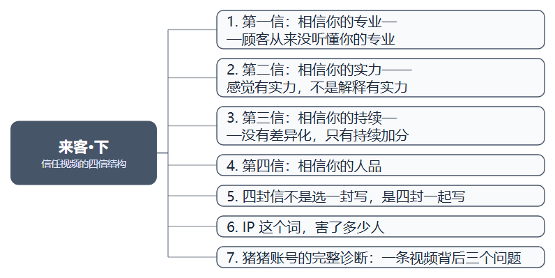

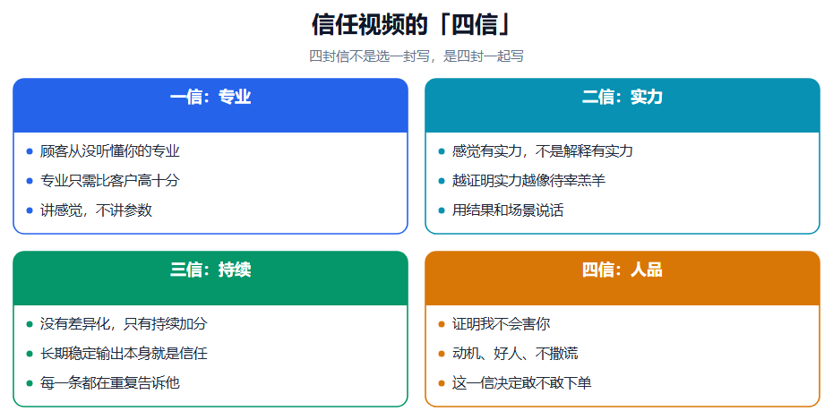

## 1\. 第一信：相信你的专业——顾客从来没听懂你的专业

### 1\. 你的专业，最好只比客户高十分

我们花了两个小时，让各位理解一件事，我管它叫世界第九大奇迹：顾客从来都没有听懂你的专业。无论你说什么，顾客其实都听不懂。

反过来讲，你的专业最好还是刚好比客户高十分。这是比较有效的状态——高太多，他听不明白；一点都不高，他不服你。

这是建立信任的第一个理由，也是顾客找你的原因。当然，它不是只有一个维度，它有很多个维度：我的身份、我的画面、我的语言、我的成果，等等这一切，这些是顾客找你的部分。

第二个，是让顾客相信你的实力。

📌 一句话总结：专业只高客户十分，讲浅一层，他才听得懂、够得着。

## 2\. 第二信：相信你的实力——感觉有实力，不是解释有实力

### 1\. 想拿真本事说话

怎么让顾客相信你的实力？有的人说，我不想那么麻烦，我干脆拿本事来说话，真本事不会骗人。

对，真本事不会骗人。可真的把本事摆出来，其实也不太打动人。

我曾经问过很多人，也问过现场很多同学：你怎么解决这个问题？你有什么好方法？基本上大家都会这么讲——我的产品真的很有效，我的服务真的很用心，我们甚至取得了什么样的结果。

我们很多人都是这样说的：我是怎么解决问题的，我跟你讲我怎么解决这个问题。我们真是一个有本事的团队，我们真是一个有结果的团队，我们真的有结果。

我相信结果。可是顾客并没有那么真意义上相信结果。

### 2\. 保过班：你都敢承诺结果了，他还是不信

我们曾经有一个非常之迷的段子。

课上来了两个同学，都做高三升学，一模一样的业务。我问其中一个，我说：顾客为什么找你买单？

他说：因为我们对孩子提分啊。

我说：那别人为什么找你买单？

他说：我们也能给孩子提分啊。

我说：你怎么证明你们能给孩子提分？

他说：我们有很多名师。

我说：别人也有很多名师啊。

我说：那你怎么让顾客相信你呢？

那边那个同学，情绪突然发生了巨大的变化，感觉遇到了一个很大的痛苦，当场抓下来几根白头发。他说：这个也是我们现在遇到的问题，所以我们现在想出来一个办法——做协议班，各位应该听说过，叫保过班。

你跟我签个合同，交 3 万块钱，或者交 5 万块钱，我包你的孩子过，不过退钱。

按道理来说，顾客该信了吧？你都保过了。可他现在遇到的问题还是：不太好卖。

原因是什么？原因还是因为不相信。很多时候，你证明自己真的有结果，甚至你跟顾客承诺结果，顾客还是不信。

而且很多时候，结果上的优势不等于宣传要素上的优势。你真正解决问题的方法，并不能拿来宣传。

### 3\. 红娘猪猪：把交付流程当卖点，一样卖不动

举个例子。我们有一个做红娘的学员，在常熟，干了 23 年红娘，天意红娘的创始人，我们叫她猪猪姐。

我问她一个问题：姐，别人为什么找你？

她说：我们做了很多年红娘了，我们真的很会。

我说：你有什么手段呢？

她说：高的呀、矮的呀、胖的呀、瘦的呀，我跟他聊两句话，我就知道他是什么样的定位了。

坦白讲，我内心是认同的。我认为她真的很会，解决问题她是最重要的那一环。

于是她干了一件事：把自己解决方案里最关键的步骤拿出来，做成了宣传卖点。

她视频的开头就四个字：需求互补。看懂这一个，少走很多弯路。我结合了 23 年的婚姻咨询经验，总结出了婚姻需求：第一情感需求，第二经济需求，第三家庭的需求，第四……

各位看完想买单吗？并不想买单。可她明明是在解决问题啊。

她把自己解决问题的核心步骤、把自家交付的成果和过程拿出来宣传，为什么没有用？

因为有一个东西叫：一切后端真实的水平，都是消费者买单之前看不懂的。

你是怎么交付的，消费者并不在意。你拿出来宣传，消费者也不能感知。这是我们家的交付流程图——你能感受到价值吗？你不能。买单之前，你根本不能理解我为什么要这么设计。

### 4\. 德鲁克：企业内部只有成本，成果在外部

著名的管理学家德鲁克说过一段话：企业内部只有成本，成果在外部。

也就是说，你的企业内部是如何解决这个问题的，这些内容如果放在前端，消费者是不能理解的，也并不会形成打动消费者的东西。

我们有非常非常多的顾客，很喜欢去宣传：我解决这个问题的方法有多科学，我的交付比同行多优秀，我的能力比同行高多少。

你的消费者能理解吗？你说你解决问题比同行更好，你的消费者怎么知道？你说你们家的人专业能力比同行更强，消费者怎么知道？你说你的方法论是行业里更先进的，消费者怎么知道？

这些东西拿出来宣传，是没有意义的。

因为你的真实水平，消费者其实不懂，他根本看不明白，他只能看感觉。你说你真的很专业、真的很厉害，他是不能理解的。

买单之前，感觉最重要；买单之后，事实最重要。

为什么买单之前感觉最重要？因为消费者买单之前，他的认知没有那么强。为什么买单之后事实最重要？因为买单之后，如果你没有给他提供很好的交付，你的口碑就会崩，转介绍就会崩，客户体验也会不好。

所以这是两个能力：一个是宣传，一个是解决问题。这是两个能力，两门功课。

### 5\. 21000 元的营养教练：他从来不解释，只带我去

我有个营养教练，也是刘思怡的营养教练，刘思怡推荐给我的。多少钱？21000 元一年，到今年是第三年。

我当年给他付费的时候，第一个月，这个教练每天在群里发这些信息，全是论文：植物油的风险、B 族维生素与大脑的综合机制、纤维真的有传说中的那么好吗、基于可溶性膳食纤维的增稠剂对婴儿配方奶粉中钙、铁和锌有效性的影响，临床实验结果如下。

基本上就是这些东西。当时我找他买单，买完单之后，我的合伙人老杨跟我说：经纬啊，你找的那个营养师，没有办法知道他专不专业。

对，没有办法知道他专不专业。那什么时候我开始判断得了他专不专业？什么时候我开始能判断他能不能帮我解决问题？

是有一天下午，他给我发了一个微信：该做体检了，下个礼拜三，杭州第二人民医院，我带你去做体检。我说好的。

第二个礼拜三早上七点半，我跟他在杭州第二人民医院门口见面。我说我去挂个号，他说不用管。

于是，在医院门口，他带着我从门诊一楼、二楼、三楼、四楼、五楼，我们俩走到了五楼。五楼挂着一个科室的名字：生活方式医学科，就是通过生活方式的改变来养出一个健康，大概是这个科目。

长长的走廊，最起码有 15 个房间。你知道医院就那个样子，房间非常非常多，门口最起码挤满了 300 人，一堆人在那边排队。

然后那个教练干了什么？他带着我，就像黄牛一样，穿插在各种各样的病人中间。最终我们走到一个房间，那个房间门口的人是最多的。我看了一下房间的名字。

门口大概堆了十来个人。他干了一件我终身难忘的事：他把所有人都直接拨开，推开了那扇门。其实里面有人在看诊，正常来说我们都会很礼貌，不会直接进去。他把门直接推开——主任在里面坐着，在给别人看病。

我在后面站着，他在我前面，主任在我们右前方。他对着主任说了一句话，我终生难忘。他说：让我的客户来找你，我先看。

我就完全理解了。

你知道他的解决方案是什么吗？他一定不会跟我讲很多，他的解决方案就是：不要吃饭，多吃肉。

他每天在群里就这样发，每天发各种各样的论文，早上问一句起来了吗，下午翻两句：多喝水，晚上早点睡，第二天早上再问一句。365 天，每天重复。

当初我还质疑他，我说你这样子做，我真的会瘦吗？他说这些最重要。我说要不要相信别的饮食？他说别的饮食你不用相信。我说你能不能给我解释一下？他不解释。

后来，我愿意跟随他，是因为他带我去了那个门口，推开了那扇门。

我们很多时候是这样子的：很喜欢讲自己解决问题的途径——你要注意哪些，不要注意哪些，你是不是真的解决了这个问题，把这个问题解决到什么程度。这些消费者都听不懂。

都听不懂你的流程、你的方案、你要注意什么。解决这个问题要注意什么，这都不是消费者在意的事情。

### 6\. 六个核桃和设计师：买单之前只认感觉

否则的话，你没有办法解释这瓶饮料。这个鬼玩意叫六个核桃，它的 slogan 叫"经常用脑，多喝六个核桃"。

那鬼玩意！我当年上小学、上高中的时候，年年家里一大堆亲戚朋友给我送，说现在上学正在补脑子。后来今年有豆包了，我才理解一件事。我前阵子问豆包：这个玩意里面到底有多少营养因子？

你懂我的意思——消费者买它，从来不是冲着成分表去的。

所以我们来看两个视频。有时候这是一件很无奈的事情：真的很用心，但是你宣传的时候没有用。

这是一个设计师的视频，文案是这么说的：

"究竟怎样才能真正落地呢？这是我们很多业主都很关心的问题。对于设计师来说，其实没那么简单。"

"所有的装修陷阱，不是你多去巡查几次工地、盯着工人干活，或者刷几个避坑视频就能做到的。装修它不是考试，记住几个知识点，并不代表你就能拿高分或者满分。与其把自己变成监工，不如把时间花在一个真正懂你的设计师身上。设计师更是身经百战、做过很多装修题，一个靠谱的设计师能帮你把模糊的需求梳理清楚，就像揉面一样，再把你的需求一点点揉进方案里。"

你刚刚有没有发现，大量的画面其实在传递一种感觉：拿个铅笔在纸上画来画去，穿一件很漂亮的风衣，打扮得非常非常漂亮。真实的施工怎么可能这样？但它给你传递的是一种感觉。这就是扮演，这就是有一定程度的表演，没办法。

所以我再次强调：不要去试图解释。我从来不讲我们怎么解决问题，我都是在传递感觉。

你看这条视频，我会讲我们公司有什么；这条视频向你证明我们在出差；这条视频讲我们有文化墙；这条视频讲我们的原理；这条视频讲我们公司的人才都是 211；这条视频讲我们公司的什么什么。

我们从来不讲我们怎么解决问题，讲了也是白讲。买之前，他不过去看就行。

你真的有实力，你自己的独家解决方法，顾客听不懂。你用了什么配方？你用了什么原理？你解决问题比别人多用心？你有什么样的流程？你有什么样的品控？你有什么样的行业成果？只有感觉可以：身份、结果。

所以，不是你专业、你靠谱成交的顾客，而是你传递的某种感觉在成交你的顾客。不是专业靠谱，而是你传递的感觉在成交顾客。

各位要问自己一个问题：在你的生活当中，有哪些画面、哪些语言、哪些结果、哪些身份，在心智层面上传递了信任？学会利用和放大这个部分，而不是去宣传自己专业的那部分。要感觉有实力，而不是解释自己哪里真的有实力。

### 7\. 乔峰的降龙十八掌

这一段我常常讲，我觉得在这里也可以跟各位分享，我们所有人都会有感觉。

天龙八部里的丐帮帮主乔峰，武功盖世，北乔峰南慕容。丐帮要获客，请问他要干嘛？是不是要让人加入丐帮？

好，那我们认为，如果用刚刚这套来讲，乔峰如何打动用户？他应该拍什么样的内容？

降龙十八掌第一式，有来有回。然后拍什么视频？叫"为什么降龙十八掌是天下第一武功"。

很好笑。你觉得很好笑，可这跟别人有什么关系？别人凭什么要关心你的降龙十八掌？

那我再给你：降龙十八掌第一式有三个注意事项。降龙十八掌第六式，在黑板上画两画。降龙十八掌第八式，你打的时候一定要注意第一点、第二点、第三点。

这不就是你们拍的视频吗？

我觉得很好玩，可我们就是降龙十八掌啊。然后呢，当你没有流量、没有获客，你会得出一个结论：妈的，顾客就喜欢去学蛤蟆功，降龙十八掌太强了，我讲得太干了，他们不喜欢在短视频里学降龙十八掌，所以我不能获客。

这不就是各位的归因吗？顾客就是没本事，就是没有审美，今天的顾客就喜欢学蛤蟆功，就不学降龙十八掌。

我们能这么规定吗？"相信你的实力"，说你看我的降龙十八掌打得这么好，你为什么不学降龙十八掌？我的降龙十八掌这么厉害，你为什么不加入丐帮？——这是解释的事情。

乔峰真正该拍的是什么？我乔峰的武功天下第一，我可以保护你们。

大理城主段誉，还有那个谁。乔峰这个人最讲义气，我对我的兄弟一视同仁，这是一个完全平等的帮派。

还有乔峰穿的衣服。我乔峰这个人从来不穿锦衣玉食，我就跟我的兄弟、跟我丐帮所有兄弟穿一模一样的衣服。

乔峰从来没有说，我要拍一个高质感短视频，再打一个灯光，穿个很好看的衣服。因为丐帮用户并不需要你有高审美。

所以什么叫彰显你的专业？还要去学会建立、迎合用户。这是第二封信：相信你的实力。

📌 一句话总结：别解释实力，给画面、身份、结果，让他感觉你有实力。

## 3\. 第三信：相信你的持续——没有差异化，只有持续加分

### 1\. 同行第二天就能学走，怎么办

有些同学会说：这样的方法，同行马上就能学走，那我应该怎么办？我们很多新手会提出这个问题。我要跟各位报告一个市面上大多数人给不了的答案。

重点不是去找出差异化，而是条条视频都在为同一个点加分。

差异化这个词，是一个非常有诱惑性的词。我们今天商业变现效率不高，不是因为执行力不强，而是因为没有找到那个差异化——只要我拥有那个差异化的方式，只要我去掘金，我不停地挖呀挖，我只要找到了那个差异化的定位，我的业务马上就会翻 5 倍、翻 10 倍。

在今天短视频这个公开赛马的环境里面，我们可以明确地告诉各位：没有差异化。

因为你能想象的所有概念，会在一个月之内被你的同行学走、抄走。抄你的视频真的没有任何成本。

所以有些老博主会有痛苦：有大量的入行搅局者在搅和你的市场，应该怎么办？

这些方法论并不是线上的方法论，线下也一样。线下不也在内卷吗？我们来看线下那些更成熟的商业业态，他们是如何解决这个问题的。

你说，在今天的中国，做衣服、做手表、做充电宝、做手机壳、做手机、做餐饮、做家装、做设计，我们还有没有可能做？那些活下来的品牌、活得很好的业态，如果靠的不是差异化，那他们存活下来的手段是什么？

### 2\. 巴奴：没有一句"我食材好"，处处都在说食材好

巴奴这家火锅店，从头到尾只做一件事：让每一个触点都为"食材好"加分。

|**触点**|**巴奴做了什么**|**传递的信号**|
|---|---|---|
|门店口号|主打食材原汁原味|食材新鲜|
|调料台|标明食材和来源|来源可查|
|展示柜|摆出食材的品质|看得见的好|
|桌面电子屏|放农田、丰收、冷链画面|从地里到餐桌|
|上餐话术|服务员再讲一遍食材|反复确认|

这家店叫巴奴，大家知道吧？巴奴的味道还不错，是我最喜欢的一家火锅店。

为什么我很喜欢巴奴？因为巴奴有一个口号：所有的食材都是原汁原味。主打中高端，所有食材都非常原汁原味。

那我问各位：巴奴作为一个火锅店，主打食材新鲜、原汁原味，这个定位够差异化吗？够吧。那我再问：这个定位，全中国模仿它的火锅店低于 1 万家吗？也不低于 1 万家。

也就是说，巴奴并不是靠差异化做出来的。巴奴怎么做出来的？

我跟各位分享两件事。第一，为什么巴奴能胜利？因为从你踏进这个门店开始，你就已经开始被不断强化感觉了。

走进门店，他会说巴奴的毛肚很新鲜。进入门店去调料台，调料台会告诉你食材，会告诉你食材来源于哪里。然后你走进去，看到展示柜，展示柜会告诉你它的食材有多么优质。

然后你走到座位上，开始吃饭。吃饭的时候，桌面旁边有一个小的电子屏，电子屏里放各种各样的画面：农田里把菜拔出来的画面、农民丰收的画面、用簸箕去弄辣椒的画面，等等一切。他告诉你巴奴的辣椒、巴奴的毛肚、巴奴的肉、巴奴的羊都长什么样子，然后怎么样冷链送过来的。

你点完餐，服务员上餐的时候，他还会讲。

巴奴没有差异化。巴奴提出的是一个非常非常常规的口号，是一个非常非常常规的符号。

同时，巴奴做到的事情是：在这一个点上，我没有说我食材好，但是处处都在体现食材好。我的门店的每一个地方、每一个跟消费者接触的触点，都在为同一个信号加分。

这里加三分，那里加三分，那里再加三分，最后再加三分，我的综合分数怎么样？我是一个给消费者感觉优先给到 95 分的门店，而另一个门店可能只有 60 分。

最终不是我差异化赢了，而是在这个差异化的选项上，我的分数赢了，我的总分赢了。

这个总分赢怎么讲？叫这里好一点，那里好一点，哪哪都好一点，消费者就会说这家店真的好，你要不去试试？

这就是今天传播、今天线下门店他们取胜的方法。

我跟餐饮人聊过，我说巴奴的品质真的有那么好吗？巴奴的食材真的有那么好吗？当然，这是另外一个话题，我们先不扯开。

因为在今天的市场上就是这样子：你有的卖点别人都有。你说你实战，别人也说实战；你说你用心，别人也说用心；你说你教得好，别人也说他自己教得好。

所以这就回答了那个问题。今天白天我问大家：你打动用户的理由是什么？告诉各位，那些理由都有效，但是你必须持续加分。

### 3\. 三家店做同一道酸菜鱼

三家门店：一家叫太二酸菜鱼，一家叫烤匠，一家叫江边烧饭。这三家店都在做酸菜鱼，都在做烤鱼，每个人主打的都是一样的东西：鲜活、鲜活、鲜活，没有差异化。

最终这家店，比如烤匠，现在是一个非常非常知名的门店，它为什么做出来了？是因为它差异化吗？不是，是因为它得分最高。

每个行业里面，你知道有用的卖点就那么多。比如对所有咨询或者专家老师来说，这个卖点其实只有一个：你靠谱。你不会有新的理由，你不会有新的卖点，你不就只有这一个吗？

就算有一天你找到了新的卖点，又怎么样？同行第二天就会跟上。

所以既然如此，我们今天下午跟大家讲，建立信任有什么用？我不是让你出一条，我是让你一直出。

我回答了一个问题：为什么经纬在 23 年、24 年、25 年，很多同行都没了，但我活得还不错？不是因为我有不一样的理由，而是我在各个视频里面都在给"实战"这个理由加分。持续加分，从不同的维度加分：从身份、从场地、从出差、从方法论、从自己的理念、从自己的招聘、从公司的人员组织，等一切一切的角度，都在为同一个东西加分。

我是得分最高的选手，而并不是我是一个差异化的选手。这是持续存在的方法。

### 4\. 三年前的消费者和今天的消费者

同样一个卖点，三年前的消费者一听就买，今天的消费者要看你演完全过程。

|**维度**|**三年前的消费者**|**今天的消费者**|
|---|---|---|
|状态|懒惰，不愿自己做决定|勤劳，愿意自己论证|
|相信什么|你说厉害、有结果|看见解决问题的全过程|
|决策方式|给个身份案例就下单|持续观察同一个信号|
|你要给什么|一个理由|一直为同一个理由加分|

今天的消费者到底在相信什么？

三年前，消费者其实是非常非常简单的状态：你只要跟我讲你很厉害，我就愿意给你买单；你只要有结果，我就给你买单。三年前的消费者是懒惰的，他不愿意自己做决定，只要你给我一个身份、给我一个案例，我就可以偷懒去做决定。

而今天的消费者是勤劳的。今天的消费者之所以愿意找你买单，他必须得在你的视频里面看到你解决问题的全过程，要持续地在你的账号里面去论证。

昨天李敏跟我说，有个同学——他为什么来？是因为你发现这个人好像一直在持续做同一件事，而且是同一个信号。

这是今天买单用户的逻辑。你认为自己的转化率比较低，为什么？就是不够。

第三个叫相信你的持续：没有差异化的卖点，就是同一个点。提出一个点，然后持续为这个点去打穿。

这里面有两件事：第一，要提出同一个点，否则你会没有方向性；第二，要持续地在各个维度为这个点加分。

📌 一句话总结：没有差异化，定一个点，条条视频从各维度持续加分。

## 4\. 第四信：相信你的人品

### 1\. 两个医生：贴心的那个和没耐心的那个

除了能力的信任，我们还有一种信任，也是最后一种信任：相信你的人品。这是一个非常非常重要的维度。

今天下午讲了一个故事，各位应该还有印象。王一迪在广州第二人民医院和上海华山医院看了两个医生。其中一个医生非常贴心地跟他讲：你找任何医生都这样选择，要这样选一个医生。特别特别贴心。

华山医院那个医生，其实对他没有那么多耐心，他会觉得：我没有办法替你判断杭州的医生跟上海的医生谁手艺更好。

所以你不要总是试图证明。你可以证明你的专业，你的同行也可以证明你的专业。消费者觉得你很专业，也觉得别人很专业，但他不知道怎么判断。

那他能判断什么？他觉得你这个人还怪好的，不会是一个骗子，不会是一个坏人。这是不是成交用户的关键？也是打动用户的关键。

**⚠️ 我们总是很喜欢证明自己的实力。这并不是一个善的方法，因为你越证明自己的实力，消费者越会认为自己是一只待宰的羔羊。**

### 2\. 你为什么连医美机构的门都不愿意进

今天你为什么不愿意去医美？真的是不相信那些医美机构吗？

比如杭州排名第一的医美机构，你为什么连进去都不愿意进去？我没有说让你付费，你为什么连进去都不愿意进去？

你觉得他会害你。你觉得他不会跟你讲实话。

所以你不是不相信他的实力，你认为他是一个商人，你认为他是一个不会为他着想的人。

这是今天短视频里的一个情况：短视频今天骗子扎堆，所以证明自己的人品比证明自己的能力要更重要一些。

我不光要证明自己有能力解决你的问题，我还要证明我不会害你。我要证明自己的动机，我证明自己是一个好人，我证明自己是一个不会撒谎的人。

你得证明这个部分。否则你光讲能力，他多多少少会觉得有些担忧。

### 3\. 留学客户：因为都喜欢段永平

之前有一个做留学的人来找我，他说之所以来找我学，是因为发现我也喜欢段永平。段永平有一个文化，叫本分。

本分文化。所以他认为：你选的人很明，那你应该是一个好人，因为你应该是一个本分的人，那我就找你买单。

那怎么样去证明自己的人品？怎么样去证明自己是一个好人？讲价值观。

### 4\. 讲价值观：先说喜欢谁，再说讨厌谁

怎么样讲自己的价值观？给大家分享两个方法。

第一个方法：出一些视频，分享你喜欢谁、你喜欢什么词、你喜欢什么样的事情。

比如你拍一条视频，说你最喜欢巴菲特，你喜欢巴菲特的长期主义，那你是一个什么样的人？

再比如，你最喜欢刘德华，那你是一个什么样的人？兢兢业业的人。你喜欢他，不就是喜欢这样的精神吗？

喜欢什么样的词？你喜欢长期主义，你喜欢本分，那说明你就是这样的一个人。

包括你认同什么样的事情，你不认同什么样的事情。我们可以通过发表对一些人、一些句子、一些事情的看法，来让别人知道你到底是一个什么样的人。

我们出过一条视频，可以给大家看一下。我本人非常喜欢段永平的本分文化，这几年创业下半场，其实也一直在践行他说的这些。我理解的本分，这里面涉及到一个世界观的问题：你到底信什么。另一部分人的世界观，是偏向英雄主义的。

第二个方向是反面的：你讨厌什么词、你讨厌什么事。

比如我举例，最近华为……吹牛。你讨厌这样的人，其实就是在让消费者知道你是一个讨厌吹牛的人。

再比如，你很喜欢山姆超市这个品牌，或者说你讨厌某一个品牌，就说明你认同什么、不认同什么。

每一个名词、每一个人、每一件事情，它背后都代表了一种价值观。

### 5\. 讨厌"原生家庭"的心理咨询师

以前我听过一个很好的东西。有一个心理咨询师，他说他最讨厌一个词，叫原生家庭。

为什么呢？因为你说原生家庭，就是现在好多人把自己所有的问题全部归结为原生家庭：出现什么样的问题，爸妈的错；我现在有什么样的性格，爸妈的错；我现在执行力不好，爸妈的错；我现在不敢跟人说话，爸妈的错。

他放弃了自己人生一切的可变性——我未来的人生是不可变的，我未来的人生在我出生在这个家庭的那一刻就已经全部决定了。

他很讨厌这个词。他认为每一个人的人生都应该像树芽一样，随时可以变化，将来可以茁壮地成长。

所以你看，你讨厌一个东西，是不是就意味着反映出来你喜欢什么样的东西？你反感原生家庭，就认为人生是可以向上生长的，是可以不停变化的。

再比如，我们讨厌战略这个词。如果我们说我们讨厌战略这个词，就是我们认为做人、做事应该脚踏实地。

我讨厌当老板每天就谈战略，就说明我认为什么？

所以你讨厌什么词、讨厌什么人，就可以反映出你是一个什么样的人。

黄仁中，我们当年也给他做了一条视频，可以看一下。他非常讨厌现在一个很流行的词，叫做"做自己"。

他说：每个人每一刻都在做自己，我就是那个恨我自己的自己。

你看，我们虽然在讲做自己，但我们在讲的是：相信我的价值观。

你相信我，上课不会害你；你相信我，上课不会跟你讲那些很虚的东西。这就是在获客。

你相信我跟那些搞洗脑方法论的老师不一样。

📌 一句话总结：讲喜欢谁讨厌谁，先证明你不会害他，人品大于能力。

## 5\. 四封信不是选一封写，是四封一起写

四封信各有各的打法，谁也替代不了谁。

|**这一信**|**靠什么建立**|**消费者怎么感知**|**你要做的动作**|
|---|---|---|---|
|相信你的专业|专业只比客户高十分|听得懂、够得着|把专业讲浅一层|
|相信你的实力|画面、身份、结果的感觉|感觉你有实力|给画面，别解释|
|相信你的持续|同一个点，条条视频加分|一直在做同一件事|一个点打穿到底|
|相信你的人品|价值观、喜欢谁讨厌谁|这人不会害我|先证明我不会害你|

顾客的信任其实有很多种维度：相信你的专业，让你的专业刚好高十分，有专业的感觉；相信你的实力，叫感觉有实力，不是解释有实力；相信你的持续，就是你没有差异化卖点，你要找到一个点，你要打穿；相信你的人品，就在于你的人品其实大于你的能力。

但这里面每一招都有用。我要教大家的方法，并不是你要用一招用透它，而是你都得用。用得越多，你的信任力就会越强，因为你有全方位的信任。

📌 一句话总结：四信全用不选一招，用得越多，信任越强、转化越快。

## 6\. IP 这个词，害了多少人

### 1\. 获客天花板太低，还是当 IP 好

之前有个同学说了一个特别特别有意思的事情。他说：获客天花板太低了，还是当 IP 好，IP 天花板很高。

刘慈欣让全中国的人都知道 IP 这个词。

于是好多人就这样讲：你今天为什么业务不好？因为你没有当 IP。你为什么产品卖不掉？因为你没有出来当 IP。你为什么公司现在遇到了一些转折、不知道该往哪里转型？因为你转型的方向就要去做 IP。今天全中国最大的商业机会在哪里？就是当 IP。

什么是 IP？

以前真的有人问我，他说：经纬，你的方法论好复杂，你的方法论有点难，获客天花板好像很低，我还是想当 IP。

那什么是 IP？我们来看两个人，这两个人到底是什么鬼玩意？雷军和张老师。我们看了雷军的账号，也分析了张老师。

那到底是 IP 还是获客？他从第一天就在获客。量大了，别人就说他是 IP。可本质上，比如做二手车的，两个版本的时候我就在变现，我只是今天粉丝量稍微大一点了，你说我是个 IP 而已。

**⚠️ 24 年、25 年，那些我的同行死掉的，全都是自认为自己是 IP 的人。**

要那个名声有什么意义？最傻的就是盯着 IP 两个字。

而且，你今天在外面看到的那些所谓的 IP、所谓有影响力的 IP，在我所构建的信任力面前，其实非常可破。

📌 一句话总结：别盯 IP 的名声，本质就是获客，粉丝量大只是结果。

## 7\. 猪猪账号的完整诊断：一条视频背后三个问题

### 1\. 四个圈，一个都没圈上

猪猪这条视频，看着像拍得不好，其实是四个维度同时错了。

|**维度**|**原来错在哪**|**现在怎么改**|**为什么**|
|---|---|---|---|
|人群|讲给所有单身男女听|只圈家长|掏钱的是家长|
|画面|看不出干了 23 年红娘|要有资源、有圈子的样子|家长只看感觉|
|观点|讲需求互补、底层逻辑|只讲眼缘|买单前听不懂专业|
|选题|同行才关心的题目|孩子回家说的"没眼缘"|家长天天在愁|

我们来看猪猪这个人。

首先看开头。他刚刚讲了什么？他说，婚恋匹配的底层逻辑就是需求互补。也就是说，猪猪犯了一个定位的问题：他到底要圈什么样的人群？他知道吗？

你说猪猪到底能成交年轻人，还是成交年轻人的父母？其实猪猪只能成交家长，他成交不了孩子。有些人不可能怎么找他。

所以他犯的第一个问题：他有没有圈人？没有选择。这是一个策略的问题，并不光是拍摄的问题。

第二个看画面。现在这个画面，家长会觉得美吗？

第三个看观点。他讲了什么？他说婚恋需求的底层逻辑就是需求互补，婚恋一定要定位。请问这两个观点，是一个用户买单之前能理解并且接受的观点吗？

这是什么？这是我们今天早上讲的，叫正确答案——一个买单之后解决问题的正确答案。

所以猪猪在这个视频里面，开头没有圈人群，画面也没有圈人群，观点也没有圈人群。

第四个看选题。他说婚恋匹配的底层逻辑，看懂这个少走很多弯路。这是一个顾客在买单之前会感兴趣的东西吗？也不是吧？没有哪个顾客摆在面前，会先关注底层逻辑。这个选题按道理来说是什么东西？是一个同行感兴趣的东西。

如果是在讲师上课的时候讲这个东西，可以的，没问题的。但它是一个解决问题的方法论的浓缩，仍然是买单之后的信息。

所以猪猪其实犯了非常非常多的问题，他的锁客、他的圈客其实都没做好。

而我们给他重新做一次圈人群，他真正应该圈谁？他应该圈家长。他的画面也需要调整。他讲的观点，不应该讲定位，不应该讲底层逻辑，他应该讲眼缘——因为眼缘是孩子会高频跟家长提到的一个东西。

所以我们应该围绕眼缘这个选题来出内容。出完这个内容之后，看视频的人是不是变成了家长？

### 2\. 家长为什么买单

那家长为什么买单？因为我会尽力呀——因为我干了 23 年红娘。

你认为这个能打动家长吗？有没有别的？他说没有了。

我说，感觉真的很重要。请看这张脸，你感觉这个人有什么？你感觉这个人干了 23 年红娘，在当地一定有非常多的资源和圈子。

可他的画面里根本没有。他的圈子都已经几十年没更新了。这里要的是感觉有。

猪猪说，他真正的能力是：相比别的红娘，他的定位非常强。我说，那你还有别的吗？他说我们公司有数据库，他们公司里面有很多流程、很多人选。

我说这个也否，因为我感觉你没有。

所以打动用户的理由，是专业的感觉，是相信你的实力，不是你真的很会做定位。这个宣传没有用，消费者听不懂。

要改变他的营销策略，改变他的卖点。然后相信他的持续，因为一条视频不够。然后相信他的人品：不是让你来，是让你多挑一挑。

### 3\. 重拍之后的稿子

猪猪最终拍出来的视频是这样的：

"各位家长，我问你们一句心里话，是不是天天都在愁自家孩子工作不错、又在事业单位上班、长相端正、人品又好，二十七八、三十出头的，选谁？"

"但是有的已经 35 岁了，相亲就是不成，一直不成，什么都找不到合适的。"

"我跟你们讲，太多太多的家长都跟我吐槽：我家孩子真的很乖，逢年过节让他们去吃饭、去见面，他们都很配合，从来不抗拒。可问题来了，每次见面回来，这三个字没变——没有眼缘，那个也没有眼缘。23 年下来，见了十几二十个，甚至更多，全都没有眼缘。家长们都快急死了。"

"那我问你，眼缘是什么呢？是长相吗？还是性格呢？今天我来跟你们科普一下，你家孩子嘴里说的眼缘到底是什么。"

"眼缘不光是看长相，也不是单看性格，是一种对上的、舒服的、两个人愿意聊下去的感觉。但你们知道吗？你们在家天天给孩子介绍人，介绍了一大堆，其实翻来覆去就是同一堆人，同一个圈子里的人。孩子喜欢性格外向、要聊得来的，你们直接就给他介绍条件好的、家庭好的、工作好的，完全按照你们父母的标准来挑，看来看去都是同一个圈子、同一类人，孩子有眼缘才怪。"

### 4\. 三个问题叠在一起

所以猪猪这个账号，看似是一个拍摄的问题，背后有三个问题同时叠加。

第一个问题：他不知道自己的目标人群。

第二个问题：他不知道他有什么样的卖点，不知道该用什么样的卖点来打动用户。

这两个问题属于什么问题？属于营销策略的问题，或者叫市场定位的问题。

第三个问题：他不知道怎么拍短视频，画面不好看，观点、选题、开头没有圈人群。

猪猪这个问题比较复杂，它有策略的问题，有定位的问题，有卖点的问题，也有拍摄的问题。

我们过去大家都认为短视频是一个拍摄的问题。其实有拍摄的问题，也有表达的问题，也有营销策划的问题，也有定位的问题，也有卖点提炼的问题，它是包裹在一起的。

### 5\. 我也有失手的时候

我常常把话说得很保守：上完课回去的人，只要坚持拍、坚持发，都能获客。

但猪猪不愿意用这个滤镜。她说：这个美颜太丑了呀，把我拍得太老了，你能不能改回我原来的磨皮美颜？

我说姐，我给你磨皮了，我给你美颜了。她说这个美颜太老了。

两个月之前，我们还在跟她磨了一遍，姐姐还是不愿意接受，她始终不愿意接受这个磨皮。

所以我说，这是我失手的地方。原因是什么呢？就在这儿。

当天的安排，晚上还有一场分享。

📌 一句话总结：账号问题多在人群、卖点、定位，不只是拍摄不好。

# 十、第2天晚上｜案例复盘：老杨拆一个美业 IP 的全流程

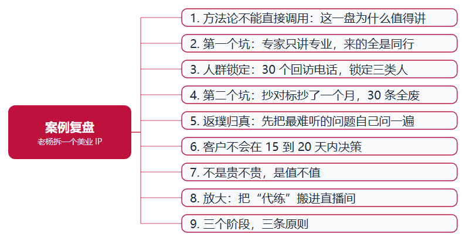

## 1\. 方法论不能直接调用：这一盘为什么值得讲

### 1\. 把方法论直接搬进项目，一定无效

两天讲了很多方法论，四个锁、四信，讲得都很清楚。但真正做短视频获客的时候，这些东西怎么用？老杨开场就把话说死了：“如果在项目中直接调用方法论本身是无效的。”

为什么无效？因为每一个项目都不一样。第一个不一样是人群不一样：你们赛道里的细分人群，跟同行不一样，跟别人的客户也不一样。第二个不一样是产品不一样，盈利点不一样。产品卖给谁、钱从哪个环节赚，每一家都不同。

在这么多“不一样”之下，真正调用方法论的时候，必须结合实际分析。所以今天晚上不讲方法论怎么背，而是拿一个真实项目，把方法论在项目里怎么落地，一步一步摊开。

### 2\. 这一盘的样子：有产品、没获客、阶段极早期

这个案例是 2025 年做的，就是去年，算是比较早期的一盘。为什么拿它讲？因为它典型。

典型在第一，IP 阶段比较早期：账号做了，但没获客。第二，他有产品，线下是赚钱的。也就是说，不是从零搭业务，而是业务已经跑着，只是线上这一块完全没打开。

这类盘在起盘过程中坑特别多。所以老杨说得很直接：“我今天晚上其实没有什么太多吹牛逼的部分，我今天就直接告诉大家，我们做项目中间吃了哪些屎。”你们避避坑总是好的，包括遇到问题怎么解决。

这还是一个 To B 的盘。培训、招商加盟这一类，统称为 To B。不是 To C 的盘，但里面的很多东西，做 To B 的各位都能对上。

To B 和 To C 最大的区别是：To C 卖的是自己用，To B 卖的是拿去赚钱。

所以 To B 的客户判断一件事，只看三条：这东西能不能帮我赚钱、安不安全、我学不学得会。

这一盘后面所有的内容，都是围着这三条转的。

### 3\. 三个月的结果：4 个客资 0 个变现，到 3000 人在线

先说结果。合作三个月，从合作之前的 4 个客资、0 个变现，做到直播间 3000 人在线，还开了自己的品牌线下招商会，做到了细分领域的第一 IP。

这个结果听起来挺漂亮，但过程一点都不漂亮。老杨说，这个项目没有宏大叙事，也一点都不性感，还特别累。这就是做项目的真相。

### 4\. 一个看起来像“骗子赛道”的 IP

先看这个 IP 是干什么的。

第一，赛道叫徒手面部骨相抗衰。第二，背书是明星的面雕师，这个是真的，战绩可查。第三，业务是教每个人赚钱，教手法技术。

这里要补充背景：他本身是有自己门店的。也就是说，他优先服务一批富婆，或者一批不希望破皮整形的大客户，这是他的优先级。在这个基础之上，他才做 To B 的培训。再往下，还有一个隐藏人设：风水师起家，这是人家家里单传下来的东西。

曾黎、彭于晏都找他做过脸，至少是长期合作，这个老杨说不敢乱讲，但确实找他做过。

第一次看完视频，老杨的直觉是：“是不是有点像个骗子赛道啊？”甚至连视频都是一股浓浓的割味儿。后来去验证，为什么会有这个感觉？因为他前面跟兰迪蔻有长期合作，所以片子的质感会趋向于“我很高级、我很牛逼”那种表达。

### 5\. 线下聊完确认两件事：业务是真的，合作点是 To B

看完视频，第一次做短视频的判断，然后约到线下去聊。聊完确认了一件事：业务真实存在。常州有门店，杭州也在开门店。C 端也真的有人给他付费。

那这次合作的点在哪？一起做 To B 的培训。这就是前期背景。

### 6\. 接项目不采访专业：懂得越多，越容易“供脑”

在开始之前，总要看看这个 IP 的内容表现力和表达力。但老杨的团队接任何一个客户，很少会直接采访：“你能不能跟我介绍一下你的课程？你的专业如何？”很少做这种事。

因为需要的只是你的一部分专业知识，不需要全盘了解。本质是帮你做前端获客，不是帮你做交付。如果今天是帮交付团队、产品团队，那当然要什么都了解；但如果只是做获客，看你的直播回放和内容就够了。

两个原因。

第一，懂得越多，越容易动荡，容易“供脑”。老杨举自己的例子：做项目经常是做三个月的。第一个月，他能清楚知道 IP 在哪句话上有问题、用户听不懂。等到第二个月，他就开始替 IP 辩解了——“这个你听不懂吗？其实是什么呀？”然后回头给自己一个嘴巴子：“做流量做久了会供脑，忘了消费者听不懂了。”

第二，我听不懂，消费者也听不懂。所以第一阶段不太会去了解业务细节和专业知识，通过看直播、看回放了解就够了。

📌 一句话总结：方法论不能直接搬，必须结合人群与产品落地分析。

## 2\. 第一个坑：专家只讲专业，来的全是同行

### 1\. 第一次看回放，所有人的感觉都值得被尊重

第一次看这个 IP 的直播回放，老杨让所有人先看，看完说感受。他说了一句话：“你在第一次看回放的时候，所有人的感觉都值得被尊重。”

学员当时的反馈很集中：太专业了；跟我有什么关系；像是在背诵。还有人说他点位很正，但整体像在上课。

老杨的回应是：“你们说的完全正确。”因为专业是相对的，专业是一个很私人的感受。你说这个东西太专业了，是相对于什么样的人群在说？没有对比，就没有“专业”这两个字。

他在直播间讲的是三个维度：骨性支撑——骨骼支撑性不足，脸往下掉；肌肉走向；还有肉的弹性。

然后教大家怎么解决骨性问题：要从哪个位置看，一定是从这一块看，不能往里面推。

第一次看回放的观众，感受几乎一致：太专业、听不懂、像在背诵。

所以现场有人直接问：这是不是一场“有会的专场”？答案是——他讲的东西，对同行是干货，对客户是噪音。

一个人听不听得懂，不取决于你讲得多深，取决于你讲的是不是他此刻的处境。

### 2\. 最要命的一刀：他在前端把技术教了

这个 IP 是在教别人做手法。他最关键的、最要命的一个地方，就在那个“教”字上。

这是交付之后才能感知到的价值，是付费之后才能感知到的价值。

再往下想一层：你在前端把框架、把技术都教了，什么样的人会为此感到兴奋？同行。而且是哪种同行？白嫖的同行——不具备付费能力，想着自己干。

老杨说话粗糙，但意思很清楚：前端把最核心的东西免费给出去，吸引来的不是客户，是想学完就跑的人。

### 3\. 当时的三条病：流量小、全是同行、内容没得拍

以小见大，直播的问题其实就是他短视频的问题。

第一，直播间是有流量，但来的全是同行。而且那个流量很小，且不具备高付费能力。后台私信有没有？有。粉丝群有没有？有。但加微信会折损 70% 到 80%，成交很少，个位数。

这是什么概念？就是你以为账号在跑，其实池子里进的都是内行，他们看得懂、点得动，但不付钱。

加微折损七八成，意味着就算有人加你，十个里也只剩下两三个还愿意往下聊。

再往后谈，剩下的还要掉一半。

第二，除了讲产品、讲技术，不知道还有什么视频内容可以出。

第三，做了半年，感觉自己这行太小众了，没戏了。

客户当时说了一句很真实的话，老杨很认可：“我有这个时间，我做做我客户也挣不少钱呢。”说白了，他拿老杨的团队就是来合作一下、试一试，有机会成功那最好，没机会就回去好好操持自己的店，也挺好，单店照样挣钱。

### 4\. 根子在身份：他对“顾客”没有概念

为什么会出现这些问题？因为身份。

这个客户本人就是手法基础老师。他跟老杨做的是同一件事——做交付的。老杨在公司做交付，不在现场做获客，客户的问题他解答，客户的业务问题他解决。这个 IP 也一样，他最擅长的就是教别人调整面部问题。

所以在他跟团队接触之前的认知里，完全没有任何问题：“我讲啥很合理呀。”这就是合理的。

但还有别的解法：没有人规定专家只能讲专业，专家只能讲技术。

现实是，他的直播间、他的短视频，全都在复刻他擅长的事情。老师就讲课程知识点，律师就讲法律条文，客户就讲产品好在哪。这个小坑对现在的各位可能已经不叫坑了，但当时就是这么掉进去的。

结果就是：来的人跟“客户”是同一类人——同行。没有目标人群。

### 5\. 一句话记住：买单前的理由和买单后的理由不一样

如果这一整段只能记一句话，就是这句：“用户买单前的理由和用户买单后的理由是不一样的。”

买单前，他不知道你的产品能解决什么问题，也不知道你的产品长什么样。你跟他讲技术，没有用，他直接再见。

这个 IP 自己也没理解这件事，所以白白做了 8 年多。

两种人群的内容取向，差别是结构性的：

|**对比维度**|**买单前的人**|**买单后的人**|**结论**|
|---|---|---|---|
|关心什么|我的问题能不能解|技术怎么落地|前端别讲技术|
|想看什么|处境、纠结、结果|原理、手法、参数|讲错层等于白拍|
|来的是谁|目标客户|同行、白嫖党|人群一开始就错|
|信任状态|完全不认识你|已经付过钱|先补信任再谈价|

### 6\. 老板做不出内容的根因：在交付里出内容

这就是第一天讲的，老板做不出来内容的核心原因：你在基于已经上门的客户问什么问题来出内容，你在交付里出内容。

所以你交付的全部是买单后人群。但今天做获客，无论做直播、做短视频、做小红书投放，你接触的都应该是买单前的人群。

你在交付里出的内容，天然带着“已经买了的人才关心”的属性：参数、原理、流程、售后。

这些东西对老客户是安心，对新客户是门槛。

一个还没买的人，看到参数只会有一个反应：这跟我有什么关系。

### 7\. 不知道客户为什么买，获客就只能靠赌

现场很多人都是这样：产品可能卖掉很多份，但并不知道是怎么卖掉的，也不知道消费者买产品是为了解决什么问题。

那获客就只能靠运气。运气从哪来？无非三条：第一条，超高转化；第二条，足够多的文案；第三条，偶尔蹦出一条灵感。

这就是赌。老杨不排斥赌——“我们自己做项目其实也在赌，只不过我们在选择概率更高、赢面更大的赌博方案，仅此而已。”

因为消费者没有在你这里获得确定感。一个人如果不知道自己的产品能解决什么问题，就不知道获客文案里该打什么卖点、击中什么用户心理、对准什么用户处境和用户时刻。

### 8\. 郑州那个 2000 家门店的老板：从“治便秘”问到“确定性方案”

上个月还是上上个月，老杨接了一个河南郑州的老板。这个人以前线下有 2000 家门店，做的是中年女性的排便问题——便秘。切得很准，就叫中年女性。

老杨说这三刀是个很好的三刀：因为他身边的妈妈、姑姑、阿姨，中年很容易出这个问题，代谢差，还叠加甲减、免疫力的问题。

这个老板线下当年真的赚到了钱，今年转线上，发现不会卖了。

为什么不会卖？第一，背靠大健康，本身就容易违规。第二，他卖的是自己研发的药剂和产品——一个用中药古方做出来的膳食饮品。

老杨拿他的直播去看，发现里面讲的所有东西全是产品参数：“我这个东西是拿 1000 年古方做的”“我这个东西得到了国际什么认证”。这就是他给出的答案。

老杨就开始问。

**问**：*请问你的客户究竟为了什么找你？*

**答**：就想治好便秘。

**问**：你的客户有没有看过大夫？

**答**：大部分都看过。

**问**：看过医生之后，为什么还来找你？

**答**：因为医生给的大部分是泻药成分偏多，他们会发现无法自主排便。

**问**：那他们现在追求的到底是不便秘，还是有一个确定性的、可以排便的方案？

**答**：后者。

问到这里，答案就出来了。消费者看起来要解决的是最终问题——不便秘；但不同阶段的用户，卡点完全不一样：有人是怕泻药、不敢长期用；有人是想恢复自主排便；有人是泻药吃多了产生依赖，拉得太多兜不住。每个人的情况不一样，这就是用户处境。

如果产品能解决什么问题都说不清，你就不知道文案该打什么卖点、击中什么用户处境和用户时刻。这就是“没有确定感”。

📌 一句话总结：前端讲交付级技术，只招来白嫖同行；要讲买单前处境。

## 3\. 人群锁定：30 个回访电话，锁定三类人

### 1\. 这一屋子人，问题高度重合

这两天坐在下面的，基本都是自己带业务的中小老板和创始人：自己拍、自己播、自己谈单。开场时有学员自报做饲料、做农业，也有做门店、做培训的。

行业不同，卡点几乎一样，就三件：账号做了，没有客资；有客资，加不上微信；加上了，也不成交。后面这一盘，基本就是把这三件事一件一件拆开。

### 2\. “美业老板”是一个无效答案

第一件事，是问 IP：我们的客户是谁？

他给了一个无效答案：美业老板人群。

为什么无效？因为你得继续往下问：你早年是在第一轮产品上赚到钱，还是在第二轮服务上赚到钱？你多大岁数？你是连锁，还是单店？你是技术型老板娘，还是销售型老板娘？这里面的差别太多了。

好消息是他没骗人。确实美业老板居多，大概一半。剩下的是同行，或者一些化妆师想转行的小白。

为什么会有化妆师和小白进来？因为赚钱。这看起来是个手法和技术，学完以后总比当化妆师赚得多一点。这个认知可能有偏差，但这就是他们的认知。

所以这一盘的人群是：美业老板，加部分同行——同样做徒手美容的，当时不止他们一家，只是那些同行小一点。

产品是什么？两个培训类产品：美业大单思维训练营、风水骨相抗衰训练营。

### 3\. 再问“他们为什么付费”，拿到的是交付视角

紧接着再问一个问题：他们为什么要给你付费？

老杨说，这个问题他还是挣扎了一下，想知道小客户懂不懂。结果没什么用。因为对方给的是从交付视角出的答案。

三条：一，我们的面诊很专业，能升单；二，我很会取得客户的信任，开价单有大胆思维；三，我们的项目有陪伴属性，有复购。

看完就四个字：关我屁事。

为什么？看主语。这三条里没有一个主语是企业老板、客户、同行，所有主语全是我。

这套话放在 5 年前可能有效，因为那时候大家没见过这么多牛逼的 IP，有病想学一下。现在你们自己行业内的 IP 一大片，牛皮很少了。

### 4\. 把话挑明：你知道客户在纠结什么吗

实在问不出来，老杨就直接拆穿了。他连着问了几句：

你知道什么客户遇到什么问题才要找你买单吗？

你知道客户在找你之前在纠结什么吗？

在给你付费之前，他有没有在纠结是找 A、找 B、找 C？以及找你之前，为什么不能当场付费，而是选择了 3 天后付费？

答案是：不知道。

老杨说这个很真实，他能接受。因为大部分 IP 不一定有这个视角，这是很正常的事，大家的精力不在这块。

### 5\. 打 30 个电话，问出真实的成交人群

这个问题自己想，百分百想不明白，因为年龄、阅历、经历不同，对一件事的了解程度不同。

方法很简单、很有效，又很容易被忽略：直接做客户回访。

老杨说了一个很有意思的发现：“大家宁愿想象和猜测，也不愿意去问一下客户。”

当时的做法是，让团队在微信群里找客户，挨个打电话。不用很多，30 个就够了。也可以不打，看聊天记录，同样看 30 个。打电话就录音，录音转文字，然后一条条罗列下来。

罗列完，答案就出来了。

第一个，生活类美容的美业老板。没有医美资质，客单价不高。原话大概是：我缺乏高客单价项目，我又是有点偏技术性门店的人，所以我觉得今天找一个高客单的技术，是很靠谱的。

这句话，是 IP 说不出来的。

第二个，上海浦东的皮肤管理店，也是生活类美容。以生活美容为主，之前了解过日式整骨，很想把这个品项嫁接进店里，但是一直没有嫁接好，也没有做成客人。也就是说，他之前接触过相关项目，但失败了。

这跟上一个用户的阶段一样吗？不一样。这也是 IP 告诉不了团队的。

第三个，小王，想创业的上班族。早几年想和朋友开个美甲店，后来还是想自己做热爱的事情，感觉更有冲劲；对人和对美有一套自己的理念，觉得用一种非常舒服、安全的方式做美，是未来的趋势，他自己非常认可。

这个人纯感觉派，看得出来没做过生意。

把这三个人的话放在一起看，会发现一个共同点：他们不是在找一个“课程”，他们在找一个能解决自己当下处境的东西。

第一个缺高客单，第二个缺一个能落地的品项，第三个缺一个安全的入场方式。

IP 以为自己在卖手法，客户其实在买“解决处境”。

这就是为什么回访要打够 30 个：三五个人，你只能听到故事；三十个人，你才能听到共性。

反过来说，如果你只跟 IP 聊，你听到的永远是“我的面诊很专业、我很会成交、我们有复购”。这三句话，一句都不是客户的话。

### 6\. 三类人，三种处境

把 30 个样本归完，人群就落成三类。三类人的处境、担心和买单理由完全不同：

|**人群**|**处境**|**担心什么**|**买单理由**|
|---|---|---|---|
|轻医美、医美门店|客诉搞得焦头烂额|刷酸刷坏、馒化烂脸|找没后遗症的替代品|
|生活美容口碑老店|想加高客单品项|引入失败砸口碑|有差异、不破皮、能升单|
|小白创业人群|想低门槛入行|投资大、没经验|安全、成本低、学得会|

第一类，医美、轻医美门店。被客诉搞得焦头烂额。做不好刷酸，刷过劲了，很容易馒化，或者刷烂脸，风险很大。老杨说，现在刷酸这个板块，成熟的问题还是少的，做些简单的还 OK，太大额支出的最好找专业机构。

第二类，口碑型老店。苦心经营的关系，一晚上就毁了，生意越做越没有口碑。翻译一下：我本来是一个社区店或者地区店，靠自己的手艺把生意越做越大。今天引入一个新品相、新技术，本来是想让客单价变高、业绩变高。结果没做好，出了一个客诉，钱没挣到，还倒贴口碑。

他要的理由是什么？找到一个没有后遗症的替代品，同样满足客户不破皮的需求。

第三类，小白创业。市场上的项目投资大、收益不确定性高，行业已经很卷；做皮相布局，竞争优势小；很多女性认同手法安全。

先不谈他讲得对不对。客户的认知无所谓对错，我只要知道他脑子里相信什么、希望什么，接下来就可以帮他做。

第四类，省内门店老板，这是最多的一类。行业竞争激烈、很卷，清洁服务客单价很低——美团一搜，19 块 9 一个清洁补水的引流品。想做医美、轻医美，又要资质，合规查得严。他们的卖点里有什么？品项有差异化、不需要资质、安全。

把三类人的阶段和认知再对一遍：

轻医美的老板，最不希望有客诉。

小白创业人群，想要安全、不要高成本、不要太复杂，甚至可以低成本创业。

生活美容类的老板，门店没有差异化、内卷严重，想增加一个有利润、有差异化的高客单技术项目。

这就是锁定到的人群和成交阶段。

人群定完，内容的靶子才算立住。到这一步，才敢说这个项目不会做得太偏——因为我至少没有停在“我是美业老板”这种答案上。

### 7\. 客户的原话，不要加工

调研拿到客户的答案之后，有一件事必须守住：不要对客户的答案做加工。

“当你开始加工客户答案的时候，你就会离客户很远。”

他脑子里有什么？他希望找一个蓝海赛道的项目，感觉安全。就照这个说。

加工一次，就偏一次；偏上三次，你写的就是自己想当然的客户，不是真客户。

### 8\. 验证了一件事：他们为手法买单，不为“大单思维”买单

这一轮调研，也验证了一件事：宋鸿易之前说的不完全正确。

大家是为了手法、新品相买单，而不是为了大单思维、变现思维或者美业经验买单。

也就是说，大家为他手上那个技术和项目买单，而不是为他理解的大单、成交高客单、变现、美业这些概念买单。

所以给一个起盘的建议：你如果要起新盘，或者马上要做人群调研，请注意一件事——你知道自己的产品有多好，没有用，完全没有价值。你要知道什么客户、为什么要买你的产品，更重要。

这句话有点绕，但它是分水岭。

### 9\. 语文老师的例子：产品好，不等于别人能替你卖

昨天晚上，2023 年的一个客户来找老杨。

这个人是山东一所体制内小学的语文老师，卖自己的语文课。当时老杨陪他做直播，几场直播大概卖了 45 万，课程价 399，其实蛮好的。后来他忙，有段时间不播了。

昨天他来问：“杨老师，你那里有没有那种 K12 或者教培的博主？我想把我的产品给他们，让他们帮我卖。”

老杨直接说：“别这么想，没用。”

理由很硬：大家自己的产品都介绍不明白，还竟然敢卖你的产品？

他说：“不是啊，我的产品卖 3 年了，口碑还是在的。”

老杨回他：“那又怎样呢？那又如何呢？”

产品好，不重要。什么人群遇到什么问题买你的产品，这件事才重要。

### 10\. 一条选题，人群锁对了，70% 获客没问题

很多 IP 和操盘手拿不到结果，就是没找准客户。

开周会的时候，一个操盘手讲了一句很精辟的话：如果一条选题的人群锁定正确，哪怕百分之百获客、百分之七十获客都没问题。人群选对，肯定能获客，哪怕文案没那么好，哪怕观点没那么对。

后来回头看他们做的选题，能获客多的那些，都是用户的处境、用户买单前的焦虑，锁得很准。

### 11\. 问客户的三条问法

怎么规避“没找准客户”？

第一，客户既然上门了，就问他遭遇了什么——你遇到啥事儿找我？

第二，再问客户，选你之前产生过哪些纠结的想法？选我不选他、犹豫、给他付费不给我付费，这些犹豫要搞清楚。

为什么这个纠结一定要问清？因为你大概就知道，客户优先会选择什么样的解决方案。

第三，对客户具体做什么、怎么买你的产品，念头一定要有清晰的认识。

最糟糕的产品介绍方式，就是主语只有“我的产品”“我的追溯”，完全没有意义。这事儿 2023 年做直播陪跑的时候就跟 IP 说过：不要我我我我我，否则就是那四个字，关我屁事。

### 12\. 教育规划这一盘：家长更相信补课

最近做的另一个项目是教培类，在北京，帮一批高知家长做整个教育规划。

他所有的客户，百分之九十左右，都是先给孩子补课——先给孩子补名师课，一节 1000 块钱——补完之后发现没有用，才会来找他。

这就是他们的纠结。

通过这个纠结，团队洞察到一件事：大部分家长更相信补课可以解决问题，而不是相信教育规划可以解决问题。

这件事没有对错，它就是客户的偏好。

所以短视频要做的事，就是扭转这种偏好，告诉更多客户：这个想法是无效的。

落到内容上，这一盘不是讲教育规划有多专业，而是讲“为什么补了课还是没用”。

因为只有先让他怀疑补课，他才会来找规划。你直接讲规划有多好，他听不进去，他心里那句“补课就行了”还挡在前面。

顺便说一句同行的边界。这个人的同行其实不只是那些学科规划老师。家长在孩子听不进话、不好好学习的时候，选择有很多：补课老师、学科语数英老师、厌学老师、ADHD 老师，甚至某个心理咨询师。你的很多同行，都不一定在你赛道之内。

### 13\. 线索一大堆但不成交，先别急着加引流品

这里插一个额外的点。如果你有很多线索，但成交客户的转化率不够高，有可能是因为缺乏引流品。

很多客户就是这样：一天光小红书投流、视频号直播，就能进大几百的客资，但就是不成交。

正常来说，一个有经验的 IP，或者一个有经验的操盘手团队，无非两个解决方案。第一个，加一个引流品；第二个，找到客户真实的成交理由和真实卡点，做内容上的调整。

这个团队总体倾向后者。

为什么？因为你有大量获客，但没有精准成交，说明短视频前面没有把客户的疑虑打消。这个时候加引流品，无意义。

当然，如果你真的多到像之前服务的峰哥、朱哥，一场直播进线大几百个，那加引流品没问题，帮团队降成本。

但反过来，如果你本来就没几个线索，后台一天就单个几个，还成交不了，就不要上引流品，不要学大主播的方法，不要学大团队的方法。因为引流品本质是一个产品设计。

### 14\. 一条视频都没拍，先花 10 到 15 天锁人群

到这一步，一条视频都还没拍。

前面花了差不多 1 周到 15 天，全在锁定人群。这件事在任何一个项目里都是一致的。

所以如果确定要启动一个项目，先把人群锁定一下，这一点都不耽误事。正式发片之前，会有 10 到 15 天的人群调研，百分百的事。

**⚠️ 各位千万别着急。如果你今天非要拍视频，其实也没问题，成本能控制好就行。编导要不要钱？剪辑要不要钱？抖加要不要钱？方向错误，先拍两个月再说，然后你就拜拜了，基本就离变现有点远了。**

这个坑，他们自己踩过。

这十几天看起来像在浪费时间，其实是把后面三个月的试错成本，压缩到这十几天里。

**⚠️ 一个人群定错，后面三十条视频、两个月的投放、整个团队的排期，全都是白干。**

📌 一句话总结：打30个客户回访电话，用原话锁定三类人处境。

## 4\. 第二个坑：抄对标抄了一个月，30 条全废

### 1\. 人群锁定了，不等于知道拍什么

第二步，人群锁完了，可以拍视频了吧？怎么拍？

当时的想法是一句行业老话：遇事不决找对标，不知道拍什么，就看别人拍什么有流量。

有人会问：你们不是把人群、成交阶段都找着了吗，怎么拍视频还找对标？

因为写过文案的人都知道一件事：锁定好人群，和知道写一个什么样的选题，是两码事。

我知道要拍给什么样的人，但这群人会被什么话题吸引？我该拍什么内容才能吸引他们？这是两码事。

所以当时的情况是：开局还不错，找到了人群，但后面一泻千里。

### 2\. 敢抄的底气：惯性，不是判断

为什么敢这么干？因为做事的惯性。

在接宋鸿易之前，团队在美业上已经拿到过结果，服务过几个医美界的老师，都做出了成绩。所以当时觉得，做这个玩意儿不是现成的吗？

当时有一个理解：哪怕你是教技术的，也不能直接讲技术，你要高一个维度。

高到哪里？高到“为什么要学技术”——因为你的门店要增长。

所以策略是：用经营视角讲技术。

于是去找同行、类同行看，看养客、看回收、看美业经营。当时那几位都是行业 top。

### 3\. 但 IP 不是素人，得让他点头

看完有思路了，就去 copy。紧接着，IP 给了团队一个要求：他觉得要重新定位，想对标的人群、想讲的话题，得是他关心的。

老杨说，他知道宋鸿易可能不 OK，但他还是会问。因为本质上今天拍的是 IP，不是素人。

“IP 的意思就是，我有我的想法，我有我的价值观，我有我的城市经验，我可以拍，但是我不能违背我的意愿。”

你们可能没经历过 IP 不想拍、当天拒绝拍摄的情况。老杨说他早期天天听这种话。

所以当时还是尊重了 IP。他的理解是四个词：面诊、升单、开大单、留客。

策略就变成：面诊怎么跟这个挂靠？升单怎么挂靠？开大单怎么挂靠？

所以策略不是说服他不讲自己要讲的，而是把他要讲的，翻译成客户要听的。

面诊、升单、开大单、留客，这四个词他认，那就用这四个词当骨架，往里填客户处境。

老杨说，他到现在做项目都是这样。客户提需求，他大概知道不一定搞得定，就直接说：“我试试。”

### 4\. 第一批选题：copy 结构、植入技术，全无效

第一批选题，是拿一些媒介上的常见话题，加上人家的结构，直接 copy 过来，试着调整，最后植入技术型的内容。什么“最自然的美”这一类，做了一批。

拍完，无效。

拍了很多条，全无效。美业经营的话题、美业看脸的话题、风水面相的话题、商业思维的话题、经营的话题，都没有用。

老杨把这件事翻译成一句话：“我看隔壁谁谁谁拍这个，今天爆单了，评论区全是客资，我也试着拍一下。” 我们也这么干，没效。

更麻烦的是，抄来的内容，你不知道它为什么有效。

它可能在人家那里有效，是因为人家有几家门店、有明星案例、有一整套交付；你只有一个手法老师和一间店，同一个选题，效果天差地别。

所以你抄的是形式，人家赚的是地基。

### 5\. 换个战场：直播，但 IP 从来没做过口播

不服输，就换直播间，选相关话题去试。为什么可以直接开直播？因为团队本来就是做直播出身的。

2023 年开始做直播，采煤、地产这些项目都服务过。直播做完以后，才发现要改造成短视频。

很快就发现一个大问题：这个 IP 从来没做过口播。

口播是什么？往这儿一坐，一张桌子，然后叭叭叭叭叭讲。他之前那个版本的直播是捏脸直播——手上有活，有过程，有画面。

这两个东西的难度完全不一样：

|**对比维度**|**口播直播**|**场景直播**|**结论**|
|---|---|---|---|
|能倚仗什么|什么都没有|手势、过程、画面|口播更吃话题|
|靠什么留人|就靠一张嘴|手上一直在动|说不好就掉人|
|失败长什么样|瞟稿、读稿|动作本身能留人|底气一眼看穿|

口播为什么更难？因为你没有任何可倚仗的东西。留不留人、获不获客、转不转化，就靠你张嘴。你能说出好话题，你行；你说不出好话题，完蛋。

### 6\. 口播的三块短板：瞟稿、废话、碎片化

第一块，眼神。做过直播的人都知道，你那个眼睛瞟来瞟去，底气是不足的。观众百分百听不进去，因为他知道你在读稿。

第二块，大量废话，没有行业洞察。

什么叫行业洞察？拿 To B 培训举例，可以讲流量、可以讲成交、可以讲经营。这三类话题难度完全不同：

|**话题类型**|**难度**|**靠什么**|**结论**|
|---|---|---|---|
|流量话题|低|技术、套路|谁都能讲|
|成交话题|中|话术、案例|可以拆解复制|
|经营话题|高|行业洞察|抄不来，也编不出|

流量和成交基本偏技术型，可以通过技术直接搞定。但讲经营，对行业动态的要求极高。

比如：2026 年美业的新趋势；2026 年什么样的门店一定会完蛋；什么样的门店、什么事情一定不要做。这种洞察是要有的。

团队也想讲经营，但确实没有。

这也是技术型 IP 的通病：他有知识，但没有判断；他能讲怎么做，讲不了什么时候该做、什么时候不该做、什么人不该做。

知识是可以学的，判断是拿时间和亏损换来的。所以这一类内容，抄不来。

第三块，表达碎片化。新主播上播以后，最常见的问题是：我驾驭不了我的内容。

东一耙子西一扫，自己被内容牵着跑。准备了三十分钟的内容，十五分钟讲完了，怎么办？再讲一遍。这就是典型的被内容牵着跑。

这里插一段现场的话，说的是门店的实情。

为什么大家愿意看？因为门店的新客本来就贵。团单客户来到门店，你会发现成交率很低。至少在他们做的生活美容里，尤其是新客户的获取，成本非常大，要花大量的时间和精力去拓新客。

所以口播直播间里那种“看热闹”的流量，跟能成交的客户不是一回事。你把人逗乐了，人不一定买单；你说的话如果对准了一个真实的经营处境，人才会停下来。

### 7\. 写框架、给参考答案，依然无效

毕竟是专业干这个的，所以就陷进一个死胡同：你直播不行，我给你解决问题。

废话多，我给你写框架。没有行业洞察，我把客户调研和常用的 IP 知识拿过来。表达碎片化，我也给你写框架。

做得非常细。单个话题拆开讲：这个话题的构成、客户的视角、直播的视角、直播间的观点，还有项目的属性。

说白了，就是让你拿着参考答案开卷考试。讲完还有复盘，过课也过，复盘文档也写了。

这些东西，对操盘手有用，对 IP 没用。

因为内容不是从文档里长出来的，是从他自己的经历里长出来的。

你把别人的答案摆在他面前，他读得再熟，说出来的也不是他自己的话。

但没有用。

本质是什么？本质是一开始就错了。出发点错了，策略错了。因为一开始就是“我把别人成功的经验套到你身上”。

套也没问题，关键是不加分辨地套。

所以后面所有动作，做得再细、颗粒度再小、再用力，都无效。因为方向一开始就错了，你离目标只会越来越远。

### 8\. 一个客观描述：他就是个手法老师

那段时间团队没什么好办法，因为这个 IP 就是个手法老师，其他什么都不擅长。

这句话听起来像贬义，但老杨说这是一个客观描述。

为什么？因为他和他媳妇两个人一起做这个业务。媳妇管门店经营和招生获客，他是公司的产品总监和交付总监。挂的是创始人的名号，但在自己的技能树上，没有点这个技能。

这就是“技术型 IP”的真实结构。

### 9\. 连画面都改了：禅意、咖啡厅、付费场地

被逼到什么份上？连画面都调。

把画面调好一点，做出禅意的感觉。为什么？因为他长得有点像苏有朋，本身有医美那种美颜感，又懂中医，可以从视觉上试一试。

于是找了一个比较好的咖啡厅，找了一个好景，还付了人家一笔下午的场地拍摄费。这边也一样，继续拍各种话题、各种趋势。

结果，精英话题再次失败，看点话题再次失败。三个字：没有用。

老杨让操盘手进场，让 IP 把别的文件先放着，跟着一起干。干了一个月，拍了三十条，屌用没有。

原因前面已经说过了：出发点就是错的。

“别看我们现在好像一个个牛逼哄哄的，在那给大家讲案例、讲课如何的，我们也踩过这个坑。一模一样。”

### 10\. 流量的真正难点：任何人的流量都无法复制

做的过程中，团队真正意识到一件事：任何人的流量都无法复制。

这跟开场讲的是同一个逻辑：每个人的客群不一样，产品不一样，所以无法直接套用方法，也不能直接套用模板。

宋鸿易虽然是美业 IP，客户也是美业人，但他自己的美业经历很少。

举个很直白的例子。第一种情况：我是个美国人，我确定要学他的技术，我去找他付费，他把我教得很好，我很开心。第二种情况：我就是个美业人，但我对这个产品是存疑的，我在犹豫到底是选骨相抗衰，还是去学刷酸。

这两种人看同样的内容，效果一样吗？对第二种人，没有用。

所以还是要回到最开始那件事：买单前的理由和买单后的理由要搞清楚，用户当时的处境要搞清楚。

他美业经历少，所以他不了解一个美业老板到底是什么样。

技术型老板娘，看着门店一天不如一天，自己在就有业绩，自己不在就没业绩。

销售型老板娘，发现只有自己能成交客户，自己不在就成交不了。

这些事情他都不知道。

再加上品相营销和门店运营都是媳妇在负责，他自己在这块提得不深，输出的时候就没有可讲的东西，讲不出优势来。就这么简单。

这也是为什么同样的方法，在两个人身上效果差很远：一个人的经历里有客户要的东西，另一个人的经历里只有技术。

### 11\. 复盘：能不能做某某人群的生意

阶段复盘时，团队经常听到客户说：流量太差了，想拍泛话题，对标某某某，模仿某某某的路线，或者能不能做某某某人群的生意。

答案基本都是不能。

这话现在看起来有点绝对。老杨一般不会这么说，他会说“老板咱们商量商量、讨论讨论”，但一般来说就是不能。

为什么？因为要问一个问题：我们是会关注什么视频有流量、什么模式赚钱，但为什么这个方向我能赢？为什么这个方向的流量我能搞得定？为什么这群客群、这个内容我能做得出来？

“为什么我能”，这件事很重要。

做项目的时候，客户跟团队经常会有矛盾或者冲突。老杨每次做咨询都会说：有冲突很正常，你千万不要抹不开脸，说事儿没问题。

因为我们是做营销的，大概知道什么人群可能成交、什么人群可能不成交。我保证的是你的成功率。要不然前 10 天、15 天调研什么？调研的就是你的人群、你的成交经历，以及你的产品能不能承接住。

### 12\. 要的是“我能赢”的点，不是“赛道能赢”的点

这段话的核心就一句：我们要找到的是你能赢的点，而不是这个赛道能赢的点。

赛道能赢的点，说白了就是没有壁垒。大家一起卷，卷三个月，一起赚过钱，然后一起死，结束。

### 13\. 好内容不来自你的嘴，也不来自编导

还有一句必须记住：好内容不来自你的嘴，也不来自编导。

千万不要觉得好编导能出内容。好编导可以帮你提炼内容，但他们不具备创作能力。

老杨说，他做了那么多 IP，靠的是什么？不是给别人出了更好的观点，而是帮他把说不明白的话，变成客户更容易听明白的话，呈现出去。

所以一定要相信一件事：如果你今天找到了一个比你洞察还深的人，那这个人应该是你的学习对象，或者是你的老板、你的领导。他不会降格成为你的编导。

当然有那百分之一的情况，但很少。百分之九十九的优质编导，价值在于两点：准确洞察人群，以及你的产品适配哪个人群、哪个成交阶段；然后把你讲得不够性感的话、不够锋利的观点，变成客户听得懂的。

原点在哪？原点在于我们每个人的阅历、经历，以及你的成功。

所以好内容不来源于你的嘴，来源于你过去人生吸收的经验、吸收的知识、掌握的专业和取得的成就。

做 IP 做得久的人会发现：拍到差不多三个月的时候，你过去三十年的经历已经发酵完了，好像没什么可讲了。

与其问能不能选这个方向，不如问：我过去的人生经历和认知，能不能支持我做出别人成功过的视频形式。

复盘过去的弯路，其实没什么好复盘的。直接记一句：你有什么优势？我放大你本来就有的实力。

这也是后面所有内容的地基：不是给你造一个人设，是把你本来就有的东西放大。别人的成交点不是你的成交点，别人的流量点也不是你的流量点。

📌 一句话总结：抄来的选题无效，要找你能赢的点，不是赛道能赢。

## 5\. 返璞归真：先把最难听的问题自己问一遍

### 1\. 面前两条路：继续死磕流量，还是先测成交

那个月做烂了。虽然前面说了免责声明“我试试”，但也是老杨亲手做的。

摆在面前两条路。

第一条，继续死磕流量，甚至做点假数据。

为什么要做假数据？因为在 2025 年之前，美业赛道还有一个特点：谁流量大、谁势能高，谁就有可能开出第一期线下课。

质感不错、长相不错，也能搞出影棚拍摄的效果，投放一下，或者搞点加分，可不可以？可以。

一条是靠势能赚钱。

第二条，跳过势能，直接往下走：我知道这个 IP 确实不太会讲经营话题，那就他会啥我讲啥，我试试给他打包出去，看别人买不买单。

### 2\. 真正怕的不是没流量，是转化不掉

分析下来，流量确实有问题，但这还不算宣判死刑。

真正怕的是：它根本转化不掉流量。

我可以给他做假流量、做假数据，但做过的都知道，过客进来以后，离成交转化还得加一个微信、聊一个天、经历一段成交周期、试成交，然后才 OK。这个路径不短。

如果这都成交不了，就完蛋了。那才是最糟糕的结果。

所以当务之急不是流量，是：这个项目能不能在线上赚到钱，能赚多少以后再说。

换句话说，就是摊牌了：这个项目我没做过，我先试试有没有人买单。

**⚠️ 假数据能解决什么问题？能解决“看起来有人”的问题，解决不了“有人付钱”的问题。**

它能骗过看客，骗不过后台那张成交表。

而且势能这个东西，是有时效的：靠流量大、靠影棚质感开出来的第一期线下课，第二期还得靠同一套东西。你一旦停投，人就没了。

### 3\. 决定：不追流量，直接圈人群做信任

于是决定，直接圈人群。

流量小不要紧，要紧的是：信任型视频能不能真的让人信任，并且付费？

成交是一种感觉。

当时那个小白人群说，这个赛道看起来是蓝海。真的吗？不一定真的，他的判断可能是错的，但是他相信。那我就给他这个感觉，让他试一下。

注意这句话的分量：客户相信的东西，不一定是对的。

但对做内容的人来说，他判断得对不对不重要，他信什么才重要。

所以你要么顺着他的相信把他带走，要么正面把他的相信拆掉。绕开是没用的。

所以要做的是信任型视频：你现在担心的关于这个赛道的一切，我都告诉你，然后你能不能相信我？

他担心什么？你这个赛道真的是蓝海吗？真的低成本吗？我完全没有做过美业，我能不能做？

这一系列问题，全部打进去。

### 4\. 完整结构：先说“能能能”，再说“我帮你搞定”

第一句，告诉他能。

第二句，光说能不够。因为他知道能，他可以行动了，但他可以不找你。所以还要再加一句：我能帮你搞定。

两句合起来，才是完整的信任结构。

### 5\. 这些问题都有点冒犯，但客户就是这么想的

回头看，这个环节其实有点不友好，因为几个问题问得多少有点冒犯。

第一句就是质问你：你是不是骗子？

如果不是骗子，就把这个问题扩大：你这个项目真的能帮我赚到钱吗？我现在门店的问题到底怎么回事？为什么要选骨相抗衰？别的刷酸不可以吗？蒸汽不可以吗？

为什么要这么直？因为这些问题，就是客户在选择我之前犹豫、纠结、没有人解答的问题。甚至是客户进了线之后，会带着这些问题去刁难你销售的问题。

你先把它们答了。

### 6\. 这批视频一点都不高级，但“面相都和善了”

那时候没有太多技巧了，老杨把它叫返璞归真：直接回答问题，直面。

效果很有意思。老杨说，这条视频你还没看，但是他们好像面相都和善了很多。

内容里放的是真人真事：来找他做手法调整的，有章子怡、唐嫣、曾黎、任容萱等等。越是有钱的高净值客户，越能接受这种手法的安全性。

杭州也有门店，可以直接去问，没有问题。这些在拍之前都调研过，战绩可查。

还有一类是借身份。“我说我牛逼不重要，一个牛逼的人选择我，牛逼。” 比如吉娜的评价。

这批视频面向的不是公域拉流量，是让精准流量进线。当时杭州门店还没装修起来，就直接用办公室拍。

为什么用办公室拍？因为真实。

一个还没装修完的门店，比一个精致影棚更有说服力：他看得见你现在在什么阶段，也看得见你要往哪走。

所以这批视频的画质不重要，场景的真实性才重要。观众要判断的不是你会不会拍，而是你是不是真干这行的。

### 7\. 一个月，拿到有效样本：赚钱了

一个月过去，老杨说他从来没想象过，一个月的密度可以这么高，可以做这么多事情。

拿到一个非常关键的信号：赚钱了。

赚钱就证明内容方向是对的。什么方向？直接面向刚才说的三类人——轻医美人群、小白人群、生美类人群——直面他们的问题。你们想做的这批人，我直接告诉你找我做，以及它的安全性在哪。

判断标准就两条：第一，有进线；第二，有产品咨询。

不是有流量、有曝光就行。

### 8\. 第一天要跑通的，是消费旅程

过来人的经验是：第一天要跑通客户的消费旅程。

什么叫消费旅程？

从第一次看到我们，到无感；刷到我，到信任——“哎，他说得有道理，你懂我”；到被某一条视频击中——“你和其他所有人都不一样，你是清流”；到后台咨询；到了解你的产品；到最后为你付费买单。

这就是一个用户的成交消费旅程。也可以拓展成各种用户阶段的统一，都是这个过程。

否则，你辛苦涨粉几千，才成交一两单，后面的路会越走越累。

为什么越走越累？因为你不知道他们为什么成交，一直在赌。而且是轮盘赌，可能几百个格子就那一个，你要中，很难。

### 9\. 成片不是宣传片，是把疑虑一条条拆掉

后面批量出的那批视频，里面做了很多设计。

第一步，找用户处境：先讲这批美业老板的情况——门店缺高客单、想加品项、怕客诉。

第二步，放客户的案例、见证和证言，把原来的评价原样放进来。

第三步，看似在讲“我是干嘛的”，其实在不停打消疑虑：赚不赚钱？放抖音团单；这个东西拿不拿得住？放现场学员的画面。

第四步，收口只有一句：我能帮你搞定。

所以它不是一条宣传片，是一条把疑虑逐条按下去的片子。观众看完，心里那些“万一不行呢”，被一条一条拆掉了。

### 10\. 短视频跑通的形式，搬到直播间再讲一遍

直播那头也没闲着。做的事是：把短视频已经测出来的形式，搬到直播间里去讲。

调的第一件东西叫转换对象。

之前的短视频话题，光注重文案，光注重修辞的好看，光注重观点犀利那个点，但没有关注“给谁讲”。

现在转换对象：美业老板，你在服务客户的时候——

为什么切这个场景？因为人群就卡在这儿：服务大客户服务不了，大客户成交不了，或者想摆脱这一点，才想来学。所以直接切这个场景，用“你在服务客户的时候”作为开头。

第二件，尾巴。为什么这些客户愿意付大单、愿意升单？“因为我们靠一双手”如何如何。这句话作为尾巴，频繁穿插进去。

结果：能带四十加进线。流量还不如原来单独做手法多，但相对来说，进线会好一些。

有人会说：就这吗？

对，就这。但这个“就这”背后，是花了一个多月测完的——他的人群、他的处境、他的购买理由，测出来才调整的。

所以运营手段是基于什么调整的？基于内容和成交之后拿到的样本确定的。

📌 一句话总结：直面客户最冒犯的问题做视频，比高级质感更促成交。

## 6\. 客户不会在 15 到 20 天内决策

### 1\. 一天三五个客资，一个月 300 个，太少了吗

这个阶段遇到的问题是什么？精准客资有了，但不多，每天三五个，一个月 300 个，觉得太少了。

老杨说，其实也不算太少。

一个月才见到这么 100 个客户，一个月才见到客户买单，是很正常的，甚至已经算是很牛。高客单另算。

团队文化墙上写的是“用户的决策旅程”。你先自己看看，是一种感觉；你把自己代入到购买高客单产品的时候，再看，又是一种感觉。

可以回顾一下：你今天去买一个相对高客单的产品，真的能做到 3 天、5 天、10 天决策吗？

### 2\. 三个真实周期：3 天、15 天、2 年

第一个案例，是今年春天做的四川的橘子哥。

他跟老杨讲过一句真实的答案：有农户找他买肥料，蹲了他 2 年，才下了 1 单。老杨对这个印象极深。

合作之后，大概有几条视频是 3 天就成交了，他觉得很爽。

当然也必须说，3 天成交，文案有没有功能？有功能。还有一部分功能来自信任类内容。

第二个案例，是老杨自己。

他的身体有段时间出过问题，经纬就把自己的营养教练介绍给他。他先拿了试用装——什么叫试用装？跟着营养教练先吃了 5 天，先练了 5 天，看到身体的变化，拿到结果了，才付费。

付了多少钱？2 万块钱一年。

从接触到付费花了多久？15 天。犹豫了 15 天才买。而且这中间两个人还线下见过面。

把这个答案往线上铺一下呢？线上只会更慢。

这件事对老杨的冲击在于：他自己就是干这行的，天天讲成交、讲转化，轮到自己买一个 2 万块的东西，照样要 15 天。

这不是消费者不专业，这是人性。

所以判断一个项目行不行，不能拿“我发了三条视频没人买”当结论。三条视频连一轮都没跑完。

### 3\. 线下都这样，线上只会更慢

老杨说自己线下面子薄：“帅哥，这衣服真好看，适合你。” 然后刷走。

线上就更没有负担了。线上你说“哥好看”，对方回一句“再见”。我线上没有任何拒绝的负担。

所以道理很简单：你自己都未必会在 15 到 20 天之内快速付费，你怎么能奢望自己的客户能做到？

这不是道德问题，是场景问题。

线下有人情压力，线上没有。线上卖东西，本质上是跟一个随时可以关掉页面的人说话。

没有销售在旁边递话，没有眼神，没有气氛，只有内容本身。所以每一句话都得自己站得住。

### 4\. 新加坡那个客户：粉丝很少，成交 4 套厂房

前两天老杨还在跟新加坡的客户聊。

这个人在新加坡做房产，自己在 TikTok 上开了新号。以前用谷歌和 Facebook 投流，后来不想投了，因为太贵。

7 月份他来创业营，说想合作。老杨说我不确定，我没做过新加坡。

他给了一个很笃定的答案：我回去成交了 4 套厂房，2 个 2000 万新币。

那他当时有多少账号、多少流量、多少粉丝？没有，很有限。

但他找到了新加坡的一批特定的人。为什么这批人能成立？因为新加坡的房产和国内有区别：第二套房产税确实有点高，百分之六十。所以有一批人，在首轮政府组屋没有结束之前，他没法买第二套。那怎么办？作为投资去买厂房。

为什么在新加坡这件事可以成立？因为新加坡的地比较少，政府管控比较严，它的升值是一个必然趋势。

也就是说，他卖的其实不是厂房，是被政策挤出来的一个投资需求。

这个需求真实、具体、有时间窗口，所以他不需要很大的流量，也能成交大单。

老杨说，这个客户很牛逼，当时就觉得他有戏，所以跟他合作。

讲这个故事的目的是什么？就是印证那句话：就算你流量真的很低，你也要等到下个月，看看能不能拿到钱，才能判断。

### 5\. 直播一周能判断，短视频最快半个月

这句话可以再往下拆一层。

如果做直播，需要一周才能确定这个动作对还是错；那么做短视频，最快也要半个月。

为什么直播短平快？做过直播的都知道，你边播，后台数据就边出来了。上一分钟留不留人，下一分钟进不进人，GPM 怎么样，投放效率怎么样，马上出来，下播之后直接复盘。前提是你想复盘，有些人是不愿意复盘的。

短视频是什么流程？选题测试、选题拍摄、选题会、拍摄、剪辑、发布，发布完之后看数据决定要不要投放，投完放再看样本。而且这还只是一条，一条不过再来两条。

靠一条视频获客这件事，已经被否定了。因为客户不可能在这么短的时间里给你买单，他至少要看一遍、看两遍。

所以长一点，就等到下个月；短一点，基本在半个月内确定，就可以了。

### 6\. 并不是所有问题都是流量问题

第二件事：并不是所有问题都是流量问题，解决问题的思路有很多。

流量很小，就提高转化率，这是可以的。

不管什么生意，今天都是做线上的。线上的逻辑是通的：你这个月赚多少钱，等于获客数量乘以转化率，再乘以客单价。

获客数量不行，我提升转化率，可不可以？可以。照顾好销售，可不可以？可以。去上直播课、上社区运营课，可不可以？可以。或者在前端内容里植入信任，提高转化率，进来的人直接问你成交买单，可不可以？也可以。

思路不是只有流量这一条路。

但一定要基于自己的优势去策划内容，而不是在“我流量不够大”这个层面上反复做文字游戏。

这句话从开头讲到现在，虽然话题一直在换，但它贯穿始终：流量不等于你业务的全部。

### 7\. 做流量的核心：回到这个人身上

再往回退一步，做流量的核心是什么？

就是回到这个人身上，找到合适的流量，放大他本身的流量点。

这句话听起来有点哲学，但翻成大白话就一句：别人的成交点，不是你的成交点。

这三个月里，有整整一个月，是陪着这个 IP 通过短视频，去测他的成交点、他的购买流、他的人群处境；然后拿样本回来，确认这个点到底对不对。

快的话，一个月之内、十五天完成；慢的话，就是要一个月。

因为最终要找的，是你能成交的人，以及相信你的人；而不是那个相信别人的人——他被人家的内容说动了，被送到你这儿，你成交不掉，最后又被人扒走。

📌 一句话总结：客户决策普遍15天以上，半个月内别急着判项目死刑。

## 7\. 不是贵不贵，是值不值

### 1\. 一报 16800，人就消失了

流量过度跑出来的问题解决了吗？早呢。

有流量不一定有客资，有客资不一定有变现。

这个阶段稳定有进线了，但进来的是问项目、不问产品的，变现依然卡着。

这时候就要问销售了。团队做项目经常会跟销售、跟环销官打交道，或者开客资盘点会：这周拍的视频，进来的客资长什么样？什么节点进来的？什么情况？最近他是出于什么想法？

**⚠️ 前端后端不能脱离。等到脱离了，那就完蛋了。**

当时最真实的一幕：我一报价格 16800，人就消失了。

这个问题超级真实。团队当时也讨论：是不是要搭一个体系，也就是产品体系的意思？你看同行的课，先进群 18 块，慢慢洗、慢慢养。我们要不要弄一个？是不是课太贵了？需不需要出一个便宜的流量承接课，用来承接流量？

这个问题 2025 年发生过，到现在还在发生，每一期都发生。

当时团队内部有两种声音。

一种说：是不是我们的课太贵了，要不要搭一个产品体系，出一个便宜的流量承接课。

另一种说：同行 18 块进群、慢慢洗慢慢养，是因为人家流量本来就大，我们学不了。

第二种声音最后是对的，但在当时，谁也不敢拍板。

因为“加一个便宜产品”这个动作，看起来成本最低、最容易执行，也最容易掩盖真正的问题：客户根本还没搞清楚你是谁。

### 2\. 先识别问题，再解决问题

这就是前面谈到的解决问题的方式：不是只有一种。先洞察问题，先识别问题，再解决问题。

看到问题很简单，这个问题背后的原因是什么，才重要。

如果识别错了，就会像第一个月那样——直接选择抄别人的爆款。

识别问题这件事，说起来像废话，但它决定了你后面所有的钱花在哪。

识别成“价格问题”，你就会去做低价；识别成“流量问题”，你就会去投流；识别成“信任问题”，你才会去做内容。

三个判断，三条完全不同的路，花的钱也完全不是一个量级。

### 3\. 什么样的产品能用 99 块去洗

先回顾产品设计的逻辑：什么样的产品能用 99 块的低价去洗？

行业普适性的大赛道。比如家庭教育、英语、K12，还有以前的情感类。受众天然巨大。

行业普适性和“能用 99 块去洗”的关联在哪？行业普适性越大，你每天直播间的人就多一点，获取流量的难度不大，你才霍霍得起。

反过来说，细分赛道根本洗不动。

老杨举了个例子：他之前服务过一个客户，帮 IP 创始人拍肖像，而且只帮 IP 创始人拍肖像。首先他是个摄影师，其次他给自己加了很多限定：第一，我只拍肖像；第二，我只帮 IP 拍；第三，我只帮创始人拍。

这几个限定词一加完，你告诉我，这池子里还有多少客户？没多少了。

这个时候你的客户天然就很少，你还靠直播去薅？本来流量就不多，你再慢慢洗，再搞搞低价，结果线下课坐得跟屎一样，连后端的思考、后来想找你的理由都没有了。

**⚠️ 没有大流量，不要去做低价。四种情况摆在一起，边界很清楚：**

|**前提条件**|**具体表现**|**能不能做**|**结论**|
|---|---|---|---|
|行业普适大赛道|家庭教育、英语、K12|能|流量便宜，洗得起|
|有做大流量能力|会讲故事、天天上人|能|用低价筛付费意愿|
|极度细分赛道|只拍 IP 创始人肖像|不能|客户天然太少|
|客资一天三五个|打不起富裕的仗|不能|先做信任和成交|

第二种情况，你有做大流量的能力。

比如会讲故事，像当年一些头部 IP 一样，张嘴就是一个没人听过的故事，那做流量太容易了。你每天有大量客资进线，这种大量客资当然有一个问题：付费意愿偏低。怎么办？拿引流品去洗。

所以只有这两种情况适合找低价品去洗。超过这两种情况，风险大于收益。

### 4\. 这一盘为什么不做引流品

当时判断宋鸿易不适合做引流品。

第一，不是每天几百几千的客资。没有那么富裕的仗可以打，本来流量就不多，还做低价消费，这是不 OK 的。

第二，大赛道才适合做引流品，小赛道不用引流。小赛道能成交一个算一个。你如果能成交高客单，为什么要成交低客单？

除非你有“今天必须成交低客单”的理由，也行。

什么叫必须成交低客单的理由？比如最近流量有点大，我要洗一洗，目的是降低销售成本。或者最近人群有点不对劲，现在的客单价偏高，有一批人想付费但付不了，我出个低客单，这是为了提升流量。

这些都叫手段，手段都可以用，但请你知道你用的目的是什么。

这句话很关键：手段本身没有对错，错的是不知道自己为什么用它。

看见别人做 99 引流就跟着做，做完了说没效果——不是 99 没用，是你用它的目的本来就不成立。

### 5\. 虚拟产品没有标准定价

团队有历史数据可以验证：有的产品近似于直接转 3 到 5 万，案件标的还能更高；下面的产品进线直接转 5 到 12 万；第一个做的私密盘，课程近似于直接转 11980。

所以当时的判断很简单：如果你能直接成交高客单，就不要做低客单。

识别这个问题的关键点在于：它不是价格高低的问题，而是对方是否觉得值的问题。

为什么能这么说？因为本质上，不论是培训、陪跑、咨询、课程，还是信息的同步，都叫虚拟产品。

虚拟产品看不见、摸不着、没有重量，它的定价没有标准行业定价。

为什么有的机构一个案子能卖 600 万？我们觉得值，就卖了。

很多东西都是一样的。很多人会说：“我操，这垃圾课程卖 9000 多，还卖这么多。”

那又如何呢？不是他产品做得好，是他的营销做得好。他让用户觉得这个问题被放大到了心里，让用户觉得这个问题必须今天解决。

所以虚拟产品的定价，本质上是一次共识：你能让多少人相信这件事值这个价，你就能卖多少份。

这也是为什么同样是课，有人卖 399，有人卖 9000 多，内容看起来差不多，差的是有没有把问题放大到用户心里。

### 6\. 线下成交和线上成交，差在三处

一个观众从第一次刷到你，到买，这个过程里有一件事必须想清楚：很多 IP 是在线下成交的，或者过去是在线下成交的。

客户愿意跟你见面、跟你碰面，就意味着他其实大概率已经了解了百分之七十左右——你的项目、人设、案例。面对面只是来敲定一下。你在线下打动我，我付费；线下没打动，拜拜。

所以线下的人，多少对你有认知。

线上不一样，线上的人根本不认识你。这句话说得很绝对，但它就是很绝对。

今天发个视频，上百万赞，中国有 14 亿人，依然可能有一到两亿人不知道你是谁。

老杨还举了个更冒犯的例子：一位头部网红，在他印象里 2024 到 2025 年左右就差不多进入收尾阶段了。结果上个月，他嫂子——在内蒙古呼和浩特做同城流量——还在看这个人的内容。

所以“没人不认识我”这句话，只在你自己的信息圈里成立。

圈外的人不但不认识你，还会先把你当骗子看。这就是线上要付的信任成本。

两个场子的差别，摊开就这三处：

|**对比维度**|**线下成交**|**线上成交**|**结论**|
|---|---|---|---|
|客户认知|已有七成了解|根本不认识你|线上要补认知|
|拒绝成本|当面不好拒绝|划走零成本|线上更易流失|
|成交动作|面对面敲定|内容全程说服|内容就是销售|

线上划走的成本非常低。线下很多销售还能逼单，人家有时候不好当面拒绝；线上你说一句“哥好看”，对方回一句“再见”，我没有任何拒绝的负担。

所以你必须通过内容，全方位地引导用户、展示给用户：凭什么你值这个价格？

### 7\. 客户跑掉的真因：认知不够、信任不够

在价值塑造不到位、信任没有建立的时候，你报价 1 万，我肯定消失。

翻译一下就是：有没有获客？有获客。能不能获客？能获客。但获来的客，销售一接触就发现——他还不知道我是干什么的，不知道我到底是卖什么的，或者他就是来要资料的。

这最常见。

再翻译一层：你的用户看完短视频，还不知道你干啥，也不知道你能解决什么问题。

这就是为什么很多团队一加量就崩：前端把量做上去了，销售接不住。

因为客户进来的时候还是零认知，销售每接一个，都要从“你是谁”开始讲一遍。

所以要做的，是确保客户在充分了解你的产品价值之后，再来报价。

这时候真正的问题是：客户关注我们不够、信任我们不够，而不是流量不够。

### 8\. 客户会跑、会纠结，是因为他有压力

那时候团队又开始做深度复盘、开会。

为什么客户会跑？为什么客户会纠结？为什么客户不愿意找我？聊天是怎么聊的？

客户加了你，可能是信任的。但客户决定找你买单这件事的时候，他还有一种压力：你能保证你没有同行吗？

除非你能保证你没有对手。

甚至很多时候，在真正的客户眼里，你的同行都不一定是你以为的同行，你的竞争对手都不一定在你这个赛道。

前面讲的教育规划就是例子：家长的选择里有补课老师、学科老师、厌学老师、ADHD 老师，甚至心理咨询师。你的很多同行，可能你都想象不到。

### 9\. 竞争力差在哪：只差一层信任背书

团队又针对这件事做了一次产品调研：不知道产品有没有接受力，就通过调研去解决。

调研完分析情况：竞争力上，大家又能差多少呢？都是米其林面雕师，从业经历都有，门店也都有，人家只是多一个认知圈的背书，仅此而已，别的没有什么大问题。

所以要解决的就是这层信任背书的问题。

或者说，我们要让用户相信：我们就是能够比别家更好地、唯一解决你问题的人。

这个答案，一部分由团队梳理，另一部分要跟 IP、跟团队、跟产品开发的人去同步。

既然是教技术、想落到招商上去，那招商盘的本质就是项目：项目能赚钱，项目安全性高，成功率有保证。

再往下拆，底层用户相信的“项目好”，怎么定义？

第一，门店做给自己的客户，效果很明显，这叫客户效果。

第二，能赚钱。怎么证明能赚钱？第一，我自己的门店在赚钱；第二，我合作的门店在赚钱；第三，我的学员在赚钱。

这三个点，当时恰恰都没有宣传过。

前端铺的内容，对于“项目有效果、能赚钱”的逻辑，并不够充分。比如只有对比图，会不会被说是批出来的？

老杨的态度是：我不建议用最恶毒的方式去揣摩我的客户会怎么看我。但我如果能连最恶毒的揣摩都接受，那我相信客户也能接受。

你说能赚，你说能赚大钱、能开大单，我怎么相信你？我怎么论证？你说跟着你能赚钱，我怎么才能相信你？

这一系列问题，还是那些有点冒犯的问题。那就先自己思考好，直接跟 IP 对线论证。

### 10\. 四类视频，把信任铺满

论证完，就做几类视频，用不同类型、不同形式去呈现。

不是只放在一条里，是多条里面都铺。目的只有一个：让一批犹豫的客户在找我买单之前，确定我是 OK 的；他是带着对我产品的初步认知、对我人的信任，来找我的。

|**视频类型**|**解决什么疑虑**|**具体形式**|**结论**|
|---|---|---|---|
|案例型|到底有没有效果|客户对比、服务过程|给相似感与确定感|
|见证型|别人信不信你|客户采访、明星客户|借身份做背书|
|赚钱型|我跟着能不能赚|学员、合作门店|证明项目能赚钱|
|身份型|你到底是谁|门店、从业、资质|先把人立住|

第一类，案例型。标题卡片直接打：“市场上的整骨，还有他们的原理。” 讲他自己发展出了一套改善面部状态的手法，做完有没有效果？肯定有，但你要知道这个手法背后的逻辑是什么。

第二类，客户采访。客户其实是过来学习的，把他们请出来讲。

第三类，合作伙伴，也就是加盟门店的那些店主。

第四类，学员赚钱的案例。

案例型视频有两个作用：第一，让用户找相似——他跟我一样；第二，让用户有确定感。

视频里有一句话很典型：“我是做工作室，一点点大，三四平，就我一个人，我一年开两个月的店，维护好 20 个客人就够了，很轻松的。”

越高端的客户，我们越简单明了。

再往下拆一层，四类视频各自有各自的分工：

案例型视频用来“对号入座”——让一个正在犹豫的老板娘看到“她跟我一样，她也怕客诉，她也缺高客单”，然后看到结果；

见证型视频用来借嘴——客户自己说、明星客户说，比 IP 自己说十句都硬；

赚钱型视频用来回答“我跟着你能不能赚钱”——学员赚钱、合作门店赚钱，都是证据；

身份型视频用来先回答“你是谁”——门店在哪、做了多久、有没有资质。

顺序上也有讲究：先让人认出自己，再让人相信你，最后才谈钱。

顺序一乱，你说的每句话都对，但客户一句都记不住。

这四类视频，本质上是在替销售把话说完。

客户在私信里问的第一句，往往不是价格，而是“你是谁”“有没有效果”“别人做成了吗”。你先在视频里答完，销售就不用从零开始。

所以内容前置的不是卖点，是那些本来要在私聊里重复一百遍的解释。

### 11\. 结果：16800 高挂 60% 以上直接成交

这一轮铺完，成交结果是什么？

有人直接看两套。理由是：觉得你们机构比较靠谱，是公司。他也有顾虑：需要全员复制，又担心复制不好。这个正常回答就好。

那个学员后来还升了 30 万的分公司合伙人。因为他公司里家人也都要学，所以第一期课的时候就出来了。

这一轮整个跑通的，是 16800 的产品，高挂百分之六十以上直接成交。

不用走低转高，线上大概聊一聊、拉扯一下，其实还是有机会成交的。

这就印证了前面那句话：不是贵不贵，而是值不值。

第二，如果消费者觉得你不值钱，你浅浅地降价根本没有用。

老杨说这是一个经典问题：原来是 399，算了一下，199 或者 99，其实没差。小板、中板、大板是没什么大差的，可能到小千、中千、大千还有点感觉。降个几百几十的，真的没什么太大感觉。

真正要把产品卖出去，就要知道你卖什么价，就要给它对应的价值。大多数时候，消费者不买单，是因为信任不够。

所以做项目要解决几个问题：第一，让用户察觉到你有问题；第二，让消费者意识到这个问题不是明天解决、不是后天解决、不是大后天解决，是当下就要解决。

所以我们要找成交时刻、找成交阶段、找用户的认知。

举个最直白的例子：我的身体有没有问题？我要不要戒烟？要戒烟。那我们要不要现在就戒烟？我不要。

它是不是问题？是。但是现在我不想解决。所以戒烟科的大夫现在成交不了我。

但是如果明天去拍个片子，查出了结节，我现在就去报名。

找成交时刻、找成交阶段、找用户的认知，就在这儿。

所以如果你的客单价有点偏高，且解释成本过高，你可以找更好的销售去解决，也可以在短视频里前置，把一些信任先完成。

方法论上没有任何难点，就是案例型视频、客户洞察、解决用户疑虑。方法论一点都不重要，一点都不难。但你到底要打消用户的什么疑虑？你的业务里，用户在担心什么、疑虑什么？这件事你要找准。

否则，那类视频拍错了，也没什么效果。前面给大家看的那些视频都很简单，就是客户论证、客户好评。

📌 一句话总结：铺满四类信任视频，让客户先懂价值再报价成交。

## 8\. 放大：把“代练”搬进直播间

### 1\. 从甲乙方，变成流量合伙人

做完这些，已经基本三个月了。

到这儿为止，线下课 40 人，客单价 16800。前端是培训的费用，后端升门店联营合伙人、分公司，再增加一部分，大约 90 万的业绩。三个月才跑完。

小闭环有没有跑完？什么叫小闭环？就是从客户刷到我，到成交，有没有跑完。跑完了。

但跑完整个业务的大闭环——具备规模化，能批量发视频、批量获客、批量成交——跑了三个月。

跑通一个单点闭环，难度不大。关键是后面的规模化、批量成交，或者进入一批可成交用户，这件事才难。

所以这个项目的节奏是：第一个月测人群、找成交阶段、找购买理由；第二个月放大，找不同形式去测；第三个月开始批量跑。

跑通之后，IP 的业务闭环成立，流量模型构建了相对完整的业务体系，所以这个项目继续合作，合作一年。

这个阶段，合作的逻辑又不一样了。

因为本质上，此时老杨和宋鸿易并不是甲乙方逻辑，而是合伙人——流量合伙人、营销合伙人。

这个时候要看的是：能不能找到一些批量增长的方式。

杠杆在哪？项目成立的逻辑已经完全找到了，那就去测试不同的流量方式，看能不能带来不一样的效果。

### 2\. 为什么先不放转化率

先确定一件事：转化效率，短期内很难放大。

第一种情况，你有一个 top sales，顶尖销售。有一个，你能快速说出第二个吗？

第二种情况，你有一个特别牛逼的产品，想把整个产品宣传出去，是不是要跑测试周期？

或者你想做私域直播，直播的基数是不是也要涨？

所以不是转化不能再上涨，而是短期内不能快速上涨。

这也解释了一个常见现象：很多团队拼命加投放，业绩只涨一点点。

因为乘号后面那两项没动。获客数量翻一倍，转化率不变，客单价不变，你只是把同样的漏勺，换成了更大的漏勺。

那怎么办？去播流量。

这个团队不是老古板、一成不变的团队，是定义阶段、定义问题，再去定策略。

第一个阶段博流量没有用，因为已经左右脑互博过了。但这个阶段不一样：产品跑通了，闭环跑通了，人群跑通了，人群阶段跑通了，购买力也跑通了。这个时候可以放流量，有这个空间。

答案在哪？答案在直播间。

### 3\. 为什么这个阶段直播间有机会

为什么是直播间，不是短视频？三个原因。

第一，表达能力经过刻意练习三个月，不再是小白了，他有了优秀主播的基本功底。

很多时候 IP 在第一个阶段跟团队做项目，都是不会口播的。但基本到第二个月、第三个月，他就扛不住了，也就会了。

为什么？因为团队做短视频，不是拿一个文案去拍完就结束。是先把选题做出来，然后开选题会跟你碰：我怎么设计的、你要怎么讲、为什么要这样讲、你要给我补充一些信息。

每一条选题虽然不是 IP 写的，但 IP 经历了同样的思考路径。所以三个月下来，IP 多多少少是有长进的。

这不是天赋，是磨出来的。

三个月里，每条选题他都要过一遍：这条为什么这么讲、用户听到哪一句会停、哪一句会被划走。讲得多了，他自己就知道哪句话有劲。

第二，流量就算泛一点，也不怕。

因为客户只要刷到我们、关注我们，也会从短视频被我成交。这就是两条腿走路。他直播间可以不买单，可以不进粉丝群，没关系，他只要关注了，就会刷到我的短视频——信任型视频、成交型视频，还有成交的逻辑。

两条腿走路没什么问题，对我来说流量利用率还提高了。

第三，我们清楚知道自己的产品卖点是什么，所以有能力在中间吸出一份粉丝来。

翻译一下。以前经常遇到 0 人直播间的博主，比如做财经的（以前还能做，现在不能做了），或者买房策略型的博主。这种博主流量很好，但转化很难做。

为什么？因为流量一高，你的人群就很大。为了维持一个高流量，你就不能讲太深的东西，否则人家就会掉。这是一个很微妙的平衡。

只不过有人选择了高流量，没有选择平衡这件事。

但宋鸿易不一样。我不指望他流量特别大，我只要保证你说的话就是咱们的产品卖点就够了。

这就是认知清楚问题之后，启动直播间的原因。策略就在这儿，觉得能做的地方也在这儿。

所以团队做项目的逻辑是：你的短视频是有策略的，你的运营动作是有策略的，有策略支撑，而不是盲打盲猜。

### 4\. 刘畊宏：强参与感，加上看见自己的变化

那接下来很简单：想清楚怎么做泛流量就可以了。

当时的选择很直接：如果要换流量，什么样的流量形式效果最好？

答案就是刘畊宏那一套。

为什么刘畊宏效果好？本质就一个：他可以参与，有强参与感。强参与感的背后，是他可以看到自己的变化。他不再是一个看客，他参与到其中。

这就是代练型直播间的效果。

练瑜伽是一个逻辑：跟着我练，这样练。大家有没有发现颧骨变高了一点？可能没有，但是我练了，我就觉得我有。

因为他只要在里面跟着练，就停留了，你的数据就拿到了。

为什么“参与”这两个字这么值钱？

因为看客会划走，参与者不会。他只要跟着你做动作，他就已经在直播间里投入了时间；投入了时间，他就会等一个结果；等结果的这个过程，就是你讲卖点的窗口。

所以代练型直播的本质，不是教动作，是把观众从“看你”变成“跟你”。

练瑜伽是这个逻辑，跳操是这个逻辑，手法教学也是这个逻辑。

所以选择就是：我也这样。一点都不高级，但好用。

过程中减少专业知识的讲解，只强调一件事：来，跟着我一起练。

### 5\. 数据曲线：100 多人在线，到 3000 人在线

改完以后，数据确实疯涨。

刚开始大概一百多人在线，最高在线一百多。然后往上走：500 多新增粉丝，97 个加团，曝光近万。接着是 165 个加团，1000 多新增粉丝，1000 多人在线。最后最高做到 3000 人。

老杨说，做到 3000 人的时候，他一点都不慌，也不担心流量泛了、成交差了。

因为他知道，泛流量进来的人会被两件事接住：一件是直播间里的卖点，一件是后台那批信任型视频。

前面三个月铺下去的内容，到这个时候才开始收利息。

为什么不担心？因为成交逻辑是通的。

泛流量是最简单的事：形式好，搞流量很简单。

### 6\. 泛流量怎么筛出客户

这个项目有两个关键词：大单、高净值人群。再加上一个特别说明——明星面雕师。

同样是代练的过程，我可以讲代练，也可以在中间讲一句：我是明星面雕师。

讲什么？我赚过大钱，很多大 IP、大客户是我的客户，我还给某个明星做过脸。

同行是什么心态？又怕兄弟过得苦，又怕兄弟开路虎。

这个人直播间这么多人，这个人看起来很赚钱的样子——总有一批人会主动找你：“老师，请问咱们这个项目收学生吗？”

同行就是这样的心态，很好理解。

所以流量是这么筛出来的：C 端的人听了，感觉这个中间在占便宜；B 端的人听了，觉得这是个不错的项目。

同样的代练动作，对着 C 端讲是“教你变美”，对着 B 端讲是“这个项目能赚钱”。

一场直播里两种话都讲：C 端听着是占便宜，B 端听着是机会，各取所需。

泛流量进来的人，B 端比例一定低，但那不重要，因为可以筛。

所以泛流量本身不是问题，泛流量里没有你能接住的人，才是问题。

那个阶段，单场能加 100 个。当然不是场场，吹牛逼肯定还是要吹最好的那一场。平时一场六七十、七八十，还是有机会的。

### 7\. 流量真大了，要不要引流品

这里又出现一个转化流程问题。

大流量有没有问题？有。有流量不一定有客，有客不一定有变现。

前面说小流量不要做引流品，现在流量真大了，要不要做引流品？要。

但没有直接做 99 的引流品。选择是：去私域直播，转化 980 的线下门票。

也就是说，尽量让用户到线下跟你面谈，尽量不要停在线上。因为在线上，可能就丢了。

这个阶段开的是 980 的线下品牌年会，盛客城合伙人升单率百分之五十。

为什么是门票，而不是继续在线上卖课？

因为一张门票换来的是一次线下见面。人到了现场，看到场地、看到人、看到真实的门店和学员，很多在线上怎么也说不清的信任，当场就补齐了。

这也是前面那句话的延续：能让用户到线下跟你谈，就不要停在线上。

到这里，这个项目才算真正做出来了，能批量做、能复制。

讲到这儿，这一盘就算讲完了。整个过程比较坦诚，没有宏大叙事，也一点都不性感，还很累。

这就是做项目的真相。

📌 一句话总结：代练型直播让观众跟着做，泛流量也能筛出B端客户。

## 9\. 三个阶段，三条原则

### 1\. 验证期、优化期、放大期

这一盘可以拆成三个典型阶段。绝大多数项目零到一，都是这个走法：

|**阶段**|**目标**|**关键动作**|**周期**|
|---|---|---|---|
|验证期|跑通从刷到到成交|锁人群、测选题、拿有效样本|1 个月|
|优化期|把购买理由做细|提炼卖点、验证转化链路|1 到 2 个月|
|放大期|批量获客与复制|换流量形式、投放、布局|按盘而定|

第一个阶段，验证期：跑精准客资，完成定量闭环，一个月。

第二个阶段，优化期：把产品里面的购买理由再进一步提炼和细化。

这里要问一个问题：购买理由，找一条就成了？

不是。购买理由可以无限细化，有很多种。最终你可以找到很多有效的。购买力的验证、产品的验证、销售转化的链路，都要走一到两个月。

第三个阶段，才是放大：短视频优化、投流投放、布局。

最后才谈到“模式”——虽然老杨不太喜欢用这个词。也就是从业务链路上看：你的流量还可以在哪些地方增长？产品还可以做哪些优化？最终要做成一个什么样的盘？

这是整个线上业务跑完的一整套逻辑。

这三段的分界，不是时间，是问题。

验证期的问题叫“有没有人买”；优化期的问题叫“为什么买、为什么不买”；放大期的问题叫“能不能批量复制”。

问题没换，阶段就不能跳。很多人一上来就想放大，本质是第一个问题还没答完。

### 2\. 原则一：变现本位

团队做项目的第一条原则是变现本位。

老杨跟操盘手讲的原话是：“你给我想这个钱怎么来的？你不要给我想这个流量怎么来的。钱怎么来的？钱在哪儿？钱在哪儿？你就给我怎么写。”

从人和业务的角度出发，只做有利于转化的内容。

当然，有人说流量你不管吗？还是要考虑的。但这不是第一优先级。

这条原则听着功利，但它解决了一个很实际的问题：团队每天都要决定拍什么、不拍什么。

有了这条，判断标准就只有一条——这条内容，能不能让人更愿意付钱。

不能，就先放着。哪怕它很专业、很高级、很涨粉。

### 3\. 原则二：深度思考

第二条，深度思考。

对待每一个问题都要深度分析：造成这个问题的原因是什么？而不是上来就“因为流量不够”。

前面展示的每一个问题，团队都有自己的分析策略和分析原因。

### 4\. 原则三：一次只解决一个关键问题

第三条，一次只解决一个关键问题。

看整个过程，其实每个月都在解决一个固定的问题：前期是人群锁定，后期是信任铺设，然后是放大。

一个阶段只解决一个问题。为什么？抓的多了，哪个也抓不住。很简单，狗熊掰棒子。项目做多了，就是这样。

很多时候，那个大问题背后是很多小问题，若干小问题背后就是一个大问题。大问题找对了、找准了，省时间还省力。

所以顺序是：先解决客资问题，再解决成交问题，最后才是放大流量。

这也是为什么这个项目每个月只推一个动作：第一个月只锁人群，第二个月只铺信任，第三个月只放大。

三个动作同时上，看起来快，实际上是三件事都做了一半。

当天的分享讲到九点半收场，后面的问题由助教对接。

📌 一句话总结：按验证、优化、放大三阶段推进，一月只解决一个问题。

# 十一、第3天上午（上）｜成客：把关注你几个月的老粉推完最后一脚

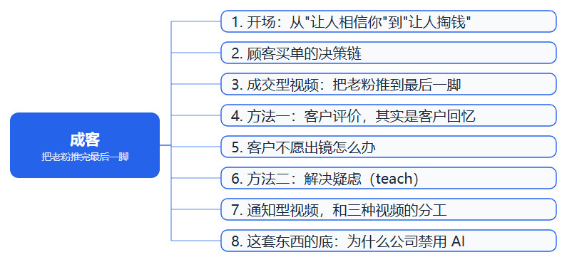

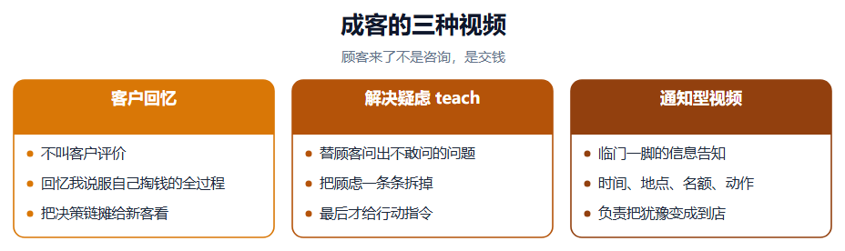

## 1\. 开场：从"让人相信你"到"让人掏钱"

### 1\. 昨天讲的是两段：线索圈客和线索来客

昨天讲了两部分，线索圈客和线索来客。核心就一件事：怎么做到看短视频的人是你想要的那个人；以及你在视频里说的那些观念，能不能让用户相信你。

拿锁客那一盘来说，问题不在于他不会拍，而在于他不知道自己要锁什么样的人。他得知道短视频要圈住的是那些父母，不是圈孩子。然后他要在视频里说出真正能打动用户的看法和观念，而不是去分享那些正确答案。

### 2\. 第一时间讲正确答案，第二时间讲操作方法，都是错的

我昨天跟大家谈过：当你第一时间想分享正确答案的时候，你第二时间就会想分享操作方法。而操作方法本身也有问题。

只有再往后走一步，把你的观点做一些降维、做一些处理，这些内容对用户才是有用的。

我们大多数人拍视频，很喜欢讲降龙十八掌的操作步骤——第一步、第二步、第三步。这种东西你拍三条、五条、十条、一百条，效果都一样。为什么？因为大部分人是用直觉拍视频的。直觉拍视频的意思就是，这是你的第一反应，不是消费者的第一反应。

### 3\. 采访式拍法：问一个问题，答一个问题，不获客

生活里有一种很常见的拍法，叫采访。镜头对着人，我问你一个问题，你回答一个问题。

这种拍法里，你的正确答案本身没有任何获客属性，也没有任何营销属性。因为观众听到的只是"这个答案是对的"，但他没听到"为什么这个答案对我（顾客）是对的"，也没听到"我为什么该信这个答案"。

这里有一个小小的信息差：采访的方法本身不能获客。有同学说，我明明用采访获客了——那是另外一回事，别把两件事混在一起。

今天早上讲线索成客。什么是线索成客？主导客户的消费旅程，让客户来。

📌 一句话总结：别讲正确答案和操作步骤，要讲买单前的观点。

## 2\. 顾客买单的决策链

### 1\. 文化墙上那张图：顾客到底怎么决定找你买单

第一天展示过一张图，公司文化墙上也挂着这张图。这张图详细展示了顾客到底是怎么决策、怎么找你买单的，叫顾客买单的决策链。

### 2\. 相信你，只是走完了第一段

昨天讲过，顾客最开始找你买单，是因为相信你。但相信你，距离买单还没走完这段旅程。

为什么"我相信你，但我并不找你买"？因为中间还缺一个对比，缺一个触发购买行为的东西；再往后，还缺一个对后续产品的持续支持、直接购买。

所以"相信"这一段的四件事是：信任你的实力，信任你的专业，信任你的人品，信任你的持续。这四样建立了，我这个时候是相信你的。

但相信你，不代表我愿意找你购买。因为我不是完全相信你——不是"不信"，是"还不够"。我需要你让我进一步确认：在我面前这几个选项里，凭什么选你。

### 3\. 清华和北大：都已经相信了，问题就变成怎么选

举个例子。你们家孩子要提分，楼下有两个辅导班。左边这个辅导班上课的老师是清华的，右边这个辅导班上课的老师是北大的。

你相信左边这个清华的吗？相信。你相信右边这个北大的吗？也相信。

这个时候已经不是相不相信的问题了，而是：我怎么判定这个清华的更适合我，还是北大的更适合我？我该怎么在这两个人之间做对比？

所以顾客此刻需要的不是"进一步强化信任"，而是辅助判断。他需要的是一把辅助的尺子。你很厉害，他也很厉害，那我找谁？我需要一把尺子。

### 4\. 第三段：首单产品通知

再往后，他还需要一个产品通知——首单的产品通知。

什么叫首单产品通知？如果我已经关注你很久了，我知不知道你是卖什么的？你的产品是什么？客单价多少？什么时候上线？有什么权益？你有没有把你的产品介绍清楚？

顾客买单是有链路的，这就是今天早上要讲的：顾客来了就买单。换个说法，叫全链路步步促成交。

顾客买单之前，一定会打开你的账号。

顾客从"相信你"到"掏钱"，中间要过三段，每一段他心里问的问题都不一样：

|**阶段**|**他心里在问什么**|**你要给的东西**|
|---|---|---|
|信任|这人靠谱吗、懂行吗|实力、专业、人品、持续|
|辅助判断|你和他，我该选谁|一把能对比的尺子|
|产品通知|你到底卖什么、多少钱|首单产品的清楚交代|

三段走完才叫全链路，少一段就卡在那里，前面所有的铺垫都白做。

### 5\. 为什么一定要做这件事：今天的顾客不愿意跟销售聊天

我为什么一定要做这件事？因为在我的逻辑里面，我认为今天的顾客，其实是不太愿意跟销售聊天的。

我说一个真实的客户的事情，我觉得这件事很典型。两个多月前，也差不多三个月前，有一个朋友托自己的朋友找到我们，谈合作。他是一个在成都的英语老师，新东方的。

现在做线上，一年大概 4000 万到 5000 万，往下也说到 2500 万这个量级。今年发展特别特别快。

他主要做小孩的英语提分。他做的英语提分是什么样的？叫做教家长如何帮助孩子提高英语分数。

你不要认为这不是一个很大的需求。在高知家庭当中，这其实是一个非常非常普遍的需求，高知家庭的父母都愿意给孩子提供英语辅导。

可他当时遇到了一个非常大的困难。他的困难在于，他的客户群体几乎都是高知家长，这些高知家长进入私域之后，成交非常困难。虽然他产品很好，但产品介绍成本非常非常高。

产品介绍成本一高，带来的最大困扰就不是流量的困扰，而是成交的困扰。这批家长进入到私域之后，他没有办法培养出足够优秀的销售来跟这些客户沟通。

没有办法培养出足够多的销售，因为销售需要跟家长沟通英语问题，销售需要跟家长沟通家庭教育的问题，然后把家长所有的问题全部解决完，销售还要能够把自己家的英语产品和新东方的产品有什么区别、和学而思的产品有什么区别说得很清楚，才能够完成成交。

他说他们家的销售太难培养，一个月可能只能培养一个——不是招一个，是只能培养出一个。你看这是一个非常大的痛点。

这个痛点在于，有些行业里面专业成本很高，你的销售其实承担了两个作用：一个叫销售，一个叫解决问题，或者叫专业顾问。你的销售其实是这两个角色之间的结合体。所以这种销售非常非常难培养。

### 6\. 销售难培养，直接带来三个结果

这样的销售如果难以培养，带来的直接结果是：可能需要老板亲自上阵；销售客户的转化率不高；还有一种情况是，很多顾客加了私域之后，他不说话。

我们的销售其实并没有办法去激活用户。顾客来了之后他不说话，有没有需求不知道；有需求之后又不愿意买单，也不知道。

所以我们研究出了一套方法。我们后来发现，在今天绝大部分超级个体阶段的创业者，典型问题是：并没有能力去搭建一个非常强有力的销售团队。

这是我发现今天超级个体这个阶段的创业者非常非常普遍的现状。基本上如果是超级个体，公司里面可能就两个销售、三个销售；大客户自己去销售，自己去补，自己去 BD。老板成为公司最大的销售。

所以一旦进入到了前端获客的阶段，因为短视频的流量可能又没有那么精准，问题就会更多。于是我们干脆把一件事做成：一个客户在买单之前，他所有的内心顾虑、所有的想法、所有的成交节点，像铁轨一样铺在账号里面。

我们争取做到一件事：你不需要跟我多说一句话，你也没必要跟我多说废话——去看账号。

### 7\. 一个手上有一百多家店的品牌方，问我能不能占用二十分钟

前天公司来了一个人，朋友推荐的，郭可言推荐的。

这个女生在线上，按道理来讲应该是一无所知的。当时郭可言把我喊到他办公室，说经纬，这人是谁是谁，某个品牌方，自己手上有一百多家店，现在想找你做流量。然后郭可言说经纬很好、经纬怎么样。

那个人说：能不能占用你二十分钟，跟你聊一聊。

我心里想，我还没有答应，但我已经准备做了，我已经做好准备了。然后我问他第二件事：你这个线下做商号的目的是什么？他说，我的目的是大概怎么做，给我一个方向就行。

我就跟他讲了一段话。我说：你也不认识我，你其实也不了解我，你就是顾客。

账号里面有我的团队是怎么做交付的；账号里面有我对于短视频所有节点问题的看法。

你在买单之前，你想了解我是什么人，有答案；你想了解我是什么样的实力，有答案；你想知道我做过哪些赛道，有答案；你想知道我对于这些赛道的看法，有答案；你想知道我解决问题的步骤，有答案；你想知道我公司的员工张三、李四、王二麻子叫什么名字、有什么样的实力，有答案；你想知道我们公司如何去解决问题的流程，有答案；你想知道我公司长什么样子，有答案。

你想知道我跟谁对比、我跟谁实力更强、我们解决问题的方法论长什么样子，全都有答案。

你没必要找我聊。

所以一个人只要看到这个账号，只要他愿意看下去，他能够自己说服自己找我买单，而且是走到买单那一步——不是走到咨询那一步。

我作为一个懒人，我很喜欢这种偷懒的方法。我也认为今天很多行业的老板，销售能力并没有那么强，销售的基因并没有那么强，把这些问题铺垫在短视频里面，其实更有利于我们成交。

### 8\. 雷军的账号：为什么不是条条视频都卖车

第一天给大家展示过雷军的账号。交付信心、关注年轻人、尊重友商、公司有钱、自驾愉悦，等等这一切。为什么雷军要这样做？为什么他不是条条视频都卖车？

为什么雷军有些视频在讲拜访王传福？这有什么好拍的？这不是卖车。小米有史以来最好的一次财报，有什么好讲的？这又不是卖车。国产 3A 级大作你们玩了吗？这有什么好拍的？这又不是卖车。

现在也许能理解一部分了。拜访王传福、何小鹏，这是不是一条昨天说的信任型视频？相信你的什么？相信你的实力，相信你的人品——我相信你不会害我，相信你是一个正直善良的商人。这就是建立信任的一部分。

雷军并没有讲我们是怎么品控的，也没有讲我们的赛车有什么参数、有什么设备。因为昨天讲过，相信你的实力靠什么？靠感觉。

雷军今天跟你讲汽车参数，你看得懂吗？你看不懂，你也不愿意看。那怎么让人感觉到这辆车实力很好？于是他把车开到火焰山，开到沙漠里。一辆车能够在沙漠里漂移，你是不是感觉性能很卓越？

他并不用讲参数，因为讲参数你看不懂。

再说相信你的专业。如果雷军在短视频里跟你讲，他对于汽车的刹车钳、各种各样的管道、各种各样的螺丝了如指掌，你懂吗？你能理解他的专业吗？你根本就不能理解雷军的专业度到底在哪里。他对于汽车的专业到了一个什么样的程度，是八十分还是八十五分？你不知道。

于是雷军干了一件事：我要让你感觉我是懂车的。怎么感觉？漂移给你看。我考一个漂移驾照给你看。我作为一个五十多岁、过去从来不开车的创业者，我考一个驾照给你看，我考漂移驾照给你看，就是感觉我懂车。

你说懂漂移跟懂汽车是不是两个概念？可是消费者会感觉你是懂车的。

所以雷军账号里面有相当一部分视频：王传福那条，叫相信你的人品；途经火焰山山脉，叫相信你的实力；一百八十度漂移，叫相信你的专业。还有小折叠五十万次折叠寿命、一直非常注意品控、可以拖车用，这是其中一部分。还有一些视频在进一步推进成交。

### 9\. 越到买单，顾客关注的东西越趋近产品

理论上讲，雷军的账号长这样：一个客户最开始对小米不了解，他更多的是感兴趣——这家公司有钱、关注年轻人、青春漂移。

距离买单再往后一点，他开始关注这辆车的性能、这辆车的颜值、这辆车的质量。

再往后，当他真正已经决定快要买单了，他开始关注你们家的交付，关注你们家的销量。

也就是说，当一个顾客处在不同的买单进程当中，他关注的东西会越来越趋近于产品。最开始是信任，然后开始做对比；对比之后，开始关注产品。

每个顾客在不同时间段关心的东西不一样。

### 10\. 我自己账号的排列：从"朋友圈有料"到"怎么判断我是真的"

我自己账号也是这么铺垫、这么排列的。带各位回顾一下：一个真实的用户点开这个账号，他会走完一个什么样的购买旅程？

他正常打开账号，先刷到最新一条——"朋友圈有料"。他会好奇：这个人为什么朋友圈有料？于是他往前刷，想了解这个人，看到"情绪稳定""踏实做事"。这些在干嘛？相信你的人品。

为什么一定要塑造"相信你的人品"？因为我们这行骗子多。我们这行公认骗子多。

再往前，"面试操盘手避坑这三种人"，学到了实力。再往前，抖音平台 24 年总结、25 年展望、流量团队如何培养、如何培养人才，这个时候的感觉是这个人很厉害。

可这个时候我还是没有完全相信你。于是再往前看：你们公司的制度、团队文化，然后你做出了一个案例，你又有非常优秀的习惯和复盘思维。

看到这里为止，相信了人品、相信了专业、相信了实力，也看到了案例。然后怎么样？完全相信。这个时候需要更进一步——"如何判断麦客博主的真实水平？"

你已经准备找我买单了，但你不确定我是不是真的有实力，所以我递给你一把尺子，教你如何判断我是真的还是假的。递给你一把尺子，辅助判断、辅助对比，后面才是判断，是做出案例。

所以在这个过程里，有信任实力、信任专业、信任人品、信任案例，也有提供对比，也有产品介绍。这样他才能够走完一个买单的旅程。

### 11\. 昨天一整个下午讲的是信任型，今天讲成交型

昨天下午重点讲的是信任型视频如何做：如何让消费者相信你能解决他的问题——相信你的专业、相信你的实力，等等这一切。

今天早上把话说完整：相信你之后，他愿不愿意找你买单？不一定。相信之后需要成交。

相信之前还需要理念，那是另外一个非常大的板块，待会儿再讲。今天先讲后面这一段，叫成交型视频。

📌 一句话总结：相信之后还差一把对比尺子和产品通知，缺一段就卡。

## 3\. 成交型视频：把老粉推到最后一脚

### 1\. 成交型视频提供的是对比

什么叫提供对比？当消费者已经完全相信你能解决问题的时候，他怎么样才会笃定"找你没问题"？

你是清华的老师，他是北大的老师，我相信清华，我也相信北大，我怎么样才能笃定找你没问题？这就是成交型视频要解决的。

成交型视频完成的并不是给客户种草的任务，它完成的是最后收钱那一步。成交型视频发完之后，要实现的目的不是"顾客来了咨询"，是"顾客来了交钱"。

不是咨询，是交钱。

### 2\. 账号里躺着一批关注你一年的人

为什么会有这样的视频出现？因为账号里面会存在大量这样的顾客：关注了你几个月，甚至一年，就是不买单。

为什么？还没有到完全放心的程度。

我认为最好的顾客、最优质的顾客，是那些已经关注了你的人。他已经关注你，说明他有需求。他有需求，为什么不找你买单？说明他在观察你、在考察你，而你目前还没有考察过关。

他对你还没有完全信任，还没有完全笃定。所以成交型视频的使命，就是把账号里面那些老粉、资深粉丝，推进到成交的最后一步，推进到完全放心的程度。

### 3\. 每月 30% 到 40% 的营收，来自三四条成交型视频

先报个数据，各位可能没什么概念：我们自己每个月的营收，30% 到 40% 来源于那三条到四条成交型视频。

平常我们发的很多视频，只是为了铺垫、铺垫、铺垫、铺垫。有没有进线？有。有没有客资？有。但这些客资不会买单。

而我们发完成交型视频之后，会一次性集中出现一笔买单，然后又集中出现一次不买单。

成交型视频往往播放量比较低，但它就是完成最后成交用的。这些顾客已经观察你一个月了，就差临门一脚。

**⚠️ 不要小看这样的视频。没有成交量的视频，在我们看来是非常遗憾的——你的账号里面很多顾客已经完全相信你了，但你没有把它兑现出来。**

### 4\. 成功案例不可能每个月都有

有些人用案例做成交型视频，我觉得完全没问题。成功案例当然是一种，可是你不可能有那么多的成功案例，你不可能每个月都有一堆主播来找你。

没有成交、没有什么案例的时候，用什么来促进成交？就是成交型视频。

我们来看第一种方法，叫客户评价。

📌 一句话总结：三四条成交型视频贡献三四成营收，专收观望老粉。

## 4\. 方法一：客户评价，其实是客户回忆

### 1\. 借用别人的嘴，证明你能帮他解决问题

第一个方法叫借用他人的说法来辅助判断，你可以理解成客户好评、学员好评。

先给各位报个背景：我们正儿八经从今年的 2、3 月份才开始做直播、搞 IP 这件事。做了一定阶段之后，我们对这个东西才开始慢慢有了自己的理解。

有个律师，最大的流量是单条 1500 万播放，那一系列都挺火。但是来的人都不对。本来是想卖课的，结果对方来相亲、来看家人的。

你原来那种达到 1500 万播放量的创作方式，跟现在这种获客的视频创作方式，区别是什么？很单纯——那个时候不太管来的是谁。

这种成交型视频是干嘛用的？借用别人的嘴、别人的评价——学员的评价、客户的评价，证明你是能帮他解决问题的。

### 2\. 错误示范：两个人说得都对，就是像托

很多人拍过，都会怎么拍？你们看这个视频，会觉得好简单，讲两句就可以了。

先看一个错误示范，这是我在网上随便找的。

"这三天下来，有没有学到自己想的很多东西？"

"太多了，很多东西是我没有想到的。但是公司团队非常细心地都帮我们列出来了，包括在实操过程当中什么东西最可能出问题，他们已经帮我们预设好了，所以我们只需要听话照做就可以了。"

"为什么刚开始选择了我们四加三？"

第二个人说："我们桌的小伙伴问我，为什么那么快又来复训？正是因为我上次上课的时候拿到了一些效果。我在上资料班之前，自己偷偷地看了一组，每个月大概有七八个案子。"

看完之后有感觉吗？坦白说，你看完之后有感觉，你想买单。为什么？感觉是托。

可是这两个人是不是真的有结果？他是真的有结果。但拍出来就不对。

区别在哪？我连坐姿都不正，我妈妈倒着坐的，我就随便搬个椅子过去跟他聊天。我挑的人也不是那种形象很好的。为什么会给你完全不一样的感觉？

### 3\. 现场模拟：我要问的到底是哪一段

我们来做一个小的模拟。我跟你交流的时候，你按真实想法说就可以。

"这次来了，学了几天，感觉怎么样？"

"吸收了很多的知识，很充分。"

"那你的收获是什么？"

"我昨天晚上也整理了一些问题……"

"你如果这么说的话，他要给你砸了。三年的口碑被你两句话直接搞砸，直接砸我场。"

"最重要的一个收获就是，我知道了要圈人群。"

对不对？他会觉得跟听天书一样。你说他们能判断？你有说过吗？他们会觉得你无非就是学到了一个概念而已。你虽然不紧张，但其实你也并没有真正意义上去辅助用户做判断。

因为你刚刚做的那个示范过于反面了。我先跟大家捋一个课题：为什么它会变成这样？我刚刚问的是哪一段？

包括他买单之后的感受——你买完单之后，感受是什么样子的？买完单之后你学到了什么？这不是在回答，这只是我在回顾我刚刚在讲的东西。

这段内容谁有感觉？买单的人有感觉。所以他说"我学到了圈人群"，他意识到了顾客买单的过程。你们刚刚听得懂，是因为你们在这个区间。也就是说，他所表达的所有内容，只有在这个区间的客户能听得懂。

他不能获客。他只会让自己的同桌朋友感觉到"我也是这么想的"而已。

我要提取的是哪个部分？我要的是这一段："你来之前遇到了什么问题？你来之前遇到的第一号问题是什么？你当时为什么选择——不去东、不去西、不去北京、不去深圳，你要选择来经纬？"

你从来之前遇到问题，到选择找经纬买单，这个过程，你当时长什么样子？我要问的是这一段。

这一段为什么更有用？因为它符合获客的属性，而且这一段是他真实的想法。

### 4\. 书店老板：12 年关注，第一站就来了

现场试一个。开书店的，开很多年了，日渐落寞的书店，开了单店，想开连锁。

"书店这个行业现在不是很好做，主要哪里不好做？"

"我们现在的群体就是学生和家长。现在都去网络购买，而且有当日达、次日达。"

"我买一本书次日就能到，我没必要在你那买。已经有描述了，为什么还要考虑自己去坐公交车？"

"线下像你们这种实体教学门店，最近这三年，能不能给我一个数字，你们整体的业绩下滑率大概有多少？"

"大概的数，我不太会做这些总结。"

"那你怎么着？现在准备转型线上还是干嘛？"

"确实得去考虑这方面，不然的话，也不能在这里等着。"

"那你是要线上开直播卖书，还是要干嘛？"

"可能是……"

"你没想好。你也没想好要卖书，也没想好要卖加盟，你怎么跑到我这来了？"

"我就打算线上卖书，然后结合实体店发一些优惠券。"

"理解了，想为实体店做线上引流。卖加盟、门店引流，或者卖书具体怎么做，你其实还没想好。所以我这里是你来的第一个地方？"

"实际上我这 12 年就关注你了。"

正常来说，得把全中国所有流量都爆完，才会到我这儿。我有几个朋友三年前就已经入门了，今年才到这儿来。你怎么第一站跑到我这来了？

"我好奇一件事。你这种没拍过视频的人——有拍过，但没专门出镜过，那就是没拍过。或者说报课学习，你会报那种操作课吗？拍摄、剪辑、选题那种。"

"我这个鬼账号从来不想实操。"

"那你怎么就跑到我这来了呢？你不去实操的地方，我打动你的是什么？"

"老师说刷视频的人就是在享受这个过程。你拍一些操作的东西，一点都没有起到享受。大家都是坐在马桶上刷视频的，摆一大堆这个，烦。"

如果我能够更突破一点，也许会好一些。

作为一个实体创业者，他代表什么人？他代表中国很多教培行业、实体门店的创业者。他遇到的问题是什么？是次日达的问题。

当这段话说出来之后，他会击中那批被次日达、被小时达打穿的创业者。"我跟你一样，我们现在的业务也是被那个小时达、次日达打的。"

那你要做线上呢？你关注了很多人。"我没有时间关注两年。"你来了之后就好了，完全就够了。

因为这一段已经在重复他自己：从发现问题、分析问题，到决策，找到我的全过程。

结尾怎么收尾？"来了之后没问题就好了。"至于为什么没问题？不用讲。因为它只是用来辅助同样经历的人做判断的。

### 5\. 它不叫客户评价，叫客户回忆

我们认为的"客户评价"，确切地讲，不叫客户评价，它叫客户回忆。

回忆我是谁，回忆我为什么找你，回忆我说服自己找你掏钱的全过程。具体地讲，是回忆我自我说服自己买单的理由。

他刚刚在回忆什么？在告诉我，他为什么一定要找我买单。因为他说"我觉得操作不重要"——因为我认为操作不重要，操作我们也不可能做，最重要的就是能不能把这件事情搞懂。

这是不是他说服自己的理由？这是不是他成交自己的理由？

他说了他是谁，也说了他成交自己的理由。所以用他的这段话来击中同样跟他一样的人，用同样的理由来成交那部分人，这就完成了帮助那些人做判断。

这就是一个成交的过程。

这一轮要的，不是让他评价你有多好。评价是 100 家之后的事情。我们要的是让他重复自己当天的角色过程，先用用户的嘴，复述他自己说服自己的理由。

### 6\. 采访谁：三个选项，选最有代表性的那个

这里有两个小的注意点，一定要跟各位分享。

第一个问题：你认为我们应该找那个能说会道、长得漂亮的人去采访吗？我们要找什么样的人？有人说是信任感强的，有人说是真的很有收获的那个人。

我给三个选项。第一，找最漂亮的、表达能力口齿伶俐最好的、粉丝最多的那个人。第二，找真的对你有很多很多感受、很想感谢你、真的拿到了巨大结果的那个人。第三，找最有代表性的人。

什么叫最有代表性？买单之前的那个问题最有代表性，或者买单之前的画像最有代表性——也许是年龄，也许是家庭，也许是收入，也许是职业，也许是行业。

我选定了：我要找的是最有代表性的那个人。我并不需要表达能力很好的，因为你表达能力好，别人会觉得是假。

三种人选，出来的效果差得很远：

|**采访对象**|**看起来的好处**|**拍出来的实际问题**|
|---|---|---|
|口齿伶俐、形象好|片子顺、话说得漂亮|观众第一反应是托|
|收获最大、最感谢|情绪足、夸得狠|只打动同桌的人|
|买单前画像最典型|一句话覆盖一群人|这才是要选的人|

### 7\. 同行太少拍不了，那就换个行业先拍

比如说我们之前那边有一个人做婚礼的，做婚礼场馆的。不可能找他拍——同行太少，这就是一个非常非常典型的状况。

但比如说他是做教培的，他哪怕再不乐意，我也要逼着他拍。那个吹笛子的那位，别笑，待会找你拍。因为你代表技能培训。

你其实什么收获、你是谁，当然也重要，但没有那么重要。找的不是最口齿伶俐的，也不是那些东西。

还有一个部分：你想让谁买单，你就找谁拍。举个例子，我们今年可能会更喜欢教培，我们发现教培行业很好做，所以我就会找教培拍。

那我们团队一直会逼着我找律师拍，我非常痛苦，偶尔也会拍几条，因为我不想要律师。当然，我们在律师赛道里面已经拿到了非常非常多的行业第一的案例。但这仅代表个人看法，我也没犯法，只是我个人不喜欢。

### 8\. 四个问题，问到他自己说服自己的那一句

怎么问？很简单：你是谁？你之前遇到了什么问题？你为什么来找我？你找我的过程当中，明明有那么多选择，你为什么不去东、不去西、不去北京、不去深圳，为什么非要选我？

大概就这四问。问完，他自己就把成交理由说出来了。

📌 一句话总结：别让客户夸你好，让他复述自己说服自己买单的理由。

## 5\. 客户不愿出镜怎么办

### 1\. "我的行业特殊，客户不方便拍"——你有没有争取过

第二个注意点是：有些人会说，我的行业比较特殊，客户不方便拍摄。

比如大哥戒赌，客户不想配合你拍摄；比如做财务规划、财富管理，客户很有钱，不愿意配合你拍摄。类似的情况总是有的。

完全没机会吗？不是完全没机会。我们有没有争取过？

你说客户不愿意配合你拍摄，你有没有给过他优惠？你有没有跟他沟通说，我可以给你的脸打码，我可以给你的声音打码？

如果你今天愿意配合我拍摄，我今天给你打八折、给你打九折。我今天如果开店，我愿意打五折。

你们今天之所以不愿意打折，是因为你们不知道效果。

### 2\. 网球教练：一条 5 万播放的视频，招了 5 个教练

这是一个真实的事情。我的一个网球教练，最早的其中一位，他自己拍视频拍了很久，从来没拍成过。

有一天他跟一个大哥打球，大哥打完之后往回走，两个人并肩这么走，他就拿手机这么拍。真的没有跟哪个教练打得这么好。

这条视频总共只有 5 万播放量。就这条客户评价的视频，让我的网球教练的客资量直接多到他必须招 5 个教练一起来消化。他直接成立了一家公司，招了 4 个人，加上他 5 个教练一起消化。

你认为你今天做不了，只是因为你今天没看到效果。

### 3\. 墓地：全中国没有比这更隐私的客户

再给各位看一个极端案例。我相信今天全中国，没有谁的行业特殊性、客户特殊性、客户对隐私的特殊性比我更高了。

你们说你们的客户很注重隐私，那如果客户快死了呢？如果客户在看墓地呢？如果客户的孩子在给自己的妈妈看墓地呢？愿意出镜吗？

没有人愿意。没有人愿意让全中国几百万人都知道我快死了、我在挑墓地。说我仍然在拍客户评价视频。

这是我们的一个墓地项目，目前杭州墓地销冠，number one。

视频里是这样的对话：

"12 万是永久的吗？"

"浙江省所有的公路，都是 20 年为第一个使用期，到期续管理费。理论上只要续管理费，它就是永久的。"

"管理费是怎么算的？"

"管理费这边便宜的，60 块钱一年，10 年交 600 块钱。"

"没人来交管理费，会不会把我们的盒子什么的丢弃出去？"

"不可能的。墓地是民生行业，一般不会有极端的这种措施，该交管理费咱们还是得交。"

"今天过三代的大孙子都来了吗？"

"至少管理 50 年的。哪怕之后真的隔代出国了、断脚了，你委托个机构帮你交。一般签出去的都是家属自己放弃的。"

"阶梯上价就便宜，你看有 2800 到 8800。正常传统就是两户一个左右平档，就是这种小户型，微小一点、面积小一点的。这种是传统大气一点的，一个是 2800 的，一个是这种大官帽的，都是很中式传统的。"

杭州政府在后台给我们小唐发微信，说小唐，你最近卖墓地这事儿，几条视频播放量太大，很多人在你评论区里面说死不起了、死不起了，你把这条视频隐藏一下。

所以大部分量的数据都隐藏了，留了几张。这张比较大：匪夷所思，我卖墓地之后才知道，人们愿意为了让那个墓碑上面多两个帽子，多花 5 万块钱——大官帽。

人们为了朝南的，都没有多放。这边价格是 89880，0\.56 平方的，送刻字、送台下和盖板。等于说我们就付一个墓地的价格，再加一个管理费就没了。打完折 87 折。

"有面积吗？"

"变省一半了。"

"所以一开始我就跟你讲，安兴园其实没有什么性价比，最主要安兴园到时候后代肯定不会去的。"

"为什么现在很多说买墓园后代不去扫了？就是因为老墓园它的配套设施太差。"

"再买一个宅是不错的。"

"那我回去跟奶奶商量一下。"

### 4\. 两张饭票：凡是能用优惠券搞定的问题，都不叫问题

我问你：你的客户有我的客户敏感吗？你的客户应该不会有我的客户敏感吧？

我们怎么做的？"阿姨，明天你来看墓的时候，我们到时候方便拍摄不拍摄一下？你要是配合我们拍摄的话，我们那个……一张饭票 10 块钱，两张饭票 20。"

阿姨说：不拍了，不拍了，不拍了。

"阿姨放心了，我们会给你打码的。你看我们账号里面的人多打码的。这样的话，到时候我们给你生意。"

"那你能不能多送我一张饭票？我老头子跟我一块来。"

就解决了吗？有什么不可解决的？

给他 100 的优惠券。100 都不行，500。不是 1000，可以。

是不是都可以？顾客打了码之后，对他本身已经没有什么影响了。你再加上优惠券——搞定。

凡是能用优惠券搞定的问题，那都不叫问题。

"你们俩下午三点钟有没有空？到时候给你打个视频电话。"

### 5\. 10 个客户里三四个拒绝，这很正常

还有什么困难？家属不愿意。多了吗？那是你开发客户的口，不是说客户不愿意。

我们也会被拒绝。昨天我的编导一鸣就跟这位律师说，让你拍一下。大哥昨天怎么回复的？一鸣说，没关系的，你完全可以拒绝我们。

只要你自己接受被拒绝，你就永远不会输。

我们也不可能找每个顾客，每个顾客都愿意为我们拍。10 个客户当中，可能有 3 个到 4 个是拒绝的。拒绝就拒绝，无所谓。

而且一般来说，社会身份越好的人，越会在意这件事情。所以被拒绝是非常非常常见的事情，但这并不影响我发起邀约和发起申请。

你拒绝我是你的事情，但是发起申请是我的事情。

这不应该成为困难。因为它真的是一种非常有效的形式，我建议所有行业都一定要拍起来。你不要管你的客户是什么，隐私这些东西帮他保护好就可以了，声音、形象都可以帮他打码。

昨天我跟我的朋友华为拍摄的时候，他也说"刚刚那段话帮我剪掉"，OK，没问题，帮我剪掉。我们甚至有顾客拍完之后说"今天拍的那个不好，能不能别发了"，我说 OK，没问题，不发了。

### 6\. 有人自己组了个"客户评价小组"，全国飞

我见过最夸张的：一个客户自己有一个"客户评价小组"，全国各地飞，飞到客户的店里面去拍客户评价。

他本人从来不出门，从来不离开本市。

视频里是这样的：这边这个理发店是我们上期的一个学员，这个学员从我们这学完之后，客单价从原来剪一个头 50 块钱，现在变成了 80 块钱，营收也翻了 1\.5 倍。我们今天去采访一下他，看他是一个什么样的情况。

镜头一转，直接切到郑州那边的镜头。这边两百平的理发店，是我们前阵子北京的一个客户的，这个客户是夫妻两口子。

他每年可以拍上千条客户评价，因为有 5 个人帮他全国飞。

我不建议各位去做这种完成主义的做法。我想告诉各位的是：你可以拍得出来。没有困难，再大的困难都不如我目的的困难大。

我那么大的困难，也就用两张饭票解决了。

📌 一句话总结：打码加优惠券，把客户不愿出镜变成可谈的条件。

## 6\. 方法二：解决疑虑（teach）

### 1\. 他不是不信你，是不会判断

还有一种方法：非得是客人和学员推荐吗？不一定。还有一种办法，叫解决疑虑。

顾客心中有非常非常多的疑虑，因为他没有判断能力。

比如我们去找医生，我们的疑虑是什么？我不知道能不能治好。或者我的疑虑是：张医生和李医生，我到底该选择谁？这个我也不知道。

再比如我去找律师，我的疑虑是：我是应该找本地的，还是找外地的？

本质上来说，他不是不相信你，他其实更多的是不知道该如何判断。你不要总认为他不相信你——他也许相信你，他只是同时也相信别人。在你和别人之间，他真的不知道该怎么判断。

### 2\. 笛子老师：一堆没有答案的疑虑

那个姑娘是做笛子教学的。我虽然现在还没有孩子，但是我已经有一堆疑虑了。

我们家孩子今年四五岁，我是应该给他找一个温柔的老师，还是给他找一个严厉的老师？

温柔有温柔的好，教学感觉更用心。但是严厉的呢？小孩子对他温柔是没有用的，因为小孩子只爱玩。这也是一种说法。那我应该找严厉的，还是温柔的？

再来。我们家是女儿，我应该给她找男老师还是女老师？

第三，我们家是初学者，我应该给他报一个头衔比较厉害的老师，还是给他报一个头衔比较一般的？

我们找任何人买单，都会有很多很多的疑虑。

### 3\. 第一把尺子没递出去，他就只能说"我再考虑考虑"

如果这个疑虑没有被第一把尺子解决——什么叫第一把尺子？就是你要给他一个判断的标准——他会选择把这个疑虑放在心里，然后非常认真地说一段话：我再考虑考虑。

我昨天跟现场一个同学非常由衷地说：我这辈子最不认同的就是这句话，只是我的个人看法——"我再考虑考虑"。

你让消费者不去考虑考虑，消费者怎么考虑？

你今天去看病，医生说你这个手术现在反正不保证能成功，你回去再考虑考虑。你怎么考虑？回去得到的信息是什么？有可能成功，有可能不成功。在这种情况下，你已经不知道该怎么判断了。考虑什么？

他只会让一个本来就纠结、本来就拧巴的人，持续存在于拧巴当中。

这个医生应该怎么讲？"这个事儿，如果你不是接下来 10 年、20 年对你的生活有很大的影响，手术最大的风险，也就是现在就这样了。"

做，这也是一种方向。

判断来源于什么？判断来源于专业，来源于经验。你明明是那个更专业的人，你明明是那个更有经验的人，你为什么不来做判断？因为你不敢，你怕担责，不想为消费者承担太多的因果关系。

但是只有你有能力给他做判断。你是专业的人，你是有经验的人，你不帮他做判断，你让他回去考虑考虑。

在我的世界观里面、在我的营销观里面，我从来不允许任何顾客回去考虑考虑。

他说要考虑考虑，我会干嘛？我会尽我所能把所有的信息给你，给你之后你做决定。但是我不会让你在没有信息的情况下"综合考虑"。

我昨天跟那个学员讲：你完全可以考虑考虑，但是我会给你我的判断。我的判断给你之后，你自己决定。但我不会以一种不负责任的状态让你空着考虑。我认为那是不负责任的，我也认为那是很怯懦的表现。这代表我自己的价值观。

为什么一定要帮消费者解决疑虑？因为消费者没有办法考虑考虑，你必须给他信息。

如果一个消费者在没有信息的情况下说考虑考虑，事实和结果就是：两年之后，你发现他还在原地。

我们无数次的经验都发现了这件事。一个消费者说"我回去考虑考虑"，因为他没有能力考虑考虑，所以两年之后你问他怎么样，他说"嗯，我还是比较纠结"。也就是说，这两年他的状态其实没有发生变化。

### 4\. 律师这一行，顾客到底在疑什么

我们来看几个视频，看看解决疑虑长什么样。

律师这一行，顾客的疑虑一层叠一层：你是网红律师，你到底还做不做案子？你们的服务长什么样子？你们是怎么为家属服务的？你们跟别人有什么不一样？

我看到有人是中国政法大学毕业的，有人是检察官，有些是退休法官，有些是退休检察官，有些人的学历比你高，有些人是牛津大学法学硕士。

我怎么样挑选一个合格的律师？你们都说自己有案例。我怎么样判断你们谁是说真话的？我怎么样判断你们是不是真的靠谱？你们怎么都是成功案例？你们难道就没有打输官司吗？我怎么知道你们是越专业的？我怎么知道什么样的律师适合我？

这都是不会判断的东西。

疑虑不怕多，怕的是你一条都不打。对着疑虑一条一条打，是这个方法的核心：

|**顾客的疑虑**|**他真正怕什么**|**视频里怎么打穿**|
|---|---|---|
|你是网红律师|怕你不办案、只做流量|讲团队承接的案件量|
|你们怎么服务|怕交钱没人管|把服务流程摊开讲|
|别人学历更高|怕你专业不如人|用办案结果代替学历比|
|都是成功案例|怕你藏了输的案子|正面回答输在哪|
|我该选谁|怕自己判断错|给一条挑选标准|

### 5\. 杨璇：转化率是同行的 10 倍以上

再看杨璇，杨律师。

"杨律，你怎么看待网上有人说你是网红律师？"

"我对这个说法没有什么感觉，因为我觉得我不红。在抖音上就这么一个小小的账号，真的很普通了，也没有什么粉丝。而且本身来说，我是一个律师，我自己本人包括我团队这边，其实承接的案件数量……"

拍视频，你有可能被说成网红。但真正值钱的不是网红，是你辛辛苦苦培养出来、已经完全相信你的那些人。

一个已经相信你的人，很困难才走到这一步。

你已经花了很多精力。你看捕鱼，先把那个人拉到你的账号里面，他刷到了你，然后他关注了你，然后他关注了你很久很久，已经是一个能够帮他解决问题的人了。结果就差临门一脚，让他笃定找你没问题，这一步你没做，全部前功尽弃。是一件很可惜的事情吧？

太可惜了。你前面做了那么多工作，就差临门一脚。这个顾客在网上已经刷到杨璇了，已经相信杨璇了，他只是需要最后一个辅助判断的标准就可以买单了。结果我们没做。

所以一定要做成交型的视频。

再报一个数据。他们公司里面是有很多律师的，做新媒体的律师也不是只有他一个。在我们自己内部的数据里，有一个数据非常惊人：杨璇通过这套解决疑虑成交型视频，转化率是同行的 10 倍以上。

如果跟我自己同律所的律师相比，他的客资转化率是 10 倍以上。

因为他的客户基本上有什么疑虑，我就打穿什么疑虑，全打穿了。只要顾客愿意看我的视频，看得越多越愿意买，看得越多越坚定要买。有没有销售都买。

这就是成交型视频。成交型视频就是辅助客户做判断，让他笃定找你没有问题。

给大家的两个方法：第一个叫客户评价，第二个叫解决疑虑。解决疑虑也叫 teach，同样的意思。

### 6\. 小金姐姐：选我还是选医生

小金姐姐做大健康慢性病管理，主要做甲状腺相关的问题。

很多顾客会有一个疑虑：我要考虑考虑。考虑什么呢？我到底是选你还是选医生？你又不是专业的医生，我怎么能找你呢？

小金姐姐说了一段话。她没有说"你考虑考虑"，她给的是第一个判断的标准，然后你再做决定。

"很多客人都问我说，你是怎么调理的？为什么你的这个调理思路和白大褂是不一样的？"

医生的工作思路，跟这个完全不一样。

还有回家之后：我这个病，现在到底是听医生的，还是听小金姐姐的？

本来很纠结，本来说要考虑考虑，看完视频不用考虑了。可以笃定判断了吧？这就是给他一个判断的标准。

📌 一句话总结：逐条打穿客户疑虑并给出判断标准，转化率可翻十倍。

## 7\. 通知型视频，和三种视频的分工

### 1\. 通知型视频：15 秒说清楚你卖什么

最后还有一种视频，叫通知型的视频。它的作用是让他知道怎么找你解决问题。

如果我作为一个粉丝，已经关注了你很久，我只需要一个产品上线的通知。我要让那些笃定要买、但暂时不着急的人知道。

所以我们要通知顾客：15 秒之内告知付费信息。怎么告知？很简单，这就是你们最会的事情，你们最擅长的事情——说出自己的产品到底是什么，就没了。

这样的视频一个月发一到两次，只是为了通知别人。

"为什么我会推荐大家来参加我一年一度的年度大课？其实大家都知道，我日常是有很多相应的小班课在开的，可是年度大课是属于我们一年一度的……"给自己家团队打个广告。

"刑事案件、刑事案子，想找律师来会见或者说阅卷的话，都可以非常放心地来找我们。现在大家来看一下我们家的律师。"

### 2\. 三种视频，各管一段

从昨天到今天，一共讲了三种视频：信任型、成交型、通知型。

这三种不是三选一，是一条链上的三段，各管一段，谁也替不了谁：

|**视频类型**|**解决什么**|**顾客此刻状态**|**结果**|
|---|---|---|---|
|信任型|让他相信你能解决问题|刚刷到你，还在看|愿意继续看下去|
|成交型|给他一把对比的尺子|关注几个月，差临门一脚|来了就交钱|
|通知型|告诉他怎么找你、多少钱|笃定要买，暂时不着急|知道何时下单|

再回顾一下信任型是什么。信任型视频是底层，是让顾客明白他到底为什么被打动——被专业的感觉打动，被你的价值观打动，被你的持续打动，被你不讲正确答案、而讲对顾客买单之前有益的观点打动。

### 3\. 从昨天到今天，讲的其实是销售

顾客为什么会找你买单？因为你能解决疑虑，因为你被发现了。

从昨天到今天为止，我们到底在讲什么？就是在讲销售。

我昨天说过一段话：不会拍短视频，就是少了几年红利而已。但如果你不会当一个"太紧"的销售，你还在坚守专业和产品——我跟大家讲的这些东西，你用不用？

你用短视频做，用不用？线下店成交一个用户也很难，因为你也不知道线下顾客到底会怎么想。我讲的这条逻辑是非常通用的、基本的消费心理。

而且并不是那种股东式的、吹牛式的、过度承诺式的销售方法，就是洞察用户到底需要什么。我用的是最本分的成交方法。

有些销售怎么可能不过度承诺？或者说什么送鸡蛋。你有什么问题，你告诉我，我帮你分析清楚，你买单。

行业里那种靠舔别人来成交的，我就是站着卖。我把所有东西给你分析清楚，你做好判断，愿意买就买，不愿意买就不买。

### 4\. 上海最大管家公司老板的两分钟

在互联网上，在这些很成功的账号里面，我们可以看到这些人的干货、案例、日常。

"交给我，你放心，我这儿便宜"——你让消费者怎么想？我对你完全不了解，你是不是好人我不知道，你有没有专业我不知道，你有没有实力我不知道，你怎么交付我不知道，你的客户对你的评价我不知道，我心里的疑虑你也没解决。让我选择你，合情合理吗？

我们会认为，那些做线上的人就是会吹牛、很会做流量，所以他们把我打赢了。不是。我们是理解消费者，我们比你更尊重消费者。

一个自认为很会成交的人，会说什么话？

有一个号称是上海最大的管家公司的老板——号称上海最大的房地产保险公司老板。当时在线下课堂听完这一段，他说他来分享，总共只有两分钟时间，他只说了两分钟的话：

"你现在是不是不知道该不该买房？我跟你讲，我自己做房地产做了 21 年了，我是上海最大的管家公司的老板。听我一句劝，好吧，现在不要买房。我跟你们讲都是真的，你们就相信我说的话就可以了，好不好？"

"我跟你们讲，我很会成交。今天我要成交你们，我轻而易举。但是我现在不是来成交你们的，这是今晚的场次。"

这叫不尊重消费者。要给消费者足够多的信息。

他说他现在不会做流量。我认为他底层的价值观，并不是在意要不要给消费者提供这样的信息、提供这样的判断。

这也就是我昨天讲的那段话：很多时候，如果你只会研究专业，你认为自己专业很厉害，其实是因为渠道还没死。

📌 一句话总结：每月一两次15秒讲清卖什么、多少钱、怎么找你。

## 8\. 这套东西的底：为什么公司禁用 AI

### 1\. 文化墙上写着"禁止使用 AI"

我这里多说一段话。公司文化墙上面写了一段话：禁止使用 AI。

**⚠️ 公司里面，如果我发现我的编导用 AI 写文案、做选题、做策划，你不要让我知道还可以；你如果让我知道，一秒都不用待，直接走。**

从 24 年开始，下一季，所有人都在说 AI 工具很好用，所有人都在说。

我当然知道卖 AI 会很赚钱。我如果从 24 年开始到现在为止卖 AI 软件、卖 AI 智能体，我最少能多挣 1500 万。因为我卖课可以赚钱，我用 AI 智能体，我就不用去花那么多人力。我为什么不用 AI？因为我深深地知道，AI 就是不好用。

你说 AI 多牛逼、多聪明，你不用跟我讲 AI 多智能，也不用跟我讲 AI 的将来。不是我不懂技术。

### 2\. 逻辑判断：AI 不理解消费者

AI 不理解消费者。

一个细分行业的消费者到底在想什么？他有什么样的顾虑？你告诉我，AI 怎么走？

你说你的消费者到底在担心什么、害怕什么？AI 怎么知道？

你说你的消费者内心深处不知道该选经纬、还是选宣威、还是选晨金，AI 怎么知道？

你说你的消费者到底在什么样的场景下，他的成交时刻在哪里？AI 怎么知道？

你跟 AI 讲，不要讲正确答案，不要讲降龙十八掌，不要讲那些操作方法，要去讲买单之前的东西——AI 怎么知道？

所以我相信一件事情：只要今天短视频获客的本质是需要理解消费者，AI 就不可能做到。

肯定有个大傻逼跟我讲，说那是因为你不懂 AI。我说，那是因为你不懂消费者。

消费者的想法，从今天早上睁眼到今天晚上闭眼的时候，已经在变了。消费者的认知是一直在变的，实时更新的，更新到这样的程度。这是我的逻辑判断。

### 3\. 事实判断：年收入 1000 万以上的 IP，没有一个用 AI

还有一个叫事实判断。

在我身边，年收入 1000 万以上的个人 IP，或者叫超级 IP，到现在为止，我没有见到任何一个人用 AI。这是事实。

我只看到从零到一的人在努力，我没有见到一个真正已经成功的人在努力。所以这个世界上任何人跟我讲，我都不相信。

因为 AI 现在还在一个叫通用大模型的阶段，还在用通用知识的阶段。它只要没有独立思考的能力，它只要没有进入 AGI，它只要没有理解消费者、理解用户的能力，它就绝对不好用。

我说这段内容，不管你能理解也好、不能理解也好，我过去跟很多人说过，有些人相信，有些人不相信，无所谓。

你可能会想：可是明明有很多人用 AI 拿到了结果，明明很多人都说有用。那是因为到现在为止，没有几个人真的非常懂短视频，都是认为自己懂而已。这是我给大家的肺腑之言。

**⚠️ 所以你买什么都可以，请不要买 AI 生成品。真的屌用没有。**

### 4\. 什么情况下 AI 才有用

除非你今天卖的是肥皂，卖的是 3000 块钱的东西。

如果你卖的是高客单，如果你卖的产品需要理解消费者，如果你卖东西需要走这么一套圈客、锁客、来客、成客——理解消费者、理解消费者顾虑、理解消费者成交时刻，然后做出获客型观点的内容，那就不行。

所以我在公司里面就提出这样的要求。我希望各位能理解，这些能力是需要长在我们这一代消费者身上、长在我们这一代创业者身上的。

没有这个能力，短视频做不好；没有这个能力，直播做不好；没有这个能力，线下销售很难成交；没有这个能力，AI 给你你也用不了。

### 5\. 收束：讲到第四段，接下来是生客

那到这里为止，圈客营销我们讲到了哪里？讲到了第四段，讲到了线索成客。讲的是顾客从信任你，到找你买单那一段长什么样子。

坦白讲，做完这么多东西，如果你已经学完了锁客、圈客、来客和成客这四个步骤，无论你是线下还是线上，无论你是短视频还是直播，一定能够拿下顾客。

如果你全部能做好，一定能够拿下顾客，因为这是一个底层能力的改变。而且就算有 AI 也无所谓，因为 AI 不理解消费者，而你理解消费者。

接下来讲最后一段，也就是最后一个部分。当天先休息十多分钟，十点四十回来。

📌 一句话总结：AI不理解客户顾虑与成交时刻，高客单获客别指望它。

# 十二、第3天上午（下）｜生客：理念型视频与「信徒」逻辑

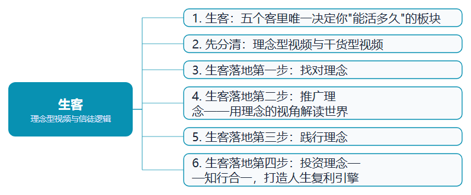

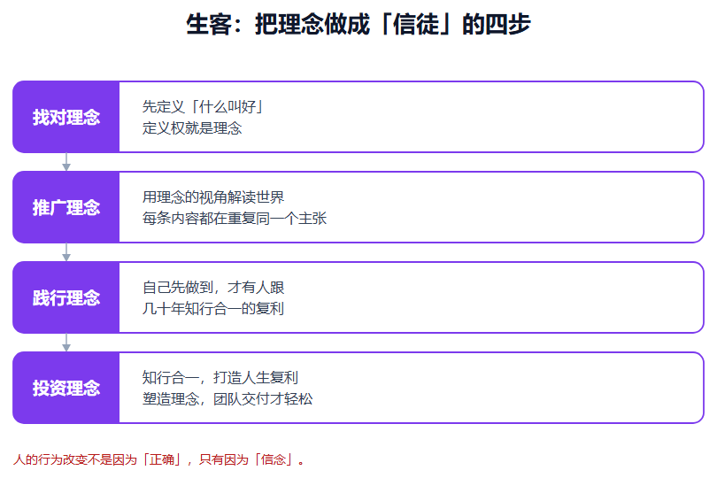

## 1\. 生客：五个客里唯一决定你"能活多久"的板块

### 1\. 圈客、锁客、来客、成客四块做完，已经是千万级营收

先把位置摆清楚。对现场绝大部分人来说，圈客、锁客、来客、成客这四块内容已经非常非常够用。这四样东西如果真的做完，已经是一个 1000 万级别的营收了。

生客是另一回事，它相对来说是一个独立的板块。

为什么还要讲生客？因为我这几年发现一个现象：很多人线上做得还不错，但随着同行更多入局，多多少少会遇到一些业务的波动。而且大家并不知道怎么长期主义地、健康地把自己的账号做好，让账号变成一个"口"，变成一个品牌。很多人其实并不明白这件事情。所以今天上午额外加这一块。

### 2\. 年营收 2000 万以上的 IP，几乎人人都有这个东西

在我过往所有的经历当中，会发现一个规律：所有年营收 2000 万以上的 IP，年营收 4000 万以上做线上的人，几乎所有人都有这个东西。

他很难在那个收入阶段维持自己的生意。

说到消费者身上，其实里面就有答案。首单、收单，它其实并不是真正意义上的顾客。我今天买你的产品，买完之后，我会过上什么样的人生？这才是顾客真正在问的问题。

总会有人问我：总会有没流量的时候，总会有一堆同行，所谓的终局在哪里呢？

**⚠️ 我们如果不考虑终局，其实就是不想好好活。你更新的越多，就会显得越乱，别人看你的账号会觉得很复杂。一旦有人抄你，你就会业绩下滑；平台不给你流量，你就只能干看着。**

### 3\. 两年我就意识到：今天做线上是为了拿流量，但三年后凭什么活

其实我在两年前就意识到了一件事情：今天做线上是为了拿到流量，可是你将来能不能在线上存活？

一条视频有 10 万播放量，你今年能保持 10 万，明年呢？观众的注意力是不是会被分散？平台的分发机制是不是也会一直给你分发？而且你就算很会讲，讲到明年，你最会讲的东西你也会讲透，你就会去讲一些你没有那么擅长讲的东西。

你现在能过得好，是因为流量。但是你明年能过得好，一定不是因为流量。三年后能过得更好，也绝对不可能是因为你很会做流量。

如果你把长期存活下来的依据，把筹码押在"我很会做流量"上——就像下棋，你下了这么一手，然后说三年后我要靠我的获客能力、我要靠我的矩阵、我要靠我别的什么东西存活——你一定活不了，活得会非常差。

流量和理念，是一个同时存在的事情。

昨天晚上有个同学在我们那个文化墙那边站了一会儿，他问了我一个问题。他说我看了两天了，为什么你们这家公司的文化叫做"成为一家不需要我们的公司"？

因为我们无限追求的目标就是三年后我们可以没有这个账号。你说三年后我还有没有账号？一定有，我账号也基本上不会被封。你说我三年后有没有影响力？我一定有。但是我们无限追求的就是三年后，我默认的前提是三年后这家公司可以不需要我。

包括内部的流程、内部的人，怎么样获得更多流量，这叫战略觉醒。这是我们内部提出的那个文化。

因为我自己一直以来都有一个习惯，我很喜欢考虑终局。三年后你凭什么活下来？三年后你凭什么火？

这个答案今天不考虑，两年后再考虑，那就意味着你整体其实是没有一个发展战略和发展方向的。要有这样的答案，我们需要知道为什么三年后我们能活下来，然后今天就以正确的轨迹、正确的方式去走。

### 4\. 理解一个问题最简单的办法：看已经解决它的人怎么做

当我们理解一个问题的时候，我认为最简单的办法就是看竞争模式——已经解决这个问题的人，他的答案和做法是什么。

我在问：三年后凭什么我能活下来？我认为这个问题的答案，在雷军身上是可以找到的。因为雷军是中国今天的"第一人"。

那我就想问：雷军为什么能活得很好？为什么雷军线上做得那么好？为什么雷军能够持续存活？因为雷军做互联网已经很多年了，他已经做了十几年。短视频这个时代他做得很好，但短视频之前，雷军的线上流量也很大。

雷军是一个活了十几年的个人 IP，是一个十几年来一直线上运营得很好的人。所以我一直在试图在雷军身上找到答案。

最终我在雷军身上找到了这么一个答案：雷军这么多年，其实只更新了一条视频。

今年其实只更新了一条视频。这条视频长什么样子呢？就是"我们国产的产品，你拿起来你就觉得很有面子，到商场以后……"——外人觉得雷军流量大，但是他却不知道，雷军创办小米就一直在践行那句话：始终做感动人心、价格厚道的好产品。

他这么多年所有的内容，所有的短视频，所有的直播，所有的采访，所有的活动，都在讲这么一句话而已。多加一个字都没有，始终做感动人心、价格厚道的好产品。

我们公司始终在围绕这么一句话展开所有的宣传，展开短视频，展开直播，展开活动策划，展开所有的一切。

所以包括雷军去卖空调、卖这卖那，我都觉得是——他几十年知行合一攒下来的复利，凭什么会被同行区区几条爆款超过？

那是他几十年知行合一攒下来的、攒出来的用户心智的复利。

### 5\. 有粉丝的人很多，能把车卖掉的只有雷军

有人也有一千多万粉。我没有听说过他能把车卖掉。

小鹏、蔚来、理想的创始人也有账号，我从来没有听说过他们的账号能像雷军这样把车卖掉。能够通过个人账号把车卖掉的，到现在为止，我只听说有雷军。

那别人有粉丝量，为什么别人没卖掉？因为他们并没有积攒这样的人生复利，他们的短视频是没有灵魂的。

什么叫没有灵魂？我曾经发过一条视频，发表过一个看法，后来被我说中了。

去年于浩在做账号的时候，所有人挺于浩，说于浩做得真好，说于浩日更一百条——就是那个追觅的于浩。我当时就说，于浩的账号毫无意义，因为我看完你的账号，我不想买你们家的东西。

他的账号没有一个中心思想。雷军所有内容都在讲：我在为做出感动人心、价格厚道的好产品，付出怎样的努力。

而于浩并没有给我指引你要带我去的方向。没有。所以我们去看于浩的账号，只会产生两个字：复杂。

我看完，我知道于浩，我知道于浩这个人，可是我并不想买你们家的产品，我也并不知道买你们家产品意味着什么，我什么都不知道。于浩的账号其实并没有商业价值。

同样是千万粉，为什么我们看雷军的账号会想买雷军的车，但看于浩的账号并不想买？

|**对比维度**|**雷军**|**于浩**|**结果差别**|
|---|---|---|---|
|内容中心|只讲一句话，几十年不变|日更一百条，无中心|一个记得住，一个记不住|
|观众感受|越刷越简单|越刷越懵，只剩"复杂"|简单产生信任|
|粉丝量级|千万级|千万级|粉丝量不决定成交|
|商业结果|个人账号能把车卖掉|有粉丝，卖不动货|差在理念不在流量|
|结论|理念攒出的心智复利|只有内容，没有灵魂|获客终局是塑造理念|

这就是里面的东西：理念引领，是获客的工具；理念，是获客的终局。

接下来我跟各位讲什么是理念。先讲理念的庞大的力量。

为什么一定要讲理念？因为理念其实给用户引领了一个方向。理念有非常非常多庞大的力量。

### 6\. 力量之一：消费者不是被一条视频打动的，是被连续视频传递的感觉打动的

理念的第一个庞大力量，是它非常简单。

雷军的账号，你刷到最后，只剩那么简单的一句话：感动人心，价格厚道。于浩的账号，你刷到最后，你懵得不得了，你都不知道他在干嘛。

理念有个非常简单的东西——简单的力量。所有和消费者接触的地方都在传递同一个理念，对消费者来说是最不费脑子的。因为消费者刷你的视频，会越刷越简单，越刷越简单。

来看一个人，张老师。

我相信今天中国绝大多数人，只要你知道张老师，如果你家孩子需要考研，你的第一选择一定是张老师。

他在视频里讲的是什么？大意是这样：

"我已经上岸。我已经通过我自己的努力改变了我的命运，改变了我孩子的命运。我已经上岸，我挣了钱，我大可以去享受生活。我也可以不捐，没人给我捐，我捐了也没人说我好。我在这里给你做直播，我说各位家长，你们应该怎么样？我们老百姓的孩子，真的是想以我走过来的经验，来告诉我们普通老百姓，我们应该怎么做。

我也可以像那些所谓的社会精英说：哎，我们不要去卷孩子，我们不要背那些什么书包，乱七八糟，我们应该素质教育。我也大可以说这样的话。但是我深深地知道，如果我们真的走所谓的那种素质教育，老百姓的孩子上升通道就堵死了。

你搞足球，你搞教育资源的匹配，你匹配得过大城市的孩子吗？你匹配得过大城市的孩子吗？我在干的事情，几乎就是想办法提升我们普通家庭家长的认知。"

然后他骂那帮人：

"那帮人他妈的过河拆桥。他自己通过高考改变了命运，他发现他们家孩子学习不好，然后他就说，我们要改变现在教育选拔的方式。你他妈这不是过河拆桥吗？你自己通过高考改变命运了，你已经从农村到大城市了，然后你发现你孩子学习不好，你说不行，现在这种教育方式不行，我们要改变教育体制，我们不能唯成绩论了——你他妈这不是过河拆桥吗？

所以说，有的时候说那些东西，他有没有道理？他有一定的道理。但是你再仔细想一想的时候，你发现这玩意真的太坏了。过河了，咔，把桥给拆了。"

### 7\. 这段话为什么不挑人：清华家庭听得懂，四线城市初中学历的父母也听得懂

就像我第一天跟大家讲的：今天如果有一个北京清华家庭的父母，他们去给孩子报考研，可以找很多的人，会听很多很多的专业。

那如果今天是河北省下面四线城市、只有初中学历的父母呢？他能听得懂那么多考研的技术吗？他能听得懂那么多择校的东西吗？

他为什么会愿意选择张老师？因为张老师讲了一句话：你的孩子一定要通过高考改变命运。

足够简单。

我问你：这段话能不能打动清华的家庭？能。在一个没有学历、父母大字不识的家庭，可不可以打动？也可以。这段话能不能打动一个有认知的妇女？可以。能不能打动一个没有认知的父母？可以。能不能打动一个家庭年收入 1000 万的人？可以。能不能打动一个家庭年收入只有 30 万的人？也可以。能不能打动一个 60 岁的人？能。那会不会打动一个 20 岁的人？也可以。

所以理念有一个非常非常庞大的力量：它足够简单，简单到不挑年龄、不挑身份、不挑阅历、不挑认知。

所以为什么我说这是超级博主的标配？因为你流量那么大，你的流量一定很泛。当你的流量很泛的时候，你想转化用户，你就不能用很复杂的方法，不能用很复杂的工具，不能用很挑顾客的工具。你只能用这个世界上最简单的工具——一句话，一个点。

这就是超级博主的标配。

### 8\. 力量之二：理念指引方向

理念的第二个庞大力量，在于指引方向。理念塑造了我们要去往的美好方向，所有人跟着一起向往那个方向。

我们来看，稻盛和夫的理念是什么？"当你竭尽全力的时候，神明都会现身。""付出不亚于任何人的努力。"够简单。

如果你今天要创业，稻盛和夫跟你讲：创业股权协议应该怎么写？税务应该怎么筹划？公司应该如何管理？复不复杂？太复杂了。

到时候客户就跟你讲一句话：怎么创业？答案——付出不亚于任何人的努力。早期创业者、中期创业者、成熟创业者，都 OK，都认同。

怎么创业？有没有答案？"不亚于任何人的努力。"这就是指引的方向。

所以，给你的一个方向感，你就知道该怎么办了。

信任不是最好的成交理由，因为不是所有人都知道自己要什么。不是所有顾客都知道自己要去哪个方向。

人的行为的产生，并不是因为知道什么是正确，而是因为信念感。人是因为信念而产生行为的，不是因为正确而产生行为的。

输出理念就是在引领用户，就是把顾客从一个迷糊的状态带进美好的方向；而输出干货，则是在回应用户。

你只能成交那些已经知道自己要什么的人。

之前有个学员问我，他说：我不能老老实实解决问题吗？我就跟他讲：不可以，我们不能老老实实解决问题。因为并不是所有的用户都知道自己要去什么样的地方。

所以，输出理念就是在引领用户，是控制用户无边界的欲望和需求，引导进美好的方向；而输出干货，则是在被动地回应用户，是在被动防守，是让用户往他的思绪方向去飞。

|**对比维度**|**输出理念**|**输出干货**|**结果差别**|
|---|---|---|---|
|用户状态|迷糊，不知道往哪走|已经知道自己要什么|一个能转化，一个只服务|
|你的角色|引领者，给方向|应答者，被需求牵着走|主导权在谁手里|
|内容形态|一句话，一个点|一二三步，方法细节|越刷越简单 / 越刷越乱|
|成交范围|所有认同方向的人|只成交已想明白的人|流量泛也能转化|
|结论|先给方向，再给方法|只给方法，等于被动防守|理念在前，干货在后|

### 9\. 我的营养师：全部理念就四个字——多吃肉，少吃饭

我的营养师，他的理念是什么？多吃肉，少吃饭。简单吧？

怎么样健康？多吃肉，少吃饭。就这么一句话。他就这么一个健康理念。他不会讲什么"具体问题具体分析"，因为具体问题具体分析太复杂。

我说为什么这样？他说因为这样子你能长期做。他说：什么是真正的健康？几点起，几点睡？

他是不是对我的人生指引了一个单一的方向？别的方向都是错的，只有这个方向是对的。

我问大家一件事情：如果他不这样做，我会怎么样？我要不要地中海饮食？我要不要十六加八？我要不要轻断食？最近有个什么新的产品，我是不是要问他？而他给我输出理念，就这一套。

我的营养师聊天记录，各位听一下。一年 2 万，三年 6 万多，快 8 万了都。

"补剂记得吃，牛油果吃了吗？"

"吃了，忘记拍了。"

"吃了就好。"——一个大拇指。

"补剂吃了吗？"

"吃了。"

"水继续喝，早点休息。"

容易睡，然后他发了一段英文，我说英文看不懂，哥。他说长按微信自带翻译，好使。

"中午吃了吗？牛油果记得买。"

"中午吃了吗？"我说我醒了。

"睡得怎么样？"我说睡挺好。"几点睡的啊？""十二点半。"大拇指，"保持十二点左右睡。"

每天就是：起了吗？吃了吗？睡了吗？这是他的理念，就这一套。

我早期还会问他：我要不要地中海饮食？他说那个是错的。我说应该这样做，他说那个是错的。

到后面，你知道吗？三个月之后，跟他的相处模式变成什么样了？我从来不问我怎么没瘦。我还跟我妈说多吃肉。我为什么不问他我怎么没瘦？他会问："你吃了多少肉啊？你几点起的？"

理念过去了之后，他不用承担结果，他只需要不停地强调这个方向的对等就好了。我只要没有结果，是因为我不够坚定。我也从来不逼逼别的想法，因为这只是单一的方向，别的方向就是错了，我就认这个方向。

### 10\. 前年过年，我跟我妈为"吃肉"吵了一架

前年过年跟我妈吃饭的时候，我妈给我上了一盘百合炒什么玩意儿。她说"百合像学识"。我说妈，百合不叫学习。她说"你多吃蔬菜，结果你现在这么胖"。

我说妈，菜其实没有那么健康，吃肉更健康。别吃饭了，跟我一块儿吃吧。

她说"吃肉才长胖"。我说妈，吃肉不长胖，吃饭才长胖。

她说"专家都讲营养要均衡"。我说妈，专家讲的是错的。她说那个营养大讲堂、中医大讲堂都讲营养均衡。我说妈，这个东西是错的。

她说"医生怎么会错呢"。我说你别管，医生就是错。健康就是得早起早睡，多吃肉。

你明天把冰箱里那些剩菜剩饭给我扔了，我明天给你买两副羊放到冰箱里面去。

### 11\. 一旦用理念塑造了方向，粉丝就成了不看价格的信徒

这里我跟各位同步一件事：一旦用理念塑造了美好的方向，粉丝就成了不看价格的信徒，因为他会拥护你这个方向。

大芳当时那段顾客的留言，她说："老师，我决定好了，我真的很想把皮肤搞好。"为什么？因为他认可这个方向，他对这个方向的信念感足够强。

等一下，我叫同事拿一下白板。

所以我要跟各位讲，到底理念为什么会有如此庞大的作用，以及我们大家常犯的误区。当然，并不是所有人都有理念。一个人只有对一个问题有非常自己独特的理解、有自己独立思考的时候，他才会有理念。

### 12\. 一个人站在岔路口：他真正的问题不是方法，是迷茫

我在白板上给各位画一个家庭。这个家庭家境普通，孩子刚好考完了。

这个家庭现在有好多种选择：第一种，让孩子回家帮家里面干活；第二种，出国留学；第三种，继续高考，高考复读；第四种，去上个技校、学一门技术。等等等等，他有很多很多的选择。

一个人在他人生任何一个困境的时候，都相当于站在一个岔路口。请问，对于这个用户而言，他是一个什么样的状态？

你们有没有看过一些恐怖电影或者科幻电影？一个人走在一条马路上，前面一团迷雾。他根本不知道前面长什么样子。前面有两条路、三条路、四条路，好像都能选，可是每条路后面意味着什么？当事人知道吗？不知道。

而我们在座的所有人都在做什么？我们在做的是这个：如果要高考复读，第一步、第二步怎么走。我们在讲这个。

可是，不是所有人都知道要走这个方向，不是所有人都坚定地要走这个方向。

什么叫"不是所有人都知道这个方向"？因为也许对这样的家庭来说，他并不认为这个方向是好的。

什么叫"不是所有人都坚定要走这个方向"？因为当一个人在这个岔路口的时候，他的闺蜜会跟他讲："要不让孩子出个国。"他在网上刷到别的老师的直播间，别的老师跟他讲："要么让孩子回家。"还有一些老师跟他讲："干脆让孩子上技校。"甚至还有一些心理咨询师说："你不要管孩子，你先管好你自己。"

有这么多的选择，他根本就没有坚定这个方向。

**⚠️ 一个人如果没有坚定方向，你跟他讲一二三步，对他的意义是什么呢？你帮他解决问题？你解决个屁的问题！他的问题现在是迷茫。**

所以我要告诉各位一件非常非常重要的事情：人的行为的改变，不是因为正确，只有因为信念。

我相信这个方向是对的，我相信这个方向是可以改变我的人生的，我相信这个方向是能够让我的人生照亮的，我才会跟着这个方向走。而我一旦确定这个方向是对的，我就会拥护这个方向，我就会成为这个方向的信徒。

我成为这个信徒之后，我就跟着你走。

### 13\. 同行为什么骂张老师：他们要"具体问题具体分析"

在张老师的这个语言体系下面，中国有大量的人来骂张老师。他们说什么呢？

"张雪峰这个人就是一个王八蛋，为了流量不择手段，所有人都在你的建议下面去高考、都去考研了。""张雪峰这个人他妈就是中国教育的毒瘤。""张雪峰这个人就是会做流量，他根本就不会做交付。"

他们为什么会这么说？因为他们的概念是：不是每个家庭都适合高考的。马云也没有考上一个很好的大学，不是所有人都名校毕业的。你张雪峰为了卖课、为了卖你们家的产品，把话说得太死。每一个家庭的情况不一样，要具体问题具体分析。

他们认为具体问题具体分析对用户是友善的，是对用户有帮助的。我们也会有这样的想法，会认为同行把话说得太绝对了：怎么能所有人来了都这么干呢？问题要具体，具体问题具体分析啊。

那我跟你讲：当你具体问题具体分析之后，当你没有重复同一个方向之后，当你今天讲这里一二三、明天讲那里一二三之后——专业化，也意味着复杂。

### 14\. 你给家长创造了什么？你只创造了复杂

这个家庭，是一个普通的家庭，家里面也没有太多的财富。孩子高考结束了，家里不知道该怎么选。父母老两口愁得不得了，不知道自己孩子的未来在哪里。

他今天下午 5 点多钟走进了张雪峰的直播间。张老师跟他讲：家长，一定要让孩子高考，一定要让孩子考研，一定要通过高考改变命运。

请问，对于这个家长来说，怎么样？

终于找到了自己的方向。今天晚上可以睡个好觉了。他心里想：我跟父母吵架了，我纠结了好久，我不知道该怎么办，我终于知道了。

好，这个时候你站出来了，你跟大家讲要具体问题具体分析。

那你为这个家长创造了什么？你只创造了复杂。他本来可以睡个好觉了，你只给他创造了复杂。

其实对用户来说并没有什么价值。

那你可能还会说：把话说得这么绝对，那不是害人吗？因为有些人就不适合。对呀，有些人不适合，他就选别人去了呀。

你的理念方向给出来之后，他是不是自动筛选客户了？愿意跟我走的跟我走，愿意跟别人走的跟别人走。但是如果你跟我走，请你坚定地跟我走。

所以一旦理念成型，就给用户划定了方向。

你看，减肥行业里面有很多很多理念：你愿意接受生酮饮食，你就生酮；你愿意十六加八，你就十六加八；你愿意怎么怎么样，就怎么怎么样。每个人都在一个确定的方向上面去走。这对用户而言才是有价值的，这才是能够帮助用户改变的。

### 15\. 我们自认为专业、友善，其实只帮用户增加了认知负担

某种程度来说，我们在座各位相当一部分人，包括我自己，曾经都犯过一个错：我们自认为自己是专业的，我们认为我们是友善的，但其实我们所做出来的东西，只是帮用户增加了复杂，增加了认知负担。

我们并没有给用户真正意义上指引方向，我们并没有给用户提供信念感。

如果一个用户没有信念感，他在这个过程当中走得弯弯绕绕，今天想往这走，明天想往那走，后天想往那走，拧巴来拧巴去。如果没有这个方向，他根本不知道该往哪走。

其实我们并没有真正意义上帮助用户，我们并没有给用户指引方向。这就是要有理念。

这个世界上，大多数的用户根本就没有想清楚自己要去哪。而解决方案，专业也好、方法也好，都是在用户已经想明白之后，才对用户有价值的东西。

当一个用户没有想明白的时候，他需要的是方向。甚至他已经走到这里了，他还需要巩固方向、强化方向。

所以理念为什么足够简单？理念有什么样的特点？理念能够指引方向。

今天有一个用户，他的生意遇到了各种各样的困难。他也许想的是加盟，他也许想的是做线上，他也许想的是做别的什么。而我给他指引了一个唯一的方向：你就短视频线索获客得了。

我也不会给你讲第一步、第二步、第三步，我会给你全景规划。所以你认可这个方向就来。

### 16\. 现场做过的小实验：80% 的人只记得"短视频获客"四个字

我以前在线下课会做一个小小的实验。

我们线下课来了很多同学，他们会讲："我特别特别认可你说的。"男生女生、老的少的都有。

然后我就问他：你这么喜欢看，你看了这么多的视频，你看了多久？他说：我最长看了 3 个月。

我说：那我对你说的什么最有印象？

80% 的人会怎么讲？"你说的那句话我特别认可。"我说：哪句话？"不知道。""短视频获客。"

他就只记得一个方向。

你们现在听我讲，是不是也是对这句话更认可？就觉得这句话太认可了嘛。

简单呀，简单到就只有那么几个字。我不断地在强化这个方向。

我们过去会执着专业。大家能够理解：专业并不是唯一打动用户的理由，你要对他的问题指引一个方向。

### 17\. 理念是终身复利资产，跟流量红利无关

理念的体量跟流量红利是无关的，你做得越久越吃香，它是终身复利资产。

它是终身复利资产——有没有流量，它都在持续增加，它不会因为你流量小而减弱。同一件事情，如果你坚持干 5 年和坚持干 10 年，它对用户心智带来的变化是不一样的。

你今天所刷到的一切变现非常好的 IP，都是把过去几十年积累的理念资产拿出来变现了而已。

来看这些人，你看到这些人，就能想到一句话。

|**人物**|**一句话理念**|**给用户的方向**|
|---|---|---|
|张雪峰|你的孩子一定要通过高考改变命运|升学只看高考这一条路|
|雷军|感动人心、价格厚道的好产品|买小米就是买厚道|
|胖东来|只有公平与爱，给消费者提供好产品|好超市先对人好|
|申哥|风口大于一切|赚钱要追风口|
|老季|同行没做到的才是服务|服务要看同行没做的|
|李阳|学英语要有 passion|学英语靠热情不靠考试|

你看到这些人，就能想到他背后理念的那句话。

"风口大于一切"，没了，你还能记得什么？没了。但他给你指引了一个方向：怎么赚钱。

胖东来："只有公平与爱，给消费者提供好产品。"简不简单？简单。有没有方向？有方向。

申哥你看三年，你也只记得这么一句话。

张雪峰："通过高考改变命运。""同学，你一定能考上。"没了。想到这么一句话，有没有方向？有没有信念感？信念感强得不得了。

所有的内容越刷越简单：我看你三条，我有收获；看五条，原来他就在讲这个；看一百条，来来回回就在讲同一个中心思想。

而且一旦信念感强，消费者就会变成这个方向的信徒。他定了这个方向，他还跳不跳价？不跳价了，因为这个方向只有你有。

那有没有人说"张老师能不能给我便宜个九折"？很少，很少。所以为什么张老师定价高？大结果嘛。

你谈恋爱就谈恋爱，你捞钱就捞钱，你别一块要嘛。一个中心思想，这么多年就那么一个，你认同就跟他走，不认同跟别人走。

老季那句："同行做到的是义务，同行没做到的才是服务。"

你过去会认为这些是金句。当然，他把它作为金句浓缩了，但其实本质上是他对消费者在岔路口到底该往哪个方向选择，做了一个方向的浓缩。他给消费者的人生指引了一个方向：你应该怎么选择，你应该往哪选。

所以我说，他们其实不是做流量很强，他们是过去践行了几十年的理念，今天拿出来拍成短视频、拍成口碑，进行变现而已。

所以获客的终点是什么？获客的终点是塑造理念。

理念因为足够简单，所以你流量再慢也能转化；因为里面有方向感，所以所有人都成了不看价格的信徒；因为里面有非常非常强的复利，所以就算你明年后年流量在掉，你的人生复利、你的品牌资产，其实也在不断累积。

这就是理念的力量，这是一个非常好用的东西。

📌 一句话总结：流量红利会退，只有理念能决定你三年后还活着。

## 2\. 先分清：理念型视频与干货型视频

### 1\. 专业的信任型视频，只有资深病友看得懂

我们来看两条视频，感受一下理念型视频和干货型视频的区别。

第一条是小青姐姐的，还记得她吧？

"过氧化物酶抗体这个指标比较高，和球蛋白抗体指标比较高，它其实的核心诱因是完全不一样的。那咱们今天就给大家讲一讲，尤其是过氧化物酶抗体指标比较高，它到底是怎么回事，以及如果这个指标比较高，我们应该怎么去进行调理。其实对于咱们桥本的姐妹来讲，很多人经常性地把桥本……"

这种视频，只有一部分客户能看得懂：病友，而且是那种非常有认知能力、有判断力的病友，资深病友，自身学习程度非常非常高的病友。

|**对比维度**|**干货型视频**|**理念型视频**|**结果差别**|
|---|---|---|---|
|内容|讲指标、讲诱因、讲调理|讲我为什么做这件事|一个考知识，一个给方向|
|看得懂的人|资深病友，学习程度高|懂不懂这行都看得懂|受众宽窄不同|
|观众反应|学到了，但未必找你|觉得这个人可以买|一个给信息，一个给信任|
|成交能力|只成交已想明白的人|认同方向的人都会来|理念型更宽|
|结论|干货做补充，不做主打|理念做主线，越刷越信|先立方向再讲专业|

### 2\. 训练营晚上在酒店拍的一条理念视频，让她一个月里被病友尊重

另外一条理念型视频，完全没有任何所谓的刻意摆拍。就是她当时在训练营，白天训练完了理念型视频的设计，晚上在那个酒店里面，编导给她拍的。

她自己也没想到效果这么好。这条视频好到什么程度？用她自己的话说：这条视频拍完放在账户里面，在接下来的 1 个月里面，所有来找他们的病友，对他们都非常的尊重。

这个结果不是说她转化率有多高——这个她没跟我提。她说的是：这条视频发完之后，很多人对他们非常的尊重。

她在视频里讲的是什么？

"我感觉思想被混淆掉了。这个行业里面有各种各样的人出来发声，对的错的都出来发声，我就感觉这个东西对粉丝影响很大。他们这种乱七八糟瞎讲的人就不应该发声。我正儿八经做内容的、做健康的，我应该好好出来跟他们说。

然后我就开始录，我就开始写，我就开始搞。搞完之后就发现，你说那么长一串的、那么好的、我自己觉得还挺好的，比不过人家'到底要不要吃鸡蛋''一天吃 10 个鸡蛋'。"

"你就会被各个流量所限制着。我一直在这个行业里面做，我可能还是知道我的粉丝到底想听什么，我对我的粉丝讲什么样的最有价值，但是……"

"我也并没有赚很多的钱。搞着搞着，你人格越来越重，你在意的东西越来越多，就感觉很辛苦、很累，甚至都有点不是在做自己。

但是我今天晚上我悟了：干嘛为了算法？干嘛为了讨好这些？你本来也不指望那个吃饭。粉丝喜欢的你才是真实的，你给客户提供了什么价值才是真实的。你本来就不想分享这种有用没用的信息，那你爱看就看，不爱看就不看，拉倒。没朋友就拉倒。"

你会发现，不管你懂不懂大健康，不管你的认知在哪里，不管你的年龄，都会觉得这个人你想买他。因为里面有方向。

我们现在在给静姐做内容上面的优化，目标是中国线上互联网慢病管理第一 IP。这就是理念的力量，非常的有方向感。

### 3\. 雷军把小米最黄金的五分钟，给了造车的理念

再看一段。这是三年前雷军的演讲，是小米 SU7 定价出来之前、发布会上最前面的五分钟。

我认为这五分钟，对于小米、对于雷军而言，是他们整个公司、整个集团至关重要的五分钟，因为这直接决定了小米汽车能不能大卖。

而在这五分钟里，雷军说了什么？他没有讲小米汽车的参数，没有讲小米汽车的功能，因为消费者其实没有那么听得懂。

雷军干了一件事：他把整个小米集团最关键、最黄金的五分钟，给了小米汽车的理念。

"很多人都说我憔悴。网上有几张不堪回首的照片，就说我憔悴了。反正在那个时候，我是极度郁闷。

在我最郁闷的时候，我想起了我试驾过的一辆车。这是我们一个同事买的车，我借来试驾了几天。这是一辆福特野马，四十多万的性能车。

那个同事跟我说，这就是他的 dream car。他工作了 10 年之后，积攒的钱买给自己的奖励。他跟我说，每天早晨一上班，坐到车里，踏下油门的那一刹那，他就热血沸腾。每天晚上回家了，还在车里再坐一会儿再上楼。

此时此刻，我都能回想起他当时跟我讲的这些话造成的冲击。

人生值得被奖励，这就是一辆好车的意义。我们的小米 SU7，其实就是为他这样的奋斗者设计的。

我相信人们对美好生活的向往，我相信三年多时间我们整个团队全力以赴的投入，我也相信小米 SU7 的魅力和强大的产品力。所以，无论多少人不看好，但我始终坚信。"

会议结束之后，下一页 PPT，产品如期上市，一夜大卖。

### 4\. 我堂弟和我一个同事，给了我同一个答案

在我自己的经历当中，有一个真实的经历。

每年我过年回家，我发现我堂弟买了一辆新车。小米 SU7。

我自己也有一个同事，一个小男生。有一次我下地库，发现他有一辆小米 SU7。我当时就问过他，我说：哎，是小米啊？

我堂弟和我的这个同事，两个人，我都是嘀咕了一句：哎，你买了个小米啊？

这两个人给了我一模一样的答案。他们俩都不约而同地说——因为我年龄比他们稍微大一点——"这是我的 dream car。"

你身边如果有买小米的人，不相信你就问他。他会说：对，你怎么知道？这是我的 dream car。

这就是理念的力量。雷军在讲什么？我在做一个什么样的车？我的理念就是我要给你们做一辆你们的 dream car。

所以他把最黄金的五分钟，给了自己造车的理念。

理念变成视频，会变成什么样子？我们都能感受得到。

📌 一句话总结：干货只服务资深病友，理念型视频才让所有人想买。

## 3\. 生客落地第一步：找对理念

### 1\. 理念在左边：它不是你的降龙十八掌

我们先不谈理念是什么，我先告诉你理念在哪里。

理念在哪里？左边还是右边？左边。

理念不是你的降龙十八掌，不是你解决问题的那个方法的浓缩。

我们来做几个错误的示范。

第一，我们这三天学的是什么？圈客营销。圈客营销是不是我的获客理念？你们这三天学到的东西是我的理念吗？它只是我解决方法的浓缩而已。它没有意义。

第二，下面有一个方法论，怎么去护理皮肤？它的方法叫"以油润肤"。这是买单之后的那一步、那一段路的东西。

第三，北京有个顾客是律师，他说我的办案思路叫"六定办案"。有用吗？没有用。

第四，金姐当初说：我们的理念是什么？叫"找根源，找到根源才能解决问题"。有用吗？没有用。

所以不是要去谈解决方案。解决方案多牛逼、多有价值，都不是消费者想知道的，因为消费者不是你的徒弟。消费者不是你的徒子徒孙，他没有必要学你们这些玩意儿。

你作为从业者，你去研究你的方法，但消费者没有责任和义务学这些东西。这并不是对消费者而言有价值的东西。

理念在左边。理念就是你一贯相信什么、你推崇什么，是你解决问题方向的浓缩。

申哥"风口大于一切"，胖东来，张雪峰，曲曲，雷军，还有疯狂英语李阳——都在左边。

### 2\. 先界定起点：消费者买单之前遇到的是什么问题

这里有一个小小的卡点，我要跟你们解释清楚，因为有些人可能会不知道。

我们现在已经知道：理念在左边。理念关注的是消费者哪个问题的解决方向？是问题一——买单之前遇到的那个问题。

所以我们第一步，是不是要界定起点？叫做：你的消费者买单之前遇到的是什么问题？行业的问题、家庭的问题、成长的问题，等等的一切。

但是好多人找的点都没有那么对。你们上大课，我可以告诉你怎么去找，但没办法非常个性化地帮你们设计理念、找理念，那个只能在方案营里面去拿。所以需要一些个性化的设计，但设计思路我会告诉各位。

我以前带过一些学员，遇到过一个问题，比如成长的命题、上学的命题——学英语、学语文、学数学、创业、管理、买房子、买保险，等等的一切。

然后好多人会跟我说一段话：我的理念是"给中国家长带来好的教育""帮助消费者选到好房子""给消费者提供好保险""帮用户解决问题""帮助客户学好英语、学好语文、学好数学"。

这是理念吗？可以说是，但它并不是一个很清楚的理念。

理念是当消费者遇到问题之后，给他指引了一个明确的方向。哪个问题？问题一。

### 3\. 什么他妈的叫"好"：好不是一个方向，好是一件没说清楚的事

我们拿英语来举例子。

这个家长孩子英语不好，我说"帮你们家孩子学好英语"。请问，什么叫好？

是英语变成了 90 分叫好？还是英语的口语能够跟外国人交流叫好？还是自信叫好？还是叫 passion 好？

什么叫好？没有定义。

换一个维度：是上小学分数很高叫好，还是一直能够让你高考的分数很高叫好，还是你将来长大之后能够自信沟通叫好？什么叫好？

这个时间线往后延长，它是不是可以有不同的"好"的定义？

"好"这个字本身就值得被定义。如果你定义不了什么叫好，说明你并没有办法真正意义上给用户指引方向。

|**行业**|**模糊说法**|**定义之后**|**差别在哪**|
|---|---|---|---|
|英语|帮孩子学好英语|口语能跟外国人交流|分数还是能力，要选一个|
|教育|给孩子好的教育|终身学习与自我复盘|一个词有五种解释|
|别墅设计|设计你想要的家|每个角落走动都方便|顾客说不清，你得替他说|
|家装|设计一个舒服的家|懒人之家，随便扔不乱|可感知、可验证|
|护发|让头发变好|头皮健康就是好|一句话记得住|
|短视频|帮客户获客赚钱|3000 播放一年 1000 万|结果必须可量化|

当然，有些人就是没有。一个人如果刚入行，坦白讲，一个人在一个行业里面干的时间低于 3 年，你几乎不会有，因为你还没有形成自己独特的理解。但时间长的人就会有。

我们换一个用户。一个家庭教育专家说"给孩子提供好的教育"。

分数提高是不是好的教育？是好的教育吗？终身学习的能力，是不是好的教育？自我复盘的能力是不是？AI 时代的逻辑思辨能力是不是？甚至爱自己，是不是好的教育？

没有对"好"做一个定义，它对用户来说就不是一个方向。

那有的人会换一个概念，叫"帮助客户拿到结果"。什么是结果？分数提高是结果，终身学习是结果，复盘是结果。

我举个例子。我们佳哥讲"3000 播放量一年赚 1000 万"。好多同行说，那你的理念是什么？"帮助客户用短视频获客赚钱。"

赚钱就是结果。什么叫赚钱？说清楚了吗？其实没有说清楚。

我说清楚了：3000 播放量一年 1000 万。理念，它要有一个非常非常清晰的东西。

再比如，找到一个好的对象。什么叫好的对象？说清楚了吗？其实并没有。

所以什么是理念？理念其实就是你对于一个问题的真正意义上的判断力，然后你在这个方向上给出答案。

### 4\. 设计师的三个版本：从"你想要的家"到"懒人之家"

我是一个比较喜欢看设计类内容的人。我在看设计类内容的时候，发现中国的设计师有一个很好玩的事情。

曾经来过一个设计师，我说你的理念是什么？他说：帮助消费者设计你想要的家。

这话准不准？不扯淡吗？消费者自己怎么可能知道自己想要什么家？他要一个五彩斑斓的黑的家。

什么叫"你想要的家"？叫做：我不知道你要什么方向，你想要什么，我给你什么。他没有指引方向，所以这样的理念毫无意义。

换一个：帮助消费者设计一个好的家，设计一个舒服的家。请问，这是理念了吗？没有。什么是好的家？

我最近听得比较多的，是南京那个横线设计。他做别墅设计的，我很喜欢他的理念。他的设计公司名字叫横线设计。

他说了一个别墅设计的理念：帮助消费者设计一个在别墅里面、家里面走动很方便的别墅。

他对别墅的核心理念是：一个好的别墅，一定是家里面任何一个地方，你去那个地方都会很方便。

这是不是已经给出来一个答案、一个定义了？"方便"，用起来很方便，这对"好"做了一层新的定义。

我还见过一个设计师，就是那个青岛的别墅设计师。他说：我给你设计一个"适合懒人之家"。

什么叫懒人之家？衣服随便乱扔，你也不会觉得很乱；一进客厅，你就可以随便找一个地方躺着；厨房永远不会乱。

这就是懒人之家。我给你设计的是什么？懒人之家。如果你想拥有一个懒人之家，你跟我走。

还有些人会做什么？极简风，这是不是对"好"做了一个定义？轻奢风，那当然是风格，我觉得也对。有些人会设计"一家四口"，是不是也可以？

我们有一个客户，我曾经在网上看到一个人的视频，他讲的是"50 岁之后住起来也不会腻的"。

都可以，你知道吗？都可以。

所以答案是什么？定义消费者和消费者当前所处的处境，以及定义你到底要带他去哪里，把中间这个所谓的"好"说清楚。这就是理念。

### 5\. 为什么不是人人都有：要靠行业深耕，大部分从业者在随大流

再次强调，不是所有人都有。因为这一步，需要有大量的行业经验，要有大量的行业深耕。

是一个人在一个行业里面深耕了非常非常多年，他真正发现了消费者想要的东西，于是把这个东西树立为口号。

而大部分中国的从业者其实是随大流的，他其实是没有独立思考能力的。所以我们各位不强求。

为什么我要把理念这件事放到今天的最后一节课来讲？因为它不是所有人都有，这是一个超级 IP 的标配。

而你会发现，一旦你成为了一个理念的拥有者，你觉得你的同行能抄你的视频吗？

你觉得流量还那么重要吗？发现不重要了，因为你每条视频都在强化你的理念，话根本捎不走。

消费者只要认同这个理念，就跟你走了。你觉得定价，客户还会再跟你搞来搞去吗？

如果你今天是互联网唯一一个做"懒人之家"设计的设计师，消费者会怎么样？非选你不可。

### 6\. 什么是好：更健康叫好，更持久叫好，你得自己定义

第二，核心理念就是对于消费者的那个问题解决方向的浓缩。方向到哪里叫好？什么是好？

你要自己去做定义：更健康叫好？更持久叫好？更舒服叫好？还是更什么叫好？

我最近在用那款洗发水，因为我秃头。那个洗发水的理念很简单：什么叫好的头发？头皮健康就是好。这就给出了一个解决脱发的方向。

📌 一句话总结：理念在买单前那一侧，把“好”定义清楚才算方向。

## 4\. 生客落地第二步：推广理念——用理念的视角解读世界

### 1\. 四步结构：认同或反对，拆逻辑，举案例，不给方法

什么叫推广理念？叫做：我要用这个理念的视角来解读世界。

给大家一个结构：第一，认同或者反对大众的现象或者观点；第二，拆解背后的底层逻辑；第三，用生活和行业的案例来讲你的理念；第四，不给方法，留白给启发。

也就是说，理念讲到哪里？讲完方向就结束，不讲操作步骤。

我们找申哥。申哥说"风口大于一切"，所以你要怎么样？

也就是说，当消费者认可这个理念之后，他应该干嘛？他应该通过购买这个理念之下的产品，来成为你理念的践行者。

我们用理念的视角来解读世界，来看具体的实践。

### 2\. 方法一：直接说出你认为该怎么样

第一个方法，叫直接说出你认为该怎么样，直接把你对于那个消费者问题一的解决方向说出来。

来看一段非常经典的理念。这个人是目前全网婚礼主持人里面，应该算是流量最大、影响力最大的人。

他说：爱是灼热又有担当。

"人生的路口，每个人都有自己的路。只要你们这条路走顺了、沟通了，这个就是一切。所以接下来这句话送给你：愿你如金风玉露。"

我们每个人都参加过婚礼。别的主持人是什么样子的？比较热闹的、大气的。

他的理念是什么？他在那条视频的标题上写了"我心中婚礼主持人的样子"，我很喜欢那一段：

"似朋友，似兄长，似恋人，似知己，唯独不能像司仪，不然就成了最格格不入的那个人。我继续追求极致的娓娓道来。"

所以他的理念是什么？好的婚礼是娓娓道来的，婚礼主持人要娓娓道来。

他这条短视频，是不是直接说出自己的理念？

一旦做到这样的程度，在市场上就会发生一个非常非常匪夷所思的事情。

如果你认可这个方向，你还会认可别的方向吗？不会了。

第二个问题：如果你认可这个方向，他的价格比别人贵 5000 块钱，你还在吗？还在。因为信念感太强了，要的就是这个方向。所以，你只会成为这个理念的信徒。

我曾经在网上看到一个新娘子发小红书，太离谱了：为了等他的档期，推迟 3 年再结婚。

我见过一个新娘子，她说：这个人太牛了，老公可以不嫁，但是你的婚礼主持我必须得等。

这帮信徒太强了。这就是理念庞大的力量，而且也很简单。

### 3\. 方法二：借由反对某种观念，说出你认为正确的

第二个方法，叫借由反对某种行为和观念，说出你认为正确的。

万物都有正有反。你认可什么方向，你就反对什么方向。

比如李阳英语，他认可学英语要 passion，所以他一直在反对什么？考试英语。所有有关考试的东西，他都可以拿出来说一遍。

我认为短视频要获客，所以所有做流量的，是不是都可以骂一遍？因为反对什么，就可以接着说什么才是正确的。

我有一个个人还比较喜欢的人，叫马新彤。他是河南郑州一个做连锁超市的创业者。

他开超市，做连锁超市，可是他的理念是一个非常非常格格不入的理念。你听完之后，一开始会觉得这个人是不是一个喷子？听完之后你就觉得很合理。

他说：90% 的零售企业，如果直接去学习胖东来，结局其实都不会特别好。

还有很多人说：马新彤，你为什么老往日本跑？

他的回答是：全球最好的零售企业就是胖东来，甚至于是东来本人现在已经成为了全球的零售之圣。今天于东来获得的成就，和他这个名字传播的广度，已经超过了铃木敏文、伊藤雅俊这些日本的老牌零售企业。

胖东来生意爆火的背后，除了对于人的理解和极强的组织力以外，实际上胖东来作为一个老牌的企业，已经沉淀了大量的管理细节。他的公司高层员工有非常强的专业知识和管理细节。

但为什么那么多零售企业去学习的时候，只能不停地去拍马桶擦得多干净、厕所擦得多干净、这个服务有多好？

是因为大量的零售技术——生鲜的管理技术、熟食的管理技术、烘焙的管理技术、人员的组织能力，这些事情是没有办法快速去传授的。

那能被传授出来的知识，只能是什么？就是不停地给员工加薪。

但是给员工加薪这件事情背后的核心，是企业是否掌握了正确的管理能力、组织能力以及零售技术。如果没有的话，成本结构上去了，而你的企业并没有获得相应的能力，企业是必死无疑的。

但今天的中国，是没有人把零售技术以及上下游产业链的管理细化出来的。所以就导致大多数人焦虑。

消费者遇到一个问题，叫"我的超市开不下去了"。

一般人的理解是什么？要爱你的顾客。他的理念是什么？要通过科学管理和系统来增加你的利润率，才能把产品的价格压下去。

这就是关于"什么是好超市"，或者叫"怎么去开一个赚钱的超市"，他们有一个不一样的东西。

甚至胖东来的理念，也并不是"开一个赚钱的超市"。

我们很多人是：消费者要什么？消费者要赚钱。这叫什么？这叫被消费者绑架。消费者说什么，你就给他什么。

我们能不能反过来说？认为好的超市，首先得是一个自由、公平与爱的场所，顺带赚钱。

这就是我想告诉大家的。

### 4\. 理念最好浓缩成口号，但没有那句话也没关系

很多我以前带过的同学，在找理念的时候，会给出在中国社会价值观里面非常非常正确的东西。哪种方向都是对的。

那找到理念之后，如果你能够把理念浓缩、浓缩成口号最好。不浓缩要不要紧？没关系，不是一定要把你企业（的话）浓缩成一句。

如果你能够把理念浓缩，它是最好的。

你知道中国理念的集大成者是谁吗？谁是中国理念做得最好的人？6 个字。

解决什么问题？中国社会各阶级、收入矛盾差距太大的社会矛盾。解决方向是什么？打土豪分田地。

在那个没有短视频的时代，6 个字就够了，因为理念太简单了。当年那么多人不识字，但是能理解。

我当年做直播的时候，因为我们当年做直播很厉害，我们提出了一个理念，叫"过程越细，结果越大"。很多人也认可我们当时的理念，一句话讲完。

但是你说我今天做短视频获客，我还有没有（这样一句）？我一直都没有找到一个我满意的句子。但这并不影响很多人知道我的理念。

所以，有那句话是最好的；但如果你没有这句话，我觉得也没问题。

我们会有个尺度：消费者如果看你 20 条视频，能够知道你是什么理念，其实就够了。

### 5\. "帮你解决问题""让你更健康"，都是没定义的话

不要光说"我能帮你解决问题"。因为问题解决到什么程度，本身是需要被定义的。

我给你举一个例子，比如看病，膝盖什么的。好多医生说：我帮你解决问题，帮你治好病。

说清楚了吗？什么叫解决问题？什么叫治好病？

我的膝盖能走叫治好，还是我的膝盖能跑叫治好，还是我康复之后能恢复原来的运动表现叫好？有没有定义清楚？其实没有。

再比如"让你更健康"。什么叫更健康？再健康叫健康，还是身体健康叫健康？好，身体健康叫健康，什么叫身体健康？

他都没有说清楚。其实是可以做一些更细致的定义的。

因为 1 万个人心中有 1 万个哈姆雷特，1 万个人心中也有 1 万个"好"，1 万个人心中有 1 万个健康，1 万个人心中有 1 万个对于赚钱的定义。

你要说清，否则消费者其实不明白这个方向，他感受不到，他的信念感就不会那么强。而且如果你不能把它定义得很清楚，就会给人一种感觉：你这个人有点随大流。

"你是一个什么样的医生？""我是一个专门为患者提供专业服务的医生。"你觉得好俗，对不对？那好俗。

"你是一个什么样的医生？""让每一个运动人士康复之后都能恢复之前的运动表现。"完全说清楚了。

📌 一句话总结：认同或反对现象、拆逻辑、举案例，讲完方向不给方法。

## 5\. 生客落地第三步：践行理念

### 1\. 一切故事、经历、观点、行为，都在践行同一套理念

什么叫践行理念？意思就是：你的一切的故事、经历、观点、行为，都在践行同一套解决问题的理念。

我当年讲了一个理念，叫"直播过程越细，结果越大"。所以你看我拍的所有视频，我都在突出同一个理念：太细了，哪哪都细。

这样子，消费者看你的视频，他就会越刷越简单，他就能感受到你的一致性。

我在内部开选题会的时候，我们家编导有时候会提出一些很好的选题，我都会把它给毙掉。

我都会跟他讲：华影，你这条视频选题，我看着我觉得没问题，你的选题切入角度都很好，但是——你这样的视频发多了之后，我已经看不出来这个客户的理念的一致性了。

他没有那种"越刷越认可、越刷越加分、越刷越简单"的感觉。

单看一条视频是对的。看多了之后，你这条视频讲要这么干，那条视频讲要那么干，条条视频都对，但是最后的一致性在哪里呢？

这就给消费者增加了理解的负担、理解成本。所以有时候我们会从这样的角度去看。

### 2\. 杨璇：不是"好律师"，是"温暖而坚实的后盾"

杨璇其实有自己的理念。

他当年在做刑事律师的时候，发现了一个特别特别操蛋的事情：他们这行很多刑事律师，穿个西装，打个领带。

中国律师过去其实是服务精英群体的。所以今天中国有相当一部分律师认为——我不是说所有，我只是说有部分律师——他们其实是比当事人高人一等。

所以中国很多律师都是这样子的：你交钱给我，我是律师；你交钱给我，态度不怎么好。非常非常多，我没说错吧？

因为他们认为自己高人一等，他们认为自己是精英群体。

然后他发现，刑事案件的家属其实非常非常的无助。相比于他们需要一个专业的律师，他们更需要的是一个温暖的律师。毕竟老公进去了。

所以你看，杨璇有没有说"成为家属心中的好律师"？他没有这么说。他说要成为一个"家属心中温暖而坚实的后盾"。

他是不是定义了什么叫好？定义了。

那坦白讲，杨璇的这个理念，它并不是一个独特的理念，很多律师今天也这么讲。为什么杨璇能够成为行业第一？

因为他条条视频都在证明自己是温暖的，条条视频都在给"温暖"这件事情加分。

我以前跟大家开玩笑讲：学员，你只要每条视频都笑，你的营收就能增长 20%。

因为他的核心理念是"成为用户心中温暖而坚实的后盾"，所以在这个理念之下，我们要做出这样的选题，叫"女性一定要掌握话语权"。我们做出了这个选题。

而我们不会出那种只卖情绪、跟理念没关系的选题。

有些人会讲，在我们这个行业里面，有些编导会这么干：他知道杨璇做得好，就会模仿杨璇。

然后他们的律师可能是像我这样子的一个人，就是一个咄咄逼人、完全不温暖的人。然后他们说：经纬，杨璇这条视频是给用户提供情绪价值，我们也拍一条。

请问，如果是我站在那里拍了，是加分还是减分？只是减分，因为它没有了一致性。

好，就算我是一个温暖的人，模仿一条有意义吗？他这个样子已经持续好多年了。你只模仿一条，没有用。

所以我们家做的项目，如果做到这样的程度，我完全不在乎你抄。你能抄我一条，你能抄我十条；超过十条，你能超过三十条？

长期的一致性根本就抄不走，常识的隐性你根本抓不走。

这就是理念。理念是什么？它是账号的心脏，所有的内容都在围绕着它跳动。

一个观众，他刷你三条视频、五条视频，能够精准地总结出你这个人一贯相信什么、一贯推崇什么，这个时候你的理念就成型了。

📌 一句话总结：所有选题围绕同一理念加分，一致性才是抄不走的墙。

## 6\. 生客落地第四步：投资理念——知行合一，打造人生复利引擎

### 1\. 持续投资理念，才是比 AI 更强的风口

最后一步，我们叫投资理念：知行合一，打造人生复利引擎。

前面讲的这些人，他们都是里面的受益者。

所以我想说：持续投资个人理念，才是比 AI 更强的风口。因为 AI 可以把信息和方法拉到平权的程度。

我问大家一件事情：如果消费者将来遇到的所有问题，AI 都能给他答案，消费者还需要什么？

就只需要方向。认可这个方向，我跟你一起走，因为你照亮了我前方。

我并不需要你给我太多的信息，因为将来的信息，AI 会比你给得更好。

你说你将来能够成为一个比 AI 更专业的人吗？能吗？你不可能。你不可能成为一个比 AI 更专业的人。

你只能成为一个什么样的人？当 AI 时代真正来临的时候，你只能去成为一个比 AI 更能照亮用户的人，比 AI 更能指引用户前方的人，比 AI 更能照亮用户人生的人。

如果张老师还在，我相信张老师一定不担心 AI 会取代他。因为张老师不是提供正确答案的，他是照亮用户前方之路的。

我完全相信他并不担心 AI，我也并不担心 AI。

### 2\. 塑造了理念，团队交付才轻松

还有一件事情：如果你塑造了理念，团队交付才轻松。

因为所有的用户完全都认可了这个方向，他认可这个方向之后，交付起来就会很轻松。

最怕的就是消费者买的是方法。买方法就比较难搞，因为如果消费者买的是方法，他就要找你买方法。

我的工作基本上就是在前端讲理念，然后消费者认可这个方向，后面怎么样，交给团队来承接。这是我的方法论。

你问我我的理念是什么？全心全意获客，就是当老板要做对的事情。

我认为今天全心全意获客，首先从营收角度来说，肯定是对公司好；其次，我把客户教育明白了，交给团队，团队交付起来也会更用心。

有圈客营销，到现在为止，我们讲了 2 天半。

### 3\. 不赌运气，不赌天赋，用商业的确定性啃下流量的不确定性

我们再次看第 1 天讲的东西：不赌运气，不赌天赋。

在方法论里面，其实没有太多运气的成分，也没有太多天赋的成分。

我们基本上就是分析消费者，用商业方法论、营销方法论、策划方法论来解决问题。

我需要你很有表现力吗？我其实不需要。需要你很有表达能力吗？也并不需要。当然我需要你有一些专业能力，这个你得有。

不把结果寄希望于所谓的网感和爆款上，用商业的确定性来啃下流量的不确定性。

我们也并不在乎今天到底是做视频号，还是做抖音，还是做小红书，都一样。

因为消费者不会变，消费者的行为不会变。而且我无比相信，各行各业最终都会变成我今天所说的这个样子。在一些非常非常竞争、非常非常激烈的赛道，市场已经变成这样。

### 4\. 最后一段话：总会有更优秀的人获胜，为什么不能是我

今天上午是我讲线下课的最后的时间。下午是团队管理，因为团队管理并不是我的板块，我在公司里面负责前端，后端是老杨。

所以在我结束的最后三分钟，我要跟大家分享一段话。

"这个世界一定会变得越来越好。有的人适应，完成了进化；有的人不适应，逐渐失去了声音。总会有更优秀的人获胜。"

为什么不能说"我"？

我特别希望在线下这三天的时间里面，跟各位强调一件事情，我觉得无论强调多少都不为过。

你认为做线上做得好的人，是更会骗、更会做流量吗？其实是因为做线上的这批人更关爱消费者。我们有让世界变得更好。

所以我觉得世界并没有变得很糟糕，消费者也并没有变得很弱智。消费者真的是用非常非常智慧的方法在投票：谁是更好的问题解决方案。

也许短期来看，有一些个人 IP 他们的交付等等会有一些问题，但时间一旦拉长，它还是会变成一个很公平的状态。

所以我想非常友善地提醒各位：今天因为短视频的出现，拉齐了很多行业的信息差。

因为短视频的出现，很多优秀的培训讲师、产品人、策划人、地产人、广告人、保险人、大健康从业者等等，他们在线上做内容，他们在帮助这个世界变得越来越好，他们在帮助消费者规划自己的人生，他们在为消费者提供指引和方向。

所以世界其实有在变好。

有些人适应，完成了进化，他们成为了一个所谓的博主、所谓的个人 IP。有些人还暂时没有那么适应，坚持认为自己的产品不错，坚持认为自己的渠道还能坚持一段时间。

慢慢慢慢地会失去声音。

最终世界还是会变得越来越好，信息会变得越来越透明，总会有更优秀的人活下来。

为什么不能是我呢？

时代的进程是不会考虑个人的死活的。你接受这个规律，你就往前走；你不接受这个规律，我们就慢慢地没有声音了。

我觉得在规律面前人人平等，我们没有什么太多自我选择的余地。这是我想最后跟大家分享的一段话。

为什么我一定要分享这段话？因为今年真的有好多人来复训。

2023 年我在做培训的时候，我就跟大家讲：你一定要好好坚持，你该怎么努力怎么努力，该写稿写稿，该直播直播，该打磨打磨。

当时会觉得：哇，好难弄，我不想做，这不是我要的。

那 3 年后你不还是得回来？因为在客观规律面前，我们每个人到最后，你必须得长成这样。做到位了，回来了；没做到位，也回来了。

当天安排：中午 12 点 15 分休息，下午 2 点 15 分回来，讲团队管理。

📌 一句话总结：持续投资理念攒终身复利，AI时代靠照亮用户取胜。

# 十三、第3天下午（上）｜管理：从零搭一支能获客的操盘手团队

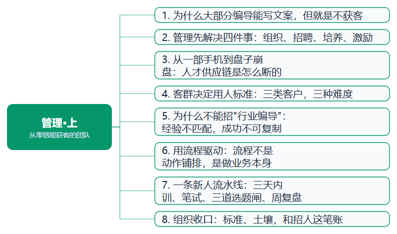

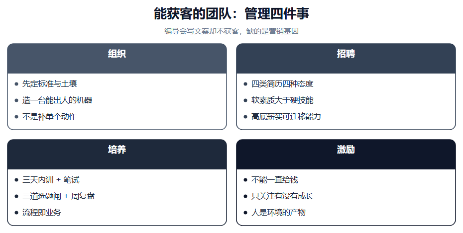

## 1\. 为什么大部分编导能写文案，但就是不获客

### 1\. 先问一个问题：为什么编导能写文案，但是不获客

圈客、锁客、来客、成客、生客五个环节讲完，最后一块是团队管理：一个能获客的操盘手团队，到底是怎么搭出来的。

我们团队一开始没有任何培训流程，没有任何内训流程，就是几个骨干直接干。干到后面发现，骨干出来的东西不稳定，各种各样的情况都出现，才一步一步调整成今天这个样子。

在讲搭建之前，先把一个问题摊开：为什么大部分编导能做到写文案，但是不获客？

我问过现场：写过两百条选题、拍过两百条视频以上的人有多少？举手的有一些。那可以聊得再具体一点。

最早我完全不用写选题的时候，我有个感觉，叫"我文案不好"。于是开始写文案，写完文案开始写选题，写完选题就发现，这个阶段很多选题也好、文案也罢，它不一定能获客。

但当你真的开始获客的时候，你会发现，那个时候你关注的不全是文案的问题。

我自己只要今天没有会，或者今天出差，所有的空余时间都在招聘的路上。接触最多的就是编导。招来的编导里，有写过文案的，但不是所有写过文案的编导都是能获客的编导。

### 2\. 第一层判断：流量不等于变现

这么长时间下来，判断就两条。

第一条，流量不等于变现。这句话我们最近反复在说。

这里面有个更狠的东西：只懂创意的人，是很难形成一个变现的基因的。

你今天跟一个艺术家去聊赚不赚钱，俗气了，俗套。同样这件事放在一部分编导身上也是一样的。我接触过很多编导朋友，他们随随便便出手就是百万爆款，出手就是几百万的流量，但是没有变现。这是常态。

### 3\. 第二层判断：好获客的短视频由三件事构成

第二条是我们团队内部现在的判断：一条好的获客短视频，由三件事构成，缺一不可。这三件事的稀缺程度完全不一样：

|**三要素**|**要解决什么**|**市场上好不好找**|
|---|---|---|
|营销策略|卖给谁、为什么现在买|极少，已是老板思维|
|观点|告诉他怎么做、为什么找你|稀缺，得在行业里扎根|
|文案|把前两样写成能看的内容|很多，最容易招到|

第一件，营销策略。翻译成人话就是：我的产品在现阶段，面对什么人、面对什么阶段的成交人、面对什么样的成交认知，去讲什么，获客和变现更快。昨天讲宋老师的案例，包括这两天大家学的所有短视频方法论，背后都有营销策略。

第二件，观点。观点就是一个人对一件事情的看法。一条片子如果没有观点，它就只是在分析问题。

第三件，好的文案。这是表达层面的东西。

大部分我招过来的编导、接触过的编导，往往缺的是前两个，只具备第三个。三件事同时具备的人，市场上几乎没有。

### 4\. 我自己的弯路：写的东西"有道理，但没记忆点"

我线上成交并不是一开始就做短视频的。最早我是做直播的，当时是直播负责人。后面转做短视频，就发现自己写出来的东西有个问题：听起来很有道理，但是没有记忆点。

后来我反应了一下，也跟其他小伙伴聊了一下，发现问题是：我的短视频只是在分析问题。我并没有告诉消费者应该怎么做，并没有告诉他可以来找我，也没有告诉他找我的原因。因为我的表达是没有观点的。

这个事儿也是常态。

### 5\. 好文案顶多是一篇满分作文

一条短视频里面，连人群阶段、连人群处境、连人群为什么找我买单都没有想过，这条选题它其实就是一篇好文案。

说得跟我以前的业务相关一点：它可能是一百五十分的语文卷子里那三十分的作文。写得很好，满分。

但它能不能获客、能不能产生商业价值，那是另一回事。

你写的辞藻再华丽又怎样？你没写到消费者心里。

我跟我们获客最好的同事聊过，我问他：你写选题的第一逻辑是什么？他说，第一逻辑是我的客户是谁，他怎么找我们。

不是开头怎么写、中间怎么写、结尾怎么写。是一开始就线上了：谁是我的客户，我怎么样成交，从这儿出发。

### 6\. 三点齐全的人，几乎是一个不可能三角

我从 2024 年开始一直在做招聘，到现在：自己招，到找 HR 帮我们招，到接触猎头，到自己开很多场招聘专场直播。市场上很难找到三点同时具备的人。懂营销策略、懂观点、文案还好，这三个几乎是一个不可能三角。

第一个，懂营销策略的人，在这一轮竞争中已经不在招聘市场上了。他清楚我的人群是谁、我的产品是什么、我的产品为什么能成交他们。某种程度来说，这已经是一个老板思维，他已经在做整条业务线的思考了。这种人不太会在招聘市场上流通。所以我们自己招来的操盘手，很多时候都要从一开始培养：他可能具备文案能力，具备观点能力，但是没有营销策略。

第二个，能提取稀缺观点的人，往往是某个行业头部里扎根很久的人。各位都是在行业里的翘楚，你们有很深度的行业洞察：这个行业 2026 年是什么趋势？在这个行业里什么样的人赚不到钱？消费者的什么行为、什么想法是不 OK 的？具备这种深度洞察能力的人，他已经在行业里扎下根了，可能已经做了自己的 IP，可能已经两个人合伙做公司了，他在自己的盘里赚钱就可以，他也不流通。

第三个，文案好的人很多，但只有好文案是不能获客的。

我自己招过广播电视编导专业的，招过数字传媒的，也招过导演系的。招来以后，文案确实写得还不错，但是不获客。这是他们真金白银试过的一个结果。

所以到这个节点我就大概理解了一件事：好文案不代表就能获客。

📌 一句话总结：好获客短视频等于营销策略加观点加文案，只有文案的人几乎无法获客。

## 2\. 管理先解决四件事：组织、招聘、培养、激励

### 1\. 我们要的不是一家"什么样的公司"

基于这样的背景，下午讲四块：组织搭建、招聘、培养、激励。

先说组织。至少在我们公司，我们的目标不是要成为一家什么什么样的公司，那是长期的使命、愿景、价值观。我和合伙人、和我的项目经理讨论的是当下的一件事：我们能不能批量培养有变现能力的营销策划、编导。

为什么非要批量？各位如果在创业路上有过一些比较牛逼的项目骨干，会发现一个问题：当他们离开，这个项目要垮一半。或者当他们离开，这个项目就要有三分之一的折损。这是常态，甚至说这是规律，不可抗拒。

那怎么办？我们能不能批量培养这批人，这是第一件要考虑的事。

### 2\. 招聘：不是招一个编导，是招一个有营销能力的人

这句话写得很简单，但我确实用了一年多的招聘历程才想明白：我不是要招一个编导，我是要招一个有营销能力的店长。

编导这个岗位，市面上还蛮多的。但你要的人，应该不是一两个会写文案、会拍短视频的人。你要的应该是那个理解你的业务、大概知道你的人群、大概知道你的产品、大概知道你这个人适合拍什么内容的人。

这样的一个编导，他脑子里的第一优先级不是怎么写好、怎么流量好。第一优先级是怎么赚钱。

### 3\. 培养：人不推着走，一定在舒适区徘徊

为什么培养很重要？因为不是每个人都有自我提升的意识。

这也是我和合伙人这一年多经常讨论的问题。我很多的操盘手和编导其实都很有能力，但大家会被一些自我的命题困住，他未必向往上探索。

很多时候，我需要做一些培养性质的动作，带着他往前走。否则人一定会在自己的舒适区徘徊，这是百分百的。人一定会在舒适区徘徊。

### 4\. 激励：拿到结果但收获不匹配，人就一定会走

最后一个，激励。

有能力的人一定会走。这句话不是吓唬，也不是一个修辞性的语言，我在描述一个客观事实。

这个客观事实是：如果一个人拿到了结果，但是他发现自己的收获不匹配，他就一定会走。

围绕这四件事，我讲讲这几年做公司过程中，关于操盘手培养、关于整个营销策划团队搭建，我们的策略和路径。

📌 一句话总结：团队搭建先解决组织、招聘、培养、激励四件事，核心是能批量出人。

## 3\. 从一部手机到盘子崩盘：人才供应链是怎么断的

### 1\. 最早的答案：一两个强人，加留人，就结束了

我和合伙人都是从带运营出身的，最早就是代理出身。

一部手机创业，或者一个支架创业，手机加支架也可以完全创业。那个时候业务比较好，相对低成本、快速扩张。

当时我们比较笃定一件事：一个业务有一到两个强人，把留人搞定就结束了。这就是我们当时的想法。

这个想法一直坚持，也让我们拿到正反馈，一直拿了一年多。那个时候我们没考虑过什么团队、什么组织、什么流程，都没有考虑过。因为增长解决一切问题，这就是当时我们的策略。

### 2\. 2025 年初：8 个项目在跑，12 个项目在手

直到什么时候？直到业务开始崩盘的时候。

崩盘之后我们才发现，前面那个"人才解决所有问题"、"一两个骨干就解决问题"的思维，是有局限性的。

当时发生了什么？2025 年初，我们有 8 个项目在运行。这还是一部分，还有几个是接之前就停掉了，其实一共有 12 个项目。

这些项目里很多都是熟悉的盘：郑州做新奥的、教育赛道的一部分、大方老师、成都做家庭教育的、杨璇、潮汕那边一家幼儿园招生、孙老师、桑毅做情感的、物理大师王春阳。项目图在并行。

这其实是好事。第一，市场上用户相信我。第二，这些全部都是我未来的案例——这里面有一些已经是我们的长期合作案例了，包括杨璇、大方老师、宋老师。

但好事的背后有风险，而且这个风险我头疼了很久：这个时候还有项目不停地在找我们。

如果各位是老板，或者跟我一样是后端合伙人，你要考虑的是什么？我能不能承接得住？我的操盘手数量够不够？

### 3\. 算一笔账：5 个操盘手，200 个项目标准

所以我就要算个账。

我之前的专场有 200 个项目左右，这 200 个项目我们都是拿项目的标准去做的。

而 5 个操盘手是什么意思？不是 5 个编导的意思。是 5 个确实能成为项目经理一样的人：他能跟你聊业务，也能跟你聊短视频，他还能拉起整个最终的业绩结果。是懂短视频、懂营销的一批业务精兵。这样的人物，只有 5 个。

那我哪怕把大家的人效顶得高一点，一个人托两个项目，但是项目还会继续来，最多也就再撑三个月。在这样的节奏之下，我的项目崩盘是早晚的事。

这就是我们当时实际面临的困难：因为我的人不够，所以我的业务不敢再扩张。不是不能扩张，是不敢再扩张。

这个事儿还是挺烦人的。合伙人那边流量做得特别好，咣咣咣，然后能不能接？不能。能不能接？不能。都在我这儿，全不能。最后的业务就是很难受，前后端总是匹配不上。

### 4\. 内部判断：人才供应链跟不上业务的发展速度

我们当时是怎么在内部识别这个问题的？一句话：我的人才供应链，跟不上业务的发展速度。

那这事儿难道没有解决方案吗？有，但是这些方案被我否定了。

### 5\. 被否掉的方案一：去市面上批量招编导

第一个方案，我确实去市面上批量招编导了。

但很快发现问题：我不能随便找几个编导和运营就来重建 IP，因为想拿到结果，是有前提的。

大家昨天听我们聊过，我们的项目合作一定要拿后端的分润。为什么？因为如果我只负责收服务费，那其实我是可以不对你的项目负责的。一方面，我的操盘手要有正反馈；另一方面，我必须通过这样的方式和我的客户相捆绑，我才能确定这件事。

在这样的情况下，我随便招的编导和运营：第一，在内部的价值观认同上还没有完全打通；第二，他没有跟我一起打过那么多项目，他不知道项目的难度。

市面上大部分的编导，我可能说一句冒犯一点的话："编导"这个词儿现在是出来了，但是编导的标准还没出来。什么样的叫好编导？我界定不了，我个人都界定不了。只要适合我就是好的——那这个时候主观判断就很大。

**⚠️ 所以这件事就导致我没办法随便招。因为我随便招，我的项目就拿不到结果，这是百分百的事儿。**

### 6\. 被否掉的方案二：只看文案、流量、沟通

第二个，我的业务是人才密集型业务。没有能打胜仗的人，我的业务就做不大。

这句话什么意思？我给大家做一个选择题，你们马上就能判断。

你面前有两个人。第一个人，做过几十个项目，也成过一到两个，或者五到六个项目，他有成事儿的经验，他知道这个事儿做成应该长什么样。第二个人，整个文案水平特别高，做流量水平也特别好，跟你的沟通也很 nice。

如果你今天是业务导向出发的，你会选一还是二？逻辑上是一。

当然也有人会选二，我也认同，没有什么问题。

换句话说，各位要理解一件事：会做这件事儿，和做成过这件事儿，是两个人。

你们今天在各自赛道上拿到过结果，其中有很重要的部分是同行不能够筛选、也不能够复制的东西，叫做"你成过什么"。

你赚过 300 万，你赚过 500 万，你赚过 800 万，你赚过 1000 万，你知道 1000 万的业务长什么样。这个就叫做经验。经验很难复制。

我要的恰巧就是一批做过项目、有过成功经验的人。

📌 一句话总结：人才供应链跟不上业务速度，5个操盘手撑200个项目必崩，只能提前育人。

## 4\. 客群决定用人标准：三类客户，三种难度

### 1\. 团队搭建也要从客群倒推

比逻辑分析更重要的，是客群分析。我们自己一直在讲用户视角，所以你的团队搭建、你的产品设计、你公司的任何逻辑，都可以从客群出发，你去倒推就可以了。

我们这么多年，客群什么样的人都有，但集中在三类。

三类人有一个共同点：全部做过业务，见过钱。不是那种轻轻松松拿两句话就能骗过来的人。人家是真的有业务理解，真的想做这件事。

所以我的操盘手就不能是只懂方法的人。方法就摆在这里，但不同的业务、不同的人群、不同的产品，你怎么调用这个方法，那是一个操盘手的能力。

### 2\. 三类客户分别难在哪

三类人，一眼看过去就知道各自难在哪：

|**三类客群**|**强在哪**|**合作时最难过的一关**|
|---|---|---|
|企业创始人|有专属经验与商业结果，擅业务交付|获客营销没干过，得先跟老板对上话|
|IP 型创始人|吃过自媒体红利，懂流量、懂营销|你的理解必须比他高，最差也要持平|
|行业专家|专业和交付有认知，多是超级个体|嫌太流量、太娱乐化，得先让他认可|

第一类，企业创始人。在自己的领域内有专属的经验、有独到的见解、有自己的实际商业结果。这样的人擅长的是业务和交付，销售型的创始人也很好。但获客营销这件事，他没干过。

服务这类客户，方法论对接上其实还 OK，最难的是：你能不能和老板对得上话。这件事很重要。很多时候是这样的——你的方法论再好，但你不理解客户、不理解老板，你也不能让老板信任你，那又怎样呢？

第二类，IP 型创始人。第一桶金或者业务本身就是从抖音自媒体出发的，这群人在线上已经过过课、已经拿过结果。人家吃过自媒体红利，对流量、对营销、对运营是有经验、有理解的。

这样的老板难在哪？一个拿过结果、有经验、有业绩、有认知的人，你想跟他合作，你的运营理解、你的短视频方法、你的人群理解，一定要比他再高一点，哪怕最差也要市场持平。否则不可能给人家带来增长。

第三类，行业专家。这几年比较多。他自己可能已经不在企业了，接近退休或者提前退休，是个超级个体、个体工作室的状态。他对交付、对产品、对专业有自己的认知——他当时离开某家公司，就是因为价值观不认同。

我操盘手对这种人也是有要求的。他们也会要求操盘手：你讲的东西不能太流量、太娱乐化。你讲这个东西我都不认可，你怎么让我讲？

### 3\. 为什么我要求的不是"会用方法"

回到最起初的问题：为什么我们要定那样的目标——我需要持续培养出有营销策划能力的编导？

因为我需要的是一个能持续培养出这种人的组织。李敏在 2025 年把杨璇那个案子打出来了，过百万的增量，这个确实很厉害。我要做的是，让李敏这样的人尽可能多地出现。

他哪怕没有办法马上变成李敏这样的人，但是他有这个潜质，给他半个月到一年时间，他还能成为这样的人，那就 OK。这就是我企业的长久福利。

### 4\. 四条硬要求

我的要求就这么几个，四条，摊开是这三列：

|**四条要求**|**具体指什么**|**缺了会怎样**|
|---|---|---|
|无障碍对话|两套语言体系能互相翻译|对不上话，方法推不进去|
|会写获客内容|一条片子装下观点、视角、理由|又变成一篇好作文|
|提炼观点|通人性，听得懂画外之音|洞察变不成用户听得懂的话|
|定策略|现阶段拍什么、先打谁|只会拍，不会选|

第一，能够无障碍地和老板、专家、创始人对话，且具备教练力。

为什么强调"无障碍"？因为跟不同的人沟通，是完全不同的两条语言体系。

我特别擅长跟什么样的老板沟通？教培的老板。因为我就是教培人，我大概知道续班是什么逻辑、招生是什么逻辑、门店是什么逻辑、校区是什么逻辑，我拿这条肯定对得上。

我也比较擅长跟一部分 IP、有主播经验的人对话，因为我做过直播运营。

但还有一些老板没有这套逻辑，对话起来就很复杂。为什么复杂？我不知道你的业务，我就没有办法把你的话翻译成你能听懂的，或者把我的话翻译成你能听懂的。

这是第一层。这层再往上一点，要有一定的教练能力。

什么叫教练能力？各位这两天学完我们的方法，会发现我们的方法其实比较难。举个很难的例子：人群处境这件事、成交阶段这件事，各位应该都听了。但现在如果咱们自己开始做短视频，能不能把自己所有的人群阶段和成交水平全部划出来、列出来？还是会有一定的难度。

所以我们在做项目的过程中，要求操盘手：你在做的过程中，最好能让 IP 理解你在做什么、你要什么。否则这个事儿推不进去。

第二，能把营销观点、客户视角和购买理由用文案呈现出来。

在我的视角里面，我并不觉得文案是一个单独的工作。我们的获客短视频、获客内容、选题里面，包含的就是营销观点：什么阶段的人、你为什么可以找我、我是你的唯一选择；以及客户的视角：你遇到了什么、你在遭遇什么、你在犹豫什么、你在纠结什么；以及购买理由。

我让你知道有这个问题，同样我也告诉你，我就是你的解决方案，我里面包含什么样的产品。把这些东西全部包在一条短视频里的人，我要这样的。

第三，具备提炼 IP 观点的洞察力和打磨观点的加工能力。

我的编导要能完全接住观点，其实很难。我们干的就是：把你现有的人群理解、洞察、行业洞察、购买理由，变成用户听得懂的东西。

说大白话点，这件事需要一个人通人性。咱不说高级的，察言观色要有吧，画外之音要能听懂吧。

第四，能从业务出发制定短视频营销策略。

拍短视频是最简单的事。但现阶段什么样的短视频适合你？现阶段你应该拍什么样的短视频？现阶段你应该先从哪个人群去切入？这是要业务视角推进的。

### 5\. 为什么三年五年只有五个操盘手

这四个点要同时具备。哪怕不能同时具备，具备两到三个也行，因为有些点是可以磨合的。

这就是为什么我们花了五年、花了三年，只有五个操盘手。我们没有批量出二十个、三十个，原因就在这儿：我的客户要求高，我对人的要求就高，而这些要求又恰恰需要长时间的、很艰难的任务才能打磨出来。

📌 一句话总结：从三类客群倒推用人标准：创始人要对上话，IP要理解更高，专家要认可。

## 5\. 为什么不能招"行业编导"：经验不匹配，成功不可复制

### 1\. 不能建培训体系，也不能只靠招聘

既然要批量培养出完整的组织，第一步我先 pass 掉一件事：我不要一套培训体系，或者一套招聘流程。因为这两件事都是局部解决问题。

为什么叫局部解决？我可以在市面上批量招人，也确实批量招过。但你会发现：批量招来的人，要么不好用；要么好用一段时间；要么用一段时间，他觉得 OK 了，就走了。基本是这么一个背景。所以招聘只能解决一部分问题。

培训体系能不能解决？好像可以。但我是做小学语文老师出身的，我第一份工作是在新东方当五年小学语文老师，所以我也学过家庭教育，也学过人的一些东西。我大概理解一件事：培训只针对部分人有效。尤其是我们内训本身就很难，如果一些人是不愿意向上的，或者一些人是听不懂的，培训对他就是无效的。

所以这两步都 pass，因为它们都叫局部解。

最终我们选择的是什么？注意，不是培训，是培养。培训只是手段。

第二块是考核体系。这件事情我以前也不在乎，后来发现还是得在乎一下。

为什么？各位如果有从零开始带团队的经历就明白：你的公司一开始可能就是一个小工作间，你像带弟弟妹妹一样带出一批人，他确实成了业务骨干，这样其实挺好。但你做好业务，不要增长。当业务要开始增长的时候，就一定会涉及到你要突破舒适圈，小伙伴也要突破舒适圈。

突破舒适圈的时候，你就会跟他聊：你要注意考勤，你要注意客户沟通，这个标准要立起来。他可能会不接受。

为什么不接受？因为你们两个人之间已经不再是单纯的上下级关系了，你们还有一层"我当时像带弟弟妹妹一样带你"的关系。他会觉得：你当时不是这样对我的。然后就会从一个很简单的业务问题，演变成办公室的矛盾。

最好的办法是什么？你直接把考核设定好。

我可以很放心地跟各位讲一件事：优秀的人是不会觉得考核很要命、很难受的。因为优秀的人，他做事的要求标准往往都在考核之上。你的考核是帮你剔除一部分不适合的人，立住那个标准。

### 2\. 第二块：有让操盘手自己成长的土壤

这里用了一个比较抽象的词，叫土壤。

我今天要的不光是一套考核标准、考核体系，我要的是一个环境。因为人是环境的产物。在好的环境里面，人是越干越有干劲儿；在一般的环境里面，人是越干越稀松、越干越没劲儿——干啥呀？完了回家了，没啥意思，这公司待着有啥意思？这就很可怕。

所以我们的出发点就是这两块：培养，加一个有土壤的环境。

### 3\. 为什么行业编导的经验，我复制不了

在做具体动作之前，先讲为什么不能找这个行业的编导。两件事，可以理解为我们的经验，大家可以接受也可以不接受。

第一件，这个行业太新了。我见过的很多编导，可能已经是很优质的一批人，但是他们过去的经验，能不能复制给我？

举个例子。今天如果我遇到一个国商的操盘手，各位大概知道国商这家公司。国商的业务是什么？批量拍一批视频，可能 20 个 G、可能 30 个 G、可能 100 个 G，然后分到各组织中去，每个组内部赛马剪辑，剪出来以后上传发布。他的逻辑叫博概率和内部赛马。

我们团队不做这样的业务。所以他很多成熟经验给我，我能用吗？我用不了。人家需要大量的操盘手团队、大量的剪辑团队，我配置不了，我给不了。放我这儿不就折了吗？我现在要的是效果。

这叫经验不匹配。

市面上还有很多做一条波自然流的、做创始人 IP 的，能不能用？有可能能，有可能不能。

但基本每次有人过来聊，我都会聊一下：你擅长什么、你不擅长什么。我也会直接告诉他：你在我这儿，可能会有哪些地方不擅长、不适应，你要学习，你能不能接受？真不适合，放进来还是我这儿的麻烦，我没必要。

我很在乎一个操盘手过去成事的经验，和我的匹配度高不高。所以我要的操盘手，大部分都是确确实实在上一个行业里就是洞察用户需求的人，是靠洞察用户需求拿到结果的人。

### 4\. 过去拿结果太快，成功就不可复制

第二件，过去这个行业，大家拿结果很快。

这件事没有褒贬，它就是一个事实。我见过很多老板就是在一轮里面快速赚到一笔钱，很快。那很快的背后，就是野路子多。

我这里说野路子，也不是贬义词，而是说：不是完全能够搞清楚为什么成功。成功的原因是什么？怎么规避失败？怎么去搭建团队？方法论怎么沉淀、怎么复盘？这些有没有？可能没有。

那在这种情况下，这个成功就是不可复制的。

还有一个问题，叫从业者素质被拉起来。如果遇到一些完全没做过的新项目，在能力不足的情况下，他没有那个心力和成熟的做事方法去支撑，他把这事做不完。

我自己从 2024 年到现在做的项目好多，我见都没见过，听都没听过。

以前我很擅长的项目真的很多：美业、美业培训，流量培训、成交培训、营销培训，还有房产——做开发商、做改善房的，还有知识付费。这都是我们已经很擅长的赛道。但这几年我发现这种赛道慢慢变少了。

变少以后，我们见到的都是什么赛道？卖肥料的，卖木器的。都没见过，听都没听过。调研的时候发现，全网有没有对标？没有对标。

那这个时候我没有方法论可借鉴，我靠的是什么？我靠的是一套成熟的做事方法论和验证假设的方法论，它不是一套技巧层面的方法。

你要有心力，有做事的耐心，去把这件事从零摸索出来。

**⚠️ 但如果过去的成功路径不是这个路径，而是靠快速批量投放、批量做矩阵、批量用 AI 洗字儿，那完蛋了，这个项目绝对做不起来。**

这就是我为什么不敢招纯线上的运营。

### 5\. 知识是书上的，智慧是从事儿里提炼的

这也回答了前面的一个问题：为什么很难培养出一个好兵、好运营？

因为成功的人最值钱的是经验，成过事儿最值钱的是经验。道理很简单：知识和智慧是两个东西。

知识是书上就有的、AI 就有的、百科全书里就有的、百度就有的。但智慧是你自己从事儿里面提炼出来的，各行各业都有。这个东西其实最难。

这个东西要靠什么？站在操盘手的角度，它靠的是老板给你机会、给你足够的项目，让你去把这个事儿打出来。

能够给出这么多机会和经验的团队，本身就不多。所以我的操盘手不一样：我的操盘手是几个项目真金白银跟他一起扛出来的，一个问题一个问题解决过来的。

这就是为什么很难培养。

📌 一句话总结：别招行业编导：经验不匹配、成功不可复制，要招靠洞察用户拿结果的人。

## 6\. 用流程驱动：流程不是动作铺排，是做业务本身

### 1\. 答案一点都不性感：用流程推动

那我们当时的答案是什么？用流程来推动，用流程来驱动。

这个答案听起来一点都不高级，听起来好像没有任何眼前一亮、性感的东西，完全不性感。但至少我们用了一下，还行。

### 2\. 对流程的两次误判

为什么还行？先说我以前错在哪。

我们之前对流程的理解，是动作的铺排：第一步、第二步、第三步、第四步，按这个做完以后就搞定了。

后来我发现，如果只是把动作做出来当流程，是没效果的。为什么？因为那个动作本身是线性执行，但做短视频、做营销策略，不是靠机械执行完成的，里面大量的思考。

这是第一个误判。第二个误判，是我对流程要解决什么问题，也有偏差。

我最早就是觉得：大家按流程做，做完以后就可以了。后来发现，大家做完流程更累——边做流程边做业务。这就很痛。它不是真正解决问题的事情，反而是给大家添负担。

所以后来我们的选择是：我要的效果，是做流程就等于在做业务。

### 3\. 第一件事：用流程保障每个人都能懂专业，还能做业务

这个流程大概解决三件事。

第一件，用流程保障每个人都能懂专业，还能做业务。

我问大家一个问题：你们在招自己行业编导的时候，最头痛的问题是什么？招来的人最容易被 pass、或者最不适合的原因是什么？

我先说我的答案。我自己招编导的时候，最头痛的不是他没做过文案，也不是他没写过短视频。我最头痛的是他没有行业理解，他没有做过业务的体感。

**⚠️ 一个没做过业务、没打过仗的新兵上战场之后，死亡率是极高的。他可能把我带死。**

所以这就带来一个情况：很多小伙伴确实带着方法能开始做短视频了，但是没有那个师傅。那个师傅是干啥的？手把手教吗？不是。是告诉他这种情况下用这招，那种情况下用那招；这个情况下你能做，那个情况下你不能做。

这样的经验，他完全没有。他只有一个东西，叫方法。他靠着方法去做，说白了跟赌博没区别：做成算你牛逼，做不成算拉倒。这跟赌博没有任何差异。

那我的流程里保障的是什么？

方法论和写选题的一部分，你们自己去完成。但是我给你定好最重要的东西：这个赛道、这个行业、这个老板的阶段、他的客群、他的产品，你优先打什么样的东西？优先打哪个人群成功率最大？

这个部分由我在流程里面完成。也就是说，他出手胜率大一点，而不是一出手就在赌。

### 4\. 第二件事：用流程保证项目驱动

第二件，用流程保证项目驱动。

现场有没有跟我一样做甲乙方型业务的？一个项目的周期越长，里面最大的风险是什么？

我们自己做业务的时候，其实同时在做两件事。第一件，把我们的动作做起来，让业务正常推进。第二件，客户本身其实也有很多东西需要沟通、需要协调。

因为哪怕很多客户找我们服务三个月、付了费，他依然会对我们的方法产生质疑：这个阶段怎么用这样呢？他的问题是很多的。

那怎么办？我的操盘手也不是每个人都具备项目管理能力和项目管理意识。但我的任务是：在整个三个月里面，我要把所有会威胁到我项目成功率的事情，全部变成流程。

大家把这些事情做了，你就最大程度地把这个项目往成功上推，而不是往失败上推。

要规避的包括什么？违规的问题；产品现在承接销售成不成熟的问题；产品本身有没有要调整的问题；业务方向正不正确的问题。这些我们都在流程里开始搞定。

### 5\. 三个流程跑完，你就是操盘手

所以最后总结就是一句话：你只要做流程，就是在做项目。

三个流程跑完，整个完整的流程跑完三次以后，OK，你就已经是操盘手了。这就是我们现在在执行的部分。

📌 一句话总结：流程不是动作铺排，做流程就等于做项目，用流程把出手胜率抬起来。

## 7\. 一条新人流水线：三天内训、笔试、三道选题闸、周复盘

### 1\. 第一步：进来先看内训，三天谁都不许找他

我们目前任何一个新人的完整流程是这样的：第一步进来，先看内训。这个内训就是我们提到的方案班。

这套内训会把一个编导做选题的全过程讲明白：定位怎么定。哪怕你不了解这个行业、哪怕你不了解这个业务，一套标准的方法论可以快速界定它的产品、它的人群阶段、它现阶段该做什么、定位怎么定、内容怎么设计。

里面会讲人群的阶段，也会把购买理由带出来，把信任型视频带出来。

然后讲拍摄：和 IP 拍摄中你要注意什么，不同的视角、不同的选题你要怎么去拍，选题里什么样的呈现——逐字稿还是框架。再讲内容的配比：不同类型的视频，信任型怎么拍、案例型怎么拍，抠得细一点，把动作教到。

最后讲发布和运营、投放：一个阶段投还是不投，下一个阶段投还是不投，怎么投，什么时候停投，什么时候拿回样本。这个环节要全部交给自己的编导。

保障是什么？他哪怕没有跟着我们做过一个完整项目，但是他现在至少已经知道我们的做事逻辑和做事原则了。

这三天是这样的：我们自己进来的人，不用直接上课，我们都有现成的录像，他们听三天。这三天我是谁都不跟他接触，我也不找他，项目经理也不找他，只有人事对接他。你就在这儿给我听，看整个我们五天的所有课程，三天连看，因为他也不干别的，就一直听就好。

### 2\. 第二步：下午笔试，基础概念题加实操题

听完了以后，下午笔试考核。

这个是比较老派的做法，但好用。为什么要有笔试考核这一环？因为一个人的学习能力，其实就是可以被验证出来的。否则为什么会有高考？

以前我们是有培训，培训完直接进去。那我怎么知道你学没学到位？我怎么知道你学得 OK 不 OK？我怎么知道你在做业务的过程中，不会把里面明明讲过的再讲一遍、再给我犯一遍错？

所以我们做笔试考核，两部分。

一部分是基础概念题，就是关于一些误区性的东西：什么叫起号？怎么样投放才是有效的？什么时候投、什么时候不投？对标到底能选还是不能选？你有没有标准？你有没有原则？都在里面。

第二部分是实操题。既然你说你是编导，你来面试的嘛，那咱们来在前面做一做。文案都学完了，做做看效果，我们可以看。

通过了你就往前走，不通过你就白来。这就是解决问题的方式。

所以我们团队是二十来个人，但是我们招聘从来没断过。快一点的话，一个月之内，一个人不行就干掉了；慢一点的话，最多三个月也就干掉了。

所以在这个流程下，也就带出我刚才说的：我是怎么保障我的团队有战斗力的。我不太会让不适合的人在我团队里待太久。

### 3\. 第三步：选题评审三道闸

从这儿先筛人。筛完以后，紧接着是选题评审。

我们自己团队做选题的时候，大概有几道流程。

第一道，先看你的选题有没有策略。

什么叫有没有策略？你随便给我写五篇选题，我怎么知道能成还是不能成？

**⚠️ 我跟大家讲个事：如果你自己不在业务一线，你拿经验判断这个选题，是无效的。**

举个例子，很多老板过来跟我聊：老板，你觉得我这业务怎么做？我真的只能很负责地跟你说一句：我凭经验觉得。但是我接下来说的话，你能不能直接拿去用？不能。

为啥？我没跟你的客群联系过，我也不知道你的业务上个月做了多少，我甚至不知道你上个月这么多条短视频进线多少个、获客多少个、加微多少个、转化多少个、转化周期有多久、为什么买单、买单的是哪几种人群、有没有趋向性、往哪个方向倾向、客单价有没有提升空间、最近有没有违规。我什么都不知道，情况怎么解决？

所以第一逻辑，你先要有人群策略：你最近优先选什么人群？为什么选这个人群？选这个人群的风险是什么？优势是什么？

第二道，这个策略过完以后，我和我的另一个项目经理会去看能不能过。能过你就把它写，不能过你继续给我出人群策略。

直到你的人群策略出得差不多了，你才有可能写选题。

人群策略出完，紧接着到观点。一条选题很重要的一个点，在观点。那你的观点从哪来？信息能不能溯源？有没有谁说过？是不是 IP 原话讲过？

这是第二次过筛，还是我和项目经理来删。

第三道，走到项目经理面前。我们每周三下午开选题会，项目经理来看这个选题 OK 还是不 OK。到这儿为止，这笔选题才走到了我们客户的面前。

为什么要加这么多道？原来我们只有一个选题会。

按那样做，会有很多纰漏。第一，操盘手的成功率是不被保证的：这批选题成了，下一批能不能成？不知道。因为你的信息是怎么来的、你的思考路径怎么来的，我不知道。所以要拆出来，让这个题成题的可能性更高。

第二，如果只有那样一道会，结尾的判断有时候也会失利。为什么？就是我刚才说的，我什么情况都不知道，人群不知道、业务不知道、产品不知道，我就说你选题对还是不对，那不是扯淡吗？

所以会有选题评审。

一个新人走完笔试考核，进到选题评审，他有三次会被筛掉的可能。通过率不超过 30%。这也说明，如果过不了，就是不适合。

本质来说，我们这个活是个啥？能动嘴是一部分，动手才是更重要的部分。如果你手上的活差一点、不出活，那就白玩了。

### 4\. 第四步：周复盘和月度考核

选题过了，大家正常推进业务，正常出一些选题、过一些内容，都 OK。紧接着，每周做一次复盘。

周复盘合伙人不出面，是我出面。我和文静——我的项目经理，一起去看：这周你做了什么事儿？你的结果是什么？然后你为什么会有这个结果？

为什么要搞清楚这个？因为我很多操盘手的情况是：他能不能拿到结果？能。但是知不知道为什么成功？他不知道。知不知道项目有风险？他也不知道。因为他没有经验。

所以在周复盘里面，我们的任务就是带着他找到成功的经验，然后让这种经验下周可以复制。最后是月度考核打分。

这么一套流程下来，我要保障的是：每一个操盘手，你可以不会业务，或者你可以不懂业务，没关系，你按这个流程来。只要你没有被流程淘汰，就说明你能跟得上我。

你只要能完整跑完这一到三个流程，OK，你应该大差不差，是我要的人，是我们能长期为你投入资源的人。

### 5\. 项目侧：最容易出问题的就四个环节

我自己做了这么多项目，也操持了这么多项目，我发现容易出问题的就那么四个环节：

|**四个环节**|**卡的是什么**|**不做会怎样**|
|---|---|---|
|方案评审|一开始的方向和策略对不对|一个月白干，盲打盲拍|
|线上选题会|观点 IP 认不认、知识点对不对|拍摄卡壳，一条两条就拍不下去|
|客资盘点|策划的人群有没有真的进来|不知道样本回收成没成功|
|月度复盘|哪些动作错了、太快还是太慢|偏差一路带下去，越做越偏|

第一个环节，一开始的方向和策略是否正确。

**⚠️ 如果大家对这件事没概念，就回忆一下昨天讲的宋老师的案子：第一个月我们的策略就错了，我们去选择抄别人的爆款，所以一个月就白干了。方向是很重要的。**

这就是第一个环节，叫策划评审阶段，也叫选题评审阶段。这个地方我要保障它的正确。因为如果这边不正确，内容配比怎么配、人群优先打什么、先做哪个，策略怎么验证正确与否，你都不知道，那就盲打呗、拍呗，拍完以后你也不知道效果呗。

所以第一个阶段是最重要的，我们要先定整个的方案评审。

第二个容易出问题的，是选题。

选题我们内部流程上已经做了三次保障，但这三次保障就代表这个选题能拿去拍吗？不能。

为什么？因为我昨天跟大家讲过，我的编导不具备各位在专业内的领域知识，也不具备你们的专业常识。所以我们写出来的是基于人群理解和产品理解的一个框架。这个框架内会有两个变量。

第一个变量，我这里面呈现出的观点，是不是各位喜欢的？是不是 IP 喜欢的？是不是 IP 能接受的？

第二个，我在这个选题里面写的知识点是不是对的？要不要补充？需要各位去填充。

所以我们会有线上选题会：选题先写出来，你来填充。你填充完以后，给我一些批改建议，我改。改完以后，我们拿着双方都过完的选题直接开拍。

目的是什么？降低在拍摄过程中出现的问题。

为什么拍摄的时候有时候拍一条两条就不行了，或者卡在那儿？因为你前期的选题会做得不够，颗粒度不够细，做得不够精细。

我直接在选题会上把所有东西全部过掉，那拍的时候利索点，咱们一个小时拍完四条五条，尽快。当然这里面是尽量保障，如果保障不了，或者出现其他的情况，我们再调整。

第三个，客资盘点。

为什么会有客资盘点？经常做项目会发现一个情况：我以为这条短视频吸引了什么样的人群，我策划吸引这样的人群，我觉得我可以吸引这样的人群，但是他没来。或者他来了，不对。

有没有人对这个环节做复盘呢？没有，我们一开始也没有。

后来我们在做项目过程中，一些操盘手已经开始做客资盘点，我发现很有特点：我上周策划了这种人群，我希望看到他；这周通过客资盘点，我验证一下这个人群有没有进来。

如果进来了，就说明我的样本回收成功，我上一轮验证的人群是有效的，我接下来得继续投。这个客资盘点会我们也有。

第四个，月度复盘。

项目做了这么久，有没有哪些动作是错的、是有偏差的？有没有哪些动作是不 OK 的、要调整的？有没有太快或者太慢的？如果有，就快停掉。

这四个流程的会议，都是他们需要去呈现出来的。对内和对外两套都要做，对内是给我和文静。

### 6\. 在这个流程下，半年出了三个操盘手

在这个流程下，依然和上面是同一个逻辑：只要你在这个流程里面能够不被我淘汰，我们做的东西不敢说一百分，但是七八十分是有的，大方向是可纠偏的、可调整的，都还 OK。

你只要不被淘汰就 OK。你要是被淘汰了，也一样：你跑不完这个流程，就说明你不合适，那咱再来呗。

所以在新的流程下，我们半年时间培养出了 3 个操盘手。这个数据应该是截止到今年 7 月那个节点统计的，到年底我还没有统计过，到时候再更新一下。

反正这个速度是符合我预期之内的。当然我们还在进一步加速，流程还在进一步迭代和调整。

📌 一句话总结：新人三天内训加笔试加三道选题闸加周复盘，通过率不超过30%。

## 8\. 组织收口：标准、土壤，和招人这笔账

### 1\. 我们坚决抗拒"一个人指挥、不会做运营"

组织流程搭建这一侧，做一个总结。

我们坚决抗拒一件事：一个人指挥，不会做运营。这是我们抗拒的，也是我们不要的。

当然我说一下，这只是我们不要，不代表这种是不对。

为什么我们不要？因为我们的业务决定了：只会拍短视频，业务是做不下去的。这样的人不具备获客的能力。

组织最好要有完善的培养和考核。培养有很多种办法，都可以。

### 2\. 标准要立在那儿

我对这件事的看法是：我不指望所有人都可以做到一百分，我不指望。但是我要让他们知道，他们应该有一个标准。

这个标准叫什么？这个事儿做好，是长这样。

你要有一个标准，否则永远都是：今天心情好，我就能做成什么；今天心情不好，我就做了什么垃圾。

我们的操盘手小伙伴，其实整个会模棱两可，他不知道什么叫对、什么叫错、什么叫好、什么叫坏。把标准立在那儿，是最重要的。

### 3\. 人是环境的产物

第二块，人是环境的产物。这还是我和合伙人一直以来比较兴奋的地方。

我的任务是什么？我的任务就是给组织创造让人自己成长的土壤，人才有可能靠这个土壤出现。

如果各位有跟我类似的经历就明白。我的经历是：从大厂出来以后，我就到创业公司去了。我第一家创业公司，就是我跟合伙人一起共事的地方。我们俩在上家创业公司的时候，我第一反应是——我大概待了半年多，我就准备走了。

为什么准备走？因为我觉得乱套了。

我不能说我是那个牛逼人，但是如果稍微是一些优质人，他对一个环境的要求是很高的。就是"我不 OK，那我就走了，反正我饿不死"。

所以这就是为什么我要在我的团队里面创造这样的土壤。

### 4\. 土壤就两件事

我的土壤就是两件事。

第一件事，让有能力的人在这待得相对舒服，他愿意在这里面继续尝试，而且给予足够的授权。

第二件事，让不适合的人走开，让不适合的人淘汰，让你的公司别人不会见到傻子。我说话没把门，不会那种傻子。说实话，身边傻子太多的话，会影响心情。

大概这就是我们的设置逻辑。

### 5\. 用流程放大创造价值的人，用流程淘汰混子

最后总结一句：优秀的人不会在平庸的组织里混。

用流程放大创造价值的人，同时用流程淘汰混子。

我见过不少混子，我也自己培养过不少混子，是有的，我也知道，很痛苦。所以我选择用流程淘汰，就不要跟我聊这个事情。

你这些东西没做好，那个没做好，那个也没做好，OK，结束了，你不适合，咱不匹配，可以了，不用聊了。

因为我这个人真的很不擅长和人去聊这种人情往来的事情。

那我就选择用我最擅长的方式，去和一个人搞清楚这件事对还是错，就可以了。

考核和流程就在那里，完成了就是完成，没完成就是没完成。没完成不代表你不 OK，没完成只代表你可能不匹配这个流程。结束了，我们换一个公司再开始。

刚才那套逻辑里面，我提的百分之七十都是我的一些理解和认知，百分之三十大概讲了我们的组织流程搭建的路径。

最终我相信现场也会有人完全去复制我们的方式。你们可以怎么理解上面那一环？就是如果未来大家走到了和我们一样的路径的时候，你们可以回忆一下：当时有一个人跟我走一样的路径，他们当时是这么解决的，就够了。

### 6\. 招聘这笔账：一个优秀运营 20 万，一个普通运营 10 万

招聘怎么招？从一个比较简单的问题开始。

一个优秀的运营帮你赚 20 万，一个普通的运营帮你赚 10 万，那请问你损失了多少？

是 10 万吗？或者只有 10 万吗？肯定远远不止。

先看一下团队规模。我带过的团队大概有 100 人和 150 人的，都带过。我从大团队过来带小团队的时候，发现一个点：小一点的团队里出点事儿，这个事儿是很容易快速发酵的。

这跟这个问题有什么关联？就在这儿——你损失的不只是 10 万。

### 7\. 两笔损失：被牵扯的精力，和人数少被放大的地方

第一笔，优秀员工辅导他所花的时间精力。

我以前其实也很爱带人，被伤到。不是说别人对我做了恶劣的事，而是我发现我带不出来。

第二，你在上面跟他牵扯、消耗的时间精力。

有没有发现一个问题：很多时候人和人产生沟通需求、产生矛盾的点，不在于事儿本身。因为每一个人不是理性的，他总会带着些情绪跟你去聊，哪怕一个再理性的人都是如此。

那这个时候，我们就要跟他沟通，要想这个措辞怎么措：既不伤到他，又不伤我体面，还聊得 OK 一点。

我举我自己的例子。假设最近要谈一个离职，我会先做一下预期准备：OK，我明天要谈。然后等到明天，今天九点多了，后天谈。然后再拖一拖，哎，周五了，下周谈吧。

这就是精力和时间的损耗。

这就是招错人最直观的影响。尤其在人数少的团队里面，这两个事会被放大。

第一个，因为你人数少，你的优秀员工就是身兼多职的。你让他去创造业务价值，还是让他今天过来做内训，还是你今天让他去带新人？都能做，但是你要怎么选？

第二个，因为人数少，很多事儿就发生在你眼皮底下，你没有办法说"哎，我就看不见"。很难。

那这个时候怎么办？你总是要考虑这件事儿。考虑的时候你就要想：有业务的事儿你不想，有增长的事儿你不想，非要为了一个烂事儿在那儿思考，精力损耗是很大的。

我以前觉得还行，后来发现等到过某个年纪，我这个精力是真不够，真的真的很不够。

如果今天赚得好，我今天能完成好多事儿；但如果今天心里挂个事儿、精力很差的时候，效率会降低 50%。这已经是很直观的一个答案。

所以这两个损失都不小。

### 8\. 选对一个人，能直接解决一个板块

在这样的过程中，我想跟大家讲的是：请正确理解"选对一个人"和招聘这件事。

如果你选对一个人，他能够直接解决一部分板块。这是一个真实的答案。

举个例子。杨璇那个案例就是李敏做出来的。现在谁过来问，我都说是李敏做出来的。如果没有他，其实没有那个案例的成功。

这就是我们选对了：一个人解决了我这么大的一个案例效果，既有宣传价值，又能够带来公司的分成，牛逼。

就是选对一个人，可以。

再举个例子，比如合伙人找我，也算选对了，我解决他后端交付的一系列问题。

第二个，选对一个助理，怎么帮你提升工资 30%，甚至两到三倍？也就是去带一条业务线，是 OK 的。

### 9\. 用人不是财务账，是 ROI

所以到现在，我和合伙人的理解是：使用人才，他不是一个财务账。

什么意思？不是我今天要花五百、花一千、花三百，还是多花一万、两万、三万。

你把它当 ROI。什么叫 ROI？你多花这点钱出去，这个人能给你带来的是不是更大倍数的回收杠杆？

这个账算清楚，各位更容易能够做得下去，也更敢花这个钱、敢做这个选择。

📌 一句话总结：把标准立在那儿再造土壤，用流程放大创造价值的人、淘汰混子。

# 十四、第3天下午（下）｜管理：招人、筛选、激励的实操

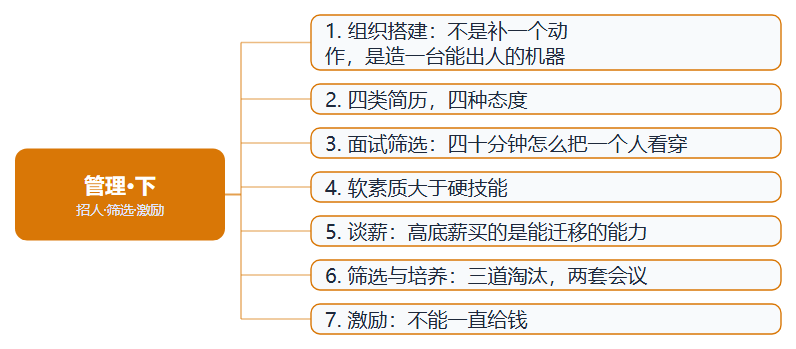

## 1\. 组织搭建：不是补一个动作，是造一台能出人的机器

### 1\. 先把上一节收口

前面讲的所有内容，落在一个词上：组织搭建。它不是单纯的招聘，也不是单纯的培养，不是某个局部动作就能把问题解决掉。

很多老板的误区就在这儿——公司出不了人，第一反应是"我再招一个"；招来不行，第二反应是"我再培养培养"。两个动作都做了，人还是出不来。因为缺的是那台机器，不是那颗螺丝。

### 2\. 招聘要当成一笔 ROI 来算

招聘怎么理解它？我建议把它理解成一个财务成果，理解成一个 ROI 的成果。

你投进去的是时间、工资、五险一金、带人的精力、给项目配的投放资源，换回来的是这个人能不能产出。这是一笔账。只是绝大部分老板不算这笔账，只算"我这个月少交付了几个客户"。

### 3\. 招错人的两种伤

招错人的代价，看起来简单，就是多发几个月工资，其实很伤。伤在哪儿？伤精力，伤状态。

**第一种伤：笨鸟飞不起来，还特别拖优秀员工的后腿。**

尤其在人数少的团队里，你以为优秀的人多，让他带一带就行。我自己早期就走这条路，觉得"让优秀的人去带团队"是个好办法。

实际情况是：不是所有人都适合带团队。

有些业务精兵，他是负责当将的。当将的人什么样？就是冲的人，像我这样的，适合带一个特种兵小分队，人不要多，三到五个，帮他把结果拿下来。有人适合当帅，统领全军，那是另一回事。这两种人不能互换。

人数越少的团队，这个问题越明显：优秀的人本来就少，你把他一半的时间拿去做管理，等于把最锋利的那把刀拿去当锤子用。

我之前就干过这种事。王一鸣那块做羊群做得特别好的时候，我给他配了两个新招的编导。配完我问他，带得怎么样？他说：哥，你要么别给我了，我自己干。

为什么？他一个人干，产出翻倍；给他两个人，他还得写作业——"这条文案怎么写、为什么这么写、怎么改"。他的人手翻倍了，产出反而没了。这就是招错人。

**第二种伤：招来之后表现平平，创造不了什么业绩。**

这个特别好判断，给你一个直观的办法：把这个人去掉，放三天假，你再看公司有没有什么变化。

如果没有变化，那这个人就是在位置上占着，不在业务里。

这种伤最容易被忽略：他不犯错、不闹事、态度还挺好，你找不到理由动他。但他占着编制、占着资源、占着你的时间，整个团队的真实密度就下来了。

### 4\. 为什么老板不肯花时间面试：三个心结

怎么解决招错人？这个解决是相对的，不是说我一眼就能招到对的人。你可以阶段性解决——先解决"这个人不对"的问题，或者先解决一部分问题，或者先解决"我敢不敢招"的信心问题，都算。

但有三道心结，你得先自己拆掉。

**第一道，损失厌恶，不敢接受阶段性的业务损失。**

我最早是做直播的，当时一个单子大概几十块钱，那个阶段我只要管足够多的这些业务就行，我承担业绩、业绩增长和业绩交付。

到某个阶段，客户开始变得很难做，业务开始很难跑。经理跟我讲，你能不能抽身出来做招聘？我说我不去，我要做交付。

那时候我大概带两个人，一个月扛着一摊业绩。我心里那笔账算得很清楚：我抽身出去面试，这个月的交付就会掉，客户可能就流失了。所以我一直觉得，做交付才是正经事，招聘是虚的。

但后面看过来，在那个阶段我脱离业务去做招聘，是一件正确的事。否则我一定会陷入"口停手停"——我只要停了，这个业务我就没得做，我就直接准备饿着。

什么叫口停手停？就是公司的收入挂在你这张嘴、你这双手上。你在，单子就在；你停，单子就停。这种公司不是不能赚钱，是永远长不大，而且老板一天都不敢病。

所以我不想走到那个阶段，那我就提前布局我的人才。

**第二道，期待频率不对，总想着这个月招人这个月就能用。**

很多岗位属于持续招聘，是布局动作，不是救火动作。你看姜太公钓鱼，那么大岁数还在渭水边上，他也没指望今天下钩、明天就有人来。等了多久才等来一个？

同样的，有些重要岗位也是如此。我们三年前，三年才出 5 个操盘手；现在半年能出 3 个操盘手。但这半年 3 个，同样是我前期持续招聘、持续筛下来的结果。

不指望今天招过来、明天就能用。这个想法其实脱离事实。

**第三道，没算过财务账。**

有人会想：我花时间去面试，是不是少交付了客户？但拉长看，招聘这件事的价值远远大于它的代价。

如果你认为招人就是六个小时的事，短时间就要出结果，那你永远算不明白这笔账。

### 5\. 我自己的面试密度

我给大家看一张我的时间表。一月份排到八月份，基本上能招聘就招聘：出差的时候招聘、面试，两个面试连着来，中间好像休了几天，这边还在外面开会，紧接着又是课程。只要有空就面试。

我放这个不是让你们学我这么面试，没必要。我是要解决一个问题——很多客户问我："你们这人怎么这么好用？"

代价就是我花了足够多的时间去面试。只要给我排过来，就是我来面。我们公司一面是我面，二面是合伙人和业务负责人文静来面，我先做一遍筛选。

选对人，是进入下一阶段的门票。这是 B 选项，也是最省事的选项。

当然，我发展不起来有很多相关因素：市场的因素、外部的因素、当前业务发展的问题、平台合规的问题，都会有。但这一系列问题背后，其实有一个共同的解决方案——把 OK 的人找进来就好了。它就是一张门票。

### 6\. 体检单上的那个数字

我为什么到现在这么重视招聘这件事？因为我确实有段时间身体出过问题。

就是现在年轻人说的那种，猝死前兆。我还没有出现过猝死的情况，但通过指标是能查出来的。

查什么？同型半胱氨酸。你们可以去查一下，这个指标反映的是你身体的炎症水平，还有你血管的压力值水平。参考值大概是 0 到 15，这是正常水平。随着年纪增大、压力增多、皮质醇更多，它就会更高。

我 2024 年巅峰是多少？84。换算一下，大概是正常人猝死风险的 16 倍。

那个阶段是什么样的阶段？就是经理跟我说"你应该去做招聘"，我说"我不要，我要去做交付"。人总会把自己干报废。

所以我是在面临这么大问题之后，才选择去做那个相对正确的选择。我也不建议大家走到我这份儿上。

### 7\. 说不清"要什么样的人"，代价是巨量损耗

想明白要招聘，接下来一步更重要：我要什么样的人。

这一步我们前期走过很多坑。最开始我亲自负责简历筛选和面试，但是"有一搭没一搭"——想起来去做，没想起来拉倒，后台躺一堆未读，我批量去看一遍。

这么干最大的问题在哪儿？我没有办法持续坚持做好一件事。我的招聘效率和人才质量，取决于我最近忙不忙、状态好不好。状态好、不忙，我就可能招出好人；一忙，这条线就断了。

后来我去问一个朋友，前阿里的 HRBP，应该是 HRD 了。我说我要招这样的人。他问我一句话：你要的能力模型是什么？

我当时是模糊的，我并不了解"能力模型"这四个字是什么意思。

后来我翻译了一下：一个人做成一件事，背后是需要不同的能力去支撑的。

比如我语文好，所以我当过语文老师，现在做内容工作。那背后支撑的能力是什么？快速阅读的能力，以及一定的表达和输出能力。我数学不好，高考数学一般般，中考数学只考了六十多分。那数学不好，背后是什么能力不行？

同样，我们要的这批操盘手，他需要什么能力去支撑？

**⚠️ 所以给大家一个建议：千万不要说"我要一个人才"，也不要说"我要一个能变现的编导"。这两句话背后，就是能力模型的模糊。**

我经常有一个感觉：别的公司的二流人才，在我这儿是一流人才；我这儿的一流人才去别的公司，是二流人才。那什么叫"能变现的编导"？编导本身应该具备哪些能力？我自己也说不清。

说不清的代价，是巨量的资源损耗。

算一笔账：只要我开始招人，要不要给试用期？要。试用期要不要发工资？要。发工资要不要交五险一金？要。全都要。

如果我根本不知道他的能力模型对不对，留了一年，一年之后发现，操，选错了。这一年工资你怎么算？

我们有一个阶段，同时招了五六个编导，还有多个剪辑同时在岗，待了三个月，发现不合适，全部改掉。那三个月的人力成本算不算成本？算。

这还只是财务成本。带人的成本算不算？资源投入算不算？他做内容要不要投放？投放给他的那些资源算不算成本？算。这个成本巨大。

它最大的问题是：短期内你看不到，但三个月之后，你就能看到当时一个错误的业务判断带来的影响有多大。

### 8\. 能力模型：四层拆开看

我们先从一个比较简单的逻辑做一次拆分。这个拆分不是全部，也不是我们现在最终的版本，我给大家一个基础版。

所谓"能变现的编导"，或者说"具备营销策划能力的操盘手"，背后的能力大概分四层。

这里先补一句，也可以叫"叠个加"。能力模型你不要指望每个人都具备。能力有培养周期快的，有培养周期慢的。如果他身上那些培养周期慢的已经具备了，培养周期快的你就当他没有，培养就行。

理解这件事的关键是：不要指望一个人身上全都有。我自己也没有完全具备。

**第一层：会采访、会选题、会拍摄，有经验。**

听着简单，难的点在于——作为老板，你要能区分，怎么样才算"会"。

先说会采访。提问算会采访吗？

我们在内训方案里专门有一个环节：为什么提问式的自然流短视频没有办法做到获客？

因为人只要处于提问的状态，你给出的答案就不是具备设计过的、引导性的答案，你给的是解决问题的答案。你进入了一种一问一答的环节，而不是进入了一种引导他人的环节。这就是提问式不太好使的原因。

一问一答，你是在服务一个人的疑问；引导，你是在替一群人做决策。这两件事的产出完全不一样：前者可能聊得很热闹，但没有一条片子能替你筛人。

那有没有自然流优质的编导？有。那种编导是具备成片能力思维的。

提问、提问、提问，打、提问、打、提问、打，剩下的交给剪辑——那你这个片段的观点够不够锋利？够不够稀缺？如果观点够稀缺，当然有可能获客。但说实话，这两年有稀缺观点、锋利观点的人很少，很少很少。

再说会选题。他说"我能写逐字稿"——这是 AI 现在就能完成的事。这叫会选题吗？很难说。

选题要被拆开看：这个选题背后是有策略的。我在打哪种人群？他的商业目的是什么？这个片子应该长成什么样子？我的 IP 适合什么样的选题形式——是框架式的，还是逐字稿背稿式的，还是他确实不太适合，得对面沟通、选自然流采访式的？

再说会拍摄。剪辑算会拍摄吗？助理也可以完成。

会拍摄的过程，是如何让你的选题变成 IP 自己的语言，然后充分地、快速地表达出来。

最后是"有经验"。怎么算有经验？所以你看，这一层里的每一个词，背后都是可以被拆出来的，都有标准。

这个标准可高可低，高低取决于你的业务难度。

比如你是做汽车的，产品力就是够强，你需不需要那么牛逼的表达？不一定。你用一个简单的变量就可以搞定了，因为你产品够强，直接卖就行了。

所以不要一味追求超高能力的人，选适合你的就可以。

**第二层：理解这个行业，理解这个群体。**

我举一个自己的例子，别的行业我不好说。

我有些家庭教育的客户，我跟他们聊往往都比较顺。因为我自己以前做老师的经验，我发现家庭教育这个板块，大家解决的不一定全是孩子的问题。

家长今天去买家庭教育产品，不论是补课也好，还是家庭教育规划也好，他解决的无非两个问题。

第一个：我不希望自己耽误孩子。我要把这个风险外包出去，有人跟我风险共担。我不希望因为没把孩子带起来，以后家里面人说"这孩子交给你了，你带成这样"。这是一个风险。

第二个：好家长会发现自己想托举孩子，但能力托举不起来，需要找新的解决方案。

在我看来，家庭教育整个赛道无非就是这两个大板块。

我描述的这个不是全部，但能做到这个程度，很重要。因为家长掏钱的那一刻，他脑子里想的不是"这门课好不好"，而是"我有没有尽到责任、我还能不能托住这个孩子"。

所以理解人群，不是一句"我家孩子九十分，到初三成绩掉下来了"。理解人群的背后，是理解人群的动机和理解人群的处境。

我们为什么在方案里花大量篇幅讲人群分析、人群购买理由分析，讲整整一天？就是因为那个地方很重要。

很多客户、很多操盘手，最开始都觉得"我理解人群了"，后来写出来的东西是这样的——他做家庭教育，那份人群分析谁都能用。

什么叫谁都能用？给语文老师讲，语文老师能讲；给数学老师讲，数学老师能讲；给英语老师讲，英语老师能讲。这就是无效的人群分析，人群没有触达。

真正的人群分析要切得很细。比如第一种：家长花大量钱补完课了，发现没有用。第二种：家长花了大量的钱做教育诊断、教育规划，自己学习去了，结果自己学完了要帮孩子的时候，发现自己的能力帮不了。

这才叫人群分析。这是理解能力的练习。

**第三层：营销思维、用户思维、自信、商业 sense。**

这些都是软性素质，我们不在这儿展开，后面在面试问题里聊。

**第四层：跟公司匹配。**

公司需要什么样的人？公司的愿景、价值观、做事逻辑是什么？你就招这样的人进来。

这个答案其实比较简单。段永平说过一句话：一个人，先合适再合格。

什么叫先合适？跟我三观相投，跟找对象一样。什么叫合格？那是能力，能力可以再提升。

### 9\. 他们身上值钱的，根本不是选题拍摄

说白了，能变现的 IP 编导、操盘手，向经理也好，什么词都可以，whatever，都得先有充分的营销能力和用户思维这些软素质。

也就是说，他今天写选题，不是为了完成选题本本身。他的目光能看得到：这个选题完成以后，能拿来什么样的客资，这批客资能够成交什么样的人群。

这就是营销思维、用户思维。再结合短视频时代的拍摄、选题、文案这些硬技能。

换个说法：我的操盘手，如果有一天从我公司离开，他会不会饿死？

应该不会。为什么？因为他们本身就不是一群"文案编导"，他们本身是一群营销策划人员。只不过今天抖音、视频号需要短视频，那我就拿短视频去炒菜。未来可能是别的平台、别的形式，他一样可以。

所以他们身上最值钱的地方，根本就不是选题和拍摄。

📌 一句话总结：出不了人不是缺螺丝是缺机器，招聘按ROI算，伤在精力和状态。

## 2\. 四类简历，四种态度

### 1\. 先分清你手上是哪一类人

面试筛选无非几类简历，四类人，我对他们的态度完全不一样。

|**简历类型**|**适合什么阶段**|**核心风险**|**我的态度**|
|---|---|---|---|
|知名大厂有背景的人|新 IP 拓荒|误判真实商业环境|谨慎再谨慎|
|做过类似行业的运营|新 IP 起步|行业差异|可以去挖|
|做过类似团队的编导|老 IP 补位|方法论无法照搬|谨慎再谨慎|
|没经验但营销有结果|老 IP 组团队|缺硬技能|优先考虑|

### 2\. 知名大厂有背景的人：谨慎再谨慎

现在确实有一部分互联网大厂会释放一部分优质人才到市场上，但他到你这儿合不合适，是另一码事。

我不去说别人，只说我自己。

我之前在新东方，2017 年开始干，一直干到 2022 年，五年。这五年里我带了课，做过整个教学主管，也做过市场那块——市场运营、招生都做，后来拿到高级主管，基本在二点五级那个岗位上。

我离开的时候，一部分是行业变化导致的。另一部分，我在选择下一份工作的时候，其实挺谨慎的。

谨慎的原因在哪儿？我觉得我上一份工作是光环，这个光环我不想浪费。所以选下一家公司的时候我就很谨慎。

但这个"谨慎"其实也不是真谨慎，我当时像傻逼一样。

为什么说像傻逼一样？因为上市公司和集团公司在中国的创业市场里是少数，90% 依然是创业公司、小型公司。我当时没看明白"90% 这样的公司是常态"，还拿着上市公司的标准去决定我下家公司要去哪。这在创业公司里面，其实挺扯淡的。

带着那个心态去创业公司，我心里就会有一种想法：我费了这么大劲才从这么大的平台出来，下家一定不能差。

90% 的人从大厂第一次出来，基本都会这个想法。但你让他出去锤炼个一年、两年，他就消停了，老实了。

第二种心态是什么？从大厂出来的人，有一定的办公室政治斗争经验，也有一定的跟客户向上沟通的经验。所以在招聘过程中，他们的演示能力和表演能力还是蛮强的。

我自己就是这样。我当天拿 offer，杭州、香港、深圳，我都可以走一遍，走一遍我都能拿到 offer，都能走到二面、三面，跟领导、跟负责人直接聊那一步，我都能搞得定。

这个东西在面试里当然是加分的，因为面试本身就是一场演示。但你要清楚：会演示和会干活，是两种能力。

但搞不定，代表我认可人家公司吗？未必。我可能待两个月、三个月，拿份工资感受一下，OK，走了。

所以来自知名大厂的人要谨慎再谨慎。不是他们能力不行，而是他们没有前期独立创业、或者在创业公司待过的经验，对真实商业情况了解不够充分，导致错误选择。而这个错误选择，是有可能我们来承担的。

我自己招大厂的人，都会问清楚一个问题：你有没有想明白，你的公司长这个样子？

你以前的十三薪、十五薪，出门的 OA、报销，这些东西当然是没有的。

流程没那么顺，你的上下游不会都为你搞定，你要的资源不会都帮你调配齐。你要一个人单挑业务线，有没有做好这个准备？

我是直接问，然后看他的状态。

如果他觉得确实跟我聊得很顺，想明白了，那就一起来碰一碰。如果他给我的感觉是没想明白、有些摸不准，我就会直接劝他：你可能想明白再来。你想一个礼拜，多面几家，然后回来再找我聊。你觉得我还 OK、还真诚，来找我；你觉得我可能在 PUA 你，那你就不要跟我聊。

因为我是过来人，我知道。

**⚠️ 我为什么愿意花这个时间劝他？因为招错一个人，成本是我出，不是他出。他待三个月走人，简历上多一行；我这边三个月的人力、资源、带教，全打水漂。**

### 3\. 做过类似行业运营的人：适合新 IP 起步

如果现场有做直播的，我多聊一句，因为我以前做直播。

如果你做直播，自己感觉起号有点费劲，你就去挖同行业里做过你这个行业 IP 的直播运营，就可以了。

为什么？直播比短视频要简单。这是我的感觉，我站在运营角度说这话；对 IP 来说，直播可能痛苦一点。

我说的简单，是建立在变量可控上。直播下来，哪里调人、哪里涨人、为什么成交、为什么不成交，你全部在后台都能看到。

做过直播的运营，可以直接拿着成熟经验告诉你：这种钓人的情况，你用这个互动话术，之前就是这么做的；这个情况你可以用那种话术，那种话术还不错，拉流效果很好，我们就是这么做的。全是现成的经验，是 OK 的。

所以这一类人最大的价值不是创意，是"我见过这个数据长什么样"。你起号卡在哪个环节，他能对着后台告诉你先动哪一步。

### 4\. 做过类似团队编导的人：谨慎再谨慎

这个我前面已经讲过了：每家做短视频的，经验、方法论、业务形态全部不一致。

我举一个情况。我们家的编导，在我这儿是一流人才，他今天去薛辉老师那里，可能不太合适。因为我们确实做的内容比较难、比较深，到那边可能就被说成"做这个东西研究得过于深了，缺乏广度和流量意识"。

反过来也一样。那边的编导来我们这里，是不是一定能搞定？能力你是 OK 的，但能不能匹配、能不能合适，我也不确定。因为双方的业务、人群、产品都不一样，无法完全照搬。

甚至有人说"我是做创始人 IP 出来的"，来我这儿，我也不确定合不合适。

我为什么说这么多？因为我前面说的这些，我都招过。

做分割的负责人、视频负责人，我们合作过；申哥的门徒在另一个公司里出来的负责人，我也招过；以前做矩阵的、小学老师那边的，我也招过；博商那边的，我也招过；自然流这边的，我也招过。

招过以后发现就是不太匹配。因为工作惯性和工作经验完全不一样，拿结果的经验也完全不一样。我并没有信心能够让他完全按照我的方式来。

### 5\. 没经验但做过营销、有结果的人：适合老 IP 组团队

这一类我优先考虑。

为什么？我前面讲过，我们的编导优先考虑的不是这条文案怎么写，而是优先考虑这条文案给什么人看、拿到什么样的客资。

这个思考起点，和销售的思考起点是一致的。所以本质上，是营销工作在前，然后配合文案去写。

你作为老 IP，其实有很多现成的文案框架、方法论、拍摄技巧，喂给他就行了。用他的营销经验，再喂他硬技能，就结束了。

📌 一句话总结：四类简历四种态度：没经验但有营销结果的人优先，行业编导要慎用。

## 3\. 面试筛选：四十分钟怎么把一个人看穿

这五个问题是一条线：先看他做没做过（最大的困难），再看他做得好不好（客资和转化率），再看他会不会想（选题怎么来的），再看他懂不懂转化（成功原因是什么），最后看他能不能在老板面前站住（怎么说服老板）。

四十分钟，问完这条线，这个人几斤几两基本就出来了。

### 1\. "有经验"最重要的不是套路，是能讲出为什么

所谓会采访、会选题、会内容、有经验，最重要的不是他有一套标准的 SOP 套路，而是他能讲出为什么。

如果一个人拿着一整套工具表格给你，你可能不太敢用。但他能跟你讲出"为什么这么设计这套 SOP、为什么定这个标准"，这种人你应该可以聊。

能讲出为什么的人，才是你要的人。

### 2\. 第一问：你项目里遇到最大的困难是什么，怎么解决的

为什么要问这个？因为真正做过项目的人都知道：没有一个项目是好做的，每天都在遇到各种各样的问题。

起号阶段怎么打通第一个客资？怎么建立人群？怎么判断人群对还是不对？人群对了以后，第二批选题怎么设计？第二批选题设计完，获客有没有批量放大？放大的原因是什么？没放大的原因是什么？

全都要一天一天解决问题。

这么多问题里面，一定会有最大的困难。那我就听他：你当时觉得什么是最大困难？你的解决方式是什么？

做过事的人，你稍微听一听就知道，他到底是做过还是没做过。

### 3\. 第二问：当时每个月客资多少，转化率多少

这是数据思维的呈现。

如果真的是拿自己的选题打出一个盘的人，他对数据是极其敏感的。

我们做项目的统计维度大概是：选题有多少个，客资多少条，多少条客资是从这条选题来的，这条客资的价位情况，然后联系情况、开课情况、成交情况，全部要问出来。

为什么要问这几项？选题是入口，客资是结果，价位决定成交难度，联系率、开课率、成交率是一层一层漏下来的。他能把这五层都说清楚，说明他真的守过这条链路；他只能说得出一个总客资，说明那个数是听来的。

所以我说，面编导其实很好面：我就对着他简历里给的那个数据对应，大概就能知道他是真做还是假做，数据是对的还是不对的。因为有些转化率基本是公开数据，很好判断。

比如你的账号，前端后台到加微，正常是 50%。你超过 50%，你做得牛逼，我就问你为什么超过 50%；你低于 50%，你有问题，我就问你这个事有没有解决方案。

加微之后再成交，要看你产品的价格。价格越高，成交周期越长。正常来说，1000 元级上下的产品，转化率在 10% 以内；价格再高一点，5% 以内。你给我一个数据比这个高，你是怎么来的？你有没有做别的动作？

我一般问得很偏门。我会问：你当时那个月打了多少条视频？视频哪个段的客资？这个客资涨幅到 5%，你们当时做了什么动作？

这些各位也可以问，有什么不能问的？因为他最终就是要跟你实打实走这条业务链：我帮你做一条选题，选题完了要获客，获客到价位这一段丢失了怎么办？

### 4\. 插一个案例：为什么离婚律师让我头疼

现场有做律师的，做拉新的，刑事的。

还好你做刑事。我跟你说，做乙类律师我是比较头疼的，做离婚律师很头疼。

为什么离婚律师很头疼？因为离婚律师有一个情况：好获客，但不好成交。

不是所有人出现情感危机以后，唯一的解决方案是离婚。他只是过来先找你问一问，他要不要离婚、要不要交钱，和确定打离婚官司，那是两码事，周期很长。

很多人就说："我只是现在担心他会怎样。"所以他过来可能先付一个小的，做一份文书的工作。但干到什么份上，才能最后两个人确定离婚，给你交一个十几万、几十万标的的案子？时间极长。

所以你看，不同业务里面又有细分。这就是很好玩的一个意思。

所以你就是要问客资每月多少、转化率多少。尤其各位是在一个大行业里的小行业时，你多问一问，没什么毛病。

### 5\. 第三问：你当时这个选题是怎么做出来的

这一类问题，如果他回答"我开头是这么设计的，结尾这么设计，中间这么设计，这里留个钩子"——这位可以直接 pass。

为什么？因为这是结构。把结构给你念一遍，没有任何意义。

所谓的"选题怎么设计出来的"，我并不是要标准答案，我说的是我一般愿意听到的答案。

比如他首先有业务观察：当时我们遇到的情况大概是什么？我们后台私域大概有不少人，这些人其实听过某某某的课程。在这个情况下，他们只是不找我买单，他们有些疑虑。

那在这种疑虑下，我当时主要去做哪些内容？过程中我也会问他：他们有什么疑虑？你怎么打消这个疑虑？你是怎么呈现的？

这叫选题怎么做出来的。所有选题，都是基于业务出发去做的，或者基于用户出发去做的。

### 6\. 第四问：你的客资能带来转化，你当时的思考是什么

具体，再具体。

这个其实就是我们刘总在客资复盘会里做的。他会问夏总：你大概得知道你的成功原因是什么吧？

你要是不知道，你们就是在撞，你只是撞对了而已。我想知道的是可复制的成功经验，你有没有？

他可能说出来了，那还不错，说明有复盘能力。哪怕说不出来、只是语言表达不对，但我还是能听到他有些设计在里边，也就是说，他具备获客营销思维。

### 7\. 第五问：你是怎么说服你老板接受你的方案的

这个问题很经典。如果现场有人是老板、是 IP 本人，你一定要多问一问这个问题。

为什么？因为我们做了这么多项目以后，有真实的体验：做得越牛逼的 IP，越有自己的想法。

"有想法"不是贬义，也不是褒义，只是一个中性词，它是一个客观事实。

在这种情况下，往往会出现一个局面：操盘手已经看到了一些别人看不到的东西，怎么办？那一定是有沟通的环节，这里面涉及沟通策略和沟通技巧，要有这个经营度。

### 8\. 理解行业、理解群体：不要问太多，问多了就变成上课

这个不要问太多。我一开始也会问很多，后来发现问多了没用。

问多了以后就变成我给他上课。招聘现场变成了面试现场，面试现场又变成了上课现场，比较土。你还不如直接快速一点。

快速一点，就看这几条。

**第一条：非本科不要。**

这是我们公司的一个偏见，我只能说是我们的偏见。只不过我们的理解是：学历，它是学习能力的一部分。

**第二条：26 岁以下不要。**

应届生和工作过两三年的人，最大的区别是社会大学的第一课——关于人的理解，关于做事的得体。

我希望他在我这里上这一课。尽量让别人上完再来，我这儿会好一点。

尤其我们做的都是偏 IP、偏老板，说话需要去注意。他如果比较神经大条地去跟老板沟通，效果其实不是很好。

**第三条：家境很重要，大家看情况。**

我们理解的是：一个人的审美，决定了他做的东西怎么样。你见过的好东西越多，你对一个东西的要求和标准就越高。

比如有些人从小在政府官员家庭或者教师家庭长大，确实可能见过很多这样的人、和这样的人打过交道。某科长、某厅长、某局长，或者某个大老板就是他朋友，他从小跟他聊过。所以他跟老板沟通不痛苦。

我就是痛苦的那种。我不介意跟大家沟通，也不介意跟客户沟通，但出于职业素养，我一定要沟通好。其实我个人是很抗拒沟通的，因为我觉得好累。我从小没有这种经验，是办业务办多了以后，才形成了这样一种业务习惯。

但真的不乏有些人就是："我不愿意跟人沟通，沟通好累。"可真正做业务，你会发现一个情况：不沟通，不可能推得动业务，就这么个事儿。

所以家境很重要。见过好东西，见过一些优质的人，见过 nice 的人，或者见过一些真正的业务本身，就不用教。

比如他家里有信托，很小就配置过资产，那我今天做一个财经账号，我其实不用给他解释，他都知道门门道道，甚至他比我都懂。

**第四条：让他看几条我同行或者我的视频，说消费者为什么选。**

这个可以作为临时性的考题去考验他。

现场随便给一个账号：这是精准的营销账号，但获客效果怎么样？你给我分析一下，为什么用户会选它？你就可以快速判断。

你也可以拿某个别人的账号给他：来，这是我们同行，你觉得他吸引什么样的人群？你就看他对用户人群的理解和洞察。

**第五条：你过往最有学习成就感的是什么？**

这是看成长心态，但要看是哪种成长心态。

理解行业和理解群体的背后，是不是需要输入信息？是。但有的人真的会输入信息输得很开心，然后忘了自己干什么。

这就是我说的"纯成长心态"。我招过一批这样的人：他随身携带一个小本子，天天记记记。他所有的产出并没有产出到工作本身，而是产出到那个本本上。

真正做业务的，大部分 90% 都是这个逻辑：我根据最近缺什么、遇到什么问题，我学什么。他不会什么都学，那会比较浪费时间。

关于行业和群体，不要问太多细节。你问太多细节，你真的变成给他补课去了。直接拿这几个点去卡就可以了。

### 9\. 营销思维、用户思维、自信、商业 sense

**第一问：你先做的案子，你的客户是谁？能不能具体描述？**

说白了，就是让他在自己的成功案例里，讲人群理解、人群处境、成交阶段，转化率够不够。这些都可以聊。

大家放心，如果这个案子真是他做得很好，他都能聊得很清楚。尤其各位这两天学过短视频了，关于人群成交阶段、人群的处境、需求这些点，你们都大概有初步概念，其实你是能听出来他是外行还是内行的。

**第二问：你能跟我说说，上岸的客户为什么找你买单，为什么不找别人？**

这个问题我想看他的营销思维和用户思维。

我其实就想知道：他在设计里面，有没有去沉淀有购买力的用户？有没有找到独一差异性和唯一性的、有购买力的用户？

他如果说得上来，也是 OK 的。

**⚠️ 第三问：凡是讲"产品好、价格便宜、专业"的，一律不要。**

为什么？因为这三点没有一个是他的能力，全部是老板的能力。

以前行业里有句话：给个好 IP，狗都能做。三五年前情况就是这样，就是这么一个逻辑。

现在也够呛，因为现在竞争确实有点大，有点难。所以凡是讲这些的，都没有用。

**第四问：你过去遇到和老板观点不一致时，怎么处理？**

做项目的过程中，一定会发生双方的分歧。

我们团队的要求是：所有的老板，尽量直接说"你"，不说"您"。我要的是平视沟通。

为什么要平视沟通？因为有些点就是你不知道的。你不知道的情况下，你要接纳一些外部信息，帮你去做出判断。

否则很有可能就是我顺着你的心意去做一批内容，又怎样呢？没什么结果。所以要接纳他具备一定的、和你沟通的能力。

### 10\. 公司稳定与融入：四个没有标准答案的问题

这个部分，倒不是要他跟我一模一样。但风险偏好特别高的人，很容易干着干着就出去创业了，这个还是有的。

我不是不接受，我也接受，只不过我希望他能够相对理性地做这件事的判断。因为我之前就操盘过，最后人就离开了，也经历过这种事儿。

这四个问题没有标准答案，你要根据对方过去的行业经历以及年龄，去听他答得是否合理。

**第一个：你想过创业吗？**

你要看对方的年龄。25 岁刚毕业想不想创业，和他 35 岁左右想不想创业，是两回事。你根据他的情况，判断这个选择是 OK 还是不 OK，你就能觉出他的风险偏好高还是低，有没有想明白。

**第二个：你的职业规划是什么？**

这个问题比较老派，你可以用各种各样的方式去问：接下来三年准备做什么？五年准备做什么？

不要拉到十年，十年没意义，十年都没人给你画饼。就问两年、三年，或者三年、五年，甚至短一点，半年、一个月都可以。

这个过程，你可以判断他的职业选择和职业判断是不是合理、是不是想清楚，其实也是看他这个人的软素质。

**第三个：你之前在公司经历的黑暗时刻是什么？**

就是看看他觉得什么事儿能压死他。

每个人的阈值不一样。有人的阈值是"工作好难"——但那个问题基本是事关行业生死、公司生死的事，是真难。有人的阈值是"当时有人给我穿小鞋，我觉得这个人很不好"，他就觉得别人对我不好，就是最黑暗的时刻。

这样的人你大概能理解：他在一些大事上未必扛得住，因为他最困难的事就是人际关系相关。这种情况就要小心。

**第四个：你觉得你职业生涯解决过最困难的问题是什么？怎么解决的？**

依然是看他的阈值——他觉得什么事是有价值的。你判断一下，跟你的价值偏好是不是一样。

### 11\. 把面试当成一场相亲

我自己怎么判断这件事？你不妨把面试当成一场相亲去聊，会好很多。

总之你怕选错人，你就啥都聊，你担心的事都聊一遍，就 OK 了，这是最保险的。

相亲你不会只问对方一个月挣多少钱，你会问他钱怎么花、跟家里人怎么相处、遇上事怎么办。招人也是这个道理。

我的面试，你说长不算长，但面试密度很高。我半个小时基本上能把他的所有相关问题都问一遍，差不多四十分钟左右结束。

你算算那个账：你多花这三十到四十分钟，总比把他招进来以后，多花三个月去验证他不 OK 要合算很多。

如果一个人面不 OK，你再加一个二面，都是可以的。

### 12\. 每个人都是特定环境塑造的产物

关于招聘，我们认可一件事：判断的标准是什么？每个人都是特定环境塑造的产物。

你面试一个人，不要只看他怎么说，你看他当时的环境和前面的环境是怎样的，就 OK 了。

要快速判断。比如我们的几个见解：过去压力大，就是能抗压；过去跟大老板在一起工作，就是有格局；过去穷过、抠门，可能是过去三十年大起过，将来还会继续大起。

用一句比较俗气的话：这个人如果第一眼判断不 OK，那后面九成九大概率也是不 OK 的。

虽然偏执，但是能够快速判断和快速决策，有用。相信你自己的判断。

📌 一句话总结：四十分钟五问：最大困难、客资转化、选题来源、成功原因、说服老板。

## 4\. 软素质大于硬技能

### 1\. 一句话总结这个岗位的要求

短视频这个岗位，我们的要求就一句：软素质大于硬技能。

硬技能有教材，软素质没有教材。有教材的东西，晚三个月学会没关系；没有教材的东西，你教不动。

这就是为什么我们不一定要招那种"一定做过多牛逼的案子"的人。他有营销思维、有营销意识，这很重要。

硬技能我们自己培养。

硬门槛三条：必须本科；必须在 26 到 31 岁之间；必须有商业经历，去做业务导向型的岗位。

### 2\. 我们公司的年龄结构

我们公司年龄结构很有意思。

我和合伙人拉一大头，我俩是 90 年出生的。紧接着后面一批全部是 98、99 这个阶段，中间 93、94、95、96 几乎没有。然后再往后就是 00 后。

直播运营这个岗，年龄基本就维持在 26 到 28 岁之间。

### 3\. 为什么必须"业务导向"：编导要为业绩结果负责

以前公司的编导不会对业绩结果负责。但对不起，我今天这个公司，所有短视频编导直接和业绩结果挂靠。

也就是说，你做的不只是客资，你要为业绩结果负责。能不能转化，这件事你要考虑。

所以最好是一个业务导向型的人。

什么叫业务导向型？我当时当老师的时候，我专门上好课，但我有一个直接的指标叫续班率。这一期 100 个孩子，你能续出多少班，这就是续班率，这就是我的业务导向。

再比如以前做销售，那我直接赚多少钱，靠我的销售数据挂靠。

业务导向型出来的人，他有一个一样强的目标，这个更重一点。

### 4\. 绝对不要的几种人

**第一种，面试跟我谈自然流、谈表述学姿态的，绝对不要。**

这我不用过多解释。谈自然流这件事，很多老板自己也不一定敢谈，因为这太空太大了，没有意义。

表述学姿态的也不太好。我经常面出这种情况：面面面，他反过来问我——"老师，您觉得像我这种情况，编导我该干点啥？"

我当然不会说什么，我大概还是会给建议，简单聊聊。但这个人我一定不会纳入考核范围，因为我觉得很奇怪。

一个来面试的人，反过来问你他该干什么，说明他连自己要什么都没想清楚。这种人进来，岗位上的事还得你替他想，那不是招人。

**第二种，没有经历过大风大浪的人，不考虑。**

**第三种，说话不靠谱的，不考虑。** 性格拧巴的、情商低的，不考虑。

不多解释，尽量能扛事儿。这是个软素质。

一个人能不能、敢不敢下决策，取决于他对自己的结果敢不敢负责、敢不敢认。我还是希望要一些业务导向型、敢认结果的人。他哪怕错了没关系，我跟你一起扛。但他不认、他不敢，那个时候很多事情就是推不动的，很要命。

### 5\. 关于 985、211

很多人说我们公司要 985、211，有人觉得这是营销话术。其实也不是，我们确实认 985、211。

这是我们一部分简历：华东政法汉语言文学的；还有一位是意大利那所大学的硕士，那个英文我认不得，但应该是研究生硕士；还有浙大的。我们确实朝这个方向在招，一直也在招这样的人。

我目前的骨干基本以 985、211 为主。也有 985 不合适的，后来离开了。

### 6\. 招不到怎么办：短期招不到是必然的

招不到是一个必然，短期招不到是必然的，百分百的事。

关键是什么？判断一个决策的质量，不是看胜率，而是看结果。

如果最终这件事要完成，就是要靠长期招聘去完成，那就持续招聘。我前面说过，一些重要的岗位，就不是一天两天能完成的，就是长期招聘、长期去看。

我就是从这个角度说服自己坚持这件事的。每个人情况不一样，大家根据自己的情况判断就好。

最近还有一批新的小伙伴慢慢出来了，我觉得挺好的。这些人无一例外，我在做的就是打造一个持续能出案例、持续出业务、持续出结果的操盘手队伍。最好他们都拿过结果，这是最好的效果。

### 7\. 严格按岗位画像招，不要按个人偏好招

面试这边，请严格按照岗位画像招聘。第一看他的环境，第二看岗位画像。

因为我自己干过这样的事：我觉得这个人跟我当时很像。

这种想法一出现，你就已经出问题了。因为你并不是在按岗位招聘，你是在按个人偏好招人。

"这小孩跟我年轻时候真像。"——我年轻时候是个傻逼怎么办？我坦诚，我 26、27、28 岁的时候，我觉得我就是傻逼，28 岁以后脑子才长明白点。那我说真相，我给你招个当年的我进来，是不是给自己找罪受？

所以不要按自己的偏好招聘，要按岗位招、按画像招、按能力招，效果更好。

如果在这个基础上，他能跟当年的你很像，那是加分项，不是决定项。

📌 一句话总结：软素质大于硬技能，本科、26到31岁、业务导向是三条硬门槛。

## 5\. 谈薪：高底薪买的是能迁移的能力

### 1\. 原则：相对高底薪

谈薪的逻辑比较简单，这是一个原则策略，不是绝对策略。

直接给高薪就可以了，给高底薪。

但高底薪是相对的。有人一说高底薪就讲：我们当地也就这么多，你怎么给？

相对高底薪看两个东西：第一看你整个城市，第二看你整个行业。给一个比城市、比行业高的就 OK 了。

### 2\. 底薪买的到底是什么

我也遇见过很多以前赚很多的人到我这儿，我确实觉得他不太适合，我会稍微跟他谈谈心。

为什么我谈得理直气壮？因为我对底薪的理解是这样的：底薪买的是一个人的能力，买你过往的经验和能力到我这里来以后，我能调动多少。

如果你的能力能够直接迁移过来，甚至你的能力是 cover 我的业务的，那我就给你高底薪没问题，我为你当前的能力买单。

但如果你就是很强，我跟你聊完以后发现只有部分能迁移——打七折、打六折、打五折的情况下——那我就直接跟你说：你有一部分能力我没有办法买单，我要跟你再聊一聊，你接受还是不接受。

比如他过去在大平台，预算、团队、资源都是现成的，到我这儿要一个人从零搭。那他那个"很强"，到我这儿可能只迁移了三成。

这就是我直接谈的方式。我没有那么多话术，也没有 PUA 的话术，因为我不太喜欢那么干。我直接讲：你在哪些方面我可以用，哪些方面我要花更多时间给你培养。

能坦诚就坦诚，坦诚不了没关系。

### 3\. 我们团队现在的三档底薪

我们现在团队内部的底薪设置大概分三类。

|**层级**|**能力标准**|**无责底薪**|
|---|---|---|
|入门操盘手|不能独立带项目|8–12K|
|独立操盘手|能独立承接项目|12–15K|
|资深操盘手|能一拖二|15–18K|

这是无责底薪，不带任何考核，我们就这么给。

无责的意思是不挂考核，不是说没有要求。要求都放在了转正和上档这两道口子上，过不去就是过不去。

所以你一看，做高管的会觉得还好，在你们行业甚至不算高。但它只要比城市、比行业高就可以了。

### 4\. 足够的安全感，才是留住人才的核心

我们的想法都在于：给予一定的安全感。足够的安全感，就是留住人才的核心。

📌 一句话总结：给比城市和行业高的底薪，只为你能力能迁移的部分买单，不买光环。

## 6\. 筛选与培养：三道淘汰，两套会议

### 1\. 试用期不是"等着转正"

我们的筛选方案是这样的：一个人进来，先进试用期。但试用期就代表你一定 OK、一定转正吗？不是的。

第一步，所有人进来先学内训。学完内训，笔试考核不通过，淘汰；选题创作不通过，淘汰；项目不创造价值，淘汰。

在他正式转正前，这三层里每个节点都会设置沟通环节，可能有述职，可能有面谈。

### 2\. 内训的目的：先把语言统一

内训讲什么？定位、产品定位、人群定位，然后设计营销文案、短视频拍摄、主导客户消费旅程、发布会运营，整个全流程的方法论、流程、实操场景，全部讲。

这一套讲完，新人脑子里应该有一张完整的图：一个客户从刷到你，到加微，到开课，到成交，中间经过哪些环节，每个环节靠什么内容去推。他现在不需要会做，但他必须知道这件事长什么样。

目的是什么？进来之前，我们达成语言的一致。

语言要一致，你最好不要跟我说不一样的、说些很傻的问题。

比如"这个账号人群标签不对"。这个问题你跟我聊有什么意义？我知道人群标签不对，咱们做的事不就是把人群标签纠正吗？你跟我说这个有什么意义？毫无意义。那是外部运营会聊的事情。

不对就不对，不对就要改。你要考虑的不是告诉我这个事是错的，你要告诉我这个事怎么改是对的。

这就是语言体系的统一。

很多人以为内训是教方法，其实第一步是拆掉他原来那套语言。他带着上一家的黑话来，你说的话他听不懂，他说的话你也不认，后面每一步都要吵一遍。

### 3\. 笔试：把工作里常犯的错，变成题

笔试考什么？

抖音账号是什么样子？抖音账号是什么？我们统一口径：我们一直在讲的是完成一个客户从不买单到买单的完整路径。这是一个完整的闭环，你要去完成这个闭环才重要。

好文案的标准是什么？审美标准是什么？他得跟我一样的审美标准。他不要说"我觉得很好、我觉得不好"，没什么可聊的。我告诉你，在这个里面这个才叫好。

写主持稿时，要确保规范性创作。你看这个短视频觉得某位特别好，拿来用需要注意哪些点？

我们把工作里常遇到的问题，直接变成笔试题给他，让他不要犯错误、不要迷失。

第一是看一个人的学习能力。合伙人要求比我狠：我让他们看，合伙人要求一天之内看完交作业。他觉得看得快、吸收快、做得也快，这本身就是学习能力的一部分。我一开始有点抗拒，后来也坚持了，因为我自己做了一遍，觉得还挺快。

### 4\. 选题练习：会说的人，永远不如会做的人

选题练习算是一个简单的格式，但不是什么值得抄的东西。

基本上我们每周的选题，都会经过我和李文静的人群策略判断，以及观点策略的判断，然后写选题。写完选题以后，交给合伙人上选题会。

这背后的判断是什么？会说的人永远不如会做的人。

我举个不恰当的案例：我就是典型的、我们公司属于"会说"的。但我写选题，写得比他们少很多。

所以我真正跟方总合作的时候，我说文案这个部分我全权相信你。但业务策略、客户沟通、产品设计，还有整个选题方向、人群方向，我还是可以参与和介入的。

有人说：方总你给我做。且不说我懒不懒，你敢不敢用？

他们基本写了 1000 多条往上，我基本也就写了 100 条、200 条左右。

所以大家一定要明白：你最后要的应该是选题的能力和结果，而不是一个抬头。

### 5\. 试用期通过，只代表你找到了"正确的人"

试用期如果通过，只代表你找到了正确的人，不代表他能成为一个合适的人。

他能不能成为合适的人，是后面要考虑的事情。这就是我前面提到的组织搭建、流程设计——用流程让一个人懂业务，用流程让一个人懂得怎么做好项目。

逻辑就是这句话：人是环境的产物，那我们就创造这个环境。

我让这个能长出牛逼人的环境出现，我去创造它。我和合伙人其实就在做这个事情。

那有没有别的培训？我前面说过了：培训是让人成长的解决方案，但对没有成长能力的人，培训是无效的。

培训只是一个底层解决方案。你要的是一套培养方案，培训只是培养方案中的一个。

### 6\. 培养方案就两条

我们的培养方案是两个：第一，用复盘会强制员工沉淀正确动作；第二，用流程让员工复制成功动作。

先认可一件事：不是一个人一定能做出正确的动作来。但他为什么下次不灵？是因为他不知道当时为什么做对了，他自己又不复盘。那我就用复盘会强制沉淀。

第二，很多人有做事的习惯，但没有"做成事"的习惯、没有"把事做赢"的习惯。那我们就用流程，给你一套能把事做成的流程。所以你会无限趋近于相对正确的答案。

这两个机制解决的是不同的问题。

|**机制**|**解决什么问题**|**怎么落地**|
|---|---|---|
|复盘会|不知道为什么做对了|强制沉淀正确动作|
|流程|没有把事做成的习惯|复制成功动作|

### 7\. 周会：先报数据，再报进度

周会的逻辑大概是这样：报数据，每周开。

数据情况是什么，成交进度走到哪一步。这些完了以后，我和文静会批注，我去问：这个地方哪儿做好了，哪儿没做好？比如账号信任度增加，这是好的，要认同。

里面还有一些问题性的东西。我们的周会其实开得很多。我先把问题批注完，重要的人在会上过，每个项目每一周统一开。

他们都是先把文档写好。

### 8\. 选题会：每个选题背后必须有策略

走完前面两个流程，就是选题会，由合伙人亲自来看。

要了解整个的目标人群是什么人群？为什么选择这个人群？收益和风险是什么？用户当时的认知相信什么？也就是用户当时的误区是什么？购买理由是什么？IP 可能拒绝的理由是什么？来源是什么？

这些都要写好。

这七个问题其实是一条链：人群是谁，为什么是他，他当时信什么、错信了什么，他为什么买，IP 为什么会拒绝，这个判断从哪来。链条上只要有一环是空的，这个选题就是猜的。

这其实个人理解为叫选题策略。也就是每个选题的背后是有策略支撑的，不是灵感一冒写出来的，而是有一个针对人群的营销策略支撑，或者有一个当前业务策略支撑。我要确保当前写的东西对我的业务当前是有效的。

### 9\. 月底复盘会：接受所有人的质询

月底复盘会，就是之前大家填的那些东西拿出来，给所有人批注。

这个批注不是"你好我好大家好"的过程，而是直接去问。

比如我就会问：什么样的专业培训形式会比较好？之前给杨璇那边的专业培训形式，效果好像一般，所以想听你的经验。也就是说，有时候客户来我们公司，会先把行业的专业信息拿过来，当时他正好聊到专业培训部分，那我就问。

也会问：什么契机下得出这个结论？依据是什么？

我问的都是你当时的行为，就是接受所有人的质询，然后确保你的动作真有效。

确实有些项目复盘出有效经验，我就可以沉淀为所有操盘手的经验。我们的操盘手流程和手册，就在这儿。

所以复盘会不是汇报会。汇报会是我讲你听，复盘会是所有人问你。问到你答不上来，说明这件事你还没真做明白。

这样就能把一部分人的经验，变成组织里面的知识资产。未来一部分是人带人，另一部分就是我的手册和会议文档去带人，新人进来可以看、可以学。

我有做事的方法论，有手册，有短视频的方法论，内训我都有。这些资产有了之后，我才能保障流程运转起来，才能保障我持续生产出这样的人。

### 10\. 流程管的是"动作正确"，人管的是"策略成功"

刚才那些都叫复盘，我是用流程在完成复盘。

复盘之外，我还关注下一件事：每个人的策略成功。就是我为什么要这么做？我进来拍这种视频，我进来投还是不投，我进来先做哪个后做哪个，这些都是策略。

策略的成功率和动作的正确性，是要靠流程做的。

就像我说的，我要把正确做事的方式变成流程，让他们按照我的做事方式、或者按照最佳实践的做事方式来做。

流程写出来不是为了管人，是为了让一个普通人也能做到八十分。九十分靠人，八十分靠流程。

这是我们最近新增加的一些流程。

我们不是一直在讲人群筛选、人群阶段、人群处境、成交处境吗？怎么来的？信息全部可以溯源。

我们先和 IP 聊一遍他的各种情况，全部录好音。录好音之后，再一层一层地定义人群：人群的定义、人群的二次过筛、筹备完必需品。这是一部分流程。

100 天的全部流程，保障的是什么？保障你在做项目之前，聚焦的人群选择里面，信息是可溯源的，有确定性的成交人群可支撑。我不想猜一个人群来做。

这个东西做完以后，会有人来看，我和文静看，过还是不过。如果不能过，2\.0 版本再来一次，3\.0 版本再来一次。

然后就是人群之后的短视频策略：你的策略是什么样的？你上期的策略是什么？本次的策略是什么？你的人群处境是什么？我还是要跟你聊。

这批人现在是不是就是错的？他们的处境是什么？他们说什么话？他们的黑话是什么？过还是不过？谁反馈？我反馈。出了问题，我负责。

这就是我们现在在大流程之下做的小流程。

换句话说，那些牛逼的、有经验的人，他不会说出来他脑子里做事的流程。我们把这个做事流程变成外化的流程，让一批可能没这么做过的人去做，这就是给他无限趋近正确的方法。

第三个，视频要能影响用户的决策，怎么办？也就是短视频选题尽量要有优质观点。

优质观点怎么来的？这里也有流程：先完成选题，然后我和文静去过选题会，过完题报文案，报完文案再上今天的选题会，上完以后是过或者不过。

到这样为止，我们自己的选题才能保证相对高的成功率。

就像我以前说的，大家今天做自媒体都是在赌博，对不对？也没错，就是在赌博。但是我们团队坚信的是：我要找相对成功率更高的赌博方案，我不想找一个低成功率的方案乱赌。

这就是我们那两套流程，现在是优化完在跑的，后面还在进一步增加。

合伙人当时说得很直观，我觉得说得很好。他跟所有同事说：大家可能会觉得最近工作量变大了，但是请大家现在这样去做，因为我们的流程就是不断优化。

那个下午，每个人都还是扛住了。内部流程做好的同时，也在推进项目，成功率也变得更高。

### 11\. 考核：不是异化人，是画一条底线

流程做完以后，一个人到底做得好还是不好，一个看流程完成度，一个就看考核。

我这个人是不喜欢考核的，因为我以前会觉得考核是对人的异化——你怎么拿数据和成绩来看这个人对不对呢？

后来我重新理解了一下：可以把考核理解为公司价值观和做事底线的外化。

说白话什么意思？用考核培养做事习惯，用考核设定能力底线。

大家要知道那个价值在哪，大家要知道这个标准在哪。我的判断是：好人会被考核出来。因为有潜力的人会在考核中不断成长。

考核管的是下限，激励管的是上限，这两件事不要混着用。

我们的考核逻辑比较简单，你们大概看就好，不一定要完全按我们的来，根据业务情况调整。

业务里面要的东西：线索获取，有效线索量是多少，线索转化率是多少，占比是多少；内容质量，选题数量有多少条，选题通过率是多少，内容专业度评分是多少；账号的增长，人群是否精准，后台增量是否有增长；还有工作项。

下面这些软性的东西，你要设置就设置，用微结构一直钉着。

而且我们的打分是三方打分：有自评，有我的评价，还有另一个项目负责人的评价。全部钉完，最后再决定要不要往上走、往上涨薪。

### 12\. 合格率与成长周期

这一整套流程，我们从去年开始做，一直跑到现在，已经一年多了，还在进一步优化和细化。

合格率是多少？入职 6 到 8 个，留 1 个。

当然不是我一次就能进 6 到 8 个，因为现在真的比较难招人。但基本平均是 6 到 8 个里面出 1 个不错的。有人说跟养狗一样，对，就是跟养狗一样。

这个数听着吓人，但它反过来告诉你一件事：功夫要下在入口，不是下在淘汰上。入口松一寸，后面就要用三个月去还。

上档合格时间是 4 到 6 个月。注意，这里说的是"上档合格"。

从能合格上档，一直到成为优质操盘手，大概 6 个月到 9 个月。从优质操盘手到优质中层，又是 6 个月到 9 个月。

当然有人做得快，那很 OK，差不多半年就能完成，我们也可以接受。

补员从哪来？普遍是这三类画像：项目经理、营销策划，或者个人创业失败的。目前以这三类为主。

所以在培养和培训这件事上，我和合伙人的判断是一致的：我们不关注员工做了多少，我们只关注员工有没有成长，只关注有没有沉淀正确的动作。

原因很简单：我能不能承接更强的客户、更高复购的客户，取决于我的人的能力有没有到那个阶段。只要到了，我们一定能成就这些客户。

📌 一句话总结：三道淘汰加周会选题会复盘会，用流程把个人经验变成组织资产。

## 7\. 激励：不能一直给钱

### 1\. 分润制和 KPI 都过去了

激励就是发钱。

分润制和 KPI 这两个，我们后面都 pass 了。pass 的原因其实就是不适合——它总是阶段性合适。

我们现在理解的激励方式，核心是这样一句话：你不能一直给钱。

因为一直给钱是有头的。你实在能给到什么份上？给到跟我一样多，就有问题了。

到达一定的临界之后，你给更多的钱，他的能力已经到上限了，他可能也做不出那个业绩。那也不能一直分润，因为我们就是从分润制过来的。

所以不是说分润制、KPI 不 OK，是它阶段性有用。当你发现阶段性不好用了，就用另一种方式。

### 2\. 激励是什么：价值产出的奖励，公司自然流的外化

我现在的理解是：激励是对员工价值产出的奖励，是公司自然流的外化。

前半句好理解。后半句是我想实现的效果或者变量：激励和奖励，一部分是大家该拿的，一部分是大家该去探索和摸索的。

这个构成里面，我们的逻辑是：用即时激励鼓励员工成长，用增长分润鼓励员工创造价值。

也就是说，不是单一运行一种激励机制，我们是多机制同时运行，解决不同的问题。

即时激励解决的是"快"，让他在这一周、这个季度就想往前冲；增长分润解决的是"久"，让他愿意跟着业务一起长大。

### 3\. 即时激励：把你想要的行为，变成奖金

即时奖励就是周奖金、季度奖金、年度奖金。

周奖金解决的是"这一周我想让他干什么"，季度奖金解决的是"这个季度我想让他扛什么"，年度奖金解决的是"这个人今年值不值得留"。周期越短，指向越具体。

这些我们设置的所有奖项，都是我和合伙人、我们团队想要看到的情况。

随便举一个例子：最佳新人奖。

作为入职不足 3 个月的新人，在首个项目里，短视频可以完成超过半数的撰写和发布，且获客数据不低于客户合作期的数据，则允许他报。

我们期待、鼓励新人不断往前，快一点把这个项目承担起来。你能写足够多的选题，你还能够获客，产出比客户更强，那就没问题。我未来只要找到比你稍微差一点的、没有经验的客户，你也能把他们扶持好，就很好了。

这些都是我们想看到的。把想看到的变成即时激励，作为奖金去发放，虽然老土，但是好用。

### 4\. 不同岗位的激励结构

基础的剪辑，就是正常基础薪资就可以了，这个地方因人而异。

我们公司的剪辑不太承担选题创作的责任，所以就是这个部分。有些公司剪辑要承担选题创作，那你再加一个绩效考核就可以。

中层岗位上，操盘手、直播运营、优质编导，就是基础薪资加成长项目，再加上项目分润。

基础薪资基本上给到最高一档，成长项目鼓励他们做一些对团队有用的事，做好一个增量分润。也就是说，如果做新业务有获利，项目里面也有 5%。

总结一下就这样。

### 5\. 激励是有边界的

这里也算给各位老板吃个定心丸。

如果大额激励你发现无效，那很有可能还有一种原因：这个人本来就不行。

实话实讲，摆出来就不行。

如果你发现一个人怎么激励都是懒洋洋的，你直接调岗吧。如果调完岗还不能激励，难道我跟你去谈感情吗？这不太现实。

所以要接纳：有些情况就不是靠激励去完成的，知道激励的边界就可以了。

激励就是给一批愿意往前冲的人留的。如果他拿不到，那就正常拿底薪工资就够了。

### 6\. 业务岗就是扛冲锋枪的

业务型的岗位，放在战场上就是打冲锋的。一个扛着冲锋枪的人，如果没有目标感，绝对不能妥协。

所以我前面聊到，在招聘面试问题中，你尽量去选择那种业务导向型的人，就在这儿。

尤其是做自媒体短视频这块，因为很容易被流量、被浏览量、被收藏量这些数据给迷惑。但你那个是要直接和业务相关的。

### 7\. 几条总结

对优秀人才，一定要舍得发高薪。

哪怕你可能发错了，没关系，发两个月、三个月也没什么大问题。总之你总要为看走眼付些费用，但你看走眼看多了，就能不看走眼。我们反正也没少付。

招聘里最不值钱的一点，就是大厂和阿里光环，软素质匹配才是最重要的事情。

你对小白兔员工的包容，他会用行动告诉你，白兔就是白兔。

15 人以内的团队，建议每年 30% 的换新率。

我们现在基本上每个季度都会谈离职。所以有些以前的学员过来，隔一段时间看，会发现有些人不在，经常会有这个情况，那就是解雇、淘汰。

我自己更贴切的表达是：经过一段时间的磨合，发现不太匹配，那我们就先暂时不合作。

这件事没有任何不好意思，很简单，双向的选择。如果不合适，我也告诉你不太合适，你也不要浪费时间。没有太多人情那些东西，不然你会很难下决策，或者决策速度过慢。

到这里，三天课程全部讲完了，辛苦各位。感谢大家，祝大家未来的业务越做越好。

# 核心要点提炼

**关于获客的底层认知**

1\. 获客不靠流量靠"看人"：播放量决定有多少人看到，不决定看到的是不是你要的人。（一\-1）

2\. 一切需要大流量才能获客的方法，本质是让你参与一场几乎必输的赌博。（一\-1）

3\. 流量故事都是幸存者偏差：刘润 230 万粉、单条约一百来个赞，说明"会做流量"和"能获客"是两件事。（一\-2）

4\. 没有流量的常见原因不是技巧不够，是人生底色太顺——观众只追随"装逼到极致"或"苦到极致"的人。（一\-3）

5\. 客资越多营收反而降，是"客资厌恶症"：不精准的客资会拖垮承接与转化。（一\-4）

6\. 正确做法是反漏斗：不筛流量，先定义产品买单人群，再去那条河里下钩。（一\-5）

7\. 获客是不显化的，流量才显化——所以大家看不懂，也学不会。（一\-7）

8\. 平台规则不用研究：用户只有"刷到—判断"两步，获客只有圈、锁、来、成、生五步。（一\-8）

**关于总纲与消费旅程**

9\. 只有成交能证明你是对的；零到一阶段唯一标准就是"起步就要成交"。（二\-1）

10\. 圈客是让看视频的人"对"，不是让更多人看。（二\-2）

11\. 来客要给一个"非选你不可"的理由。（二\-3）

12\. 顾客买单是因为信任，但不全是因为信任——还需要一个推动他立刻行动的理由。（二\-4）

13\. 生客是账号的护城河：账号最终要"活成一种渴望"。（二\-5）

14\. 大芳全案：同样流量，把 199 面诊升到 10 万主单、客单价与转化率各翻一倍，营收从 200 多万到 800 万。（二\-6）

**关于锁客**

15\. 第一把锁：锁"必定下单的成交时刻"——在顾客两三年需求期里找到那个愿意掏钱的时点。（三\-2）

16\. 第二把锁：锁你熟悉对方心理活动的人——他说第一句你就知道他第五句。（三\-3）

17\. 第三把锁：不是成交一个人，是成交"同一产品能成交的一群人"。（三\-4）

18\. 第四把锁：锁产品买单"之前"的认知，讲买单之后的事一律无效。（三\-5）

19\. 你能成交的人非常有限；有些人是优质人群，但你成交不了。（四\-1）

20\. 不要在视频里追求价值感：教顾客打左勾拳右勾拳，不是消费者要看的东西。（四\-3）

21\. 获客的本质是让顾客"从家里出发去星巴克"，不是"已经坐在星巴克"。（四\-1）

22\. 数据好看不等于锁对人：一条视频没人点赞，却成交一单 7 万、一单 15 万。（四\-7）

23\. 你的能力没有贬值，是能力上错了货架——选题错配，专业再强也没人买单。（四\-7）

24\. 老学员、老顾客、老朋友说"好"，在获客意义上往往是不好的信号。（四\-3）

**关于圈客**

25\. 锁客是策略，圈客才是把人真圈进来——开头决定谁停下来、谁划走。（六\-1）

26\. 开头定生死：用户只给你三秒到十五秒，"你往后看"这种话没有用。（六\-3）

27\. "又泛又精准"是不存在的选项，那叫流量地牢。（六\-4）

28\. 同样的选题换个开头，来的人就完全换了——开头才是人群开关。（六\-5）

29\. 痛苦表达法已经过时：你越让我痛苦，我越不看。（六\-6）

30\. 四种圈人开头：按目标人群的处境、身份、阶段、痛点切入。（六\-7）

31\. 画面圈：不是你觉得漂亮，是顾客看完觉得你美。（七\-1）

32\. 观点圈：短视频不是讲正确答案的地方，公众传播从来不讲真相。（七\-2）

33\. 不写逐字稿，写框架，把拍摄放进生活里。（七\-3）

34\. 选题圈：万物皆可作选题，关键是每个选题背后包的是哪群人。（七\-5）

35\. 这是一项练出来的销售能力，要用最快、最刻意的方式练。（七\-6）

**关于来客**

36\. "更专业、更靠谱"从来打动不了人——顾客只有 30 分，你正好 31 分就够了。（八\-2）

37\. 专业是非常私人的感受，不是客观事实。（八\-3）

38\. 讲专业最容易犯三个错：讲歪、讲深、讲错人。（八\-4）

39\. 顾客买的不是事实，是感觉；买单之前感觉最重要，买单之后事实最重要。（八\-5）

40\. 陌生人和转介绍顾客差的是"中间那一段"信任，短视频要补的就是这一段。（八\-6）

41\. 三个身份建立信任：过来人、高位者、有结果。（八\-7）

42\. 信任视频四信：信专业、信实力、信持续、信人品，四封要一起写。（九\-1 至 九\-5）

43\. 世界第九大奇迹：顾客从来都没听懂你的专业——专业只比客户高十分最好。（九\-1）

44\. 越证明实力，消费者越觉得自己是待宰羔羊；还要证明"我不会害你"。（九\-4）

**关于成客**

45\. 成交型视频完成的是"让顾客交钱"那一步：顾客来了不是咨询，是交钱。（十一\-3）

46\. 客户评价其实是"客户回忆"——回忆我说服自己找你掏钱的全过程。（十一\-4）

47\. 客户不愿出镜时，用回忆、场景、第三方替代，不要硬逼。（十一\-5）

48\. 解决疑虑型（teach）视频：先把顾客不敢问的问题替他问出来。（十一\-6）

49\. 通知型视频负责"临门一脚"的信息告知，三种视频分工不同。（十一\-7）

50\. 不允许顾客"回去考虑考虑"——让消费者去考虑，他就真的不来了。（十一\-3）

**关于生客**

51\. 四客做完已是千万级营收；生客决定你能活多久。（十二\-1）

52\. 理念型视频与干货型视频要分清：前者给方向与信念，后者给方法。（十二\-2）

53\. 人的行为改变不是因为"正确"，只有因为"信念"。（十二\-3）

54\. 生客四步：找对理念、推广理念、践行理念、投资理念。（十二\-3 至 十二\-6）

55\. "什么叫好"本身需要被定义——定义权就是理念。（十二\-3）

56\. 塑造了理念，团队交付才轻松；卖方法最难交付。（十二\-6）

**关于实操与复盘**

57\. 先看生意再看视频：账号诊断要先判断这门生意的成交结构。（五\-1）

58\. 窄就是宽，宽就是死——在一个点上打透，再谈扩张。（五\-4）

59\. 一条视频只需讲清一到两个优点，不需要十个。（五\-10）

60\. 方法论不能直接调用，必须结合具体行业、阶段、客群重新组装。（十\-1）

61\. 专家只讲专业，来的全是同行——这是最常见的第一个坑。（十\-2）

62\. 用 30 个回访电话反推"谁真的买了"，比拍脑袋定人群可靠。（十\-3）

63\. 客户不会在 15 到 20 天内决策，别用"快速成交"的标准要求长周期生意。（十\-6）

64\. 不是贵不贵，是值不值。（十\-7）

65\. 把"代练"搬进直播间：强参与感让用户看到自己的变化。（十\-8）

**关于团队管理**

66\. 编导会写文案却不获客，是因为缺"营销基因"，不是缺文采。（十三\-1）

67\. 管理先解决四件事：组织、招聘、培养、激励。（十三\-2）

68\. 不要招"行业编导"：经验不匹配、成功不可复制；要招有营销能力的人。（十三\-5）

69\. 用流程驱动：流程不是动作铺排，流程本身就是做业务。（十三\-6）

70\. 一条新人流水线：三天内训、笔试、三道选题闸、周复盘。（十三\-7）

71\. 优秀运营赚 20 万、普通运营赚 10 万，你损失的不止 10 万。（十三\-8）

72\. 招错人的代价伤精力、伤状态；想判断一个人可否去掉，放三天假看公司有没有变化。（十四\-1）

73\. 四类简历四种态度；面试四十分钟，核心看他能不能讲出"为什么"。（十四\-2 / 十四\-3）

74\. 软素质大于硬技能，硬技能可以培养；本科、26–31 岁是硬门槛。（十四\-4）

75\. 高底薪买的是"能迁移的能力"，不是买他过去的行业经验。（十四\-5）

76\. 三道淘汰、两套会议：筛选比培养更前置。（十四\-6）

77\. 不能一直给钱：激励的核心不是加钱，是成长与环境。（十四\-7）

# 金句摘录

**关于流量与获客的真相**

- "一切需要大流量去获客的方法，都是让你参与一场几乎必输的赌博。"

- "你为什么没有流量？因为你过得太幸福了，你过得太坦顺了。"

- "你要么装逼到极致，挑战不可能；你要么苦到极致，决定翻盘。"

- "如果你认为获客靠流量，其实就等于获客靠运气。"

- "精准吗？精准个屁。"

- "圈客就是让你看人，别看播放量。"

- "连大 V 都学不会的方法，你能学得会吗？"

- "有很多人找你咨询，不代表很多人愿意为你付费；有很多人买你的引流品，不代表别人愿意买你的正价品。"

- "我们是用商业的确定性来啃下流量的不确定性。"

- "获客是不显化的，只有流量才显化。"

**关于成交与起步**

- "只有成交能够证明你是对的。"

- "有流量不能证明你是对的，甚至有流量可能证明你错了。"

- "你在线上能成交的人，不能宽泛地说是一个有需要的人。确切地讲，应该是一个愿意克服麻烦的人。"

- "不是有需求就是精准人群。"

- "只要我能说清楚我的人群是谁，只要我能找到我的买单人群，这个账号一定能变现，最少10万。"

- "真正的需要是消费者愿意付出实际的行动、愿意付出实际的成本。"

- "你的用户并不是某一个职业的人，不是有需求的人，确切地讲，是在某一个特定阶段下的需求集合体。"

- "它得在我今天早上去朋友家喝完一杯咖啡，你只有在那天晚上蹦在我面前，我才有可能冲动下单。"

- "每一条短视频发布出去，就是建立了一个新的销售渠道。"

- "如果你是靠道理来打动用户，那AI越强，你就会越弱。"

**关于锁客与人群**

- "你能够成交的人是非常有限的。有些人是优质人群，但是你成交不了。"

- "什么样的人出现在你面前，他说第一句话，你就能知道他第五句话，那就是你熟悉的群体。"

- "短视频获客，是让顾客从家里面出发去星巴克，不是让他已经坐在星巴克。"

- "老学员、老顾客、老朋友、老同事说好，一定是不好的意思，一定是获客属性上不好的意思。"

- "不要教他打拳。怎么打左勾拳、怎么打右勾拳——这不是消费者愿意看的东西。"

- "你只会解决问题，你不会吸引顾客上门。"

- "获客就是锁。锁买单之前那个用户阶段，他要解决的问题。"

- "我们一直在执着于自己的专业，其实是执着于自己的自我实现。"

- "数据好看，不等于锁对了人。这条视频没人点赞，但一单7万、一单15万。"

- "你的能力没有贬值，是你的能力上错了货架。"

- "获客能力，是让一个原本觉得这件事不重要的人，觉得这件事重要。"

- "他并不关心赌博，他关心的是高利贷。"

**关于圈客与开头**

- "有钱，未必愿意把钱花给你；有钱，也未必愿意马上买单。"

- "看视频的人对你，才有可能成交。"

- "我明明手指头只能给你三秒，你不要说'你往后看，你往后看'。"

- "吸引大众的注意力和吸引目标客户的注意力，是两个概念。"

- "你越让我痛苦，我就越不看。"

- "开头的作用不是用产品让他进来，是让用户感兴趣，愿意看完。"

- "这个开头到底想要谁？"

- "不是你觉得你漂亮，是你的顾客看完视频之后觉得你美。"

- "客户觉得美就是美，否则那都是假的美。"

- "短视频不是用来讲答案的。"

- "正确的观点毫无意义。"

- "公众传播从来不是一个讲真相的地方，是击中用户的地方。"

- "人群做对，永远是第一序列。"

**关于来客与信任**

- "更专业、更靠谱，从来都打动不了用户。从来都没有。"

- "顾客往往只有三十分，而他正好三十一分。"

- "专业是一种非常非常私人的感受。"

- "让用户看完的东西和打动用户买单的东西，其实是两个东西。"

- "顾客的嘴，骗人的鬼。顾客是这个世界上最慈祥的群体。"

- "你过去线下之所以很强，是因为你靠的是'他已经知道你是谁'。"

- "每一条视频看的人不一样，所以你要不厌其烦地重复告诉他。"

- "信任不等于给出真干货，信任来源于专业高十分，且你能够传递专业的感觉。"

- "世界第九大奇迹，就是顾客从来都没有听懂你的专业。"

- "买单之前感觉最重要，买单之后事实最重要。"

- "企业内部只有成本，成果在外部。"

- "我没有说我食材好，但是处处都在体现食材好。"

- "你越证明自己的实力，消费者越会认为自己是一只待宰的羔羊。"

- "我不光要证明自己有能力解决你的问题，我还要证明我不会害你。"

- "最傻的就是盯着 IP 这两个字。"

**关于成客与成交**

- "成交型的视频完成的就是让顾客收钱的那个步骤。顾客来了不是咨询，是交钱。"

- "它不叫客户评价，它叫客户回忆——回忆我说服自己找你掏钱的全过程。"

- "只要你自己接受被拒绝，你就永远不会输。你拒绝我是你的事情，但是发起申请是我的事情。"

- "凡是能用优惠券搞定的问题，那都不叫问题。"

- "在我的营销观里面，我从来不允许任何顾客回去考虑考虑。"

- "看得越多越愿意买，看得越多越坚定要买。有没有销售都买。"

- "行业里那种靠舔别人来成交的，我就是站着卖。"

- "不是我不懂 AI，是你自己不懂消费者。"

**关于生客与理念**

- "总会有一堆同行，所谓的终局在哪里呢？我们如果不考虑终局，其实就是不想好好活。"

- "雷军这么多年，其实只更新了一条视频。"

- "他几十年知行合一攒下来的复利，凭什么会被同行区区几条爆款超过？"

- "人的行为的改变，不是因为正确，只有因为信念。"

- "什么叫好？没有定义。好这个字本身就值得被定义。"

- "理念是账号的心脏，所有的内容都在围绕着它跳动。"

- "你不可能成为一个比 AI 更专业的人，你只能成为比 AI 更能照亮用户的人。"

- "时代的进程是不会考虑个人的死活的。你接受这个规律，你就往前走。"

**关于实操与复盘**

- "一类设计师，只能吸引一类客户。"

- "一条视频里，并不需要讲清楚自己的十个优点，讲清楚一到两个优点就已经非常好了。"

- "用户最开始不会给你超过二十秒，甚至只有十五秒。"

- "窄就是宽，宽就是死。在一个点上打透，活下来，再有资格谈快速扩张。"

- "对的东西，不一定是让人买单的东西。对的东西，是你在专业视角里觉得对的东西。"

- "IP会说谎。不是刻意说谎，是IP会说自己感觉的东西。"

- "你五分的专业水平，可以背四分的客户，他也只能理解到那个程度；你讲三分，也只能背两分。"

- "你不需要成为每个行业的第一，你不需要成为最大的博主。"

- "如果在项目中直接调用方法论本身是无效的。"

- "用户买单前的理由和用户买单后的理由是不一样的。"

- "我们要找的是你能赢的点，而不是这个赛道能赢的点。"

- "好内容不来自你的嘴，也不来自编导。"

- "你自己都未必会在 15 到 20 天之内快速付费，你怎么能奢望自己的客户能做到？"

- "不是贵不贵，是值不值。"

- "你给我想这个钱怎么来的，不要给我想这个流量怎么来的。"

- "成交是一种感觉。"

- "大问题找对了、找准了，省时间还省力。"

**关于团队与管理**

- "流量不等于变现。"

- "只懂创意的人，是很难形成一个变现的基因的。"

- "你写的辞藻再华丽又怎样？你没写到消费者心里。"

- "我不是要招一个编导，我是要招一个有营销能力的店长。"

- "会做这件事儿，和做成过这件事儿，是两个人。"

- "一个没做过业务、没打过仗的新兵上战场，死亡率是极高的，他可能把我带死。"

- "你只要做流程，就是在做项目，三个流程跑完，你就是操盘手了。"

- "优秀的人不会在平庸的组织里混。"

- "一个优秀运营帮你赚 20 万，一个普通运营帮你赚 10 万，你损失了多少？肯定远远不止。"

- "招错人的代价，看起来简单，其实很伤。伤精力，伤状态。"

- "把这个人去掉，放三天假，你再看公司有没有什么变化。"

- "不是所有人都适合带团队，有些业务精兵是负责当将的。"

- "能讲出为什么的人，才是你要的人。"

- "会说的人永远不如会做的人。"

- "培训是让人成长的解决方案，但对没有成长能力的人，培训是无效的。"

- "人是环境的产物，那我们就创造这个环境。"

- "我们不关注员工做了多少，我们只关注员工有没有成长。"

- "你不能一直给钱。"

- "你对小白兔员工的包容，他会用行动告诉你，白兔就是白兔。"

📌 一句话总结：激励不能只靠加钱：即时激励管快、增长分润管久、考核只管下限。

